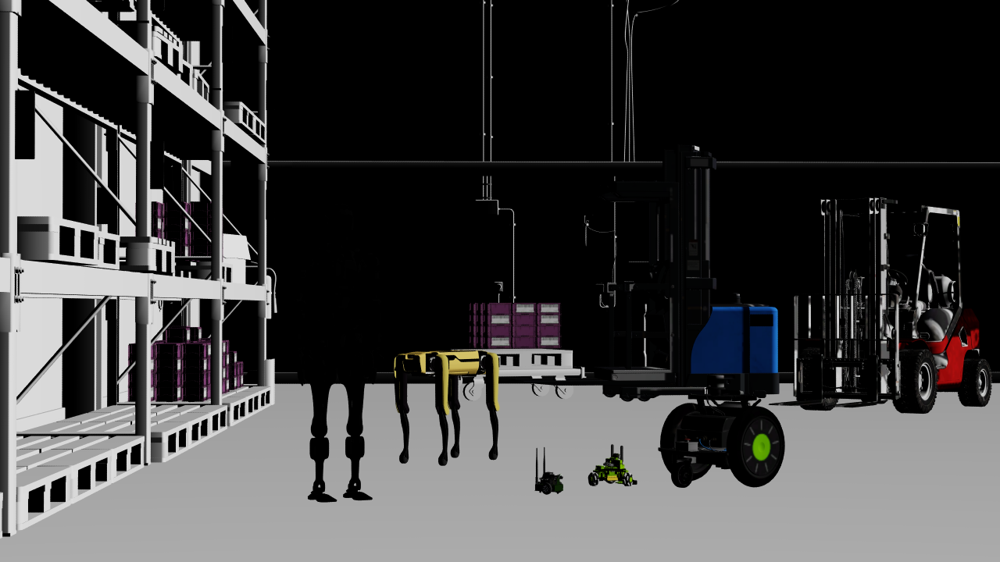

.. SPDX-FileCopyrightText: Copyright (c) 2026 NVIDIA CORPORATION & AFFILIATES. All rights reserved.
.. SPDX-License-Identifier: LicenseRef-NvidiaProprietary

C: Minimal DLSS
===============

This example loads the same robot lineup scene as :doc:`python_minimal_dlss`, renders
32 frames to build DLSS history, and saves the final
:ref:`LdrColor <camera-output-tables>` image. The scene selects DLSS-SR and the
Quality preset on its RenderProduct.

Change ``frame_count`` in ``main.cpp`` to adjust the number of render steps.
The example saves only the final frame and returns a nonzero exit status if the
PNG cannot be saved.

   *The shared scene rendered with DLSS-SR and Quality. The Python and C examples
   use the same camera, shading, and output resolution.*

Internet access is required to load the scene's robot and warehouse assets.
Build and run from the C example directory:

.. code-block:: bash

   cd examples/c/minimal-dlss
   cmake -B build -DCMAKE_BUILD_TYPE=Release
   cmake --build build --config Release
   ./build/minimal-dlss ../../python/minimal-dlss/minimal_dlss.usda minimal-dlss.png

On Windows, run ``build\Release\minimal-dlss.exe`` with the same two arguments.
The first argument is the USD scene and the second is the output PNG path.
To choose another DLSS mode, author the controls described in
:ref:`minimal-anti-aliasing-dlss` on the scene's RenderProduct.

The snippet below loads the USD scene into an attached runtime stage and waits
for its authored settings to become available before rendering:

.. literalinclude:: ../../examples/c/minimal-dlss/main.cpp
   :language: cpp
   :start-after: // [snippet:doc-minimal-dlss-c-populate]
   :end-before: // [/snippet:doc-minimal-dlss-c-populate]
   :dedent:

The following snippet requests the camera RenderProduct and waits for one frame.
The complete example repeats this step 32 times, maps the color image, and releases
each frame's results before continuing. It keeps the same renderer for the full
sequence so DLSS can reuse temporal history.

.. literalinclude:: ../../examples/c/minimal-dlss/main.cpp
   :language: cpp
   :start-after: // [snippet:doc-minimal-dlss-c-step-renderer]
   :end-before: // [/snippet:doc-minimal-dlss-c-step-renderer]
   :dedent:
