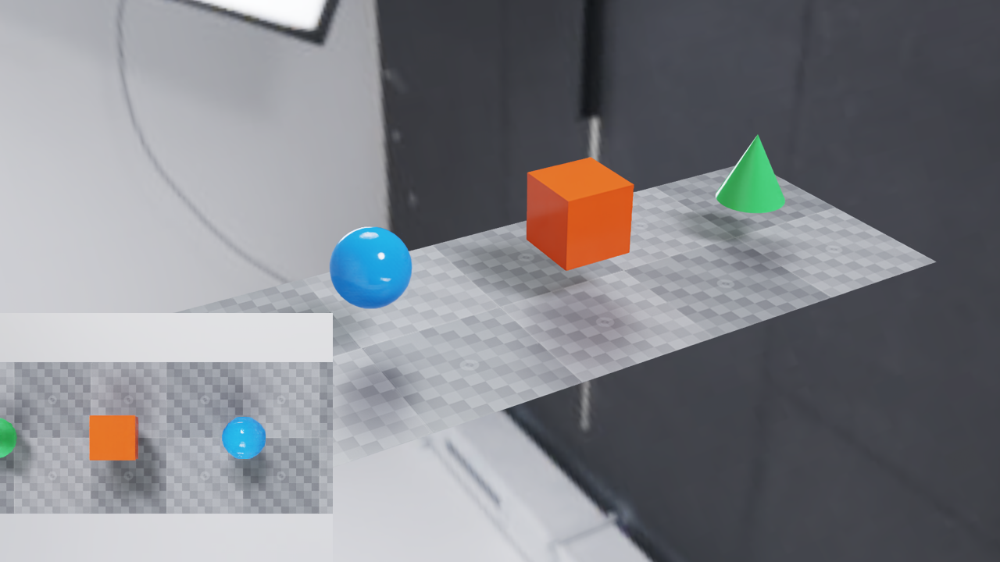

.. SPDX-FileCopyrightText: Copyright (c) 2026 NVIDIA CORPORATION & AFFILIATES. All rights reserved.
.. SPDX-License-Identifier: LicenseRef-NvidiaProprietary

C: Simulated Camera and Observer
================================

This example shows how to combine a simulated camera running at a specified tick rate,
while an interactive camera observes the scene, rendering as fast as the
display allows.

   *The observer can move while the inset retains the last 30 Hz sensor image.*

The sensor camera inspects a conveyor belt with items passing along it. The sensor
camera uses ``OmniSensorAPI`` to set ``double2 omni:sensor:frameRate = (30, 1)``,
which schedules it for 30Hz updates: frames will be returned from the sensor when
they are ready, regardless of the intervals at which the simulation is stepped.

For simplicity, the simulation is also stepped at 30Hz, though this is not necessary
for the sensor camera to operate correctly.

The observer camera provides an interactive view of the scene. It is updated in
response to mouse input from the user, whenever those inputs are available, and is
stepped immediately with ``delta_time=0`` so those updates happen independent of the
simulation. Frames are returned from the observer camera as soon as they are ready.

The observer camera's image is drawn to the viewport as fast as the display allows,
and the sensor camera's image is drawn as an inset 30 times per second.

See :doc:`../sensors/multi_rate` for the scheduling contract.

Build and Run
-------------

Use a C++17 compiler, CMake, CUDA Toolkit, a Vulkan SDK with ``glslc`` or
``glslangValidator``, and an NVIDIA RTX GPU with a supported driver. A windowed
run also needs a desktop display. Run outside a GPU-restricting sandbox.
The example reuses the graphics helpers in the adjacent ``vulkan-interop``
directory; keep both directories and ``tests/docs/data`` in the checkout.
The scene uses local geometry and the local ``studio.exr`` dome texture.

From ``examples/c/sensor-observer``, build and launch the executable:

.. code-block:: bash

   cmake -S . -B build -DCMAKE_BUILD_TYPE=Release
   cmake --build build --config Release
   # Run the 30 Hz sensor with an interactive observer and pause/resume controls.
   ./build/sensor-observer

For an X11-only GLFW source build on Linux, add ``-DGLFW_BUILD_WAYLAND=OFF``.
On Windows with a multi-configuration generator, run
``build\Release\sensor-observer.exe``. CMake finds installed ovrtx and ovstage
packages or downloads the versions pinned by the sibling CMake helpers.

* Right-drag: orbit the observer.
* Mouse wheel: zoom.
* Space: pause or resume simulation.
* Escape: exit.

Run without a window to exercise the same rendering and CUDA/Vulkan image-copy
path and export a composite PNG and capture-time CSV:

.. code-block:: bash

   # Check sensor timing with two observer updates per step; export both views and timestamps.
   ./build/sensor-observer --headless --num-steps 30 --observer-steps 2 \
       --png output.png --report timing.csv

This runs one simulated second, adds two zero-time observer updates after each
simulation step, and inserts twelve extra observer updates at the midpoint.
It checks for 30 sensor images with capture times from 1/30 through 1 second,
and no extra sensor captures on zero-time updates. Use ``--observer-steps 0``
for the comparison without observer updates. Headless mode copies the two GPU
images back to assemble the PNG; windowed mode composites them in Vulkan.

The CSV report includes ``wall_time`` in seconds since the render loop started,
alongside simulation and capture times. Use it to compare the wall-clock rate
of observer updates with the simulation and inspection rates. The first frame
can include shader compilation; exclude that startup interval when measuring
steady-state FPS. Headless mode checks capture timing without display pacing.

Optional: Pixi
~~~~~~~~~~~~~~

If you already have `Pixi <https://pixi.prefix.dev/latest/installation/>`_
installed, you can use it to provision CUDA 12.9,
Vulkan, and the build tools on Linux or Windows x86-64. On Windows, you still
need Visual Studio 2022 with the Desktop development with C++ workload and
Windows SDK installed.

From ``examples/c/sensor-observer``:

.. code-block:: bash

   pixi run build
   pixi run main

The ``build`` task depends on ``configure``. The ``main`` task launches the
existing executable. Run ``pixi run build`` after changing source code.

Schedule the Cameras
--------------------

Only the top-down camera has ``OmniSensorAPI`` and a positive frame rate.
Both use instantaneous global-shutter captures; the observer has no scheduled
rate or long exposure. The scene declares these cameras as follows:

.. literalinclude:: ../../examples/c/sensor-observer/conveyor.usda
   :language: usda
   :start-after: # [snippet:doc-observer-cameras-usda]
   :end-before: # [/snippet:doc-observer-cameras-usda]
   :dedent:

Refresh Without Advancing Simulation
------------------------------------

Keep both RenderProducts in every call, including observer-only refreshes.
Omitting the sensor product discards its accumulated rendering history and
requires expensive initialization when it is requested again. The loop selects
a positive delta for simulation steps and zero for observer-only refreshes:

.. literalinclude:: ../../examples/c/sensor-observer/main.cpp
   :language: cpp
   :start-after: // [snippet:doc-observer-step-c]
   :end-before: // [/snippet:doc-observer-step-c]
   :dedent:

The sample starts with a positive simulation step. A zero-time step exactly at
the scheduled camera's initial ``startTime`` can trigger its instantaneous
capture; this is not a way to warm up the observer without touching sensors.

Display the Last Completed Image
--------------------------------

The window keeps a separate CUDA/Vulkan image for each camera. The sensor image
is overwritten only when a completed output arrives. Before copying, the loop
waits for the preceding Vulkan presentation fence, then waits for the mapped
ovrtx output's CUDA event. It completes the copy before unmapping the output
and signals a timeline semaphore before Vulkan samples the shared images.
This deliberately serial loop keeps ownership visible; see
:doc:`c_vulkan_interop` for the larger interop example and
:doc:`../core/cuda_vulkan_scheduling` for the Linux scheduling workaround.

The following block updates the texture only for returned frames:

.. literalinclude:: ../../examples/c/sensor-observer/main.cpp
   :language: cpp
   :start-after: // [snippet:doc-observer-copy-outputs-c]
   :end-before: // [/snippet:doc-observer-copy-outputs-c]
   :dedent:

Changing the observer does not advance the scene animation or sensor clock.
