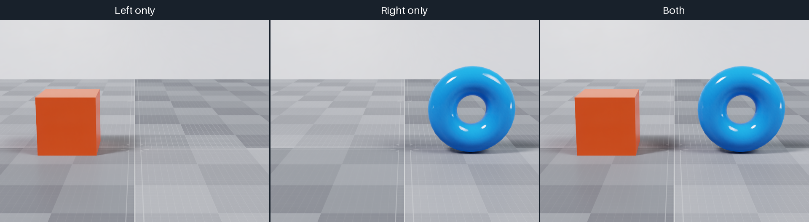

.. SPDX-FileCopyrightText: Copyright (c) 2026 NVIDIA CORPORATION & AFFILIATES. All rights reserved.
.. SPDX-License-Identifier: LicenseRef-NvidiaProprietary

Python: Camera Scene Partitions
===============================

This example renders three cameras from the same viewpoint: the left orange
cube, the right blue torus, and both objects. All three views share the ground
and studio environment.

   *Left only, right only, and both partitions, with shared ground and lighting.*

.. code-block:: bash

   cd examples/python/camera-scene-partitions
   uv run main.py
   uv run main.py --rrd _output/camera-scene-partitions.rrd
   uv run main.py --no-rr --png _output/camera-scene-partitions.png

The left and right cameras select ``left`` and ``right`` with
``omni:scenePartition``. The third camera has no partition selector.
The scene enables ``omni:rtx:scenePartitioning:showAllPartitionsByDefault`` on
``/Render/OmniverseGlobalRenderSettings`` so that camera sees both objects.
Each RenderProduct sets
``omni:rtx:scenePartitioning:excludeBackgroundDomeLightInPartition`` to
``false`` to retain the shared studio lighting.

The snippet below shows how the example loads the authored scene, renders the
left-only, right-only, and combined RenderProducts together, and maps each
``LdrColor`` output to CPU memory.

.. literalinclude:: ../../examples/python/camera-scene-partitions/main.py
   :language: python
   :start-after: # [snippet:doc-render-camera-scene-partitions]
   :end-before: # [/snippet:doc-render-camera-scene-partitions]
   :dedent:

See :doc:`../sensors/cameras/scene_partitions` for the visibility rules.
