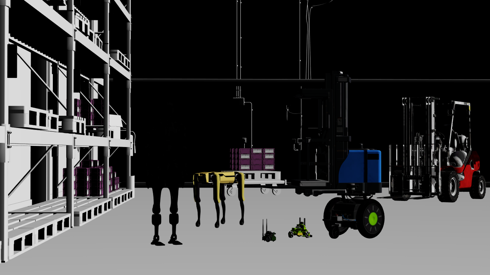

.. SPDX-FileCopyrightText: Copyright (c) 2026 NVIDIA CORPORATION & AFFILIATES. All rights reserved.
.. SPDX-License-Identifier: LicenseRef-NvidiaProprietary

Python: Minimal DLSS
====================

This example renders ``ovrtx-robot-lineup.usda`` with DLSS
disabled, DLSS Super Resolution, or DLSS Ray Reconstruction. It can display
the image in Rerun, save a recording, or save a PNG. The camera, shading mode,
and 1280 × 720 output resolution stay the same across configurations.
Shadows are disabled to keep the small robots visible inside the warehouse.

   *The example's final frame with DLSS-SR and Quality after 32 frames.*

Internet access is required to load the scene's robot and warehouse assets.
Run the example from its project directory:

.. code-block:: bash

   cd examples/python/minimal-dlss
   uv run main.py
   uv run main.py --dlss-mode 0 --no-rr --png _output/none.png
   uv run main.py --dlss-mode 1 --exec-mode quality --no-rr --png _output/sr.png
   uv run main.py --dlss-mode 2 --exec-mode quality --no-rr --png _output/rr.png
   uv run main.py --dlss-mode 1 --exec-mode rtxaa --no-rr --png _output/dlaa.png
   uv run main.py --rrd _output/minimal-dlss.rrd

The default is DLSS-SR with Quality, rendered for 32 frames. Use ``--frames``
to change the capture point. DLSS uses temporal history, so an early frame
can differ from an image captured after several frames. This scene illustrates
edge reconstruction and texture detail; it does not contain Gaussian splats.
Use ``--log PATH`` to save renderer diagnostics. Use ``--usd PATH`` to render
another scene that defines ``/World/Camera`` and a ``/Render/Camera``
RenderProduct with an ``LdrColor`` RenderVar; the documentation tests use it
with a local scene that needs no internet access.

``--exec-mode`` accepts ``auto``, ``performance``, ``balanced``, ``quality``,
and ``rtxaa``. See :ref:`minimal-anti-aliasing-dlss` for their effects.

The snippet below loads the scene with the selected RenderProduct settings,
renders consecutive frames, and copies :ref:`LdrColor <camera-output-tables>`
to CPU memory for display or saving. Renderer and stage setup, argument parsing,
and image output are in the complete example.

.. literalinclude:: ../../examples/python/minimal-dlss/main.py
   :language: python
   :start-after: # [snippet:doc-render-minimal-dlss-python]
   :end-before: # [/snippet:doc-render-minimal-dlss-python]
   :dedent:

See :ref:`minimal-anti-aliasing-dlss` for the available settings and their effects.
