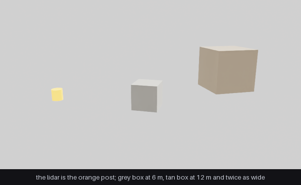
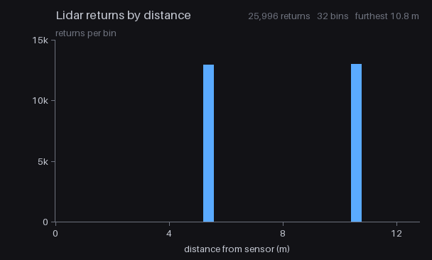

.. SPDX-FileCopyrightText: Copyright (c) 2026 NVIDIA CORPORATION & AFFILIATES. All rights reserved.
.. SPDX-License-Identifier: LicenseRef-NvidiaProprietary
..
.. NVIDIA CORPORATION, its affiliates and licensors retain all intellectual
.. property and proprietary rights in and to this material, related
.. documentation and any modifications thereto. Any use, reproduction,
.. disclosure or distribution of this material and related documentation
.. without an express license agreement from NVIDIA CORPORATION or
.. its affiliates is strictly prohibited.

Python: SPG Composite AOV
=========================

An SPG node whose input is a lidar rather than a camera. A lidar ``PointCloud`` is a
**composite AOV**: several named channels published together under one render var, instead of
the single image a camera AOV gives you. This node reads the ``Coordinates`` and ``Counts``
channels, counts the sweep's returns by distance, and publishes a bar chart on its own AOV.

The scene the sensor sweeps, from a second render product with an ordinary camera. The orange
post marks the lidar; the grey box is 6 m away and the tan box 12 m away and twice as wide:

What the node made of that sweep, one bar per box:

Prerequisites
-------------

- Python 3.10-3.13
- `uv <https://docs.astral.sh/uv/>`_
- An NVIDIA RTX-capable GPU and a supported driver

Running
-------

.. code-block:: bash

   uv run main.py                                # CUDA
   uv run main.py --scene lidar_scene_slang.usda # Slang

One ``renderer.step()`` fills two render products: the lidar and its histogram, and an
ordinary camera view of the same scene. A successful run writes ``_output/histogram.png``, the
node's chart with axes and labels drawn around it, and ``_output/scene.png``, the camera's view.

Binding the Channels
--------------------

Each channel binds like any other buffer:

.. filtered-literalinclude:: ../../examples/python/spg-composite-aov/RangeHistogramKernel.cu.lua
   :language: lua
   :start-after: -- [snippet:histogram-binding]
   :end-before: -- [/snippet:histogram-binding]
   :exclude-pattern: ^\s*--\s*\[/?snippet:
   :dedent:

See :doc:`../spg/do/composites` for what a composite AOV is and how the channels are found.
