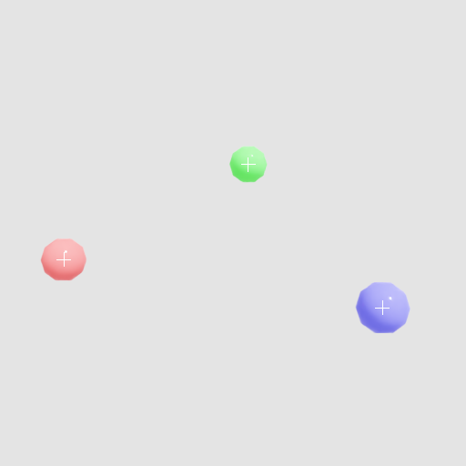

.. SPDX-FileCopyrightText: Copyright (c) 2026 NVIDIA CORPORATION & AFFILIATES. All rights reserved.
.. SPDX-License-Identifier: LicenseRef-NvidiaProprietary
..
.. NVIDIA CORPORATION, its affiliates and licensors retain all intellectual
.. property and proprietary rights in and to this material, related
.. documentation and any modifications thereto. Any use, reproduction,
.. disclosure or distribution of this material and related documentation
.. without an express license agreement from NVIDIA CORPORATION or
.. its affiliates is strictly prohibited.

Python: SPG Scene Query
=======================

An SPG node that reads the scene it runs in. Its launch script asks for the render product it
sits under, takes the camera that product is bound to, reads the camera's lens values and world
transform, and looks up the world position of every marker a prim of the scene lists. The kernel
projects each marker into the camera image and draws a crosshair on it, over the renderer's
``LdrColor``. Nothing in the node names a camera or a marker.

.. pull-quote::

   *“Write an SPG node that draws a crosshair on chosen scene prims, working out where they land from the camera's transform and lens values read inside the launch script.”*

Prerequisites
-------------

- Python 3.10-3.13
- `uv <https://docs.astral.sh/uv/>`_
- An NVIDIA RTX-capable GPU and a supported driver

Running
-------

.. code-block:: bash

   uv run main.py                                    # CUDA
   uv run main.py --scene overlay_scene_slang.usda   # Slang

The first step compiles the kernel and can block for up to a minute on a fresh shader cache. A
successful run writes ``_output/color.png``, the rendered image, and ``_output/overlay.png``, the
same image with a white crosshair on each marker.

The Launch Script
-----------------

Everything the kernel needs about the scene is read here and handed in as kernel arguments.

.. filtered-literalinclude:: ../../examples/python/spg-scene-query/MarkerOverlayKernel.cu.lua
   :language: lua
   :start-after: -- [snippet:scene-query-camera]
   :end-before: -- [/snippet:scene-query-batch]
   :exclude-pattern: ^\s*--\s*\[/?snippet:
   :dedent:

The settings prim ``/World/Overlay`` holds custom attributes the renderer has no use for, so
``main.py`` opens the scene with a description that publishes them alongside the renderer's own
content:

.. literalinclude:: ../../examples/python/spg-scene-query/main.py
   :language: python
   :start-after: # [snippet:scene-query-populate]
   :end-before: # [/snippet:scene-query-populate]
   :dedent:

Refer to :doc:`../spg/do/scene_queries` for the task-by-task guide and :doc:`../spg/ref/lua_rtx`
for every call.
