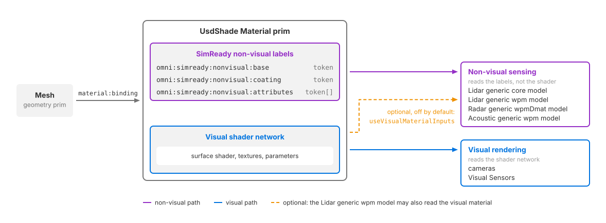

.. SPDX-FileCopyrightText: Copyright (c) 2026 NVIDIA CORPORATION & AFFILIATES. All rights reserved.
.. SPDX-License-Identifier: LicenseRef-NvidiaProprietary
..
.. NVIDIA CORPORATION, its affiliates and licensors retain all intellectual
.. property and proprietary rights in and to this material, related
.. documentation and any modifications thereto. Any use, reproduction,
.. disclosure or distribution of this material and related documentation
.. without an express license agreement from NVIDIA CORPORATION or
.. its affiliates is strictly prohibited.

.. _materials-nonvisual-sensor-materials:
.. _sensors-common-materials:

Non-Visual Sensor Materials
===========================

Non-visual materials describe what a surface is made of so lidar, radar and
acoustic sensor models can calculate its response. Author SimReady material
labels on the ``UsdShade.Material`` prim bound to the geometry. These labels are
separate from the shader that controls its appearance in camera images.

A UsdShade material can carry both a visual shader network and non-visual labels. Changing a
visual texture or tint does not normally change the non-visual response.
The Lidar generic wpm model can also use visual material inputs through
``omni:sensor:LidarWpm:useVisualMaterialInputs`` (``false`` by default); see
:doc:`its attributes <../sensors/nonvisual/lidar_wpm/attributes>`.

   *One bound UsdShade material supplies visual shading and non-visual surface labels.*

:doc:`../sensors/cameras` and :doc:`camera-based sensor models
<../sensors/visual/index>` use visual shading. See :doc:`material_binding`
for binding and shader setup, :doc:`decals` for layered surface detail, and
:doc:`projectors` for projected imagery.

:doc:`Semantic labels <../scene/semantic_labels>` used for segmentation are
separate from non-visual material labels.

Material attributes
-------------------

Author these attributes on the bound ``Material`` prim, not on the geometry.
The base identifies the substrate, the coating adds a surface layer, and the
attribute array adds surface flags.

.. csv-table::
   :header: "USD declaration", "Description"
   :widths: 52, 48
   :class: compact-table

   "``token omni:simready:nonvisual:base``", "Base material, such as asphalt, steel or concrete."
   "``token omni:simready:nonvisual:coating``", "Layer over the base material. Use ``none`` for no coating."
   "``token[] omni:simready:nonvisual:attributes``", "Surface flags. Multiple flags can be supplied; use an array containing ``none`` when none apply."

These custom attributes have no schema-declared defaults. Use the exact token
spellings in the `SimReady Non-Visual Sensor Attributes Table
<https://nvidia.github.io/simready-foundation/latest/capabilities/nonvisual_sensors/nonvisual_materials/nonvisual_attributes_table.html>`__,
including case. The `SimReady material requirements
<https://nvidia.github.io/simready-foundation/latest/capabilities/nonvisual_sensors/nonvisual_materials/capability-nonvisual_materials.html>`__
require all three attributes on every visual material of an asset, consistent
with its visual appearance and without time samples.

A sensing-only material needs no surface shader: ovrtx recognizes a bound
Material with at least one non-visual attribute, including when the attribute
is added after loading. Author all three for a complete material description.
If the material also renders visually, keep its visual shader network
connected to the UsdShade material and author the labels on the same Material prim.

Creating non-visual materials
-----------------------------

These snippets create the asphalt, steel and concrete materials used by the
:doc:`Python <../examples/python_sensor_radar>` and
:doc:`C <../examples/c_sensor_radar>` radar examples. The ground uses asphalt,
the moving cube uses steel, and the fixed cube uses concrete. Both example
scenes contain the same labels and bindings.

The Python snippet uses an existing USD ``stage``. Bind the materials to
geometry as described in :doc:`material_binding`.

.. tab-set::

   .. tab-item:: USDA
      :sync: usda

      .. literalinclude:: ../../examples/python/radar/radar_example.usda
         :language: usda
         :start-after: # [snippet:configure-nonvisual-materials]
         :end-before: # [/snippet:configure-nonvisual-materials]
         :dedent: 4
         :prepend: #usda 1.0

   .. tab-item:: USD Python
      :sync: python

      .. literalinclude:: ../../tests/docs/usd/test_usd_python_examples.py
         :language: python
         :start-after: # [snippet:doc-nonvisual-materials-python]
         :end-before: # [/snippet:doc-nonvisual-materials-python]
         :dedent:

Runtime changes
---------------

Adding, changing or removing labels on the runtime stage updates the material
without reinitializing the renderer or saving and reopening the scene.
Publish edits through ovstage using the sequence in
:doc:`ovstage Integration <../core/ovstage_integration>`. This runtime editing
support is separate from SimReady's requirement that an asset's authored
material labels have no time samples.

Checking material assignments
-----------------------------

Lidar point clouds can report the packed base, coating and surface flags in
``MaterialId``. See :doc:`Lidar generic core outputs
<../sensors/nonvisual/lidar_core/outputs>` for decoding. Radar and acoustic
outputs do not report material IDs.

For a visual check, use the camera's ``nonVisualMaterialId``
:ref:`debug view <sensors-cameras-outputs-debug-views>`, which colors surfaces
by their resolved material ID.

If surfaces that should differ report the same ID, check their material
bindings, attribute types and token spellings. ID ``0`` can represent an
intentionally unspecified material; it does not by itself prove that labels
failed to load. Unrecognized base or coating tokens contribute zero to their
respective fields, so a nonzero ID does not prove that every label is valid.
See the :doc:`Symptom Index <../sensors/troubleshooting/symptoms>` for further
checks.

Related
-------

- :doc:`material_binding` — assign materials to geometry.
- :doc:`../sensors/nonvisual/index` — lidar, radar and acoustic sensor models.
- :doc:`../sensors/common/sensor_configuration` — configure the sensor that reads the material labels.
- `SimReady material requirements <https://nvidia.github.io/simready-foundation/latest/capabilities/nonvisual_sensors/nonvisual_materials/capability-nonvisual_materials.html>`__ and `attribute vocabulary <https://nvidia.github.io/simready-foundation/latest/capabilities/nonvisual_sensors/nonvisual_materials/nonvisual_attributes_table.html>`__.
