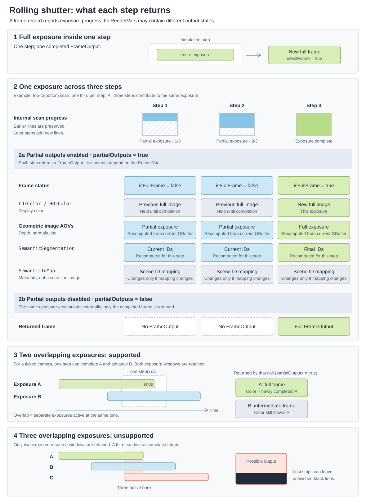

.. SPDX-FileCopyrightText: Copyright (c) 2026 NVIDIA CORPORATION & AFFILIATES. All rights reserved.
.. SPDX-License-Identifier: LicenseRef-NvidiaProprietary
..
.. NVIDIA CORPORATION, its affiliates and licensors retain all intellectual
.. property and proprietary rights in and to this material, related
.. documentation and any modifications thereto. Any use, reproduction,
.. disclosure or distribution of this material and related documentation
.. without an express license agreement from NVIDIA CORPORATION or
.. its affiliates is strictly prohibited.

.. _sensors-cameras-rolling-shutter:

.. _sensors-cameras-howto-rolling-shutter:

Rolling Shutter
===============

Overview
--------

A global shutter samples all photosites at the same time. A rolling shutter
offsets sample time across the image, one row or column at a time. Moving
straight edges can therefore appear curved or skewed.

.. figure:: ../../img/camera-rolling-shutter.avif
   :width: 100%
   :alt: A moving cube rendered with global and top-to-bottom rolling shutters
   :align: center

   *The global-shutter image on the left keeps the moving cube square. The
   top-to-bottom rolling shutter on the right skews it across the scan.*

.. _sensors-cameras-rolling-shutter-attributes:

Creating A Rolling-Shutter Camera
---------------------------------

Apply ``OmniRtxRollingShutterAPI`` to a camera and author its analytic timing
attributes. Times are rational seconds expressed as a ``(numerator,
denominator)`` pair.

.. csv-table::
   :header: "USD declaration", "Description"
   :widths: 50, 50
   :class: compact-table

   "``token omni:rtx:rollingShutter:scanOrder = ""none""``", "Selects the scan direction. ``none`` disables rolling shutter."
   "``double2 omni:rtx:rollingShutter:lineOffset = (0, 1)``", "Time from the start of one scan line to the next, expressed as rational seconds in ``(numerator, denominator)`` form. For example, ``(1, 1000)`` represents 1 ms. ``(0, 1)`` represents zero seconds."
   "``double2 omni:rtx:rollingShutter:lineExposure = (0, 1)``", "Exposure duration for each scan line, expressed as rational seconds in ``(numerator, denominator)`` form. For example, ``(1, 1000)`` represents 1 ms. ``(0, 1)`` represents zero seconds."

``scanOrder`` accepts these values:

.. csv-table::
   :header: "Token", "Behavior"
   :widths: 30, 70
   :class: compact-table

   "``none``", "Disables rolling shutter."
   "``topToBottom``", "Scans image rows from top to bottom."
   "``bottomToTop``", "Scans image rows from bottom to top."
   "``leftToRight``", "Scans image columns from left to right."
   "``rightToLeft``", "Scans image columns from right to left."

The following example scans from top to bottom. Each line starts 40
microseconds after the previous line, and each line has a ``(1, 32)`` second
exposure (31.25 ms).

.. tab-set::

   .. tab-item:: USDA
      :sync: usda

      .. literalinclude:: ../../../tests/docs/usd/data/camera_rolling_shutter.usda
         :language: usda
         :start-after: # [snippet:doc-camera-rolling-shutter]
         :end-before: # [/snippet:doc-camera-rolling-shutter]
         :prepend: #usda 1.0

   .. tab-item:: USD Python
      :sync: python

      .. literalinclude:: ../../../tests/docs/usd/test_usd_python_examples.py
         :language: python
         :start-after: # [snippet:doc-camera-rolling-shutter-python]
         :end-before: # [/snippet:doc-camera-rolling-shutter-python]
         :dedent:

Runtime Use
-----------

.. _sensors-cameras-rolling-shutter-motion-bvh:

Rolling shutter requires the motion BVH. Create the renderer with
:py:attr:`ovrtx.RendererConfig.motion_bvh` set to
:py:attr:`ovrtx.MotionBvh.AUTO` or :py:attr:`ovrtx.MotionBvh.ENABLE`. ``AUTO``
activates the motion BVH when a rolling-shutter camera is rendered. In C, pass
``OVRTX_MOTION_BVH_AUTO`` or ``OVRTX_MOTION_BVH_ENABLE`` to
:c:func:`ovrtx_config_entry_motion_bvh`.

.. tab-set::

   .. tab-item:: Python
      :sync: python

      .. literalinclude:: ../../../tests/docs/python/test_support_api.py
         :language: python
         :start-after: # [snippet:doc-create-rolling-shutter-renderer]
         :end-before: # [/snippet:doc-create-rolling-shutter-renderer]
         :dedent:

   .. tab-item:: C
      :sync: c

      .. literalinclude:: ../../../tests/docs/c/test_support_api.cpp
         :language: cpp
         :start-after: // [snippet:doc-create-rolling-shutter-renderer-c]
         :end-before: // [/snippet:doc-create-rolling-shutter-renderer-c]
         :dedent:

.. _sensors-cameras-rolling-shutter-line-timing:

For line index *i*, ovrtx samples at the end of this interval:

``startTime + i * lineOffset`` to
``startTime + i * lineOffset + lineExposure``.

The total exposure span is ``(lineCount - 1) * lineOffset + lineExposure``.
Top-to-bottom and bottom-to-top scans use the RenderProduct height as
``lineCount``. Horizontal scans use its width.

.. _sensors-cameras-rolling-shutter-exposure-across-steps:

Exposure Across Steps
~~~~~~~~~~~~~~~~~~~~~

If a :py:meth:`~ovrtx.Renderer.step()` window contains the entire exposure,
ovrtx returns one completed frame. If the exposure crosses step boundaries,
ovrtx processes the exposure in portions across those steps. ``isFullFrame`` becomes true only
for the final portion.

.. _sensors-cameras-rolling-shutter-partial-outputs:

.. _sensors-cameras-rolling-shutter-rendervars:

With ``omni:sensor:Core:partialOutputs = true`` (the runtime default), each
portion produces a :py:class:`~ovrtx.FrameOutput`. The renderer keeps one internal
canvas for the exposure, preserves scan lines written by earlier steps, and
adds the newly exposed lines on each later step. The RenderVars in the
:ref:`camera output tables <camera-output-tables>` behave as follows:

.. csv-table::
   :header: "RenderVars", "Intermediate-output behavior"
   :widths: 42, 58
   :class: compact-table

   "``LdrColor``, ``HdrColor``", "Return the last completed display image. The final portion returns the newly completed image."
   "``NormalSD``, ``DepthSD``, ``DistanceToCameraSD``, ``DistanceToImagePlaneSD``, ``DiffuseAlbedoSD``, ``Camera3dPositionSD``", "Recomputed for every step from the accumulated scan lines. Intermediate values describe the partially accumulated exposure, not a completed frame."
   "``SemanticSegmentation``", "Recomputed for every step. Per-pixel IDs follow the accumulated scan lines."
   "``SemanticIdMap``", "Metadata rather than a scan-line image. It does not accumulate across scan lines and changes only when the scene's semantic mapping changes."

With ``omni:sensor:Core:partialOutputs = false``, ovrtx suppresses intermediate
frame outputs and returns the frame only after the final portion completes.
For setting this policy on cameras through ovstage, see
:doc:`../common/multi_rate`.

For a camera with an authored sensor frame rate, two exposure windows can overlap. Both are retained. A
single :py:meth:`~ovrtx.Renderer.step()` call can therefore return multiple
:py:class:`~ovrtx.FrameOutput` entries when it completes the older exposure and
also advances the newer one. With partial outputs enabled, this can be a full
frame for exposure A followed by an intermediate frame for exposure B whose
display-color outputs still display A.

   *A normal exposure may complete in one step or accumulate across several
   steps. Partial-output mode controls whether intermediate frame records are
   returned. Two simultaneous scheduled exposures are retained; a third exceeds
   the supported overlap limit and can produce unfinished scan lines.*

.. note::

   ``lineExposure`` shifts the sample time to the end of each line's interval.
   It does not integrate motion blur over that interval.

.. _sensors-cameras-rolling-shutter-two-exposures:

.. warning::

   This limit is separate from one exposure accumulating normally across
   several :py:meth:`~ovrtx.Renderer.step()` calls. For a camera with an
   authored sensor frame rate, keep the total exposure span at or below two
   sensor frame intervals. If the span is longer, three or more exposures can
   overlap. ovrtx retains only two overlapping exposures, so accumulated
   scan lines from the newer exposure can be discarded and appear black.
   Reduce the resolution, ``lineOffset``, ``lineExposure``, or sensor frame
   rate.

See :doc:`../../examples/python_camera_rolling_shutter` for a runnable
example.

Limits
------

A rolling shutter samples each line at the end of its exposure interval; motion
within that interval is not integrated into motion blur. At most two exposures
are in flight per camera. For an authored frame rate, keep
``(lineCount - 1) * lineOffset + lineExposure`` at or below two frame intervals,
where ``lineCount`` is the output resolution along the scan direction.

Related
-------

- :doc:`usd_camera_attributes`
- :doc:`../common/multi_rate`
- :doc:`../../examples/python_camera_rolling_shutter`
- :doc:`../../core/renderer_configuration`
