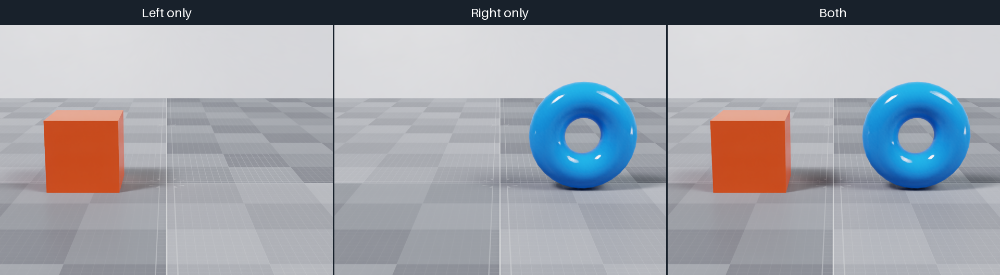

.. SPDX-FileCopyrightText: Copyright (c) 2026 NVIDIA CORPORATION & AFFILIATES. All rights reserved.
.. SPDX-License-Identifier: LicenseRef-NvidiaProprietary
..
.. NVIDIA CORPORATION, its affiliates and licensors retain all intellectual
.. property and proprietary rights in and to this material, related
.. documentation and any modifications thereto. Any use, reproduction,
.. disclosure or distribution of this material and related documentation
.. without an express license agreement from NVIDIA CORPORATION or
.. its affiliates is strictly prohibited.

Scene Partitions
================

Overview
--------

Scene partitions let different cameras render isolated environments from one
stage. You can use them to simulate independent robot environments while
keeping shared, unpartitioned content visible to every camera.

ovrtx enables scene partitioning when it creates the renderer.

   *The cameras render the left orange cube, the right blue torus, and both
   objects from the same viewpoint. The ground and studio environment remain
   visible in all three views.*

Creating Scene Partitions
-------------------------

Select a camera's partition with ``omni:scenePartition``. Assign geometry with
the ``primvars:omni:scenePartition`` token primvar. Primvars are inherited, so
you can assign an entire environment on its top-level ``Xform``.

.. csv-table::
   :header: "USD declaration", "Description"
   :widths: 46, 54
   :class: compact-table

   "``custom token omni:scenePartition``", "Author on a Camera to select the named partition that it renders."
   "``token primvars:omni:scenePartition``", "Author on geometry or an ancestor Xform to assign that content to a named partition."

These are custom Omni attributes. They do not currently have generated schema
accessors, so author them with their exact names and token types.

- A camera sees geometry assigned to its selected partition.
- A camera does not see geometry assigned to another partition.
- Unpartitioned geometry remains visible to every camera.

This excerpt from the example assigns the two objects to separate partitions
and selects them with the left and right cameras. The third camera has no
partition selector.

Both tabs author the same scene objects. Asset paths are relative to the
example directory; the Python snippet assumes an existing USD ``stage``.

.. tab-set::

   .. tab-item:: USDA

      .. literalinclude:: ../../../examples/python/camera-scene-partitions/scene_partitions.usda
         :language: usda
         :start-after: # [snippet:doc-example-camera-scene-partitions]
         :end-before: # [/snippet:doc-example-camera-scene-partitions]

   .. tab-item:: USD Python

      .. literalinclude:: ../../../tests/docs/usd/test_usd_python_examples.py
         :language: python
         :start-after: # [snippet:doc-camera-scene-partitions-python]
         :end-before: # [/snippet:doc-camera-scene-partitions-python]
         :dedent:

To let the third camera see both objects, the example sets
``omni:rtx:scenePartitioning:showAllPartitionsByDefault`` to ``true`` on
``/Render/OmniverseGlobalRenderSettings``. It also sets
``omni:rtx:scenePartitioning:excludeBackgroundDomeLightInPartition`` to
``false`` on each RenderProduct to retain shared dome lighting.

Supported Object Types
----------------------

Meshes, curves, points, OpenVDB volumes, and ray-traced Gaussian splats support
scene partitioning through ``primvars:omni:scenePartition``. Geometry instances
also carry their own partition assignment.

The following limitations apply:

- **Neural-reconstruction volumes (NuRec/NRE):** their separate compositing
  paths do not filter volumes by the camera's scene partition. Assigning a
  partition does not isolate these volumes.

.. warning::

   Deforming geometry may be clipped to its undeformed bounds.

Example
-------

See :doc:`../../examples/python_camera_scene_partitions` for a runnable
example.

Further Reading
---------------

- :doc:`../configuration`
- :doc:`../../scene/loading_usd`
