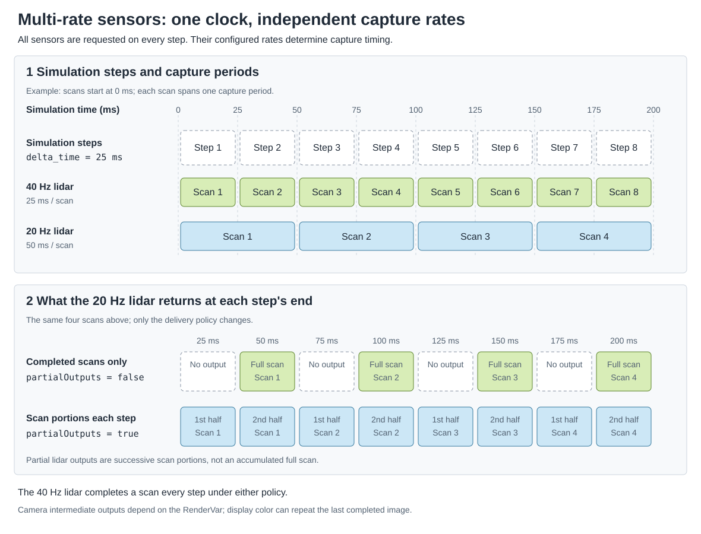

.. SPDX-FileCopyrightText: Copyright (c) 2026 NVIDIA CORPORATION & AFFILIATES. All rights reserved.
.. SPDX-License-Identifier: LicenseRef-NvidiaProprietary
..
.. NVIDIA CORPORATION, its affiliates and licensors retain all intellectual
.. property and proprietary rights in and to this material, related
.. documentation and any modifications thereto. Any use, reproduction,
.. disclosure or distribution of this material and related documentation
.. without an express license agreement from NVIDIA CORPORATION or
.. its affiliates is strictly prohibited.

.. _sensors-common-multi-rate:

Sensor Scheduling
=================

Sensors can capture at different rates within one simulation. You configure each sensor's capture rate, then step the simulation at a cadence that
suits your workflow. The renderer schedules captures and returns the outputs that are ready. Your loop does not need to track which sensor is due.

Cameras are unscheduled by default: they render on each renderer step rather
than at an independent capture rate. To schedule a camera, apply
``OmniSensorAPI`` to its USD Camera prim and set ``omni:sensor:frameRate`` to a
positive rate. Applying the API alone leaves the rate unset. Camera sensor-model
schemas already include this API; non-visual sensor model schemas include it
and supply a positive default rate.

The Radar generic wpmDmat model and the Acoustic generic wpm model declare no
delivery policy of their own. They take their scan rate from the same
``omni:sensor:frameRate`` attribute. What a radar step that fires no scan
delivers is on the Outputs page of the :doc:`Radar generic wpmDmat model
<../nonvisual/radar_wpm_dmat/outputs>`; the Outputs page of the
:doc:`Acoustic generic wpm model <../nonvisual/acoustic_wpm/outputs>`
describes its frames, each one complete firing cycle.
The :doc:`Generic wpm model <../nonvisual/generic_wpm/outputs>` publishes a
complete selected pattern per capture and exposes no partial-output policy.
Its firing offsets affect motion sampling within that capture; they do not
split a scan over later frames.

.. |multi-rate-python-example| replace:: :doc:`Python example <../../examples/python_multi_rate_sensors>`

.. figure:: ../../img/multi-rate-sensors-full.avif
   :alt: Camera and lidar outputs at different capture rates during a simulation stepped at 40 Hz
   :align: center
   :width: 100%

   Two cameras and two lidars running at different capture rates in the
   |multi-rate-python-example|. The simulation advances in 25 ms steps and
   requests all four sensors on every step. With partial outputs disabled,
   each sensor returns only completed captures; blank cells mark steps with no
   output. Lidar points are projected from the rolling-shutter camera's
   viewpoint.

.. _sensors-common-multi-rate-frame-rate:

Frame rate, step and delivery
-----------------------------

The simulation step, a sensor's capture period and output delivery are three
separate things:

* ``delta_time`` advances the common sensor simulation clock, in seconds.
* ``omni:sensor:frameRate`` schedules each sensor independently, in rational Hz.
* ``omni:sensor:Core:partialOutputs`` controls whether an unfinished capture
  can produce intermediate outputs.

A positive ``omni:sensor:frameRate`` schedules captures at that rate,
independently of how often you step. ``omni:sensor:startTime`` sets the start
offset. See :ref:`Shared attributes
<sensors-common-sensor-configuration-shared-attributes>` for defaults.

Without a positive rate:

- A camera is unscheduled and renders one frame per step. ``delta_time`` alone
  does not establish a fixed capture rate.
- Non-visual sensors retain a default 30 Hz capture schedule. Each capture spans
  1/30 s; a step that advances time delivers the captures within it. Every
  non-visual schema supplies a positive rate, so this fallback requires you
  to author ``(0, 1)`` explicitly.

The non-visual models handle those captures differently:

- :doc:`Lidar generic core <../nonvisual/lidar_core/attributes>` flashes a whole
  scan per capture.
- :doc:`Lidar generic wpm <../nonvisual/lidar_wpm/attributes>` requires a positive
  rate and publishes nothing without one.
- :doc:`Radar generic wpmDmat <../nonvisual/radar_wpm_dmat/attributes>` scans
  once per capture.
- :doc:`Acoustic generic wpm <../nonvisual/acoustic_wpm/attributes>` produces
  one frame per capture regardless of the rate.
- :doc:`Generic wpm <../nonvisual/generic_wpm/attributes>` traces its complete
  selected pattern per capture.

For example, a 20 Hz scanning lidar needs two 1/40 s steps to complete one
scan. Keep it selected during both steps, including the first step, which
delivers no completed output. A 40 Hz lidar completes a scan on every step.

   Simulation steps advance a shared clock. Each lidar captures at its own
   configured rate; ``partialOutputs`` changes when data is returned without
   changing those capture periods.

Capture rate and output delivery
--------------------------------

Author the rate and the output policy on the **sensor prim**, not on its
RenderProduct. Give each sensor its own RenderProduct, as
:doc:`Output Configuration <output_configuration>` describes under
"Independent RenderProducts". No single default of the delivery policy holds
for every model, so the table lists, per model, where the controls are declared
and what they default to:

.. list-table::
   :class: compact-table
   :header-rows: 1
   :widths: 20 38 42

   * - Sensor
     - USD declaration
     - Behavior
   * - Every sensor
     - ``double2 omni:sensor:frameRate = (0, 1)`` in ``OmniSensorAPI``
     - A positive numerator/denominator sets the capture frequency in Hz; each
       model's default is under "Shared attributes" on :doc:`Sensor
       Configuration <sensor_configuration>`.
   * - Lidar generic core model
     - ``bool omni:sensor:Core:partialOutputs = false`` in
       ``OmniSensorGenericLidarCoreAPI``
     - What ``false`` and ``true`` deliver is under
       :ref:`sensors-common-multi-rate-partial-outputs` below. Its interaction
       with ``instantLidar`` and ``includeInvalidPoints``, and that it takes a
       live edit, are on the model's :doc:`USD attributes page
       <../nonvisual/lidar_core/attributes>`.
   * - Lidar generic wpm model
     - ``bool omni:sensor:LidarWpm:partialOutputs = false`` in
       ``OmniSensorGenericLidarWpmAPI``
     - The model declares the policy in its own namespace; its
       :doc:`USD attributes page <../nonvisual/lidar_wpm/attributes>`
       describes it.
   * - Generic wpm model
     - No partial-output attribute.
     - Delivers the complete selected pattern in each capture. Firing offsets
       select motion samples within it; see :doc:`Outputs <../nonvisual/generic_wpm/outputs>`.
   * - Cameras
     - No schema declares the attribute on a ``Camera`` prim.
     - ovrtx looks for ``omni:sensor:Core:partialOutputs``, with a capital
       ``C``, on the camera prim. Without a value, the camera behaves as
       ``true``. A camera takes the value through the runtime-stage write
       shown in :ref:`sensors-common-multi-rate-partial-outputs`.

The following lidar captures forty scans per simulated second and delivers only
completed scans; the Python tab authors the same attributes with OpenUSD:

.. tab-set::

   .. tab-item:: USDA
      :sync: usda

      .. literalinclude:: ../../../examples/python/multi-rate-sensors/multi_rate.usda
         :language: usda
         :start-after: # [snippet:doc-multi-rate-lidar-usda]
         :end-before: # [/snippet:doc-multi-rate-lidar-usda]
         :dedent:
         :prepend: #usda 1.0

   .. tab-item:: USD Python
      :sync: python

      .. literalinclude:: ../../../tests/docs/usd/test_usd_python_examples.py
         :language: python
         :start-after: # [snippet:doc-multi-rate-lidar-python]
         :end-before: # [/snippet:doc-multi-rate-lidar-python]
         :dedent:

Apply ``OmniSensorAPI`` and the same ``frameRate`` attribute for a scheduled
camera. For a rolling-shutter camera, also configure the exposure timing. This
20 Hz camera has a 50 ms exposure span at 240 rows:
``239 / 9560 + 1 / 40 = 1 / 20`` second, so each exposure spans exactly two
25 ms simulation steps:

.. tab-set::

   .. tab-item:: USDA
      :sync: usda

      .. literalinclude:: ../../../examples/python/multi-rate-sensors/multi_rate.usda
         :language: usda
         :start-after: # [snippet:doc-multi-rate-camera-usda]
         :end-before: # [/snippet:doc-multi-rate-camera-usda]
         :dedent:
         :prepend: #usda 1.0

   .. tab-item:: USD Python
      :sync: python

      .. literalinclude:: ../../../tests/docs/usd/test_usd_python_examples.py
         :language: python
         :start-after: # [snippet:doc-multi-rate-camera-python]
         :end-before: # [/snippet:doc-multi-rate-camera-python]
         :dedent:

The exposure span a scheduled camera may use and the timing attributes behind
it are on :doc:`Rolling Shutter <../cameras/rolling_shutter>`. A
rolling-shutter camera also needs the motion BVH; :ref:`Motion BVH
<sensors-common-output-configuration-motion-bvh>` on Output Configuration gives
the modes and which sensors need which.

.. _sensors-common-multi-rate-stepping:

Step every RenderProduct on every step
--------------------------------------

The RenderProduct input set identifies the sensors to simulate. Request every
sensor in every step, and ovrtx returns the results that are ready on that
step. Omitting a sensor discards its accumulated capture and invokes tear-down
and reinitialization costs when it is requested again.

The snippets show one step of the example's loop. The Python tab advances the
scene's USD animation to the step's simulation time with
``ovstage.population.update_from_usd_time``, publishes that state at a new
ordinal, then steps all four products by 25 ms. The USD animation clock and the
sensor clock advance together here, but they are separate things. The C tab
does the same with ``ovstage_population_apply_usd_time`` and
``ovrtx_step_with_stage``.

.. tab-set::

   .. tab-item:: Python
      :sync: python

      .. literalinclude:: ../../../examples/python/multi-rate-sensors/main.py
         :language: python
         :start-after: # [snippet:doc-multi-rate-step]
         :end-before: # [/snippet:doc-multi-rate-step]
         :dedent:

   .. tab-item:: C
      :sync: c

      .. literalinclude:: ../../../tests/docs/c/test_sensor_configuration.cpp
         :language: cpp
         :start-after: // [snippet:doc-multi-rate-step-c]
         :end-before: // [/snippet:doc-multi-rate-step-c]
         :dedent:

For attached-stage ordering and ordinals, see :doc:`ovstage Integration
<../../core/ovstage_integration>` under "Ordinals and Write-Floor Gates". For
fetching results and their lifetime, in C in particular, see :doc:`Sensor
Outputs <sensor_outputs>` under "Frames in a step result" and "Lifetime and
ownership".

.. _sensors-common-multi-rate-partial-outputs:

Partial outputs
---------------

When an exposure or scan spans several simulation steps, you can choose to
receive only completed captures or also receive intermediate outputs while the
capture is in progress. Cameras, the Lidar generic core model and the Lidar
generic wpm model support this choice through ``partialOutputs``. Radar and
acoustic models do not expose this control.

With ``partialOutputs = false``, a capture spanning several steps accumulates
until it is complete. This is the right policy when a consumer needs a whole
lidar scan or a completed camera exposure. It suppresses intermediate delivery;
it does **not** pause the sensor's simulation or remove the work of
accumulating the capture.

With ``partialOutputs = true``, a step can also deliver partial captures, so
the output rate can exceed the authored capture rate. For a lidar, consume the
delivered portion of the scan. Camera RenderVars differ in what an intermediate
frame carries: the color outputs ``LdrColor`` and ``HdrColor`` of the
:ref:`camera output tables <camera-output-tables>` repeat the last completed
image while an exposure is unfinished, and the frame that completes the
exposure carries the newly completed image. :doc:`Rolling Shutter
<../cameras/rolling_shutter>` tabulates the intermediate behavior of
the RenderVars it lists. Nothing in a delivered image marks it as a repeat or
as newly completed; the frame's capture window does. Use
``partialOutputs = false`` when the consumer needs only newly completed images.

Cameras and lidar core use ``omni:sensor:Core:partialOutputs``; lidar wpm uses
``omni:sensor:LidarWpm:partialOutputs``. Both lidar models default to ``false``;
cameras default to ``true``. The lidar schemas declare their attributes, so you
can author them in USD.

For cameras, set ``omni:sensor:Core:partialOutputs`` through ovstage after loading
the scene, preferably before the first render step.

On a ``Camera``, authoring this attribute in USD alone has no effect by default:
no supported camera schema declares it, so population omits it from the runtime
stage and the policy remains ``true``. Either write it through ovstage, as below,
or set ``customLayerData.populateAllAuthoredAttributes = true`` on the root layer.
See :doc:`Loading USD <../../scene/loading_usd>`, "Authored Attribute Population".

The renderer reads the camera policy on every step. A later write therefore
takes effect on the next step; writing before rendering is a recommendation,
not a restriction. The Lidar generic core model also accepts live edits to
``partialOutputs``. See :doc:`runtime_updates` and
:doc:`its attributes <../nonvisual/lidar_core/attributes>`.

The snippets apply one policy to all four sensors of the example. Both write
one boolean to the four sensor prims through an ovstage query at a new ordinal,
then advance the write floor so that the renderer sees the write:

.. tab-set::

   .. tab-item:: Python
      :sync: python

      .. literalinclude:: ../../../examples/python/multi-rate-sensors/main.py
         :language: python
         :start-after: # [snippet:doc-multi-rate-partial-outputs]
         :end-before: # [/snippet:doc-multi-rate-partial-outputs]
         :dedent:

   .. tab-item:: C
      :sync: c

      .. literalinclude:: ../../../tests/docs/c/test_sensor_configuration.cpp
         :language: cpp
         :start-after: // [snippet:doc-multi-rate-partial-outputs-c]
         :end-before: // [/snippet:doc-multi-rate-partial-outputs-c]
         :dedent:

Process only the output that arrived: iterate every returned product and all
of its frames, and place data in time with the frame's capture window and the
model's params, as :doc:`Sensor Outputs <sensor_outputs>` describes under
"Frames in a step result". For a lidar, bound every read by ``Counts[0]``
(:ref:`sensors-common-sensor-outputs-counts-bound`); a zero count is not a
reason to drop the lidar from the next step
(:ref:`sensors-common-multi-rate-stepping`). The frame counters and timestamps
a model publishes among its output params follow that model's rules; for a
point cloud they are on the Outputs pages of the
:doc:`Lidar generic core model <../nonvisual/lidar_core/outputs>` and the
:doc:`Radar generic wpmDmat model <../nonvisual/radar_wpm_dmat/outputs>`.

.. _sensors-common-multi-rate-observer:

Observe a paused simulation
---------------------------

A camera with no positive ``omni:sensor:frameRate`` and no long exposure can
act as an interactive observer of the same scene. After publishing the
observer's transform at a new ordinal, step with ``delta_time = 0``; zero is a
valid step length. This refreshes the view without advancing the common sensor
clock. Do not advance object animation on these view-only updates.

Keep both the observer and the scheduled sensor products in the input set. Use
``partialOutputs = false`` on the simulated camera and hold its last completed
image between captures. Stage ordinals order scene writes and renderer reads;
they are independent of elapsed simulation time, as :doc:`ovstage Integration
<../../core/ovstage_integration>` explains under "Ordinals and Write-Floor
Gates".

Start this pattern with a positive simulation step. A zero-length step whose
end falls exactly on a scheduled sensor's initial ``omni:sensor:startTime``
reaches that capture time, and a sensor whose capture is instantaneous captures
there; a zero-length step is therefore not a sensor-free warm-up at that
boundary.

The :doc:`C: Simulated Camera and Observer <../../examples/c_sensor_observer>`
example combines a 30 Hz top-down sensor with a Vulkan observer, pause and
resume controls, and a retained sensor inset.

Related
-------

- :doc:`Python: Multi-rate Sensors <../../examples/python_multi_rate_sensors>` — the runnable comparison with two lidars, two cameras, a timing report and headless image output.
- :doc:`C: Simulated Camera and Observer <../../examples/c_sensor_observer>` — a scheduled sensor camera beside an interactive observer, with pause and resume.
- :doc:`Sensor Outputs <sensor_outputs>` — result iteration, mapping, the capture-window fields of a frame, ``Counts`` and the lifetime of results.
- :doc:`Generic wpm model <../nonvisual/generic_wpm/index>` — complete-pattern capture and firing offsets.
