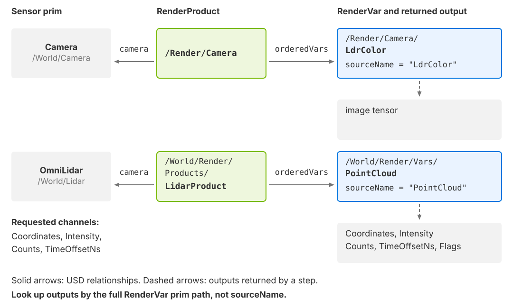

.. SPDX-FileCopyrightText: Copyright (c) 2026 NVIDIA CORPORATION & AFFILIATES. All rights reserved.
.. SPDX-License-Identifier: LicenseRef-NvidiaProprietary
..
.. NVIDIA CORPORATION, its affiliates and licensors retain all intellectual
.. property and proprietary rights in and to this material, related
.. documentation and any modifications thereto. Any use, reproduction,
.. disclosure or distribution of this material and related documentation
.. without an express license agreement from NVIDIA CORPORATION or
.. its affiliates is strictly prohibited.

.. _sensors-common-output-configuration:

Output Configuration
====================

A RenderProduct selects a sensor and the outputs to produce. Its ``camera``
relationship targets the sensor prim; ``orderedVars`` lists the RenderVars to
return. Each RenderVar selects an output through ``sourceName``.

   *RenderProducts connect sensors to requested outputs. A composite output
   contains several named tensors, called channels.*

.. list-table::
   :class: compact-table
   :header-rows: 1
   :widths: 22 78

   * - Object
     - Purpose
   * - RenderProduct
     - Selects one sensor, or several supported sensors for tiled output.
       Holds the output list, resolution and product settings.
   * - RenderVar
     - Requests an image such as :doc:`LdrColor <../cameras/outputs>`, or a
       composite output: ``PointCloud`` for lidar/radar, ``SignalWays`` for acoustic,
       or :doc:`Contributions <../nonvisual/generic_wpm/outputs>` for Generic wpm.
   * - Channel
     - A named tensor inside a composite output, with its own type, shape and
       units. See the :doc:`Glossary <../reference/glossary>` for the other meanings
       of "channel" on model pages.

A product returns only its listed RenderVars. Composite outputs contain the
requested channels plus any the model always includes. Author these prims in the
scene file or :ref:`add them at run time
<sensors-common-output-configuration-runtime-products>`.

.. _sensors-common-output-configuration-renderproduct:

RenderProduct
-------------

This product requests :doc:`LdrColor <../cameras/outputs>` from the Camera prim
at ``/World/Camera`` at 1920 × 1080. Its RenderVar is a child of the product.

.. tab-set::

   .. tab-item:: USDA
      :sync: usda

      .. literalinclude:: ../../../tests/docs/usd/data/minimal_render_product.usda
         :language: usda
         :prepend: #usda 1.0
         :start-after: # [snippet:doc-minimal-render-product]
         :end-before: # [/snippet:doc-minimal-render-product]

   .. tab-item:: USD Python
      :sync: python

      .. literalinclude:: ../../../tests/docs/usd/test_usd_python_examples.py
         :language: python
         :start-after: # [snippet:doc-minimal-render-product-python]
         :end-before: # [/snippet:doc-minimal-render-product-python]
         :dedent:

.. _sensors-common-output-configuration-rel-camera:

The ``rel camera`` relationship
^^^^^^^^^^^^^^^^^^^^^^^^^^^^^^^

Despite its name, ``camera`` targets a USD Camera prim, or an ``OmniLidar``,
``OmniRadar``, ``OmniAcoustic`` or ``OmniGeneralSensor`` prim with its model schema applied. See
:doc:`sensor_configuration` for creating those prims.

Tiling
~~~~~~

For models that support tiling, listing several sensors in ``camera`` batches
their work into one RenderProduct to improve throughput. The output layout and
shared configuration depend on the model:

- **Cameras:** each camera occupies one tile of a single output image. Use this
  when you only require very small images and can pack many of them into a single
  frame, which increases throughput. See
  :doc:`Python: Tiled rendering <../../examples/python_tiled_rendering>`.
- **Lidar wpm:** the product returns one aggregate point cloud, with a separate
  range of points for each sensor. The first sensor supplies the shared
  configuration; each sensor retains its own pose and motion. See
  :doc:`Tile Lidars <../nonvisual/lidar_wpm/howto/tile_lidars>` and its
  :doc:`Outputs <../nonvisual/lidar_wpm/outputs>` page.
- **Generic wpm:** the contribution layout has a tile axis. The first sensor
  supplies the shared configuration; each sensor supplies its own pose and
  motion. See :doc:`Generic wpm Outputs <../nonvisual/generic_wpm/outputs>`.
- **Lidar core:** tiling is not supported. Use :ref:`one RenderProduct per sensor
  <sensors-nonvisual-lidar-core-attributes-one-product-per-sensor>`.

For separate outputs, use :ref:`independent products
<sensors-common-output-configuration-independent-products>`. For USD relationship
syntax, see `Relationships
<https://docs.nvidia.com/learn-openusd/latest/stage-setting/properties/relationships.html>`_.

.. _sensors-common-output-configuration-ordered-vars:

The ``rel orderedVars`` relationship
^^^^^^^^^^^^^^^^^^^^^^^^^^^^^^^^^^^^

``orderedVars`` targets the RenderVar prims to produce. List several RenderVars
to request several outputs from one sensor. Each target must define its own
``sourceName``.

RenderVars can be children of the product, as above, or live in a shared scope.
:ref:`Independent RenderProducts
<sensors-common-output-configuration-independent-products>` shows two products
sharing one RenderVar.

.. _sensors-common-output-configuration-rendervar:

RenderVar
---------

A RenderVar's **prim path** identifies its output in the results of a step.
Its **sourceName** selects the output to produce. For example, the RenderVar
above requests ``LdrColor`` and appears in results as ``/Render/Camera/LdrColor``.
See :doc:`Camera Outputs <../cameras/outputs>` for image source names.

Use each model's Outputs page for its source names and channel rules:
:doc:`Lidar core <../nonvisual/lidar_core/outputs>`,
:doc:`Lidar wpm <../nonvisual/lidar_wpm/outputs>`,
:doc:`Radar wpmDmat <../nonvisual/radar_wpm_dmat/outputs>` and
:doc:`Acoustic wpm <../nonvisual/acoustic_wpm/outputs>`.

The default ``sourceType`` selects a built-in output by name.
With ``sourceType = "lpe"``, ``sourceName`` instead contains a light path
expression. This is available in Path Tracing mode; see
:doc:`../cameras/light_path_expressions`.

Each returned output contains zero or more named tensors and parameters.
:doc:`sensor_outputs` explains how to find it by its full RenderVar path and map
its contents in Python and C.

.. _sensors-common-output-configuration-channels:
.. _sensors-channels-requesting:

Requesting channels
-------------------

For a ``PointCloud`` RenderVar, author ``token[] channels`` to select the tensors
you need. This attribute is declared by ``RenderVarChannelsAPI``; the renderer
reads it even if that API is not applied. Its default is an empty list. Use
``token[]``: a ``string[]`` value yields no channels.

Each RenderVar has its own channel list. Several RenderVars in one product can
request ``PointCloud`` with different lists, reducing memory use when consumers
need different subsets.

.. list-table::
   :class: compact-table
   :header-rows: 1
   :widths: 25 75

   * - Model/output
     - Channel selection
   * - Lidar core and radar ``PointCloud``
     - Return the requested channels plus ``Counts`` and ``Flags``. Unknown
       names are ignored with a warning; the remaining channels are still produced.
   * - Lidar wpm ``PointCloud``
     - An empty list requests all channels. ``Counts`` and ``Flags`` are always
       included. See :doc:`its Outputs page <../nonvisual/lidar_wpm/outputs>` for
       its channel set.
   * - Acoustic ``SignalWays``
     - Always returns all its channels; it takes no channel list.
   * - Generic wpm ``Contributions``
     - One RenderVar per product. An empty list requests the default channels.
       ``Valid`` is always included. See :ref:`requesting Contributions
       <sensors-nonvisual-generic-wpm-outputs-requesting>` for selection and
       pairing rules.

For ``PointCloud``, ``Counts`` reports how many entries were delivered;
``Flags`` indicates validity.
See :doc:`sensor_outputs` for reading them. Check channel names and case against
the model's Outputs page before indexing the result.

This lidar example requests ``Coordinates``, ``Intensity``, ``Counts`` and
``TimeOffsetNs``. Its product references a RenderVar in a shared ``Vars`` scope:

.. tab-set::

   .. tab-item:: USDA
      :sync: usda

      .. literalinclude:: ../../../examples/python/lidar/lidar_example.usda
         :language: usda
         :prepend: #usda 1.0
                   def Xform "World" {
         :append: }
         :start-after: # [snippet:configure-lidar-pointcloud-output]
         :end-before: # [/snippet:configure-lidar-pointcloud-output]

   .. tab-item:: USD Python
      :sync: python

      .. literalinclude:: ../../../tests/docs/usd/test_usd_python_examples.py
         :language: python
         :start-after: # [snippet:doc-output-lidar-channels-python]
         :end-before: # [/snippet:doc-output-lidar-channels-python]
         :dedent:

The radar examples request ``Coordinates``, ``Counts`` and ``RadialVelocityMs``;
the C example also requests ``RCS``. The model adds ``Flags`` automatically.
See :doc:`Radar Outputs <../nonvisual/radar_wpm_dmat/outputs>`.

.. _sensors-common-output-configuration-independent-products:

Independent RenderProducts
--------------------------

Create one RenderProduct per sensor when each sensor needs its own output
variables, resolution, stepping, device pinning
(:ref:`sensors-common-output-configuration-device-pinning`) or result handling.
The products can still share their RenderVars: here two camera products reference
one ``LdrColor`` RenderVar in a ``Vars`` scope.

.. tab-set::

   .. tab-item:: USDA
      :sync: usda

      .. literalinclude:: ../../../tests/docs/usd/data/multi_render_product_shared_vars.usda
         :language: usda
         :prepend: #usda 1.0
         :start-after: # [snippet:doc-multi-render-product-shared-vars]
         :end-before: # [/snippet:doc-multi-render-product-shared-vars]

   .. tab-item:: USD Python
      :sync: python

      .. literalinclude:: ../../../tests/docs/usd/test_usd_python_examples.py
         :language: python
         :start-after: # [snippet:doc-multi-render-product-shared-vars-python]
         :end-before: # [/snippet:doc-multi-render-product-shared-vars-python]
         :dedent:

Pass every active RenderProduct path on each step, including sensors that have
no completed output yet. :doc:`multi_rate` explains the scheduling requirements.
This example steps both products using a Python set of paths or a C
``ovrtx_render_product_set_t``:

.. tab-set::

   .. tab-item:: Python
      :sync: python

      .. literalinclude:: ../../../tests/docs/python/test_sensor_configuration.py
         :language: python
         :start-after: # [snippet:doc-step-multiple-render-products]
         :end-before: # [/snippet:doc-step-multiple-render-products]
         :dedent:

   .. tab-item:: C
      :sync: c

      .. literalinclude:: ../../../tests/docs/c/test_sensor_configuration.cpp
         :language: cpp
         :start-after: // [snippet:doc-step-multiple-render-products-c]
         :end-before: // [/snippet:doc-step-multiple-render-products-c]
         :dedent:

.. _sensors-common-output-configuration-runtime-products:

Adding RenderProducts at run time
---------------------------------

To add output configuration without editing the scene file, sublayer that file
beneath an inline root layer containing the new RenderProducts and RenderVars.
Populate the root layer through ``ovstage.population.open_usd_from_string()``
in Python or ``ovstage_population_open_usd_from_string()`` in C.

These snippets add :doc:`LdrColor and HdrColor <../cameras/outputs>` outputs and
publish the stage write. The Python snippet also steps the new product:

.. tab-set::

   .. tab-item:: Python
      :sync: python

      .. literalinclude:: ../../../tests/docs/python/test_sensor_configuration.py
         :language: python
         :start-after: # [snippet:doc-add-render-config-layer]
         :end-before: # [/snippet:doc-add-render-config-layer]
         :dedent:

   .. tab-item:: C
      :sync: c

      .. literalinclude:: ../../../tests/docs/c/test_sensor_configuration.cpp
         :language: cpp
         :start-after: // [snippet:doc-add-render-config-layer-c]
         :end-before: // [/snippet:doc-add-render-config-layer-c]
         :dedent:

.. tip::

   Use the stage-population reference functions only when you need removable
   referenced content after a root stage is already open. For one composed root
   stage, prefer the inline ``subLayers`` pattern shown above.

You can also add a sensor in the same layer. This example adds a Camera with
``OmniSensorGenericCameraCoreAPI`` and a product requesting
:doc:`LdrColor <../cameras/outputs>`. The sublayer path is relative to the new root
layer; the Python tab assumes a file-backed stage in the same directory:

.. tab-set::

   .. tab-item:: USDA
      :sync: usda

      .. literalinclude:: ../../../tests/docs/usd/data/inline_sublayers_camera_renderproduct.usda
         :language: usda
         :prepend: #usda 1.0
         :start-after: # [snippet:doc-usda-inline-sublayers-camera-renderproduct]
         :end-before: # [/snippet:doc-usda-inline-sublayers-camera-renderproduct]

   .. tab-item:: USD Python
      :sync: python

      .. literalinclude:: ../../../tests/docs/usd/test_usd_python_examples.py
         :language: python
         :start-after: # [snippet:doc-output-inline-camera-python]
         :end-before: # [/snippet:doc-output-inline-camera-python]
         :dedent:

This is also how you override a sensor's parameters without editing the file that
defines it; :doc:`sensor_configuration` covers overrides. For how an attached stage
orders writes and renders through ordinals, see
:doc:`../../core/ovstage_integration`.

Product-level controls
----------------------

RenderProducts carry render settings, warm-up requirements and GPU device
allow-lists. A few global settings belong on a RenderSettings prim instead.
For settings specific to a camera render mode, see :doc:`../cameras/render_modes`.

.. _sensors-common-output-configuration-render-settings:

Render settings
^^^^^^^^^^^^^^^

Render settings are RenderProduct attributes in the ``omni:rtx:`` namespace.
For example, ``omni:rtx:rendermode`` selects the mode and
``omni:rtx:rtpt:maxBounces`` limits bounces in
:doc:`Real-Time Path Tracing <../cameras/render_modes/real_time_path_tracing>`.
See :doc:`../cameras/render_modes` for each mode's settings.

These snippets update ``maxBounces`` through the runtime stage. Its USD type is
``uint``, so the Python code writes one ``uint32`` with ``is_array=False``;
the C code passes a ``DLTensor`` containing one ``uint32``. After changing a
setting, call :py:meth:`~ovrtx.Renderer.reset()` or :c:func:`ovrtx_reset` and
:ref:`warm up <sensors-common-output-configuration-warmup>` before capturing.

.. tab-set::

   .. tab-item:: Python
      :sync: python

      Write the setting through an ovstage query at a new ordinal, then publish the
      write by advancing the write floor:

      .. literalinclude:: ../../../tests/docs/python/test_base.py
         :language: python
         :start-after: # [snippet:doc-set-render-setting]
         :end-before: # [/snippet:doc-set-render-setting]
         :dedent:

   .. tab-item:: C
      :sync: c

      Query the product with ``ovstage_query_from_path_list`` and write the
      attribute with ``ovstage_write_attribute``, passing a ``DLTensor`` that holds
      the value:

      .. literalinclude:: ../../../tests/docs/c/test_base.cpp
         :language: cpp
         :start-after: // [snippet:doc-set-render-setting-c]
         :end-before: // [/snippet:doc-set-render-setting-c]
         :dedent:

Render settings can be updated while the renderer runs. See
:doc:`ovstage Integration <../../core/ovstage_integration>` for write ordering.

.. _sensors-common-output-configuration-global-settings:

Settings on the RenderSettings prim
^^^^^^^^^^^^^^^^^^^^^^^^^^^^^^^^^^^

A few settings are not RenderProduct attributes. They live on the stage's
``RenderSettings`` prim: the prim the stage's ``renderSettingsPrimPath`` metadata
names, or, without that metadata, ``/Render/OmniverseGlobalRenderSettings``.
``renderingColorSpace``, the color space that spectral rendering converts from and
to, is one such setting and carries no ``omni:rtx:`` prefix
(:doc:`../cameras/render_modes/spectral_rendering`);
``omni:rtx:pt:multigpu:enabled`` is another
(:doc:`../cameras/render_modes/path_tracing`). The scene-partitioning switch
``omni:rtx:scenePartitioning:showAllPartitionsByDefault`` is authored there too;
:doc:`Scene Partitions <../cameras/scene_partitions>` explains it.

.. _sensors-common-output-configuration-warmup:

Warming up the renderer
^^^^^^^^^^^^^^^^^^^^^^^

Run warm-up steps after loading a scene or changing settings before capturing
output:

- **Texture streaming:** early frames may use low-resolution mip levels while
  higher-resolution textures load.
- **Path tracing:** early frames have fewer accumulated samples and more noise.
- **Sensor pipelines:** the acoustic model's first frames contain no echo data;
  see :ref:`sensors-nonvisual-acoustic-outputs-first-frames`.

Some camera examples use 40 warm-up frames as a starting point for streaming and
convergence, not as a guarantee that loading or accumulation is complete. The
lidar, radar and acoustic examples use three steps for pipeline startup;
non-visual output does not converge through accumulated frames. The required
warm-up depends on the scene and pipeline.

Warm up after populating a scene or adding a reference, after resetting the
renderer, and after changes that invalidate accumulated samples, such as changing
bounce counts. These snippets discard warm-up outputs before capture:

.. tab-set::

   .. tab-item:: Python
      :sync: python

      .. literalinclude:: ../../../tests/docs/python/test_base.py
         :language: python
         :start-after: # [snippet:doc-warmup]
         :end-before: # [/snippet:doc-warmup]
         :dedent:

   .. tab-item:: C
      :sync: c

      .. literalinclude:: ../../../tests/docs/c/test_base.cpp
         :language: cpp
         :start-after: // [snippet:doc-warmup-c]
         :end-before: // [/snippet:doc-warmup-c]
         :dedent:

.. warning::

   Warm-up steps return results too; in C destroy each one (:ref:`Sensor Outputs,
   Lifetime and ownership <sensors-common-sensor-outputs-lifetime>`).

Texture streaming itself is a renderer-creation option, described under
:ref:`sensors-common-output-configuration-renderer-options`.

.. _sensors-common-output-configuration-device-pinning:
.. _render-product-device-pinning:

RenderProduct device pinning
^^^^^^^^^^^^^^^^^^^^^^^^^^^^

A RenderProduct can be restricted to a list of CUDA-visible device indices. Author
the ``uint[] deviceIds`` attribute directly on the RenderProduct before loading the
stage.

``deviceIds`` is an allow-list of indices after ``CUDA_VISIBLE_DEVICES`` has
filtered and remapped the process-visible GPUs. A singleton list such as ``[0]``
constrains the product to CUDA-visible GPU 0; a list such as ``[0, 1]`` allows the
renderer to choose either visible device. This product is pinned to GPU 0:

.. tab-set::

   .. tab-item:: USDA
      :sync: usda

      .. literalinclude:: ../../../tests/docs/data/ovrtx-test-picking-selection.usda
         :language: usda
         :prepend: #usda 1.0
                   def Scope "Render" {
         :append: }
         :start-after: # [snippet:doc-pin-render-product-to-gpu-0-usda]
         :end-before: # [/snippet:doc-pin-render-product-to-gpu-0-usda]

   .. tab-item:: USD Python
      :sync: python

      .. literalinclude:: ../../../tests/docs/usd/test_usd_python_examples.py
         :language: python
         :start-after: # [snippet:doc-output-device-pinning-python]
         :end-before: # [/snippet:doc-output-device-pinning-python]
         :dedent:

Use device pinning when:

- A test or application must run a specific RenderProduct on a deterministic
  CUDA-visible device.
- The renderer-level ``active_cuda_gpus`` list is broader than the device set
  allowed for one product. The two must be compatible; refer to
  :doc:`../../core/renderer_configuration`.
- The product is used for picking. Picking runs on CUDA-visible GPU 0, so a product
  that serves pick queries must author ``deviceIds = [0]``; refer to
  :doc:`../../scene/picking`.

.. _sensors-common-output-configuration-renderer-options:

Renderer options sensors depend on
----------------------------------

Some settings must be chosen when creating the renderer. Python exposes them
through ``RendererConfig``; C uses ``ovrtx_config_entry_*`` helpers.
:doc:`../../core/renderer_configuration` documents the full configuration.

.. _sensors-common-output-configuration-motion-bvh:

Motion BVH
^^^^^^^^^^

Motion BVH accounts for sensor and geometry motion at each ray's time within a
scan or exposure. Without it, lidar scans do not show motion distortion
and rolling-shutter images do not show motion-induced skew.

Choose the mode when creating the renderer; changing it requires recreating the
renderer. Set ``RendererConfig.motion_bvh`` in Python or use
:c:func:`ovrtx_config_entry_motion_bvh` in C.

.. list-table::
   :class: compact-table
   :header-rows: 1
   :widths: 22 78

   * - Mode
     - Behavior
   * - ``DISABLE`` (default)
     - Motion BVH stays off.
   * - ``ENABLE``
     - Motion BVH stays on.
   * - ``AUTO``
     - Turns on when a stepped product targets a non-visual sensor or
       rolling-shutter camera; turns off when none does.

Python uses ``MotionBvh.ENABLE`` or ``MotionBvh.AUTO``; the C equivalents are
``OVRTX_MOTION_BVH_ENABLE`` and ``OVRTX_MOTION_BVH_AUTO``.

Which sensors need it:

- The :doc:`Radar generic wpmDmat model <../nonvisual/radar_wpm_dmat/index>`
  needs an active motion BVH for motion effects, with ``AUTO`` or ``ENABLE``.
- The :doc:`Acoustic generic wpm model <../nonvisual/acoustic_wpm/index>` needs
  an active motion BVH, with ``AUTO`` or ``ENABLE``.
- The :doc:`Lidar generic core model <../nonvisual/lidar_core/index>` and the
  :doc:`Lidar generic wpm model <../nonvisual/lidar_wpm/index>` need it for motion
  effects, with ``AUTO`` or ``ENABLE``; without it they still deliver points, each
  ray traced against a scene that does not move.
- The :doc:`Generic wpm model <../nonvisual/generic_wpm/index>` uses an active
  motion BVH for sensor and geometry motion at its firing times. Use ``AUTO``
  or ``ENABLE``, as in its :doc:`Python example <../../examples/python_generic_wpm>`.
- A :doc:`rolling-shutter camera <../cameras/rolling_shutter>` needs it too,
  with ``AUTO`` or ``ENABLE``.

Use ``ENABLE`` for sensor workloads. The
:doc:`lidar <../../examples/python_sensor_lidar>`,
:doc:`radar <../../examples/python_sensor_radar>`,
:doc:`acoustic <../../examples/python_sensor_acoustic>` and
:doc:`multi-rate <../../examples/python_multi_rate_sensors>` examples use it;
the multi-rate example includes a rolling-shutter camera.

The motion BVH takes effect only on GPUs whose driver exposes ray-traced motion,
all of them if the renderer uses several. Otherwise it stays off whichever mode you
choose, and every sensor behaves as it does without it. The Motion BVH column of
:ref:`driver-requirements` lists support by GPU architecture.

No output reports whether the motion BVH was active; a sensor delivers data either
way. To confirm it, compare a run created with it against one created without, in a
scene with motion. :doc:`Motion Artifacts
<../nonvisual/lidar_core/howto/motion_artifacts>` and :doc:`Moving Targets
<../nonvisual/radar_wpm_dmat/howto/moving_targets>` walk through that comparison
for a lidar and a radar.

The snippets create a renderer with ``AUTO``, suitable for a scene whose
motion-dependent sensor is a rolling-shutter camera:

.. tab-set::

   .. tab-item:: Python
      :sync: python

      .. literalinclude:: ../../../tests/docs/python/test_support_api.py
         :language: python
         :start-after: # [snippet:doc-create-rolling-shutter-renderer]
         :end-before: # [/snippet:doc-create-rolling-shutter-renderer]
         :dedent:

   .. tab-item:: C
      :sync: c

      .. literalinclude:: ../../../tests/docs/c/test_support_api.cpp
         :language: cpp
         :start-after: // [snippet:doc-create-rolling-shutter-renderer-c]
         :end-before: // [/snippet:doc-create-rolling-shutter-renderer-c]
         :dedent:

The motion BVH and a model's own motion attributes, such as the Lidar generic core
model's ``omni:sensor:Core:outputMotionCompensationState``, are separate settings in
separate places, and setting either one does not set the other;
:ref:`Motion Artifacts <sensors-motion-both-settings>` explains the pairing and how
to check both.

Texture streaming, render modes and GPUs
^^^^^^^^^^^^^^^^^^^^^^^^^^^^^^^^^^^^^^^^

Three more creation-time options shape what a product can do; each is documented
in full on :doc:`../../core/renderer_configuration`.

- **Texture streaming mode** is disabled, synchronous or asynchronous (the
  default), chosen with ``RendererConfig.texture_streaming_mode`` or
  :c:func:`ovrtx_config_entry_texture_streaming_mode`. Synchronous mode controls
  texture-feedback processing only; it does not make every texture load
  synchronous.
- **Render-mode availability.** A RenderProduct can only select a render mode the
  renderer made available when it was created. :doc:`../cameras/render_modes`
  covers choosing a mode per product, and the renderer configuration page's
  "Startup Render Mode Availability" section covers the creation-time choice.
- **GPU list.** ``active_cuda_gpus`` restricts the CUDA-visible devices the
  renderer as a whole may use; a product's ``deviceIds`` allow-list
  (:ref:`sensors-common-output-configuration-device-pinning`) narrows the choice
  for that product and must be compatible with it.

Related
-------

- :doc:`Sensor Configuration <sensor_configuration>` — authoring the sensor prim, applying its API schema and overriding parameters
- :doc:`Sensor Outputs <sensor_outputs>` — mapping a step's outputs, the output container, capacity versus count
- :doc:`Sensor Scheduling <multi_rate>` — capture rates, partial outputs and why every product is stepped every step
- :doc:`Runtime Parameter Updates <runtime_updates>` — changing sensor attributes and render settings while the renderer runs
- :doc:`Your First Lidar Sensor <../first_sensor>` — the walk-through that applies this page to one lidar
- :doc:`Generic wpm model <../nonvisual/generic_wpm/index>` — requesting raw propagation channels.
