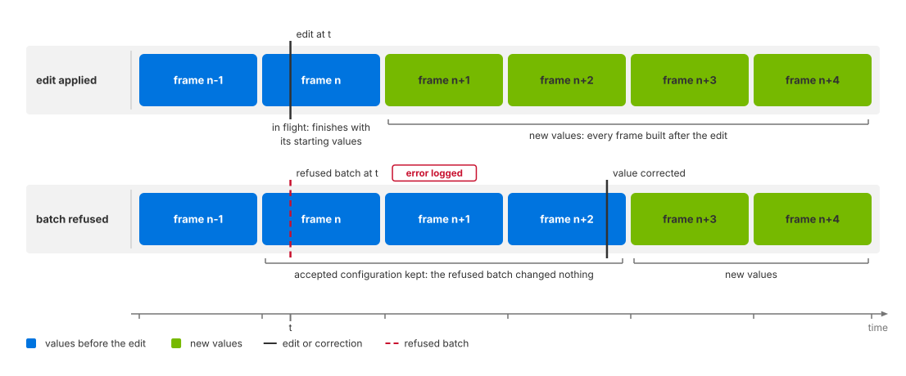

.. SPDX-FileCopyrightText: Copyright (c) 2026 NVIDIA CORPORATION & AFFILIATES. All rights reserved.
.. SPDX-License-Identifier: LicenseRef-NvidiaProprietary
..
.. NVIDIA CORPORATION, its affiliates and licensors retain all intellectual
.. property and proprietary rights in and to this material, related
.. documentation and any modifications thereto. Any use, reproduction,
.. disclosure or distribution of this material and related documentation
.. without an express license agreement from NVIDIA CORPORATION or
.. its affiliates is strictly prohibited.

.. _sensors-common-runtime-updates:

Runtime Parameter Updates
=========================

Many sensor model attributes can change without reloading the scene. Others require
recreating the sensor, or reject invalid edits while retaining the previous
configuration. Whether an edit takes effect depends on the attribute and model.
Plain cameras respect all attribute changes at runtime.

Check the model's USD attributes page for its live-update rules:
:doc:`Lidar generic core <../nonvisual/lidar_core/attributes>`,
:doc:`Lidar generic wpm <../nonvisual/lidar_wpm/attributes>`,
:doc:`Radar generic wpmDmat <../nonvisual/radar_wpm_dmat/attributes>`,
:doc:`Acoustic generic wpm <../nonvisual/acoustic_wpm/attributes>`,
:doc:`Generic wpm <../nonvisual/generic_wpm/attributes>` or
:doc:`Camera generic core <../visual/camera_core/attributes>`.

Applying an update
------------------

Change the sensor's attributes on the runtime stage through ovstage. For
example, an acoustic sensor's ``omni:sensor:WpmAcoustic:azSpanDeg`` can change
from 90 to 120 degrees while the sensor runs.

1. Write the new values and wait for the writes to complete.
2. Advance the stage's write floor and wait for publication.
3. Update the renderer from the stage, then step it. In C, enqueue
   :c:func:`ovrtx_update_from_stage` before :c:func:`ovrtx_step_with_stage`.
   Python's :py:meth:`~ovrtx.Renderer.step` performs the update automatically.

:doc:`ovstage Integration <../../core/ovstage_integration>` provides the
Python and C update loops and explains write ordinals. The model receives the
sensor's full parameter set before the next step, including unchanged
attributes. Moving the prim is not a sensor-parameter update.

Update timing
-------------

Support for runtime changes depends on both the attribute and the model.
Some attributes are read only when the model is created; others are read on
every update. Check the model's attributes page: the attribute's type,
namespace, or absence of a runtime-change note in its schema does not establish
whether it can change live.

For sensor-model parameters, a frame already in progress finishes with its
starting values. Accepted changes apply to the next frame. Camera output
delivery policy is an exception: ``omni:sensor:Core:partialOutputs`` is read
on every step, so a change takes effect on the next step. See
:doc:`Sensor Scheduling <multi_rate>` for the delivery options and examples.

   *Accepted parameters apply to the next frame; rejected updates leave the
   previous configuration in use.*

.. _sensors-common-runtime-updates-outcomes:
.. _sensors-runtime-changes-outcomes:

Update outcomes
---------------

An update can change the running configuration, require reallocation, or be
refused. The distinction determines whether output changes and whether sensor
history is retained. These are model behaviors, not status values returned by
an ovstage write. A successful write confirms that the runtime stage accepted
the value; it does not confirm that the sensor model uses it.

Check the renderer's error log after the update, then inspect an output frame
produced with the new configuration. Continued output, a successful stage
readback, or the absence of an error alone does not establish acceptance.

.. list-table::
   :header-rows: 1
   :class: compact-table
   :widths: 18 48 34

   * - Outcome
     - Behavior
     - How to check
   * - Applied
     - The next frame uses the new value.
     - Check the output parameter that reports the value, or verify a
       predictable output change. See :ref:`Verifying an update
       <sensors-common-runtime-updates-verification>`.
   * - Applied, after a reallocation
     - The change alters how much memory the sensor needs: a longer firing
       sequence, an extra mount, a larger return capacity. The model resizes
       its output for the new configuration; expect a brief delay on the step
       where that happens. The sensor itself is not recreated, so its frame
       counter carries on. On the Lidar generic core, Radar generic wpmDmat and
       Acoustic generic wpm models the noise restarts from its built-in
       starting point on that step. On the Acoustic generic wpm model even a
       change to a scalar such as ``noiseMax`` is applied this way; refer to
       :doc:`its USD attributes <../nonvisual/acoustic_wpm/attributes>`.
     - Verify acceptance as above. The model's attribute documentation
       identifies changes that require reallocation; a changed output layout
       can confirm a resize, but a slower step alone cannot. There is no
       reallocation status in the output.
   * - Refused, value kept
     - The model recognizes the attribute, will not change it on a running
       sensor, and carries on with the old value. The frame is still
       produced.
     - Look for an error identifying the unsupported runtime change. Where
       the output reports the affected parameter, it still reports the old
       value.
   * - Update rejected
     - The whole parameter update fails before the model applies any of it.
       Nothing in that batch is applied, including otherwise valid edits.
     - Look for a parameter-validation error. Outputs continue to use the
       previously accepted configuration; they carry no rejection marker.

.. _sensors-common-runtime-updates-batch:
.. _sensors-runtime-changes-batch:

Batch validation
^^^^^^^^^^^^^^^^

If validation fails, the entire parameter update is rejected, including valid
edits in the same batch. The sensor retains its previous configuration and
output layout, and logs the reason as an error. The invalid value remains on
the runtime stage and is included in later updates until corrected. Change
one attribute at a time when diagnosing a rejection.

Use the logged validation error to identify the invalid parameter, correct it
on the runtime stage, and publish the update again. Then verify the intended
values in a subsequent frame as described :ref:`below
<sensors-common-runtime-updates-verification>`. Reading the corrected value
back from the stage does not show whether the model accepted the new batch.

A sensor created with invalid parameters has no previous configuration to
retain. Creation behavior is model-specific; see, for example,
:doc:`Lidar generic core attributes <../nonvisual/lidar_core/attributes>`.

Model-specific behavior
^^^^^^^^^^^^^^^^^^^^^^^

The following examples illustrate which changes each model accepts. Follow
the links for the full attribute restrictions.

- The Acoustic generic wpm model supports live changes to nearly all its
  parameters, including ``omni:sensor:WpmAcoustic:enableInterference``, where a frame already in
  flight finishes in the mode it started in. Refer to
  :doc:`its USD attributes <../nonvisual/acoustic_wpm/attributes>`.
- The Lidar generic core model applies edits to the output attributes
  (coordinate representation, frame of reference,
  custom transform, motion compensation state) and to its delivery policy
  ``omni:sensor:Core:partialOutputs`` from the next frame on;
  :doc:`Configure Lidar Output <../nonvisual/lidar_core/howto/output_shaping>`
  states what an edit made mid-scan does to a scan still being accumulated.
- A resizing edit on the Lidar generic core model, such as ``maxReturns`` or
  the emitter and channel counts, changes the output layout without recreating
  the sensor: the frame counter continues. Refer to
  :doc:`its USD attributes <../nonvisual/lidar_core/attributes>`.
- The Radar generic wpmDmat model re-reads its output group (coordinate
  system, frame of reference, custom transform) on every update; refer to
  :doc:`its USD attributes <../nonvisual/radar_wpm_dmat/attributes>`.
- On the Camera generic core model, ``omni:sensor:frameRate`` is frozen: its
  schema declares that the attribute does not take runtime changes. Refer to
  :doc:`its USD attributes <../visual/camera_core/attributes>`.

Sensor recreation
-----------------

Output requests
^^^^^^^^^^^^^^^

On the Lidar generic core, Radar generic wpmDmat and Acoustic generic wpm models, changing
which RenderVars the product requests, their order or their ``channels`` rebuilds
the model. Its frame counter restarts and a scan in progress is lost. A changed channel list
therefore takes effect through a rebuild, not as a live edit, and the rebuilt
model takes everything that is fixed at build time from what is authored then.
The Lidar generic wpm model is not rebuilt this way; refer to
:doc:`Retune the Sensor While It Runs <../nonvisual/lidar_wpm/howto/runtime_updates>`.
Removing a product from the step's input set discards its accumulated
history as well, so keep every RenderProduct in every step, as
:doc:`Sensor Scheduling <multi_rate>` explains.

Creation-only attributes
^^^^^^^^^^^^^^^^^^^^^^^^

Some attributes cannot change on a running sensor. The Lidar generic core model's
``omni:sensor:Core:scanType`` and ``omni:sensor:Core:rayType`` are the
examples; :ref:`what the model holds fixed
<sensors-nonvisual-lidar-core-attributes-no-runtime-changes>` on its USD
attributes page states both. Recreate the sensor to change one.

Tiled products
^^^^^^^^^^^^^^

A model may read parameters only from the first sensor in a tiled product.
The Lidar generic wpm model does; refer to
:ref:`tile zero <sensors-nonvisual-lidar-wpm-attributes-tile-zero>`. The visual
models share one parameter set per tiled product as well: the Camera generic
core model takes every setting from the first of its cameras (:ref:`one pipeline per product <sensors-visual-camera-core-outputs-per-product>`), and
the Camera single-view stereo depth model uses one parameter set for the
whole tiled frame (:ref:`several products, cameras and projections <sensors-visual-depth-camera-howto-set-up-depth-product-per-product>`).

.. _sensors-common-runtime-updates-quiet-refusal:
.. _sensors-runtime-changes-quiet-refusal:

Rejected-update diagnostics
---------------------------

A refused update leaves the accepted configuration and output layout in use.
Output frames contain no rejection status or marker; continued output does
not prove that an edit was accepted.

Validation failures and refused changes, such as edits to the Lidar generic
core model's scan type, are logged as errors. Configure the renderer's log
level to include errors and route them to your application. See
:ref:`Diagnostics <sensors-troubleshooting-symptoms-diagnostics>` and
:doc:`Renderer Configuration <../../core/renderer_configuration>`.

.. _sensors-common-runtime-updates-verification:

Verifying an update
-------------------

Read the output to check which configuration produced a frame. Reading the
runtime stage confirms only the authored value, which may differ from the
value the model accepted.

Output parameters
^^^^^^^^^^^^^^^^^

Where an output reports the parameter you changed, compare it with the
requested value. Each frame's parameters identify the configuration used
for that frame, including when an edit took effect.

- Lidar point clouds report ``coordsType`` and ``frameOfReference``; see
  :doc:`Lidar generic core outputs <../nonvisual/lidar_core/outputs>`.
- Acoustic ``SignalWays`` reports ``centerFrequency`` as
  ``centerFrequencyHz`` and ``sampleDuration`` as ``sampleDurationUs``.
  The latter converts seconds to microseconds; see
  :doc:`Acoustic generic wpm outputs <../nonvisual/acoustic_wpm/outputs>`.

Output comparisons
^^^^^^^^^^^^^^^^^^

If the output does not report the parameter, compare frames before and after
an edit with a predictable structural effect. Prefer a reproducible integer,
such as the acoustic model's number of signal ways, over noisy amplitudes or
point counts, which :ref:`can vary between runs
<sensors-common-sensor-outputs-counts-vary>`.

Adding an acoustic mount or channel id can increase ``numSignalWays``.
:doc:`Retune the Sensor While It Runs <../nonvisual/acoustic_wpm/howto/live_retuning>`
provides the recipe and explains conditions that can hide the increase.
If the expected change is absent, check those conditions and the error log
before concluding that the update was rejected.

Capture a valid baseline before editing: a missing frame cannot serve as a
comparison. Verify both the expected output change and the absence of update
errors.

For the Generic wpm model, write coordinated pattern selectors and arrays in
one batch. A rejected batch retains the complete last accepted configuration;
its accepted selectors are reported in output params. See
:doc:`Switch Stored Patterns <../nonvisual/generic_wpm/howto/runtime_updates>`.

Related
-------

- :doc:`Sensor Configuration <sensor_configuration>` — the shared identification attributes and the values they accept.
- :doc:`Output Configuration <output_configuration>` — render settings, the reset they require and warming up the renderer.
- :doc:`Sensor Outputs <sensor_outputs>` — the composite output, its params and how to read a frame.
- :doc:`Sensor Definition Validation <validation>` — checking a parameter set against the model's rules before you render.
- :doc:`Symptom Index <../troubleshooting/symptoms>` — "Runtime edits have no effect", and where the diagnostics go.
- :doc:`Generic wpm model <../nonvisual/generic_wpm/index>` — coordinated pattern edits and acceptance checks.
