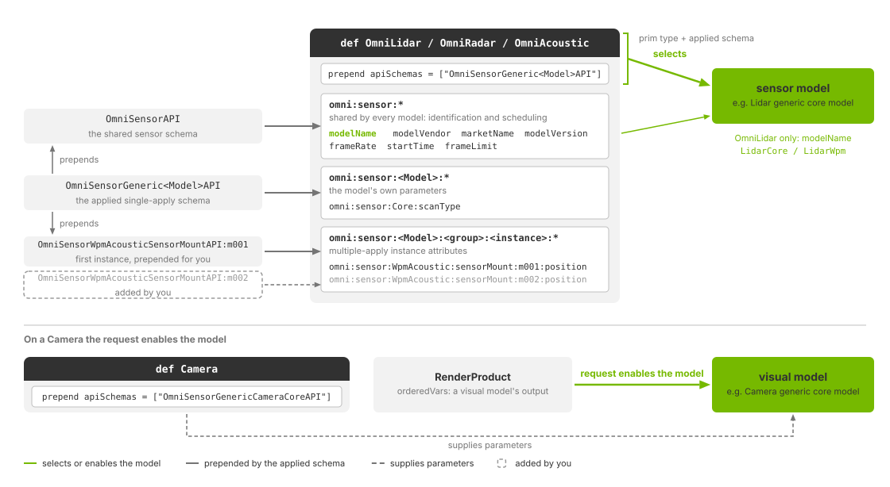
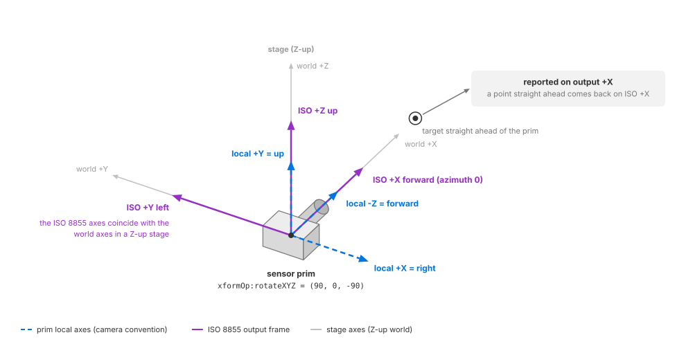

.. SPDX-FileCopyrightText: Copyright (c) 2026 NVIDIA CORPORATION & AFFILIATES. All rights reserved.
.. SPDX-License-Identifier: LicenseRef-NvidiaProprietary
..
.. NVIDIA CORPORATION, its affiliates and licensors retain all intellectual
.. property and proprietary rights in and to this material, related
.. documentation and any modifications thereto. Any use, reproduction,
.. disclosure or distribution of this material and related documentation
.. without an express license agreement from NVIDIA CORPORATION or
.. its affiliates is strictly prohibited.

.. _sensors-common-sensor-configuration:

Sensor Configuration
====================

Configure a sensor by creating its USD prim, applying the model's API schema,
and setting its attributes. The schema supplies defaults for attributes you
leave unauthored. You can author the sensor in a scene file or add it at run time
through :ref:`stage population <sensors-common-sensor-configuration-overrides>`.

Use a :doc:`RenderProduct <output_configuration>` to request its outputs, then
:doc:`map the returned data <sensor_outputs>`.

r prim.
   :align: center
   :width: 85%

   Sensor attributes include shared settings, model parameters and named
   instances such as scan patterns or emitter states.

.. _sensors-common-sensor-configuration-model:

Creating a sensor
-----------------

Choose the prim type and model schema from the table below. Each model defines
its own parameters and outputs; an attribute name used by two models does not
necessarily have the same meaning. Follow the model's attributes link for its
units and constraints.

.. _sensors-common-sensor-configuration-models:

Each model uses a single-apply API schema. Models with repeated groups, such as
scan configurations, include an initial instance of a multiple-apply schema.

.. list-table::
   :class: compact-table
   :header-rows: 1
   :widths: 24 16 36 24

   * - Model
     - Prim
     - Applied API schema
     - Model attributes
   * - :doc:`Lidar generic core model <../nonvisual/lidar_core/index>`
     - ``OmniLidar``
     - ``OmniSensorGenericLidarCoreAPI``; prepends emitter state ``s001`` of
       ``OmniSensorGenericLidarCoreEmitterStateAPI``
     - ``omni:sensor:Core:*`` (:doc:`attributes <../nonvisual/lidar_core/attributes>`)
   * - :doc:`Lidar generic wpm model <../nonvisual/lidar_wpm/index>`
     - ``OmniLidar``
     - ``OmniSensorGenericLidarWpmAPI``; prepends firing pattern ``p001`` of
       ``OmniSensorGenericLidarWpmFiringPatternAPI``
     - ``omni:sensor:LidarWpm:*`` (:doc:`attributes <../nonvisual/lidar_wpm/attributes>`)
   * - :doc:`Radar generic wpmDmat model <../nonvisual/radar_wpm_dmat/index>`
     - ``OmniRadar``
     - ``OmniSensorGenericRadarWpmDmatAPI``; prepends scan configuration ``s001``
       of ``OmniSensorGenericRadarWpmDmatScanCfgAPI``
     - ``omni:sensor:WpmDmat:*`` (:doc:`attributes <../nonvisual/radar_wpm_dmat/attributes>`)
   * - :doc:`Acoustic generic wpm model <../nonvisual/acoustic_wpm/index>`
     - ``OmniAcoustic``
     - ``OmniSensorGenericAcousticWpmAPI``; prepends mount ``m001``, receiver
       group ``g001`` and firing sequence ``seq001`` of the mount,
       receiver-group and firing-sequence schemas
     - ``omni:sensor:WpmAcoustic:*`` (:doc:`attributes <../nonvisual/acoustic_wpm/attributes>`)
   * - :doc:`Generic wpm model <../nonvisual/generic_wpm/index>`
     - ``OmniGeneralSensor``
     - ``OmniSensorGenericWpmAPI``; includes transmitter, receiver and ray
       pattern APIs with roles ``tx``, ``rx`` and ``ray``, and receiver mapping
     - ``omni:sensor:GenericWpm:*`` (:doc:`attributes <../nonvisual/generic_wpm/attributes>`)
   * - :doc:`Camera generic core model <../visual/camera_core/index>`
     - ``Camera``
     - ``OmniSensorGenericCameraCoreAPI``
     - ``omni:sensor:core:*`` (:doc:`attributes <../visual/camera_core/attributes>`)
   * - :doc:`Camera single-view stereo depth model <../visual/depth_camera/index>`
     - ``Camera`` (the prim the RenderProduct renders through)
     - ``OmniSensorGenericDepthSensorSingleViewAPI``
     - ``omni:sensor:depthSensor:*`` (:doc:`attributes <../visual/depth_camera/attributes>`)

This minimal lidar applies the core model schema and sets a 10 Hz capture rate.
The schema supplies the remaining defaults, including ``modelName = "LidarCore"``.
Python snippets on this page assume an existing USD ``stage``.

.. tab-set::

   .. tab-item:: USDA
      :sync: usda

      .. literalinclude:: ../../../tests/docs/usd/data/sensor_configuration_minimal.usda
         :language: usda
         :prepend: #usda 1.0
         :start-after: # [snippet:doc-sensor-config-minimal]
         :end-before: # [/snippet:doc-sensor-config-minimal]

   .. tab-item:: USD Python
      :sync: python

      .. literalinclude:: ../../../tests/docs/usd/test_usd_python_examples.py
         :language: python
         :start-after: # [snippet:doc-sensor-config-minimal-python]
         :end-before: # [/snippet:doc-sensor-config-minimal-python]
         :dedent:

For a visual sensor, apply exactly one of the two model schemas to the Camera
and request that model's outputs on its RenderProduct. Requesting sensor outputs
from a camera with neither schema, or with both, fails validation and produces no
outputs from that model. See :doc:`Camera core outputs
<../visual/camera_core/outputs>` and :doc:`Depth camera outputs
<../visual/depth_camera/outputs>` for the output requirements.

.. _sensors-first-sensor-camera:

If the RenderProduct requests only rendered images, no sensor model runs, even
if the Camera carries a sensor schema. See :doc:`Cameras <../cameras>`.

.. _sensors-common-sensor-configuration-identity:
.. _sensors-ref-model-identity-vs-plugin:

Model identity
~~~~~~~~~~~~~~

Model selection depends on the prim:

- ``OmniRadar`` always runs the Radar generic wpmDmat model, regardless of
  ``omni:sensor:modelName``.
- ``OmniAcoustic`` always runs the Acoustic generic wpm model, regardless of
  ``omni:sensor:modelName``.
- ``OmniLidar`` uses ``omni:sensor:modelName``: ``"LidarWpm"`` selects the
  Lidar generic wpm model. ``"LidarCore"``, an absent name or any other value
  selects the Lidar generic core model. An unrecognized name logs one warning.
- ``OmniGeneralSensor`` requires ``omni:sensor:modelName = "GenericWpm"``
  to select the Generic wpm model. Its schema supplies that value. An absent
  or unrecognized name selects no model and logs a warning once. Keep
  ``modelVendor = "NVIDIA"`` too: a different vendor refuses the configuration.
- On a ``Camera``, the requested outputs activate the pipeline. The Camera
  generic core pipeline then checks all three identity strings against the
  values its schema supplies. Keep those values unchanged; see
  :ref:`camera model identification <sensors-visual-camera-core-attributes-identification>`.

The schema supplies these identity strings. Apart from the model-selection and
validation rules above, they are descriptive labels. Their meanings and defaults
are listed under :ref:`Shared attributes <sensors-common-sensor-configuration-shared-attributes>`.
The validation utility uses separate model identifiers, listed in
:doc:`Sensor Definition Validation <validation>`.

.. _sensors-common-sensor-configuration-instances:

Instances of multiple-apply schemas
~~~~~~~~~~~~~~~~~~~~~~~~~~~~~~~~~~~

The model schema includes the first instance of each required group. For
example, the acoustic schema includes mount ``m001``, receiver group ``g001``
and firing sequence ``seq001`` with usable defaults. You can override their
attributes without applying another schema; see :ref:`acoustic default topology
<sensors-nonvisual-acoustic-attributes-default-topology>` for the values.
Lidar emitter state ``s001``, firing pattern ``p001`` and radar scan ``s001``
work the same way.

The Generic wpm model uses fixed roles ``tx``, ``rx`` and ``ray``. Alternatives
are flattened arrays within each role, not newly named schema instances. Those
arrays are empty by default; author a complete pattern before rendering. See
:doc:`Generic wpm USD Attributes <../nonvisual/generic_wpm/attributes>`.

To add an instance, add ``SchemaName:instanceName`` to ``apiSchemas`` and include
the instance name in its attribute namespace. Names must be valid USD
identifiers and cannot start with a digit. Names such as ``s002`` and ``m002``
follow the existing convention; each model defines its ordering rules.

This example keeps the default radar scan ``s001`` and adds ``s002``, with
different ranges and angular sampling densities:

.. tab-set::

   .. tab-item:: USDA
      :sync: usda

      .. literalinclude:: ../../../tests/docs/usd/data/radar_scan_configurations.usda
         :language: usda
         :start-after: # [snippet:doc-radar-second-scan]
         :end-before: # [/snippet:doc-radar-second-scan]
         :prepend: #usda 1.0

   .. tab-item:: USD Python
      :sync: python

      .. literalinclude:: ../../../tests/docs/usd/test_usd_python_examples.py
         :language: python
         :start-after: # [snippet:doc-radar-second-scan-python]
         :end-before: # [/snippet:doc-radar-second-scan-python]
         :dedent:

:doc:`Run More Than One Scan Pattern <../nonvisual/radar_wpm_dmat/howto/scan_configurations>`
explains how the radar uses and orders scans. Additional lidar emitter states
(``OmniSensorGenericLidarCoreEmitterStateAPI:s002``) and acoustic mounts
(``OmniSensorWpmAcousticSensorMountAPI:m002``) use the same authoring pattern.
Their model attributes pages describe each instance's parameters and effects.

.. _sensors-common-sensor-configuration-namespaces:

Three namespace shapes
~~~~~~~~~~~~~~~~~~~~~~

Sensor attributes use three namespace forms:

- ``omni:sensor:*`` — shared identification and scheduling attributes.
- ``omni:sensor:<Model>:*`` — model parameters, such as ``omni:sensor:Core:*``
  for lidar core or ``omni:sensor:WpmAcoustic:*`` for acoustic sensors.
- ``omni:sensor:<Model>:<Group>:<Instance>:*`` — instance parameters, such as
  ``omni:sensor:WpmAcoustic:sensorMount:m001:position``.

Use the exact namespace. An attribute such as ``omni:sensor:Core:modelName``,
or a mount attribute missing ``m001``, can be authored in USD but has no effect.
:doc:`Sensor API Schemas <../reference/schemas>` lists the complete declarations;
the model pages explain how to use them.

.. _sensors-common-sensor-configuration-overrides:

Overriding parameters
---------------------

Set a parameter by authoring its attribute on the sensor prim:

- **In a scene file:** apply the schema and author the values you want to change.
  Unauthored attributes use schema defaults.
- **In a stronger layer:** sublayer the existing scene and author overrides in
  the root layer. You can populate an inline root layer at run time; see
  :ref:`Adding RenderProducts at run time
  <sensors-common-output-configuration-runtime-products>`, which also shows
  applying a camera sensor schema.
- **On the runtime stage:** update supported attributes while the sensor runs.
  :doc:`Runtime Parameter Updates <runtime_updates>` lists the supported edits
  and what happens when an edit is rejected. Camera partial-output delivery is
  configured this way; see :doc:`Sensor Scheduling <multi_rate>`.

These tabs author the same lidar: 40 Hz, complete scans, valid Cartesian points
in world coordinates, one-degree firing resolution, and a translated pose.

.. tab-set::

   .. tab-item:: USDA
      :sync: usda

      .. literalinclude:: ../../../examples/python/multi-rate-sensors/multi_rate.usda
         :language: usda
         :start-after: # [snippet:doc-multi-rate-lidar-usda]
         :end-before: # [/snippet:doc-multi-rate-lidar-usda]
         :prepend: #usda 1.0

   .. tab-item:: USD Python
      :sync: python

      .. literalinclude:: ../../../tests/docs/usd/test_usd_python_examples.py
         :language: python
         :start-after: # [snippet:doc-multi-rate-lidar-python]
         :end-before: # [/snippet:doc-multi-rate-lidar-python]
         :dedent:

To override an existing sensor, save the minimal example above as
``sensor_configuration_minimal.usda``. Place this new root layer alongside it.
The root layer changes the capture rate to 20 Hz and records a device name;
the sensor type and applied schema come from the sublayer. For the Python tab,
use a file-backed ``stage`` with its root layer as the edit target.

.. tab-set::

   .. tab-item:: USDA
      :sync: usda

      .. literalinclude:: ../../../tests/docs/usd/data/sensor_configuration_override.usda
         :language: usda
         :prepend: #usda 1.0
         :start-after: # [snippet:doc-sensor-config-override]
         :end-before: # [/snippet:doc-sensor-config-override]

   .. tab-item:: USD Python
      :sync: python

      .. literalinclude:: ../../../tests/docs/usd/test_usd_python_examples.py
         :language: python
         :start-after: # [snippet:doc-sensor-config-override-python]
         :end-before: # [/snippet:doc-sensor-config-override-python]
         :dedent:

See :doc:`Python: Multi-rate sensors <../../examples/python_multi_rate_sensors>`
for the complete example, or :doc:`Python: Lidar <../../examples/python_sensor_lidar>`
for a single lidar with Cartesian output and invalid points excluded.

.. _sensors-common-sensor-configuration-orientation:

Orienting the prim
~~~~~~~~~~~~~~~~~~

   Camera-style prim axes and ISO 8855 output axes. With the rotation shown,
   both forward directions point along world ``+X`` in a Z-up stage.

Sensor prims use camera axes: local ``-Z`` points forward, ``+Y`` points up,
and ``+X`` points right. Lidar beams, radar fields of view and acoustic lobes
are aimed along ``-Z``.

Outputs use the ISO 8855 sensor frame: ``+X`` forward, ``+Y`` left and ``+Z`` up.
A point directly ahead of the sensor therefore has positive output ``X`` and
azimuth zero. See :ref:`The sensor frame <sensors-common-sensor-outputs-sensor-frame>`
for output-frame details.

In a Z-up stage, ``xformOp:rotateXYZ = (90, 0, -90)`` points the sensor along
world ``+X`` with its up axis along world ``+Z``. The lidar and radar examples
use this rotation; the acoustic example uses an equivalent matrix. Use a Z-up
stage when comparing world-frame outputs directly with stage coordinates.
In a Y-up stage, the model converts between stage axes and ISO 8855 axes.

This example authors the Z-up orientation described above. The rotation aims
the sensor along world ``+X`` and keeps its up direction along world ``+Z``.

.. tab-set::

   .. tab-item:: USDA
      :sync: usda

      .. literalinclude:: ../../../tests/docs/usd/data/sensor_configuration_orientation.usda
         :language: usda
         :prepend: #usda 1.0
         :start-after: # [snippet:doc-sensor-config-orientation]
         :end-before: # [/snippet:doc-sensor-config-orientation]

   .. tab-item:: USD Python
      :sync: python

      .. literalinclude:: ../../../tests/docs/usd/test_usd_python_examples.py
         :language: python
         :start-after: # [snippet:doc-sensor-config-orientation-python]
         :end-before: # [/snippet:doc-sensor-config-orientation-python]
         :dedent:

.. _sensors-common-sensor-configuration-shared-attributes:

Shared attributes
-----------------

All seven model schemas include ``OmniSensorAPI``. Its shared defaults are listed
below; the model-specific defaults follow the table.

.. csv-table::
   :header: "USD declaration", "Description"
   :widths: 48, 52
   :class: compact-table

   "``string omni:sensor:modelName = """"``", "Model identifier supplied by the schema. Selects the lidar or Generic wpm model and participates in Camera core identity checks."
   "``string omni:sensor:modelVendor = """"``", "Model vendor. Validated by Generic wpm and Camera core; otherwise a label."
   "``string omni:sensor:marketName = """"``", "Parameterization name: Generic for schema defaults, or a device name for a profile. Keep the schema value for Camera core identity checks."
   "``string omni:sensor:modelVersion = ""latest""``", "Leave at the default; no model schema overrides it."
   "``double2 omni:sensor:frameRate = (0, 1)``", "Capture rate in rational Hz (numerator, denominator). For example, (10, 1) means ten completed scans or frames per second. Zero means unset."
   "``double2 omni:sensor:startTime = (0, 1)``", "Start offset in rational seconds. Frame or scan counting begins at this offset."
   "``uint omni:sensor:frameLimit = 0``", "Maximum number of output frames; zero means unlimited."

``frameRate`` controls completed captures, not renderer steps or individual lidar
firings. With an unset rate, a camera captures on every step and a non-visual
sensor uses the renderer's default schedule. See :doc:`multi_rate` for scheduling
and delivery rules.

Model schemas set ``modelVendor`` to ``"NVIDIA"`` and ``marketName`` to
``"Generic"``, with these model names and rates:

.. list-table::
   :class: compact-table
   :header-rows: 1
   :widths: 44 36 20

   * - Model
     - ``modelName``
     - ``frameRate`` (Hz)
   * - Lidar generic core
     - ``"LidarCore"``
     - ``(10, 1)``
   * - Lidar generic wpm
     - ``"LidarWpm"``
     - ``(10, 1)``
   * - Radar generic wpmDmat
     - ``"RadarWPMDMAT"``
     - ``(20, 1)``
   * - Acoustic generic wpm
     - ``"AcousticWPM"``
     - ``(30, 1)``
   * - Generic wpm
     - ``"GenericWpm"``
     - ``(10, 1)``
   * - Camera generic core
     - ``"CameraCore"``
     - ``(30, 1)``
   * - Camera single-view stereo depth
     - ``"DepthSensorSingleView"``
     - ``(0, 1)`` (inherited)

The radar schema writes ``startTime = (0, 1000)``, also zero seconds.
No model schema overrides ``frameLimit``. The depth-camera schema applies to
the Camera and includes the shared attributes; it leaves ``frameRate`` unset.

A plain Camera can apply ``OmniSensorAPI`` without either visual sensor model.
Author a positive ``frameRate`` to schedule its captures; otherwise it keeps the
shared defaults and captures on every renderer step.

Partial-output delivery is model-specific. The lidar schemas declare
``omni:sensor:Core:partialOutputs`` and ``omni:sensor:LidarWpm:partialOutputs``;
no schema declares it on a Camera. See :doc:`multi_rate` for defaults and the
camera delivery policy.

For a device profile, map its output, update, scan or frame rate to ``frameRate``
and its start delay or trigger offset to ``startTime``. Except on cameras, use
``marketName`` to record the device represented by the profile. Keep lidar
``modelName`` set to ``"LidarCore"`` or ``"LidarWpm"``: it selects the sensor
model. Keep ``modelName = "GenericWpm"`` on an ``OmniGeneralSensor``.
Keep the Camera core identification strings unchanged.
The model's spec-sheet guide covers its remaining parameters.

All seven model schemas also include ``OmniSensorEncryptionAPI``. Its
``uchar[] omni:sensor:encryption:params`` attribute defaults to an empty array
and has no effect in ovrtx.

Related
-------

- :doc:`Output Configuration <output_configuration>` — the RenderProduct and RenderVars that request a sensor's outputs, and the runtime inline-sublayer technique.
- :doc:`Sensor Outputs <sensor_outputs>` — mapping what comes back, and the ISO 8855 sensor frame the outputs are expressed in.
- :doc:`Sensor Scheduling <multi_rate>` — what ``frameRate`` does to scheduling, and the partial-outputs delivery policy.
- :doc:`Non-Visual Sensor Materials <../../materials/nonvisual_sensor_materials>` — the non-visual material labels and how to author them.
- :doc:`Your First Lidar Sensor <../first_sensor>` — one sensor from prim to consumed output, step by step.
- :doc:`Generic wpm model <../nonvisual/generic_wpm/index>` — model-specific patterns and capture setup.
