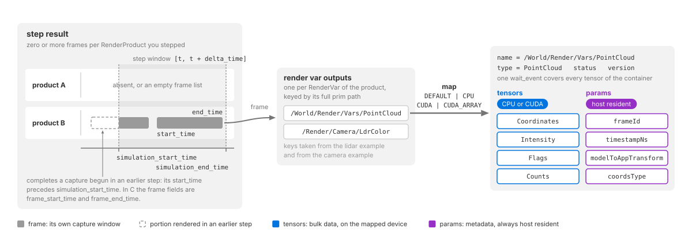
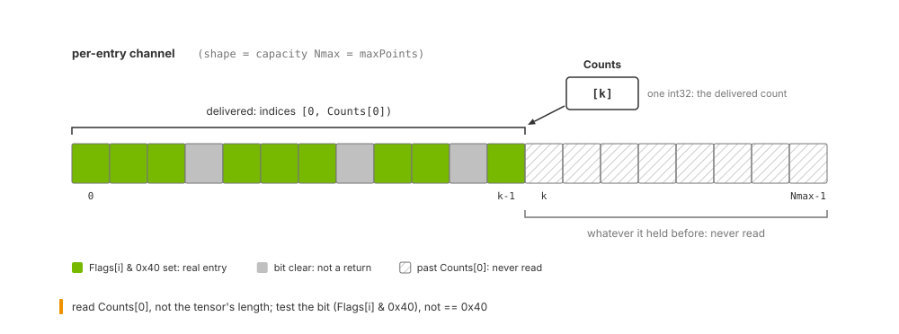

.. SPDX-FileCopyrightText: Copyright (c) 2026 NVIDIA CORPORATION & AFFILIATES. All rights reserved.
.. SPDX-License-Identifier: LicenseRef-NvidiaProprietary
..
.. NVIDIA CORPORATION, its affiliates and licensors retain all intellectual
.. property and proprietary rights in and to this material, related
.. documentation and any modifications thereto. Any use, reproduction,
.. disclosure or distribution of this material and related documentation
.. without an express license agreement from NVIDIA CORPORATION or
.. its affiliates is strictly prohibited.

.. _sensors-common-sensor-outputs:

Sensor Outputs
==============

After a renderer step, find each output by its RenderVar's full prim path and
map it before reading. See :doc:`output_configuration` for requesting outputs.

In Python, ``frame.render_vars`` accepts either an exact key or a prim name
unique among the outputs returned in that RenderProduct's frame. The name is
the final prim path component, not ``source_name``. Exact keys take precedence.
Multiple returned paths with the same name make that name ambiguous, even if
they share a source name. Indexing an ambiguous name raises ``KeyError`` directing
the caller to use a full path. Configured targets that produced no output do
not count toward ambiguity. Missing outputs remain missing. ``get`` returns
its default for missing or ambiguous names; containment returns false.

Both spellings return the same output object. Its ``render_var_path`` remains
the full canonical path: use that path for application identity and maps.
Iteration, keys, counts and dictionary mutations use exact canonical keys.
Exact reserved output names such as ``ovrtx_pick_hit`` take precedence over
authored prim-name aliases. Lookup scans the current dictionary, so adding or
removing canonical entries changes name resolution. Later scene edits do not
change an earlier result's returned keys, including when it is fetched later.

Name lookup uses the existing full-path results and requires no additional
native capability. The C API continues to enumerate full paths and map handles.

Lidar and radar ``PointCloud`` outputs and acoustic ``SignalWays`` outputs contain
named tensors and parameters. Read them by name rather than casting the container
to a fixed struct. Tensors hold bulk data on the CPU or GPU; parameters are small,
host-resident metadata values available when the output is mapped.

Camera outputs such as :doc:`LdrColor <../cameras/outputs>` contain a
:ref:`single tensor <sensors-common-sensor-outputs-single-tensor>`. Each model's
Outputs page defines its channels and parameters;
:ref:`C API <c-api-sensor-types>` and :ref:`Python API <python-api-render-outputs>` define the output containers. See also the C API’s
:ref:`sensor functions <c-api-sensor-simulation>` and
:ref:`handle types <c-api-handle-types>`.

   From a step to a mapped output: the step result holds zero or more frames
   per RenderProduct, each with its own capture window; a frame holds one
   output per RenderVar, keyed by prim path; mapping an output hands you a
   container of named tensors, host-resident params and one wait event.

Mapping an output
-----------------

.. _sensors-common-sensor-outputs-frames:

Frame delivery
^^^^^^^^^^^^^^

A renderer step advances simulation time by ``delta_time``. Scheduled sensors
capture at their own rates, and an exposure or scan can span several steps.
The number of frames returned for a RenderProduct therefore depends on which
captures become ready during that step:

- **Zero:** no capture is due, or a capture is still in progress and intermediate
  outputs are disabled.
- **One:** one capture completes, or the sensor delivers one intermediate frame
  from an unfinished capture.
- **Several:** the step spans several captures, or overlapping captures deliver
  frames during the same step. For example, it can complete an older exposure
  while also delivering an intermediate frame from a newer one.

For example, a 20 Hz lidar needs two 25 ms steps to complete a 50 ms scan. With
intermediate outputs disabled, the first step returns no completed scan and the
second returns one. See :doc:`multi_rate` for capture scheduling and delivery
policies. An unscheduled camera without a long exposure normally returns one
frame per step.

A requested product can be absent from the result or have an empty frame list.
Iterate returned products and their frames instead of assuming one frame per step.

Within each frame, outputs are keyed by RenderVar prim path. Python uses
``frame.render_vars["/World/Render/Vars/PointCloud"]`` for the lidar/radar examples
and ``frame.render_vars["/Render/Camera/LdrColor"]`` for the camera examples.
In C, inspect ``render_var_path`` in each ``output_render_vars`` entry.

When ovrtx cannot produce a RenderVar the RenderProduct lists, for example because
one of its settings has a value ovrtx does not accept, the frame still includes that
output in ``orderedVars`` order and reports the failure in the step result:

- ``status`` is ``EventStatus.FAILURE`` in Python and ``OVRTX_EVENT_FAILURE`` in C.
- ``error_message`` names the RenderVar and the reason.

Check ``status`` before mapping an output; mapping a failed output fails with the
same message. The RenderProduct's other outputs are delivered as usual.

Each frame reports its capture window in sensor simulation seconds:
``FrameOutput.start_time`` and ``end_time`` in Python, or ``frame_start_time``
and ``frame_end_time`` in C. For an instantaneous capture, start and end are equal;
otherwise they bound the exposure or scan.

The step result separately reports ``simulation_start_time`` and
``simulation_end_time``: the window ``[t, t + delta_time]`` advanced by the step.
A frame's capture window overlaps this window but need not fit inside it:

- A capture that starts and finishes during the step lies within it.
- A capture that began earlier reports its full window when it completes.
  Its ``start_time`` precedes ``simulation_start_time``.
- An intermediate frame from an unfinished capture reports only the slice
  rendered by this step.

Use the frame's times and model params to timestamp data. The step that delivers
it may occur after the capture began.

.. _sensors-common-sensor-outputs-frames-across-steps:

A capture longer than one step can deliver intermediate frames or wait until
completion. Overlapping captures are retained: one step can return the older
capture's completed frame followed by an intermediate frame of the newer capture.

``partialOutputs`` controls this policy: ``omni:sensor:Core:partialOutputs`` for
cameras and lidar core, and ``omni:sensor:LidarWpm:partialOutputs`` for lidar wpm.
See :ref:`sensors-common-multi-rate-partial-outputs` for defaults and configuration,
and :doc:`../cameras/rolling_shutter` for intermediate camera outputs. For lidar,
read only the delivered portion bounded by
:ref:`Counts[0] <sensors-common-sensor-outputs-counts-bound>`.

.. _sensors-common-sensor-outputs-mapping:
.. _mapping-outputs:

Mapping API
^^^^^^^^^^^

In C, map with :c:func:`ovrtx_map_render_var_output` and release with
:c:func:`ovrtx_unmap_render_var_output`. In Python,
``RenderVarOutput.map(device=...)`` returns a ``MappedRenderVar``.
The requested device controls where tensor data is made available.

Check each returned tensor's ``device`` before using its data. This is a DLPack
``DLDevice`` with a device type and id, not the mapping-mode enum. In Python,
compare ``device.device_type.value`` with ``ovrtx.DLDeviceType.kDLCUDA`` or
``ovrtx.DLDeviceType.kDLCPU``, not with ``ovrtx.Device``.

An explicit CPU map returns host tensors; an explicit CUDA map returns linear
CUDA tensors. ``Device.DEFAULT`` (``OVRTX_MAP_DEVICE_TYPE_DEFAULT`` in C) chooses
the cheapest representation, so inspect the result rather than assuming one.

.. _sensors-common-sensor-outputs-mapping-modes:

Mapping modes
^^^^^^^^^^^^^

Choose a mapping mode for the tensors; parameters remain on the CPU.

.. csv-table::
   :class: compact-table
   :header: "Mode", "What you ask for"
   :widths: 18, 82

   "``DEFAULT``", "The cheapest representation. Host data stays on the host, device data stays on the device, and an array-backed image resolves to the zero-copy array."
   "``CPU``", "A readable host buffer. Device data is copied down, and the call blocks until it has arrived."
   "``CUDA``", "A raw device pointer usable from a kernel."
   "``CUDA_ARRAY``", "An opaque CUDA array handle for texture and surface work. Zero-copy, and not readable through DLPack."

Mapping costs depend on the output format as well as where the producer wrote
the data. For image outputs and channels of non-visual composite outputs:

.. csv-table::
   :class: compact-table
   :header: "Producer's memory", "Requested", "Result", "Cost"
   :widths: 20, 22, 24, 34

   "Host", "``DEFAULT`` or ``CPU``", "Host pointer", "None; returned as is."
   "Host", "``CUDA``", "Device pointer", "An allocation and a host-to-device copy."
   "Linear device", "``DEFAULT`` or ``CUDA``", "The producer's own device pointer", "None. This is the point-cloud path."
   "Linear device", "``CPU``", "Host buffer", "Blocks on the producer's event, then copies down."
   "CUDA array", "``DEFAULT`` or ``CUDA_ARRAY``", "Opaque handle, reported with an opaque-handle element type", "None."
   "CUDA array", "``CUDA``", "Device pointer", "An allocation and a device-to-device copy."
   "CUDA array", "``CPU``", "Host buffer", "Blocks on the producer's event, then copies down."

Structured camera outputs have additional mapping costs:

- Identifier maps and host-produced record outputs allocate an owned CPU
  snapshot or normalized backing allocation. An explicit CUDA map uploads that
  backing once and exposes named tensor views into it.
- GPU-produced bounding boxes and occlusion outputs copy their backing once
  for ``DEFAULT`` or ``CUDA`` mapping; ``CPU`` mapping reads it back. Their
  named fields share the mapped allocation rather than copying each field.
- ``CameraParams`` snapshots its 23 CPU parameters and exposes no tensors,
  regardless of the requested mapping device.

See :doc:`../cameras/decoding_outputs` for the fields and supported mapping
devices of each structured camera output.

The point-cloud tensors of the lidar and radar models are written on the
device whatever the sensor's configuration; where you read them is decided by
the mapping alone.

``CUDA_ARRAY`` is the zero-copy path for image outputs. The tensor reports an
opaque-handle dtype instead of readable memory, so no DLPack consumer can read
it. Read the handle from ``tensor.cuda_array`` and consume it with a CUDA
library of your choice: Warp 1.15 or later (``wp.Texture2D(cuda_array=handle)``),
CuPy's ``cupy.cuda.texture``, or your own CUDA wrapper. The array belongs to
one CUDA device, which is not necessarily device 0: read ``device.device_id``
and make that device current before issuing copies against the handle.

.. _sensors-common-sensor-outputs-cuda-array-linear:

.. warning::

   Asking for a CUDA array from a tensor that is not one is an error, not a
   fallback. Point-cloud channels are linear device memory, so requesting
   ``CUDA_ARRAY`` for a ``PointCloud`` output fails the whole map and reports
   that only ``DEFAULT``, ``CPU`` and ``CUDA`` are valid for that tensor. Use
   ``CUDA`` for GPU point-cloud pipelines; ``CUDA_ARRAY`` is for array-backed
   image outputs.

CPU mapping
^^^^^^^^^^^

Use CPU mapping for logging, validation and CPU processing. These snippets read
:doc:`LdrColor <../cameras/outputs>`: Python creates a NumPy view with
``np.from_dlpack()``; C checks for one ``[H, W, 4]`` tensor and reads ``tensors[0]``.
The Python excerpt uses ``products`` returned by ``renderer.step()`` and the
minimal example's parsed ``args`` to select saving and display options. See the
:doc:`complete example <../../examples/python_minimal>` for those prerequisites.
The C example unmaps after the displayed block.

.. tab-set::

   .. tab-item:: Python
      :sync: python

      .. literalinclude:: ../../../examples/python/minimal/main.py
         :language: python
         :start-after: # [snippet:read-render-output]
         :end-before: # [/snippet:read-render-output]
         :dedent:

   .. tab-item:: C
      :sync: c

      .. literalinclude:: ../../../examples/c/minimal/main.cpp
         :language: cpp
         :start-after: // [snippet:map-rendered-output-cpu]
         :end-before: // [/snippet:map-rendered-output-cpu]
         :dedent:

CUDA mapping
^^^^^^^^^^^^

Map to CUDA when GPU code downstream should consume the output without a CPU
readback. The snippets map a camera RenderProduct's ``LdrColor`` RenderVar at
``/Render/Camera/LdrColor`` and check that the tensor landed on a CUDA device.
The C snippet names the stream to synchronize with through ``sync_stream``,
which :ref:`sensors-common-sensor-outputs-synchronization` explains.

.. tab-set::

   .. tab-item:: Python
      :sync: python

      .. literalinclude:: ../../../tests/docs/python/test_camera_sensors.py
         :language: python
         :start-after: # [snippet:doc-map-render-output-cuda]
         :end-before: # [/snippet:doc-map-render-output-cuda]
         :dedent:

   .. tab-item:: C
      :sync: c

      Linear CUDA memory is selected with ``OVRTX_MAP_DEVICE_TYPE_CUDA``:

      .. literalinclude:: ../../../tests/docs/c/test_camera_sensors.cpp
         :language: cpp
         :start-after: // [snippet:doc-map-render-output-cuda-c]
         :end-before: // [/snippet:doc-map-render-output-cuda-c]
         :dedent:

CUDA arrays
^^^^^^^^^^^

Both bindings can map an image output as a CUDA array: ``Device.CUDA_ARRAY``
in Python, ``OVRTX_MAP_DEVICE_TYPE_CUDA_ARRAY`` in C. Use it when a CUDA
texture or surface, or a graphics interop path, can consume a ``CUarray``
directly and you want to avoid a copy into linear device memory.

.. tab-set::

   .. tab-item:: Python
      :sync: python

      ``LDR_COLOR_PATH`` is the prim path of the ``LdrColor`` RenderVar,
      ``/Render/Camera/LdrColor`` in the example scene. The snippet maps it as
      a CUDA array, reads the handle and the device it belongs to, and unmaps:

      .. literalinclude:: ../../../tests/docs/python/test_camera_sensors.py
         :language: python
         :start-after: # [snippet:doc-map-render-output-cuda-array]
         :end-before: # [/snippet:doc-map-render-output-cuda-array]
         :dedent:

   .. tab-item:: C
      :sync: c

      .. literalinclude:: ../../../tests/docs/c/test_camera_sensors.cpp
         :language: cpp
         :start-after: // [snippet:doc-map-render-output-cuda-array-c]
         :end-before: // [/snippet:doc-map-render-output-cuda-array-c]
         :dedent:

.. _sensors-common-sensor-outputs-container:

Output container
----------------

The mapped container is ``ovrtx_render_var_output_t`` in C and
``MappedRenderVar`` in Python. Alongside tensors and parameters, it carries:

.. list-table::
   :class: compact-table
   :header-rows: 1
   :widths: 30 70

   * - C field
     - Meaning
   * - ``status``, ``error_message``
     - Map success or failure and its error text. Success does not mean a complete
       sensor frame; ``error_message`` is empty on success.
   * - ``map_handle``
     - Handle used to release the mapping.
   * - ``cuda_sync``
     - One ``wait_event`` covering every tensor. Its ``stream`` is zero (none).
   * - ``name``, ``type``, ``doc``
     - Output identity and description; see
       :ref:`sensors-common-sensor-outputs-identity`.
   * - ``version``
     - Output schema version; camera outputs and non-visual composite outputs use 0.

C strings use ``ovx_string_t``: a pointer and byte length. Non-empty library
strings are also null-terminated; ``{ NULL, 0 }`` means no value. For exact name
matching, compare both length and bytes. A prefix comparison with ``strncmp()``
can accept a different, longer name. See :ref:`C API <c-api-sensor-types>` and :ref:`Python API <python-api-render-outputs>`
for the full field definitions.

.. _sensors-common-sensor-outputs-description-first:

Metadata availability
^^^^^^^^^^^^^^^^^^^^^

Tensor names, types, devices, shapes and strides, and all parameter values are
populated when the output is produced. Tensor data may still be in flight.

You can use descriptors to allocate buffers, choose kernel launch dimensions,
and read frame identity and pose before waiting for tensor data. Synchronize
before reading the tensor bytes.

Values known only after rendering are tensors, not parameters. For example,
``Counts`` is a tensor because its value depends on the completed trace.

.. _sensors-common-sensor-outputs-tensors:

Tensors
^^^^^^^

A tensor is a named multidimensional array described using DLPack: data pointer,
shape, dtype, device, strides and byte offset. NumPy, PyTorch, Warp, JAX and CuPy
can consume compatible DLPack tensors as views without copying.

Two examples (a CUDA mapping places them on the device, a CPU mapping returns
the same tensors on the host):

- A Lidar generic core model ``PointCloud`` output carries ``Coordinates``
  (``[3, maxPoints]`` ``float32``), ``Intensity`` (``[maxPoints]``
  ``float32``), ``Flags`` (``[maxPoints]`` ``uint8``) and ``Counts`` (``[1]``
  ``int32``, the number of delivered entries this frame), plus whatever other
  channels the RenderVar requested. The full catalog is on
  :doc:`../nonvisual/lidar_core/outputs`.
- A camera ``HdrColor`` output is one image tensor, ``[H, W, 4]`` ``float16``,
  read as the mapping itself. The camera tables are on
  :doc:`../cameras/outputs`.

The output's semantic ``type`` and ``doc`` strings describe its contents. Each
model's Outputs page lists supported and always-included channels;
:doc:`output_configuration` explains how to request them.

.. _sensors-common-sensor-outputs-dlpack-reading:

Reading DLPack tensors
~~~~~~~~~~~~~~~~~~~~~~

For every tensor:

- Take the dtype and shape from the descriptor; never hard-code them.
- Add ``byte_offset`` to the data pointer before reading.
- Treat ``strides`` as element counts, not bytes, and check them against the
  layout you expect before assuming the data is contiguous.
- Keep the mapping alive for as long as you use pointers taken from it.

Composite outputs report explicit strides and a zero byte offset. Still read
these fields so your code handles other layouts. Scalar params and count tensors
use shape ``[1]``, including scalar params in ``CameraParams`` and
``InstanceIdTokenMapSD`` (``ndim == 1``, shape ``(1,)`` in Python).

.. _sensors-common-sensor-outputs-params:

Params
^^^^^^

Params are named, typed metadata values, always CPU resident and available
as soon as the output is mapped.

Each param uses a ``DLTensor`` descriptor: dtype gives the value type and shape
gives its dimensions. Scalars use shape ``[1]``, vectors use ``[N]`` and matrices
can use ``[4, 4]``. Inspect ``ndim`` and ``shape`` to determine each param's layout.
The same DLPack consumer can read tensors and params.
Capacity is already available in tensor shapes; a count determined during
rendering arrives in a tensor.

Parameter sets vary by model. Look up names you need and ignore unfamiliar ones.

.. _sensors-common-sensor-outputs-shared-params:

Shared point-cloud params
~~~~~~~~~~~~~~~~~~~~~~~~~

Lidar core and radar wpmDmat share these thirteen params. Their timing semantics
remain model-specific: ``frameId`` does not count delivered captures, and the
meaning of ``timestampNs`` and the start/end window depends on the model.
Use each model's Outputs page together with the
:ref:`frame capture window <sensors-common-sensor-outputs-frames>`.

.. csv-table::
   :class: compact-table
   :header: "Param", "Type", "Shape", "Value"
   :widths: 24, 10, 10, 56

   "``frameId``", "``uint64``", "``[1]``", "The model's frame counter."
   "``timestampNs``", "``uint64``", "``[1]``", "The frame's time in nanoseconds; which instant it stamps is the model's rule."
   "``modality``", "``uint32``", "``[1]``", "``0`` undefined, ``1`` lidar, ``2`` radar, ``3`` acoustic, ``4`` the Idealized depth model."
   "``frameOfReference``", "``uint16``", "``[1]``", "``0`` sensor, ``1`` world, ``2`` custom, ``3`` parent."
   "``coordsType``", "``uint32``", "``[1]``", "``0`` Cartesian, ``1`` spherical, ``2`` not applicable."
   "``modelToAppTransform``", "``float32``", "``[4, 4]``", "Sensor frame to application frame, stored row by row with a bottom row of ``0, 0, 0, 1`` and translation entries in meters."
   "``frameStartTimeStampNs``", "``uint64``", "``[1]``", "Start of the window the delivered data covers, in nanoseconds."
   "``frameStartPosM``", "``float32``", "``[3]``", "Sensor position at that start, in meters."
   "``frameStartOrientation``", "``float32``", "``[4]``", "Sensor orientation at that start, as a quaternion ordered x, y, z, w."
   "``frameEndTimeStampNs``", "``uint64``", "``[1]``", "End of the window the delivered data covers, in nanoseconds."
   "``frameEndPosM``", "``float32``", "``[3]``", "Sensor position at that end, in meters."
   "``frameEndOrientation``", "``float32``", "``[4]``", "Sensor orientation at that end, as a quaternion ordered x, y, z, w."
   "``maxPoints``", "``uint32``", "``[1]``", "The capacity of the per-entry tensors, duplicating the shape already in the descriptor; refer to :ref:`sensors-common-sensor-outputs-capacity`."

The window the frame-start and frame-end params span follows the model's
delivery policy. On the Lidar generic core model with
``omni:sensor:Core:partialOutputs`` false, a delivered scan carries the whole
scan, from the scan's start to the end of the frame that completed it; the
start pose is the sensor's pose at the start of the scan's first frame,
stamped with the scan's start time. With ``partialOutputs`` true each
delivered frame carries only its own window. Two further enumerated params are
published by the Lidar generic core model and the Lidar generic wpm model, not
by the Radar generic wpmDmat model: ``motionCompensationState`` (``0``
non-compensated, ``1`` compensated, ``2`` not applicable) and
``compactionType`` (``0`` unspecified, ``1`` uncompacted, ``2`` compacted).
Each model's Outputs page lists its full param set, including these and the
ten scan params the radar adds, and says what differs for the shared ones:
:doc:`../nonvisual/lidar_core/outputs`,
:doc:`../nonvisual/radar_wpm_dmat/outputs` and, for its own larger set,
:doc:`../nonvisual/lidar_wpm/outputs`.

The same container serves outputs that are not point clouds. The acoustic
``SignalWays`` output carries seven params of its own and no ``Counts``
tensor; :doc:`../nonvisual/acoustic_wpm/outputs` says how to bound a read of
it. The Generic wpm model's ``Contributions`` also has no ``Counts`` or ``Flags``:
read its dense dimensions and ``Valid`` channel. Its selectors and grid-shape
params describe the accepted configuration. See
:doc:`../nonvisual/generic_wpm/outputs` for layout, units and coordinate frames.

.. _sensors-common-sensor-outputs-identity:
.. _sensors-output-container-name-vs-type:

Output identification
^^^^^^^^^^^^^^^^^^^^^

Use the RenderVar's full prim path to distinguish outputs. Several RenderVars in
one product can request the same source, such as ``PointCloud``, with different
channel lists.

.. list-table::
   :class: compact-table
   :header-rows: 1
   :widths: 28 34 38

   * - Field
     - Location
     - Example / purpose
   * - ``render_var_path``
     - Step result, both bindings; Python mapping
     - ``/World/Render/Vars/PointCloud``: identifies the output.
   * - ``name``
     - C mapped container
     - The same full prim path, not ``PointCloud``.
   * - ``source_name``
     - Step result, both bindings
     - Authored source name; absent from the mapped container.
   * - ``status``
     - Step result, both bindings
     - ``COMPLETED``, or ``FAILURE`` when ovrtx could not produce the output.
   * - ``error_message``
     - Step result, both bindings
     - Why the output failed; empty when ``status`` is ``COMPLETED``.
   * - ``type``
     - Composite mapped container
     - Model output name, such as ``PointCloud``: identifies the kind of data.

.. _sensors-common-sensor-outputs-python:

The Python wrapper
^^^^^^^^^^^^^^^^^^

``RenderVarOutput.map(...)`` returns a ``MappedRenderVar`` whose tensors and
params you reach by name:

- ``np.from_dlpack(rv)``: for a single-tensor output, the mapping itself is
  the DLPack view of that tensor (``HdrColor`` and ``LdrColor``, for example).
- ``rv["Coordinates"]``: for a multi-tensor output, index by tensor name to
  get a ``RenderVarTensor``. It exposes ``name``, ``doc``, ``shape``,
  ``dtype``, ``ndim``, ``data`` and ``device``, implements the DLPack protocol,
  and adds ``cuda_array`` for an array-backed mapping.
- ``rv.params["frameId"]``: look up a ``RenderVarParam`` by name. It has the
  same accessors minus ``cuda_array`` and is DLPack-compatible as well.
- ``rv.render_var_path``, ``rv.type``, ``rv.doc`` and ``rv.version``: the
  output's identity and schema metadata, matching the C fields of the same
  meaning.
- ``rv.wait_event``: the producer event, or ``None`` for a CPU mapping and for
  any mapping whose tensors all landed on the CPU.

Iterating a ``MappedRenderVar`` yields its tensor names in declaration order,
and ``values()`` / ``items()`` yield the tensors; in C walk ``num_tensors`` /
``tensors`` and ``num_params`` / ``params``. Both tensors and params implement
the DLPack protocol, so the same consumer code works for either. The accessors
are generic: they read any output that follows this format, so a new output
type needs no new reader code.

.. _sensors-common-sensor-outputs-reading:

Reading a variable-size output
------------------------------

For lidar and radar point clouds, use ``Counts`` to bound the delivered range
and ``Flags`` to identify valid returns within it. The allocated capacity can
be larger than the delivered range. Acoustic ``SignalWays`` uses different
bounds; see :doc:`../nonvisual/acoustic_wpm/outputs`.

   Capacity versus count: a per-entry channel is allocated for ``Nmax``
   entries, the delivered entries ``[0, Counts[0])`` sit at the front, the
   ``VALID`` bit of ``Flags`` marks the real ones inside that range, and
   everything past ``Counts[0]`` holds whatever it held before.

.. _sensors-common-sensor-outputs-capacity:
.. _sensors-output-container-capacity-shape:

Allocated capacity
^^^^^^^^^^^^^^^^^^

For variable-size outputs, descriptor shapes report capacity, not the number of
entries produced. This lets the renderer publish descriptors before data is
ready. Lidar and radar also expose capacity through ``maxPoints``. Read it from
the descriptor rather than hard-coding it; sensor configuration changes capacity.

The delivered count arrives in ``Counts``, a one-element ``int32`` tensor. Read
``Counts[0]``, not the tensor's length.

Lidar wpm has one exception: an empty output has zero-length per-entry tensors
while ``maxPoints`` still reports capacity. See
:ref:`sensors-nonvisual-lidar-wpm-outputs-empty-output`.

.. _sensors-common-sensor-outputs-counts-bound:
.. _sensors-channels-counts-bound:

Delivered entry count
^^^^^^^^^^^^^^^^^^^^^

Only indices ``[0, Counts[0])`` contain this frame's delivered entries. Data
beyond that range is stale, even when a ``Flags`` value there happens to be zero.

A zero count means no entries were delivered. It does not distinguish an
unfinished capture from a completed capture with no returns. Use capture times
and model parameters for that distinction. Keep stepping a sensor even when its
output is empty; see :doc:`multi_rate`.

.. _sensors-common-sensor-outputs-counts-vary:

Sampling and configured noise can change counts between runs, even in a static
scene. A non-zero count only shows that entries were produced. Compare structural
properties and invariants, such as which frames contain a target or the direction
of a change, rather than requiring equal counts.

.. warning::

   Bound per-entry reads by ``Counts[0]``, not by tensor capacity or ``Flags``.
   Unwritten entries can contain plausible but stale values.

.. _sensors-common-sensor-outputs-valid-bit:
.. _sensors-channels-valid-bit:

Checking validity
^^^^^^^^^^^^^^^^^

Within the delivered range, a return is valid when ``Flags[i] & 0x40`` is nonzero.
Test the bit rather than comparing ``Flags[i] == 0x40``: other bits can be set
on a valid return.

.. _sensors-common-sensor-outputs-new-scan-bit:

Lidar core can also set the new-scan bit, ``0x20``. It marks returns from the scan
after the one in which the frame started. This occurs only for rotary sensors
with ``omni:sensor:Core:partialOutputs`` enabled when a frame crosses a scan
boundary: returns from the older scan have ``0x40``; valid returns from the new
scan have both bits.

With ``partialOutputs`` disabled (the default), each frame contains one full scan
and no new-scan bit. Solid-state windows never cross a scan boundary. Lidar wpm,
radar wpmDmat and acoustic wpm set only the validity bit.

.. _sensors-common-sensor-outputs-counts-vs-flags:

Delivered and valid entries
^^^^^^^^^^^^^^^^^^^^^^^^^^^

``Counts`` bounds the delivered entries; ``Flags`` identifies which are valid.
All delivered entries are valid only when the model excludes invalid returns.
Lidar core controls this with ``omni:sensor:Core:includeInvalidPoints``;
lidar wpm uses ``omni:sensor:LidarWpm:includeInvalidPoints``. The
``compactionType`` param reports the output's compaction state. See each model's
Outputs page for defaults and interpretation:
:doc:`lidar core <../nonvisual/lidar_core/outputs>` and
:doc:`lidar wpm <../nonvisual/lidar_wpm/outputs>`.

Radar wpmDmat has no include-invalid switch; its delivered entries are valid.
See :doc:`../nonvisual/radar_wpm_dmat/outputs`.

.. _sensors-common-sensor-outputs-validity-carriers:

Use ``Counts`` and ``Flags`` for validity; lidar and radar include both even when
not requested. Identifiers, normals, RCS and velocities outside the delivered
range or in invalid entries do not describe the scene.

Reading a lidar point cloud
^^^^^^^^^^^^^^^^^^^^^^^^^^^

These readers use the lidar core example's Cartesian output with
``includeInvalidPoints = false``, so every delivered entry is valid. Both bound
reads by ``Counts[0]``. Python extracts coordinates, intensity and time offsets;
C prints intensity and time-offset statistics. These are readers for that known
layout, not general decoders for every sensor model.

.. tab-set::

   .. tab-item:: Python
      :sync: python

      The reader maps the frame's point cloud to the CPU, then returns arrays
      containing only the delivered entries:

      .. literalinclude:: ../../../examples/python/lidar/main.py
         :language: python
         :start-after: # [snippet:read-lidar-pointcloud]
         :end-before: # [/snippet:read-lidar-pointcloud]
         :dedent:

   .. tab-item:: C
      :sync: c

      This reader accepts an already CPU-mapped output. The example's
      ``cpu_tensor_data()`` helper finds a channel by name and checks that its
      data is CPU resident before returning the pointer:

      .. literalinclude:: ../../../examples/c/lidar/main.cpp
         :language: cpp
         :start-after: // [snippet:read-lidar-pointcloud]
         :end-before: // [/snippet:read-lidar-pointcloud]
         :dedent:

The complete :doc:`Python <../../examples/python_sensor_lidar>` and
:doc:`C <../../examples/c_sensor_lidar>` examples include scene setup, mapping
and helper functions. For outputs that retain invalid entries, also test the
``VALID`` bit within the delivered range.

.. _sensors-common-sensor-outputs-packing:

Tensor layouts
^^^^^^^^^^^^^^

Read shape and strides instead of inferring layout from a channel name.
Component-first arrays store all x values, then y, then z; their component stride
is capacity, not delivered count. Point-first arrays store each point's components
together. Different models can use different layouts for the same channel name.
Each model's Outputs page specifies its layout.

.. _sensors-common-sensor-outputs-shared-names:

Model-specific channel semantics
^^^^^^^^^^^^^^^^^^^^^^^^^^^^^^^^

The same channel name can have different meanings across models. For example,
``TimeOffsetNs`` uses different reference instants. Consult each model's Outputs
page before sharing conversion or motion-correction code between models.

.. _sensors-common-sensor-outputs-map-status:

Mapping status and capture completion
^^^^^^^^^^^^^^^^^^^^^^^^^^^^^^^^^^^^^

``status`` reports map success, including successful mapping of empty outputs.
It does not indicate whether a capture is partial or complete. Bound point-cloud
reads by ``Counts[0]``; partial frames retain capacity-sized shapes with only a
portion populated. See :ref:`sensors-common-multi-rate-partial-outputs` for
which models deliver partial frames and how to configure them.

.. _sensors-common-sensor-outputs-sensor-frame:

The sensor frame
----------------

Every non-visual composite output measured in the ``SENSOR`` frame of
reference uses the ISO 8855 sensor frame: +X forward, +Y left, +Z up,
right-handed. Spherical coordinates use the same frame: the three components
of a spherical ``Coordinates`` entry are azimuth in degrees in [-180, 180],
elevation in degrees in [-90, 90] and distance in meters, in that order. The
``coordsType`` param, tabulated under
:ref:`sensors-common-sensor-outputs-shared-params`, reports which
representation an output used, and ``modelToAppTransform`` is the transform
that takes these axes to the application's. How the sensor frame relates to the
prim's own axes when you place a sensor is on :doc:`sensor_configuration`.

.. figure:: ../../img/sensors/common/iso8855.avif
   :alt: ISO 8855 sensor coordinate system with X forward, Y left and Z up, azimuth measured about Z and elevation above the XY plane
   :align: center
   :width: 550

   The ISO 8855 sensor frame that every ``SENSOR``-frame composite output
   uses.

.. _sensors-common-sensor-outputs-synchronization:

Synchronization
---------------

Tensor data may still be in flight when mapping returns.

.. warning::

   Reading device data before synchronizing can return stale or uninitialized
   values without reporting an error.

One event covers all tensors: ``cuda_sync.wait_event`` in C or ``wait_event``
in Python. CPU mapping blocks until data is ready and needs no further wait.
For a device mapping, choose one synchronization method:

.. list-table::
   :class: compact-table
   :header-rows: 1
   :widths: 36 64

   * - Method
     - Effect
   * - Supply ``sync_stream`` when mapping
     - Inserts a barrier on that stream. Consume the data on that stream.
       Python uses the default stream when ``sync_stream`` is omitted.
   * - Wait on the event from a consumer stream
     - In Python, call ``wait_on(stream)`` before queuing work on that stream.
   * - Wait on the calling thread
     - In Python, call ``wait()``. Once it returns, data is ready for any access.

Combining these methods is redundant. A device mapping always provides a usable
event. If mapping copied data, the event covers completion of both production
and the copy.

The C CUDA snippet above sets ``sync_stream = 1``, the default stream, before
mapping. The Vulkan interop example shows a full double-buffered C path using
CUDA arrays, timeline semaphores and explicit synchronization:
:doc:`../../examples/c_vulkan_interop`.

.. _sensors-common-sensor-outputs-lifetime:

Lifetime and ownership
----------------------

The mapping owns its strings, descriptors, parameter bytes and tensor data.
Destroying the step result does not invalidate an existing mapping.

- **C:** data stays valid until :c:func:`ovrtx_unmap_render_var_output` releases
  the mapping. Copy anything that must outlive it; synchronize before copying GPU
  data. Unmapping remains valid after the step result is destroyed.
- **Python:** existing tensor/param objects, DLPack capsules and derived NumPy or
  Warp views keep the buffer alive. You do not need a copy just to extend its
  lifetime. After ``unmap()`` or leaving a ``with`` block, new lookups such as
  ``rv["X"]``, ``rv.params`` or ``np.from_dlpack(rv)`` raise. Previously acquired
  entries and arrays remain readable, as do ``render_var_path``, ``type``, ``doc``
  and ``version``. Acquire what you need before unmapping.
- **Pending GPU work:** release with a synchronization hint (stream or event)
  so the buffer is not freed until your work finishes.

Step results have a lifetime of their own in C: every step result, including
one with no frames and every warm-up result, must be destroyed with
``ovrtx_destroy_results``, and destroying it leaves live mappings intact. The
C API's usage patterns are on :doc:`../../c_api/practical_patterns`; warming
up the renderer is on :doc:`output_configuration`.

.. _sensors-common-sensor-outputs-single-tensor:

Single-tensor outputs
---------------------

Camera color, depth and synthetic-data image outputs do not go through the
composite path. Each is mapped as one tensor named after the RenderVar's
``sourceName``, with no params, no semantic type and no description. Shapes
are channel-last DLPack shapes, ``[H, W, C]``, and the tensor already carries
its scalar type, so Python preserves the dtype and C readers inspect
``dtype.code``, ``dtype.bits`` and ``shape`` before reading pixels. In Python
the mapping is itself the DLPack tensor (``np.from_dlpack(rv)`` on an
``HdrColor`` or ``LdrColor`` mapping). Which output has which dtype, channels
and units is the catalog on :doc:`../cameras/outputs`; tested decoders for
images, identifiers and packed records are on
:doc:`../cameras/decoding_outputs`.

Tiling adds no tile axis to any output, composite or single-tensor. The Lidar
generic core model renders one sensor per RenderProduct
(:doc:`../nonvisual/lidar_core/outputs`); how the Lidar generic wpm model lays
out several sensors that share one product is on
:doc:`../nonvisual/lidar_wpm/outputs`.

Related
-------

- :doc:`Output Configuration <output_configuration>` — declaring RenderProducts and RenderVars and requesting channels.
- :doc:`Sensor Scheduling <multi_rate>` — why a step returns zero or several frames, and the delivery policy.
- :ref:`C API <c-api-sensor-types>` and :ref:`Python API <python-api-render-outputs>` — the C and Python output types of the step result and the mapped output.
- :doc:`Runtime Parameter Updates <runtime_updates>` — changing parameters at run time and reading params back.
- :doc:`Generic wpm model <../nonvisual/generic_wpm/index>` — dense contribution layout and validity.
