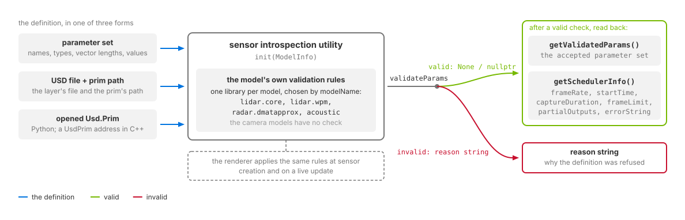

.. SPDX-FileCopyrightText: Copyright (c) 2026 NVIDIA CORPORATION & AFFILIATES. All rights reserved.
.. SPDX-License-Identifier: LicenseRef-NvidiaProprietary
..
.. NVIDIA CORPORATION, its affiliates and licensors retain all intellectual
.. property and proprietary rights in and to this material, related
.. documentation and any modifications thereto. Any use, reproduction,
.. disclosure or distribution of this material and related documentation
.. without an express license agreement from NVIDIA CORPORATION or
.. its affiliates is strictly prohibited.

.. _sensors-common-validation:

Sensor Definition Validation
============================

Validate a sensor definition before rendering to find parameter errors. The
sensor introspection utility runs the model's own validation rules and returns
either success or a diagnostic. After a successful check, you can inspect the
accepted parameters and the capture schedule derived from them.

   *The model validates the definition before rendering. A successful check makes
   its accepted parameters and scheduling information available.*

.. _sensors-common-validation-models:
.. _sensors-common-validation-identifiers:

Supported models
----------------

Validation is available for these five non-visual models. Camera models do not
provide a validation implementation. Initialize ``ModelInfo`` with the model and
vendor identifiers below:

.. list-table::
   :class: compact-table
   :header-rows: 1
   :widths: 44 32 24

   * - Model
     - ``modelName``
     - ``modelVendor``
   * - :doc:`Lidar generic core <../nonvisual/lidar_core/attributes>`
     - ``lidar.core``
     - ``nv``
   * - :doc:`Lidar generic wpm <../nonvisual/lidar_wpm/attributes>`
     - ``lidar.wpm``
     - ``nv``
   * - :doc:`Radar generic wpmDmat <../nonvisual/radar_wpm_dmat/attributes>`
     - ``radar.dmatapprox``
     - ``nv``
   * - :doc:`Acoustic generic wpm <../nonvisual/acoustic_wpm/attributes>`
     - ``acoustic``
     - ``nv``

   * - :doc:`Generic wpm <../nonvisual/generic_wpm/attributes>`
     - ``generic.wpm``
     - ``nv``

For Generic wpm, this utility checks model controls and the shared capture
schedule. It does not validate flattened pattern arrays or active mapping
compatibility. Rendering validates those together; verify the accepted selectors
in output params. See :ref:`Generic wpm configuration acceptance
<sensors-nonvisual-generic-wpm-attributes-live-edits>`.

These lowercase identifiers select the validation library. They differ from
``omni:sensor:modelName`` and ``omni:sensor:modelVendor`` on the sensor prim;
for lidar core those are ``"LidarCore"`` and ``"NVIDIA"``. See
:ref:`model identity <sensors-ref-model-identity-vs-plugin>` and the
:ref:`library naming convention <sensors-common-validation-naming>`.
``marketName`` is free text and is not read by the utility.

.. _sensors-common-validation-version:

Set ``schemaVersion`` and ``modelVersion`` explicitly. The examples request
schema ``1``, model ``0`` (``modelInfo.version = { 1u, 0u }`` in C++).
``init()`` rejects unset versions and unsupported requests. Leave
``allowDeprecated`` at its default. See
:ref:`error handling <sensors-common-validation-errors>`.

Validation inputs
-----------------

``validateParams()`` accepts a parameter set or a USD sensor definition:

.. list-table::
   :class: compact-table
   :header-rows: 1
   :widths: 28 72

   * - Input
     - Requirements
   * - ``Parameters``
     - Supply parameter names, data types, vector lengths and values using the
       structure documented below.
   * - USD file and prim path
     - Pass the file path and the path of the sensor prim within it.
   * - Python ``Usd.Prim``
     - Pass the prim to ``validateParams(prim)``. The wrapper uses its stage's
       root-layer file and prim path, so the stage must be file-backed.
   * - C++ ``UsdPrim``
     - Pass its address to ``validateParams(void*)``. This overload reads the prim
       directly and does not require a file.

For USD inputs, the utility reads every ``omni:sensor`` attribute, including
unauthored attributes supplied by applied API schemas. Those attributes use their
schema defaults. The utility registers the packaged schemas during initialization.

Validation results
------------------

``validateParams()`` returns ``None`` in Python or ``nullptr`` in C++ on success.
A failure returns a string explaining the rejected definition.

After success, ``getValidatedParams()`` returns the accepted parameter set.
``getSchedulerInfo()`` returns:

.. list-table::
   :class: compact-table
   :header-rows: 1
   :widths: 45 55

   * - Fields
     - Contents
   * - ``frameRate``, ``startTime``, ``captureDuration``
     - Capture rate and timing as rational numbers.
   * - ``frameLimit``, ``partialOutputs``
     - Capture limit and intermediate-output policy.
   * - ``errorString``
     - A diagnostic if no parameters have been validated, the last validation
       failed, or required scheduling attributes are missing.

Without a prim argument, ``getSchedulerInfo()`` uses the last validated parameters
without validating again. With a prim, it validates that prim first.

.. _sensors-common-validation-lidar-checks:

The renderer uses the same rules when creating a sensor or updating its parameters
and logs rejection reasons as errors. :doc:`runtime_updates` describes what a
rejected creation or update does to the sensor. Lidar core's
:ref:`parameter validation rules <sensors-lidar-core-invalid-parameters>` list its
checks; the :doc:`lidar tutorials <../nonvisual/lidar_core/tutorials/index>` run
validation before their rendering checks.

.. _sensors-common-validation-where:

Package and imports
-------------------

The ovrtx package includes the utility at ``bin/libs/sensors-introspection/``.
It is also distributed as the standalone ``sensor-introspection`` package, with
the Python module available as the ``sensor_introspection`` wheel.

::

    bin/libs/sensors-introspection/
    ├── bin/                                # utility, model libraries and schemas
    ├── include/                            # C++ headers
    ├── omni/sensors/sensor_introspection/   # Python module and its native libraries
    ├── docs/                               # utility reference
    └── PACKAGE-LICENSES/

The headers include ``ISensorIntrospectionImpl.h``, ``SensorIntrospectionTypes.h``
and ``SensorIntrospectionUtil.h``. The Python wrapper uses ``ctypes`` and requires
no compilation; it looks for the native utility library in its own directory
first.

For the bundled package, add ``omni/sensors`` to the Python path and import the
module:

.. code-block:: python

   import sys

   sys.path.append("/path/to/ovrtx/bin/libs/sensors-introspection/omni/sensors")
   import sensor_introspection as sc

If you instead add the package root to the path, import through
``omni.sensors.sensor_introspection``. The wheel contains the same
``omni/sensors`` tree. ``init()`` discovers the model library as described under
:ref:`library loading <sensors-common-validation-loading>`, or accepts an explicit
library path as its second argument.

.. _sensors-common-validation-embedded:

Utility reference
-----------------

The following reference comes from the packaged utility documentation. It covers
API structures, examples, library loading and errors. The output-buffer
validation example and its structure are omitted here.

.. include:: _generated/sensor_introspection_utility.txt
   :start-after: body can sit under a wrapper page title.
   :end-before: Architecture overview

Architecture overview
---------------------

.. include:: _generated/sensor_introspection_utility.txt
   :start-after: Architecture overview
     ---------------------
   :end-before: How dynamic loading works

.. _sensors-common-validation-loading:

Library loading
---------------

.. include:: _generated/sensor_introspection_utility.txt
   :start-after: How dynamic loading works
     -------------------------
   :end-before: Data structures

Data structures
---------------

.. include:: _generated/sensor_introspection_utility.txt
   :start-after: Data structures
     ---------------
   :end-before: AOVInfo

Usage examples
--------------

These examples initialize the lidar core validator and inspect the validation
result. Python validates a USD file; C++ shows both a manually supplied parameter
set and USD-file validation.

.. tab-set::

   .. tab-item:: Python
      :sync: python

      .. include:: _generated/sensor_introspection_utility.txt
         :start-after: Python usage
           ~~~~~~~~~~~~
         :end-before: For native C++ callers

   .. tab-item:: C++
      :sync: cpp

      .. include:: _generated/sensor_introspection_utility.txt
         :start-after: C++ usage
           ~~~~~~~~~
         :end-before: USD file validation

      After initialization, validate a USD file by passing its path and the
      sensor prim path:

      .. include:: _generated/sensor_introspection_utility.txt
         :start-after: USD file validation
           ~~~~~~~~~~~~~~~~~~~
         :end-before: AOV validation

.. _sensors-common-validation-naming:

Library naming convention
-------------------------

.. include:: _generated/sensor_introspection_utility.txt
   :start-after: Library naming convention
     -------------------------
   :end-before: Error handling

.. _sensors-common-validation-errors:

Error handling
--------------

.. include:: _generated/sensor_introspection_utility.txt
   :start-after: Error handling
     --------------
   :end-before: - Unsupported or denied soft-deprecated version requests

.. include:: _generated/sensor_introspection_utility.txt
   :start-after: - Accepted soft-deprecated version requests (writes a warning to stdout and continues)
   :end-before: Platform loader paths

Platform loader paths
---------------------

.. include:: _generated/sensor_introspection_utility.txt
   :start-after: Platform loader paths
     ---------------------
   :end-before: Current implementations

Current implementations
-----------------------

.. include:: _generated/sensor_introspection_utility.txt
   :start-after: Current implementations
     -----------------------
   :end-before: - **rtx.sensors.dummy.nv.ispect.impl**:

Related
-------

- :doc:`Sensor Configuration <sensor_configuration>` — the shared identification and timing attributes.
- :doc:`Runtime Parameter Updates <runtime_updates>` — what a refused parameter update does on a running sensor.
- :doc:`Lidar generic core model: USD attributes <../nonvisual/lidar_core/attributes>` — validation rules and handling of rejected parameters.
- :doc:`Validate a Parameterization <../nonvisual/radar_wpm_dmat/howto/validate_parameterization>` — checking a radar's behavior in a controlled scene once its definition passes.
- :doc:`Symptom Index <../troubleshooting/symptoms>` — where the diagnostics go, and the symptoms of a definition the renderer refused.
