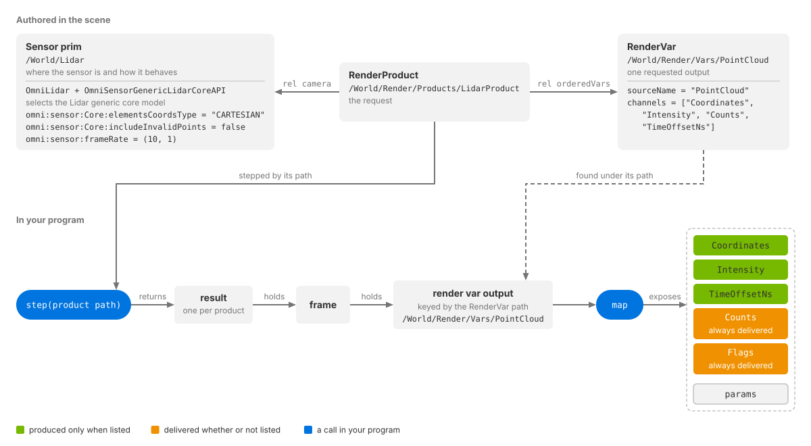
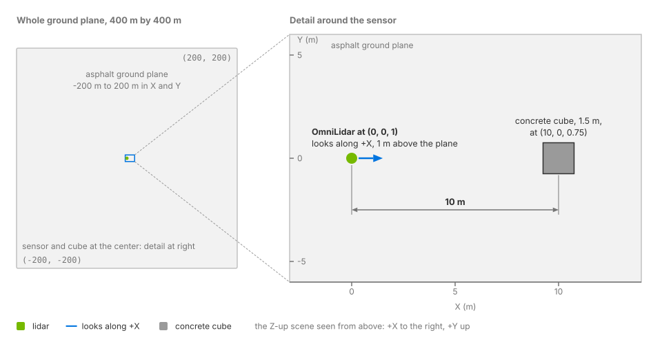

.. SPDX-FileCopyrightText: Copyright (c) 2026 NVIDIA CORPORATION & AFFILIATES. All rights reserved.
.. SPDX-License-Identifier: LicenseRef-NvidiaProprietary
..
.. NVIDIA CORPORATION, its affiliates and licensors retain all intellectual
.. property and proprietary rights in and to this material, related
.. documentation and any modifications thereto. Any use, reproduction,
.. disclosure or distribution of this material and related documentation
.. without an express license agreement from NVIDIA CORPORATION or
.. its affiliates is strictly prohibited.

.. _sensors-first-sensor:

Your First Lidar Sensor
=======================

Configure a lidar, render a scan and read its point cloud using the
Lidar generic core model. The code comes from the runnable
:doc:`Python <../examples/python_sensor_lidar>` and
:doc:`C <../examples/c_sensor_lidar>` examples.

A sensor needs a USD prim that defines its pose and settings, plus a
RenderProduct that requests its outputs. The workflow is:

1. Create the sensor prim and apply the schema that selects its model.
2. Override the attribute values you need.
3. Configure the output: a RenderProduct and a RenderVar.
4. Create the renderer.
5. Load the scene.
6. Warm up and step.
7. Read the output.
8. Display the output.

Radar, acoustic sensors and cameras use the same workflow with different
prim types, model selection and outputs. See
:doc:`common/sensor_configuration`.

You need ovrtx and ovstage installed; refer to :doc:`../python_api/getting_started`
or :doc:`../c_api/getting_started`.

.. _sensors-first-sensor-pieces:

Sensor components
-----------------

.. list-table::
   :header-rows: 1
   :widths: 20 80

   * - Component
     - Role
   * - **Sensor prim**
     - A USD prim containing the sensor's pose and settings: ``Camera``,
       ``OmniLidar``, ``OmniRadar`` or ``OmniAcoustic``.
   * - **Sensor model**
     - The simulation that interprets the settings and produces outputs.
       Non-visual models use the prim type and applied API schema.
       Camera models are selected by the requested outputs.
       See :doc:`common/sensor_configuration`.
   * - **RenderProduct**
     - Binds the sensor through ``rel camera``, lists outputs in
       ``rel orderedVars`` and holds render settings. Cameras and the
       Lidar generic wpm model can share a product using
       :ref:`tiles <sensors-reference-glossary-tile>`.
   * - **RenderVar**
     - Selects an output by ``sourceName``: for example, ``LdrColor`` for an
       image, ``PointCloud`` for lidar or radar, or ``SignalWays`` for acoustic.
   * - **Channel**
     - A named tensor inside a composite output, such as ``Coordinates``
       or ``Counts``. See :doc:`common/output_configuration`.

For a point cloud:

- Request each channel you need. ``Counts`` and ``Flags`` are always delivered;
  other channels are produced only when requested.
- Read only the entries indicated by ``Counts``. A tensor's shape describes
  its capacity, not the number of returns in this frame.
- If invalid points are included, check the ``VALID`` bit (``0x40``) in
  ``Flags`` before using an entry. See :doc:`common/sensor_outputs`.

   Configure the sensor and requested output in USD. Then step the
   RenderProduct, find the output by its RenderVar path and map its tensors.

.. _sensors-first-sensor-scene:

The scene
---------

Both examples use ``lidar_example.usda``, a Z-up scene measured in meters:

- Lidar at ``(0, 0, 1)``, looking along world +X.
- Ground plane from -200 to 200 m along both X and Y.
- A 1.5 m cube centered at ``(10, 0, 0.75)``, resting on the ground.

The ground and cube have non-visual material labels ``asphalt`` and
``concrete``. These determine their lidar response; no visual surface shader
is needed. See :doc:`../materials/nonvisual_sensor_materials`.

   The example scene from above: the lidar one meter above the origin, looking
   along +X at the cube ten meters ahead, on a 400 m by 400 m ground plane.

.. _sensors-first-sensor-author:

Author the sensor
-----------------

Define the sensor, its settings and its output in the scene's USD layer.

Create the prim and apply the schema
^^^^^^^^^^^^^^^^^^^^^^^^^^^^^^^^^^^^

The example's lidar prim, as authored in ``lidar_example.usda``:

.. literalinclude:: ../../examples/python/lidar/lidar_example.usda
   :language: usda
   :start-after: # [snippet:configure-lidar-sensor]
   :end-before: # [/snippet:configure-lidar-sensor]
   :caption: ``lidar_example.usda``, from the runnable :doc:`Python lidar example <../examples/python_sensor_lidar>`
   :prepend: #usda 1.0

``OmniLidar`` is the prim type. ``OmniSensorGenericLidarCoreAPI`` selects the
Lidar generic core model and supplies its attribute defaults. The default
``omni:sensor:Core:scanType`` is ``ROTARY``. See
:doc:`nonvisual/lidar_core/index` for the model's behavior.

Override values
^^^^^^^^^^^^^^^

The example sets three attributes:

- ``omni:sensor:Core:elementsCoordsType = "CARTESIAN"`` returns x, y and z.
  The default, ``SPHERICAL``, returns azimuth, elevation and distance.
- ``omni:sensor:Core:includeInvalidPoints = false`` removes invalid returns.
  This is the default, so the reader below can use every delivered entry
  without checking ``Flags``.
- ``omni:sensor:frameRate = (10, 1)`` sets 10 Hz, or one scan every 0.1 s.
  The value is a rational number, numerator divided by denominator. This is
  also the default; only the coordinate type changes a default here.

Sensor prims look along local -Z with +Y up. The translation places this lidar
1 m above the ground. ``xformOp:rotateXYZ = (90, 0, -90)`` maps local -Z to
world +X and local +Y to world +Z.

See :doc:`nonvisual/lidar_core/attributes` for settings and output coordinate
frames, :doc:`common/runtime_updates` for runtime changes, and
:doc:`common/sensor_configuration` for USD layer overrides.

Configure the output
^^^^^^^^^^^^^^^^^^^^

The example's RenderProduct and RenderVar, authored in the same scene:

.. literalinclude:: ../../examples/python/lidar/lidar_example.usda
   :language: usda
   :start-after: # [snippet:configure-lidar-pointcloud-output]
   :end-before: # [/snippet:configure-lidar-pointcloud-output]
   :prepend: #usda 1.0

``LidarProduct`` binds the lidar through ``rel camera`` and lists the
``PointCloud`` RenderVar in ``rel orderedVars``. The RenderVar sets
``sourceName = "PointCloud"`` and requests these channels:

- ``Coordinates``: each return's x, y and z position in meters, relative to
  the sensor's origin. This example uses the sensor frame: +X forward, +Y left,
  +Z up.
- ``Intensity``: unitless return strength.
- ``Counts``: number of returns. Listing it is optional because it is always delivered.
- ``TimeOffsetNs``: each return's firing time relative to the point-cloud frame
  start. See :ref:`sensors-nonvisual-lidar-core-outputs-time-offset`.

``Flags`` is also delivered automatically. After rendering, look up this output
by its RenderVar path: ``/World/Render/Vars/PointCloud``.

See :doc:`common/output_configuration` for channel selection and for adding
products through an overlay layer without editing the scene.

.. _sensors-first-sensor-render:

Render the sensor
-----------------

Create the renderer, load the USD scene into an attached ovstage stage,
then step the product and read its output.

Create the renderer
^^^^^^^^^^^^^^^^^^^

The renderer is created once, before any scene is loaded. The highlighted line
enables the motion BVH.

.. tab-set::

   .. tab-item:: Python
      :sync: python

      .. literalinclude:: ../../examples/python/lidar/main.py
         :language: python
         :start-after: # [snippet:create-renderer]
         :end-before: # [/snippet:create-renderer]
         :dedent:
         :emphasize-lines: 10
         :caption: ``main.py``, from the runnable :doc:`Python lidar example <../examples/python_sensor_lidar>`

   .. tab-item:: C
      :sync: c

      .. literalinclude:: ../../examples/c/lidar/main.cpp
         :language: cpp
         :start-after: // [snippet:create-renderer]
         :end-before: // [/snippet:create-renderer]
         :dedent:
         :emphasize-lines: 12
         :caption: ``main.cpp``, from the runnable :doc:`C lidar example <../examples/c_sensor_lidar>`

Enable the motion BVH when creating the renderer. See
:ref:`sensors-common-output-configuration-motion-bvh` for sensor requirements
and :doc:`nonvisual/lidar_core/howto/motion_artifacts` for its effect on lidar.

The Python snippet also attaches an ovstage stage and optionally sets a log
file. The C snippet sets the renderer's binary package location; it creates
and attaches the stage in the next step.

Load the scene
^^^^^^^^^^^^^^

The scene goes into the attached stage, not into the renderer directly.

.. tab-set::

   .. tab-item:: Python
      :sync: python

      .. literalinclude:: ../../examples/python/lidar/main.py
         :language: python
         :start-after: # [snippet:load-lidar-scene]
         :end-before: # [/snippet:load-lidar-scene]
         :dedent:

   .. tab-item:: C
      :sync: c

      .. literalinclude:: ../../examples/c/lidar/main.cpp
         :language: cpp
         :start-after: // [snippet:load-lidar-scene]
         :end-before: // [/snippet:load-lidar-scene]
         :dedent:

Load the scene at an ordinal, then advance the stage's write floor to make
those changes visible to the renderer. Render that same ordinal with
``Renderer.step(..., ordinal=...)`` in Python or ``ovrtx_step_with_stage`` in C.
See :doc:`../core/ovstage_integration` and :doc:`../core/application_flow`
for the update lifecycle.

Warm up and step
^^^^^^^^^^^^^^^^

Run three warm-up steps before reading the output. See
:doc:`common/output_configuration` for warm-up guidance.

.. tab-set::

   .. tab-item:: Python
      :sync: python

      .. literalinclude:: ../../examples/python/lidar/main.py
         :language: python
         :start-after: # [snippet:warm-up-lidar]
         :end-before: # [/snippet:warm-up-lidar]
         :dedent:

   .. tab-item:: C
      :sync: c

      .. literalinclude:: ../../examples/c/lidar/main.cpp
         :language: cpp
         :start-after: // [snippet:warm-up-lidar]
         :end-before: // [/snippet:warm-up-lidar]
         :dedent:

Step once more to capture a frame. Python passes the first frame to the
reader below. C fetches the result, finds ``PointCloud``, maps it to the CPU,
calls its reader and unmaps it.

.. tab-set::

   .. tab-item:: Python
      :sync: python

      .. literalinclude:: ../../examples/python/lidar/main.py
         :language: python
         :start-after: # [snippet:step-and-visualize-lidar]
         :end-before: # [/snippet:step-and-visualize-lidar]
         :dedent:

   .. tab-item:: C
      :sync: c

      .. literalinclude:: ../../examples/c/lidar/main.cpp
         :language: cpp
         :start-after: // [snippet:step-lidar-pointcloud]
         :end-before: // [/snippet:step-lidar-pointcloud]
         :dedent:

Step the **RenderProduct path**. Each product returns a result containing
frames; each frame contains outputs keyed by RenderVar path. Map an output
before reading its tensors.

For multiple products or capture rates, see :doc:`common/output_configuration`
and :doc:`common/multi_rate`. Mapping modes are described in
:doc:`common/sensor_outputs`.

.. warning::

   In C, destroy every step result, the warm-up results included
   (:ref:`Sensor Outputs, Lifetime and ownership <sensors-common-sensor-outputs-lifetime>`).
   In Python there is nothing to destroy.

.. _sensors-first-sensor-read:

Read the output
---------------

The Python reader maps the output and reads the requested channels.
The C reader receives an already-mapped output and reads ``Counts``,
``Intensity`` and ``TimeOffsetNs``. It skips ``Coordinates`` because it only
prints statistics.

.. tab-set::

   .. tab-item:: Python
      :sync: python

      .. literalinclude:: ../../examples/python/lidar/main.py
         :language: python
         :start-after: # [snippet:read-lidar-pointcloud]
         :end-before: # [/snippet:read-lidar-pointcloud]
         :dedent:

   .. tab-item:: C
      :sync: c

      .. literalinclude:: ../../examples/c/lidar/main.cpp
         :language: cpp
         :start-after: // [snippet:read-lidar-pointcloud]
         :end-before: // [/snippet:read-lidar-pointcloud]
         :dedent:

Read tensors by their exact channel names. Python uses NumPy's DLPack
support; C reads ``DLTensor`` data through helpers included with the example.
The mapped output also exposes :ref:`params <sensors-reference-glossary-param>`.

Both readers use ``Counts[0]`` to limit per-point reads. Neither checks
``Flags`` because this scene sets ``includeInvalidPoints = false``.
See :ref:`sensors-nonvisual-lidar-core-outputs-reading` for reading clouds
that retain invalid points.

The Python expression ``coordinates[:, :valid_count].T`` converts the
component-first coordinates into one row per point. Copies are optional in
Python but required in C if the data must outlive the mapping. See
:ref:`sensors-common-sensor-outputs-lifetime`.

.. _sensors-first-sensor-use:

Display the output
------------------

The Python example displays points in `Rerun <https://rerun.io/>`_, colored by ``Intensity``.
Both examples print the point count, mean intensity and maximum time offset.
Python prints:

.. code-block:: text

   valid points=..., mean intensity=..., max time offset=... ns

C labels the last value ``max point time offset to point cloud frame start``.
Expect a nonzero point count for this scene; the exact count varies between
runs. See :ref:`why counts vary <sensors-common-sensor-outputs-counts-vary>`.
If no points are returned, Python prints ``valid points=0`` and C exits with
an error.

.. figure:: ../../img/example-sensor-lidar.avif
   :alt: The lidar example's point cloud in the Rerun viewer, points shaded by intensity
   :align: center
   :width: 1265

   The point cloud of ``lidar_example.usda`` as the Python example shows it,
   each point shaded by its ``Intensity``.

.. _sensors-first-sensor-next:

Next steps
----------

Run the complete examples:

- Lidar: :doc:`Python <../examples/python_sensor_lidar>` or
  :doc:`C <../examples/c_sensor_lidar>`.
- Radar: :doc:`Python <../examples/python_sensor_radar>` or
  :doc:`C <../examples/c_sensor_radar>`. These use the Radar generic wpmDmat
  model with a moving target and multiple ordinals.
- Acoustic: :doc:`Python <../examples/python_sensor_acoustic>`. This reads
  one ``SignalWays`` frame from the Acoustic generic wpm model.

All three examples enable the motion BVH. Both ``AUTO`` and ``ENABLE`` support
radar motion effects and acoustic simulation. See
:ref:`sensors-common-output-configuration-motion-bvh`.

To customize the lidar, see its :doc:`attributes <nonvisual/lidar_core/attributes>`
and :doc:`how-tos <nonvisual/lidar_core/howto/index>`. The
:doc:`tutorials <nonvisual/lidar_core/tutorials/index>` build profiles from
vendor datasheets. Use :doc:`common/validation` to check sensor definitions
before rendering.

.. _sensors-first-sensor-richer-scene:

Try a richer scene
------------------

Both examples also ship ``lidar_example_panels.usda``. It uses the same
sensor settings and output request, with the lidar 1.5 m above asphalt:

- Ahead: glass at 3 m, with a concrete wall behind it at 6 m.
- Right: a silver panel at 3 m.
- Left: a wide concrete wall at 4 m.
- Behind: a concrete panel at 3 m.

Materials have both visual shaders and non-visual labels: ``asphalt``,
``concrete``, ``clear_glass`` and ``silver``. See :doc:`../materials/nonvisual_sensor_materials`.
The scene also has a preview camera and ``CameraProduct``; the lidar example
does not step that product.

Select the scene with Python's ``--scene`` option, or pass its path as the
C example's first argument. No code changes are needed.

.. code-block:: bash

   cd examples/python/lidar
   uv run main.py --scene lidar_example_panels.usda

.. list-table::
   :widths: 50 50

   * - .. image:: ../img/sensors/overview/first_sensor_panels_camera.gif
          :alt: The panel scene from a camera circling the lidar: ahead, a glass pane with a concrete wall behind it; a silver panel to the right, a wide concrete wall to the left and a concrete panel behind, all on asphalt, the lidar's position marked by a white dot
          :width: 100%
     - .. image:: ../img/sensors/overview/first_sensor_panels_lidar.gif
          :alt: One scan of the same lidar seen from the same circling viewpoint, points colored by Intensity, the lidar marked white, over a 1 m ground grid; beyond the silver panel, the sparse points of the concrete wall mirrored in it
          :width: 100%

Left: the scene viewed from a camera circling the lidar. Right: one lidar
scan from the same viewpoints, colored by ``Intensity``. White marks the lidar.
The sparse points beyond the silver panel are reflections of the concrete wall.

A sample run returned about 440,000 valid points:

.. code-block:: text

   valid points=441505, mean intensity=0.3046911656856537, max time offset=99996722 ns

The exact count varies between runs.

Related
-------

- :doc:`Sensor Configuration <common/sensor_configuration>` — prim types, schemas, model selection and how overrides compose.
- :doc:`Output Configuration <common/output_configuration>` — RenderProducts, RenderVars, channels, warm-up and the renderer options sensors depend on.
- :doc:`Sensor Outputs <common/sensor_outputs>` — step results, mapping, lifetime and the composite output.
