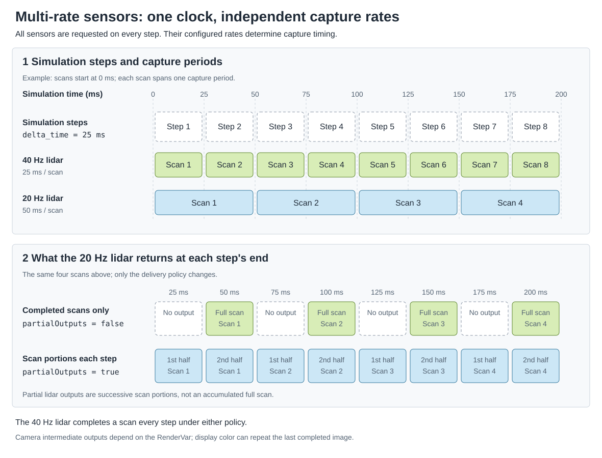

.. SPDX-FileCopyrightText: Copyright (c) 2026 NVIDIA CORPORATION & AFFILIATES. All rights reserved.
.. SPDX-License-Identifier: LicenseRef-NvidiaProprietary

Multi-rate Sensor Simulation
============================

Multi-rate sensor simulation lets cameras and lidars capture data at different
rates within the same simulation, without requiring you to schedule each sensor
yourself. Configure the capture rate on each sensor, then step the simulation
at a cadence that suits your workflow. Keep all enabled sensors in every
:py:meth:`~ovrtx.Renderer.step()` call; the renderer schedules their captures
and returns available outputs automatically. This lets you combine sensors
with different rates without tracking which sensors are due on each step or
changing your simulation loop when their rates change.

.. |multi-rate-python-example| replace:: :doc:`Python example <../examples/python_multi_rate_sensors>`

.. figure:: ../img/multi-rate-sensors-full.avif
   :alt: Camera and lidar outputs at different capture rates during a simulation stepped at 40 Hz
   :align: center
   :width: 100%

   Two cameras and two lidars running at different capture rates in the
   |multi-rate-python-example|. The simulation
   advances in 25 ms steps and requests all four sensors on every step.
   With partial outputs disabled, each sensor returns only completed captures;
   blank cells mark steps with no output. Lidar points are projected from the
   rolling-shutter camera's viewpoint.

The simulation step, a sensor's capture period, and output delivery are separate:

* ``delta_time`` advances the common sensor simulation clock, in seconds.
* ``omni:sensor:frameRate`` schedules each sensor independently, in rational Hz.
* ``omni:sensor:Core:partialOutputs`` controls whether an unfinished capture can
  produce intermediate outputs.

For example, a 20 Hz scanning lidar needs two 1/40-second steps to complete one
scan. Keep it selected during both steps, including the first step with no
completed output. A 40 Hz lidar completes a scan on every step.

   Simulation steps advance a shared clock. Each lidar captures at its own
   configured rate; partialOutputs changes when data is returned without
   changing those capture periods.

Configure Each Sensor
---------------------

Author the rate and output policy on the **sensor prim**, rather than on its
RenderProduct. Give each sensor its own RenderProduct as described in
:doc:`configuration`.

The shared timing API and generic lidar schema provide these controls:

.. csv-table::
   :header: "USD declaration", "Behavior"
   :widths: 50, 50
   :class: compact-table

   "``double2 omni:sensor:frameRate = (0, 1)``", "In OmniSensorAPI, a positive numerator/denominator sets capture frequency in Hz. The generic lidar schema defaults to (10, 1)."
   "``bool omni:sensor:Core:partialOutputs = true``", "In OmniSensorGenericLidarCoreAPI, permits intermediate scan delivery. Set false for completed scans. For cameras, set this policy through the runtime-stage API below."

The following lidar captures forty scans per simulated second and delivers only
completed scans. The Python tab authors the same attributes with OpenUSD:

.. tab-set::

   .. tab-item:: USDA

      .. literalinclude:: ../../examples/python/multi-rate-sensors/multi_rate.usda
         :language: usda
         :start-after: # [snippet:doc-multi-rate-lidar-usda]
         :end-before: # [/snippet:doc-multi-rate-lidar-usda]
         :dedent:

   .. tab-item:: Python (USD)

      .. literalinclude:: ../../tests/docs/usd/test_usd_python_examples.py
         :language: python
         :start-after: # [snippet:doc-multi-rate-lidar-python]
         :end-before: # [/snippet:doc-multi-rate-lidar-python]
         :dedent:

Apply ``OmniSensorAPI`` and use the same ``frameRate`` attribute for a scheduled
camera. Without a positive
authored rate, an ordinary camera is automatically triggered by renderer steps;
it does not acquire a fixed capture rate from ``delta_time`` alone.

For a rolling-shutter camera, also configure the exposure timing. This 20 Hz
camera has a 50 ms exposure span at 240 rows: ``239 / 9560 + 1 / 40 = 1 / 20``
second. Each exposure spans exactly two 25 ms simulation steps:

.. tab-set::

   .. tab-item:: USDA

      .. literalinclude:: ../../examples/python/multi-rate-sensors/multi_rate.usda
         :language: usda
         :start-after: # [snippet:doc-multi-rate-camera-usda]
         :end-before: # [/snippet:doc-multi-rate-camera-usda]
         :dedent:

   .. tab-item:: Python (USD)

      .. literalinclude:: ../../tests/docs/usd/test_usd_python_examples.py
         :language: python
         :start-after: # [snippet:doc-multi-rate-camera-python]
         :end-before: # [/snippet:doc-multi-rate-camera-python]
         :dedent:

See :doc:`cameras/rolling_shutter` for exposure-span and motion-BVH requirements.
The current scheduler reads ``omni:sensor:frameRate``; do not substitute the
legacy ``omni:sensor:tickRate`` spelling.

Stepping Multiple RenderProducts
--------------------------------

The RenderProduct input set identifies the sensors to simulate.
You should always request every sensor in every step, and ovrtx will deliver
back the results that are ready each step. Removing a
product discards its accumulated rendering history. Repeatedly omitting and
re-adding a slow sensor can incur teardown, initialization, and warm-up work.
Do not construct the input set from a list of outputs due this step.

.. tab-set::

   .. tab-item:: Python

      .. literalinclude:: ../../examples/python/multi-rate-sensors/main.py
         :language: python
         :start-after: # [snippet:doc-multi-rate-step]
         :end-before: # [/snippet:doc-multi-rate-step]
         :dedent:

   .. tab-item:: C

      .. literalinclude:: ../../tests/docs/c/test_sensor_configuration.cpp
         :language: cpp
         :start-after: // [snippet:doc-multi-rate-step-c]
         :end-before: // [/snippet:doc-multi-rate-step-c]
         :dedent:

For attached-stage ordering and ordinals, see :doc:`../core/ovstage_integration`.
For C result fetching and lifetime, see :doc:`sensor_outputs`.

Choose When To Deliver Outputs
------------------------------

Set ``omni:sensor:Core:partialOutputs`` through ovstage after loading the scene
and before the first render step. For cameras, adding this attribute only to the
USD scene does not set the runtime output policy. The following snippets apply
the same policy to all four sensors and publish the write before stepping:

.. tab-set::

   .. tab-item:: Python

      .. literalinclude:: ../../examples/python/multi-rate-sensors/main.py
         :language: python
         :start-after: # [snippet:doc-multi-rate-partial-outputs]
         :end-before: # [/snippet:doc-multi-rate-partial-outputs]
         :dedent:

   .. tab-item:: C

      .. literalinclude:: ../../tests/docs/c/test_sensor_configuration.cpp
         :language: cpp
         :start-after: // [snippet:doc-multi-rate-partial-outputs-c]
         :end-before: // [/snippet:doc-multi-rate-partial-outputs-c]
         :dedent:

With ``partialOutputs = false``, a capture spanning several steps accumulates
until it is complete. This is the appropriate policy when a consumer needs a
whole lidar scan or completed camera exposure. It suppresses intermediate
delivery; it does **not** pause the sensor's simulation or eliminate the work
needed to accumulate the capture.

With ``partialOutputs = true``, a step can also deliver partial captures.
The output rate can therefore exceed the authored capture rate. For lidar,
consume the delivered portion of the scan. Camera AOVs have different
intermediate-output semantics. In particular, :ref:`LdrColor <camera-output-tables>`
returns the last completed display image during an unfinished exposure.
Its public output has no ``isFullFrame`` parameter. Use ``partialOutputs = false``
when the consumer requires only newly completed images. See
:doc:`cameras/rolling_shutter` for the per-AOV behavior.

Process only available output:

* Iterate the returned products and all of their frames. A product can be absent
  or have an empty frame list; a sufficiently large step can complete multiple
  frames.
* For lidar, use ``Counts[0]`` to bound delivered point data. A zero count means
  there are no delivered points in that output. It is not a reason to remove
  the lidar from the next step.
* A zero point count alone does not identify an incomplete scan: a completed
  scan can also contain no valid returns. Use sensor timing and output metadata
  when that distinction matters.
* Use frame capture timestamps and point-cloud metadata to associate data with
  simulation time. The time when a result becomes available need not equal the
  capture start time.

For the generic lidar in this example, ``frameId`` advances on intermediate
render calls too; it is not a count of delivered full scans.
The point-cloud motion timestamps ``frameStartTimeStampNs`` and
``frameEndTimeStampNs`` describe the final render slice in an accumulated scan.
Use ``FrameOutput.start_time`` / ``end_time`` for the full capture interval.

In ovrtx 0.6 and later, ``timestampNs`` anchors the delivered point offsets at
the accumulated scan start. The pinned 0.5 package predates this fix: do not
use its ``timestampNs`` as the accumulated scan's start time. The example's
JSON report includes the runtime version and the ``FrameOutput`` capture times.

Observe a Paused Simulation
---------------------------

A normal camera with no positive ``omni:sensor:frameRate`` and no long exposure
can act as an interactive observer of the same scene. After publishing an
observer transform at a new ordinal, step with ``delta_time=0``. This refreshes
the view without advancing the common sensor clock. Do not advance object
animation on these view-only updates.

Keep both the observer and the scheduled sensor products in the input set.
Use ``partialOutputs=false`` on the simulated camera and hold its last completed
image between captures. Stage ordinals order scene writes and renderer reads;
they are independent of elapsed simulation time.

Start this pattern with a positive simulation step. For an instantaneous
scheduled sensor, a zero-time step exactly at its initial ``startTime`` can
trigger a capture. Repeated zero-time warmup at that boundary is not a neutral
observer-only operation.

The :doc:`../examples/c_sensor_observer` example combines a 30 Hz top-down
sensor with a Vulkan observer, pause/resume controls, and a retained sensor inset.

Further Reading
---------------

* :doc:`../examples/python_multi_rate_sensors` — runnable comparison with two
  lidars, two cameras, a timing report, and headless image output.
* :doc:`sensor_outputs` — result iteration, mapping, and output metadata.
* :doc:`pointclouds` — point-cloud tensor layouts and validity.
