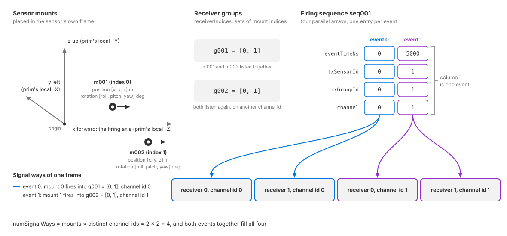

.. SPDX-FileCopyrightText: Copyright (c) 2026 NVIDIA CORPORATION & AFFILIATES. All rights reserved.
.. SPDX-License-Identifier: LicenseRef-NvidiaProprietary
..
.. NVIDIA CORPORATION, its affiliates and licensors retain all intellectual
.. property and proprietary rights in and to this material, related
.. documentation and any modifications thereto. Any use, reproduction,
.. disclosure or distribution of this material and related documentation
.. without an express license agreement from NVIDIA CORPORATION or
.. its affiliates is strictly prohibited.

.. _sensors-nonvisual-acoustic-attributes:

USD Attributes
==============

Apply ``OmniSensorGenericAcousticWpmAPI`` to an ``OmniAcoustic`` prim.
The defaults create one transducer at the prim's origin that transmits and
receives once per cycle. All model attributes belong on that prim.

A *mount* locates a transducer. A *firing event* sends a pulse from one mount
to a group of receivers. Each receiver records a sampled echo envelope on a
channel id; this is a *signal way*. Mounts, receiver groups and firing sequences
define the array and its output shape.

The default operating mode is basic; ``omni:sensor:WpmAcoustic:enableInterference``
selects interference mode. The sections below explain which mode reads each
attribute. See :doc:`Sensor API Schemas <../../reference/schemas>` for declarations
and defaults, :doc:`howto/set_up_sensor` to request ``SignalWays``, and
:doc:`outputs` to read it.

.. _sensors-nonvisual-acoustic-attributes-namespaces:

Attributes use the shared ``omni:sensor:*`` namespace, the model-specific
``omni:sensor:WpmAcoustic:*`` namespace, or an instance namespace for a mount,
receiver group or firing sequence. See :ref:`namespace conventions
<sensors-common-sensor-configuration-namespaces>` and
:ref:`topology attributes <sensors-nonvisual-acoustic-attributes-topology>`.

.. _sensors-nonvisual-acoustic-attributes-identification:

Identification
--------------

``OmniSensorGenericAcousticWpmAPI`` defaults ``omni:sensor:modelName`` to
``"AcousticWPM"``, ``omni:sensor:modelVendor`` to ``"NVIDIA"``,
``omni:sensor:marketName`` to ``"Generic"`` and ``omni:sensor:frameRate``
to ``(30, 1)``. It retains the base-schema defaults for
``omni:sensor:startTime`` (``(0, 1)``) and ``omni:sensor:frameLimit`` (``0``).
The three names are labels; ``frameRate`` schedules the sensor. See
:doc:`Sensor Configuration <../../common/sensor_configuration>` for shared
attributes and :doc:`Sensor Scheduling <../../common/multi_rate>` for
stepping and delivery.

.. _sensors-nonvisual-acoustic-attributes-ray-tracing:

Ray tracing, frame and firing direction
---------------------------------------

Both operating modes use the following controls to sample the space around
each transmitting mount. They affect propagation, not output layout.

- ``omni:sensor:WpmAcoustic:azSpanDeg`` and ``omni:sensor:WpmAcoustic:elSpanDeg``
  are the full angular span, in degrees, of the lobe traced around each mount's
  axis, in azimuth and in elevation. Both default to 90.
- ``omni:sensor:WpmAcoustic:raysPerDeg`` is the ray density per degree along
  each axis, default 3. A lobe therefore carries ``azSpanDeg * raysPerDeg`` by
  ``elSpanDeg * raysPerDeg`` rays, and every firing event traces one lobe from
  its transmitting mount (the events are described under
  :ref:`Mounts, receiver groups and firing sequences
  <sensors-nonvisual-acoustic-attributes-topology>`).
- ``omni:sensor:WpmAcoustic:traceTreeDepth`` is the maximum number of surfaces
  a pulse's path may bounce off before the model stops following it, default
  2. More depth lets more indirect paths reach a receiver: more echoes in the
  envelope, including ghost echoes from paths that bounced more than once, at
  more tracing cost. A depth of 1 keeps single-bounce echoes only: the pulse
  reaches a surface and returns to a receiver from there.

.. warning::

   Tracing cost grows with the ray count. Doubling ``raysPerDeg`` quadruples
   the rays of every lobe, and a wide span at a high density, multiplied by
   several events per cycle and a deeper trace tree, is what makes an acoustic
   frame slow. Raise the density for stable coverage of the surfaces that
   matter, and raise the depth only for a scenario that needs indirect paths.

.. _sensors-nonvisual-acoustic-attributes-firing-axis:

The tracing lobe is centered on the prim's local ``-Z`` axis; see
:ref:`sensor orientation <sensors-common-sensor-configuration-orientation>`.
:doc:`howto/set_up_sensor` shows the example's orientation transform.

.. _sensors-nonvisual-acoustic-attributes-mount-frame:

Mount transforms use the sensor frame:

- ``position``: ``[x, y, z]`` in meters.
- ``rotation``: ``[roll, pitch, yaw]`` in degrees.

The sensor-frame axes are:

- +X: firing direction (prim -Z).
- +Y: left (prim -X).
- +Z: up (prim +Y).

Zero rotation aligns the mount with the firing direction. Roll rotates about
that direction, pitch tilts vertically, and yaw turns horizontally. Mounts
move with the sensor prim. See :ref:`mount attributes
<sensors-nonvisual-acoustic-attributes-topology>`.

Trace depth is the only configurable propagation limit. Other propagation
limits are fixed; see :doc:`Limitations <../../troubleshooting/limitations>`.

.. _sensors-nonvisual-acoustic-attributes-physical-sensor:

Physical sensor
---------------

The following attributes use the ``omni:sensor:WpmAcoustic:`` prefix:

- ``membraneDiameter``: receiving-membrane diameter in meters (default
  ``0.03``). Larger membrane area increases received amplitude. Both operating
  modes use this attribute.
- ``centerFrequency``: transmitted pulse frequency in Hz (default ``51200``).
  Each ``SignalWays`` output reports it as ``centerFrequencyHz``.
- ``bandwidth``: transmitted pulse bandwidth in Hz (default ``3000``).
- ``pulseDuration``: transmitted pulse duration in seconds (default ``0.0025``).
- ``pulsePower``: dimensionless transmitted-pulse power (default ``513.57``).
  It scales echo amplitudes in basic mode and is ignored in interference mode.
- ``sampleDuration``: time between echo-envelope samples in basic mode,
  in seconds (default ``0.0001024``, or 102.4 µs). It determines the range-bin
  spacing and is ignored in interference mode. The output reports it in
  microseconds as ``sampleDurationUs``; see :doc:`Outputs <outputs>` for
  converting sample indices to ranges.

.. _sensors-nonvisual-acoustic-attributes-close-range:

Close range
-----------

Basic mode boosts early echoes at the start of each envelope. Configure the
boost with these attributes under ``omni:sensor:WpmAcoustic:``:

- ``closeRange``: the threshold up to which the boost applies. A value of
  ``0`` or less disables it.
- ``closeRangeDecay``: the point beyond which the boost fades.
- ``closeDirectAmpl`` and ``closeDirectAmplBase``: boost settings for echoes
  received by the transmitting mount.
- ``closeIndirectAmpl`` and ``closeIndirectAmplBase``: boost settings for echoes
  received by another mount.

Interference mode uses a fixed boost and ignores these attributes.

The ``"AM"`` signal mode applies a stronger boost than ``"CHIRP"``; refer to
:ref:`Signal processing <sensors-nonvisual-acoustic-attributes-signal-processing>`.

.. note::

   The defaults of the six are calibration constants, declared with many digits
   in the schema. Author them exactly as declared or leave them unauthored; a
   rounded copy is not the same calibration.

.. _sensors-nonvisual-acoustic-attributes-noise:

Noise
-----

Basic mode adds uniformly distributed noise to each envelope sample after
amplification. ``omni:sensor:WpmAcoustic:noiseMin`` and
``omni:sensor:WpmAcoustic:noiseMax`` set the lower and upper limits
(defaults ``0.3`` and ``1.7``). Both are dimensionless, like envelope amplitudes.

Noise is sampled again for each frame, so envelopes vary even when the scene
is unchanged. Interference mode adds no noise.

Basic-mode noise can produce nonzero samples without an echo. Use the
:ref:`validity flag <sensors-nonvisual-acoustic-outputs-validity>` to identify
responses.

.. _sensors-nonvisual-acoustic-attributes-signal-processing:

Signal processing
-----------------

``omni:sensor:WpmAcoustic:signalMode`` controls amplitude shaping in both
operating modes:

- ``CHIRP`` (default): no additional amplitude boost.
- ``AM``: stronger close-range boost and increased echo amplitudes at ranges
  from 3 m to 4.5 m, relative to ``CHIRP``.

Values are case-insensitive. Any other value rejects the entire parameter
update; see :doc:`Sensor Definition Validation <../../common/validation>`.

``omni:sensor:WpmAcoustic:enableInterference`` selects the
:ref:`operating mode <sensors-nonvisual-acoustic-attributes-operating-modes>`.

Basic mode also uses two coefficient arrays under ``omni:sensor:WpmAcoustic:``:

- ``gainCoeffs``: evaluates a polynomial of the sample's one-way range in
  meters. The result multiplies the sample amplitude.
- ``directivityCoeffs``: evaluates a polynomial of the angle from the mount's
  axis in radians. The result scales both transmission strength and receive
  sensitivity in that direction.

Both arrays list coefficients in ascending power order: element ``0`` is the
constant term, and element *i* multiplies the input raised to power *i*.
Each defaults to seven coefficients; see :doc:`Sensor API Schemas
<../../reference/schemas>` for their values.

Basic mode requires both arrays to be non-empty. Supply complete coefficient
lists or retain the defaults. Interference mode ignores both arrays.

.. _sensors-nonvisual-acoustic-attributes-operating-modes:

Operating modes
---------------

``omni:sensor:WpmAcoustic:enableInterference`` selects the operating mode:

- ``false`` (default): basic mode simulates concurrent transmissions without
  interference between them.
- ``true``: interference mode also simulates interference between concurrent
  transmissions from multiple mounts, at a higher computational cost.

You can :ref:`change the mode while the sensor runs
<sensors-nonvisual-acoustic-attributes-runtime-updates>`.

.. _sensors-nonvisual-acoustic-attributes-mode-reads:

Both modes use:

- Mounts, receiver groups and firing sequences.
- ``azSpanDeg``, ``elSpanDeg`` and ``raysPerDeg`` for ray sampling.
- ``traceTreeDepth`` for tracing depth.
- ``membraneDiameter`` and ``signalMode`` for amplitude processing.

Only basic mode uses:

- ``pulsePower`` and ``sampleDuration``.
- ``gainCoeffs`` and ``directivityCoeffs``.
- The six close-range attributes.
- ``noiseMin`` and ``noiseMax``.

Interference mode uses fixed pulse power, gain, directivity and close-range
boost, with no added noise.

.. _sensors-nonvisual-acoustic-attributes-topology:

Mounts, receiver groups and firing sequences
--------------------------------------------

Apply mount, receiver-group and firing-sequence schema instances to the same
``OmniAcoustic`` prim. Add an instance for each additional mount, group or
sequence.

.. list-table::
   :class: compact-table
   :header-rows: 1
   :widths: 18 34 12 36

   * - Piece
     - Schema
     - Instances
     - Attributes
   * - **Sensor mount**
     - ``OmniSensorWpmAcousticSensorMountAPI``
     - ``m001``, ``m002``, …
     - Where one transducer sits: ``position``, a ``float3`` in meters, and
       ``rotation``, a ``float3`` in degrees as ``[roll, pitch, yaw]``, both in
       the :ref:`sensor's frame <sensors-nonvisual-acoustic-attributes-mount-frame>`.
   * - **Receiver group**
     - ``OmniSensorWpmAcousticRxGroupAPI``
     - ``g001``, ``g002``, …
     - Which mounts listen together: ``receiverIndices``, a ``uint[]`` of
       mount indices. ``[0]`` is a single receiver, ``[0, 1, 2]`` three
       listening together.
   * - **Firing sequence**
     - ``OmniSensorWpmAcousticFiringSeqAPI``
     - ``seq001``, ``seq002``, …
     - One repeating cycle of firing events, as four arrays with one entry per
       event: ``eventTimeNs``, the event's time offset within the cycle in
       nanoseconds; ``txSensorId``, the transmitting mount's index;
       ``rxGroupId``, the listening receiver group's index; and ``channel``,
       the output channel id the result is filed under.

Attribute names follow the instance:
``omni:sensor:WpmAcoustic:sensorMount:<instance>:<attribute>``,
``omni:sensor:WpmAcoustic:rxGroup:<instance>:<attribute>`` and
``omni:sensor:WpmAcoustic:firingSeq:<instance>:<attribute>``.

         sensor frame, two receiver groups drawn as sets of mount indices, a
         firing sequence drawn as four parallel arrays, and arrows from one
         firing event to one signal way per receiver in its group.
   :width: 1180

   How the three pieces fit: mounts ``m001`` and ``m002`` sit in the sensor
   frame with a position and a rotation each; receiver groups ``g001`` and
   ``g002`` are sets of mount indices; a firing sequence is four parallel
   arrays with one entry per event; and one event, from the mount its
   ``txSensorId`` names into the group its ``rxGroupId`` names, writes one
   signal way per receiver of that group, filed under the event's channel id.

.. _sensors-nonvisual-acoustic-attributes-default-topology:

``OmniSensorGenericAcousticWpmAPI`` applies three default schema instances:

- ``OmniSensorWpmAcousticSensorMountAPI:m001``: a mount at the origin with no
  rotation.
- ``OmniSensorWpmAcousticRxGroupAPI:g001``: a receiver group containing mount
  ``0``.
- ``OmniSensorWpmAcousticFiringSeqAPI:seq001``: one firing event at time ``0``,
  from mount ``0`` to group ``0`` on channel ``0``.

Together, these define one transducer that transmits and receives once per
cycle, producing one signal way.

Override the default instances' attributes directly. To add a mount, group
or sequence, apply another schema instance, such as
``OmniSensorWpmAcousticSensorMountAPI:m002``, and author its attributes.

The example scene's sensor prim shows the default topology in use: it applies
the main schema, sets the frame rate and the four ray-tracing attributes, and
authors no mount, group or sequence of its own.

.. tab-set::

   .. tab-item:: USDA
      :sync: usda

      .. literalinclude:: ../../../../examples/python/acoustic/acoustic_example.usda
         :language: usda
         :start-after: # [snippet:configure-acoustic-sensor]
         :end-before: # [/snippet:configure-acoustic-sensor]
         :prepend: #usda 1.0

   .. tab-item:: USD Python
      :sync: python

      .. literalinclude:: ../../../../tests/docs/usd/test_nonvisual_authoring.py
         :language: python
         :start-after: # [snippet:doc-nonvisual-example-configure-acoustic-sensor-python]
         :end-before: # [/snippet:doc-nonvisual-example-configure-acoustic-sensor-python]
         :dedent:

:doc:`Lay Out a Transducer Array <howto/array_topology>` grows this prim into a
two-mount array step by step.

.. _sensors-nonvisual-acoustic-attributes-instance-order:

Mounts, receiver groups and firing sequences are ordered lexicographically by
instance name, ignoring case. ``receiverIndices``, ``txSensorId`` and
``rxGroupId`` index those orderings. Use zero-padded names such as ``m001``
and ``m010``; unpadded ``m10`` sorts before ``m2``. Names differing only in
case identify the same instance. The sensor cycles through firing sequences
in this order, reported by :doc:`cycleIndex <outputs>`.

.. _sensors-nonvisual-acoustic-attributes-parallel-arrays:

A firing sequence is four parallel arrays, one entry per event. Element
*i* of ``eventTimeNs``, ``txSensorId``, ``rxGroupId`` and ``channel`` describes
the same event: when it happens, which mount transmits, which group listens,
and which output channel the result is filed under. Author all four together,
with the same length.

Each event transmits from one mount to all mounts in the receiver group
selected by ``rxGroupId``. Define separate groups for the receiver subsets
your events require.

.. _sensors-nonvisual-acoustic-attributes-channel-ids:

Number channel ids consecutively from ``0``. Use a separate id for each event
whose echoes must remain distinguishable. Each receiving-mount/channel-id
pair has one signal way; see :ref:`output layout
<sensors-nonvisual-acoustic-outputs-slots>`.

.. _sensors-nonvisual-acoustic-attributes-index-repair:

Indices and channel ids range from ``0`` to ``255``. Each of these must be
at most 255:

- The number of mounts.
- The number of distinct channels.
- The mount count multiplied by the distinct channel count (the number of
  signal ways).

Validation does not enforce these capacity limits.

Topology references must satisfy these rules:

- Receiver indices and ``txSensorId`` must refer to existing mounts.
- ``rxGroupId`` must refer to an existing receiver group.
- Each receiver group must contain at least one receiver index.

The sensor removes nonexistent mount indices from receiver groups and
replaces nonexistent ``rxGroupId`` values with group ``0``. It logs both
kinds of correction as errors and continues running with the modified topology.

Validation checks scalar and coefficient attribute types and the value of
``signalMode``. It does not check physical plausibility: implausible values
can be accepted and affect the output. See
:doc:`Sensor Definition Validation <../../common/validation>` for the
validation process.

.. _sensors-nonvisual-acoustic-attributes-runtime-updates:

Runtime updates
---------------

Runtime updates support ray-tracing, physical, close-range, noise and
signal-processing attributes; mount transforms; receiver groups; firing
sequences; and ``enableInterference``. The sensor need not be recreated.
``signalMode`` uses the same update mechanism.

- Accepted edits may reallocate resources and take longer to apply, including changes to scalar
  attributes such as ``noiseMax``, ``pulsePower``, ``sampleDuration`` and
  ``signalMode``. Interference mode does not read
  ``gainCoeffs`` or ``directivityCoeffs``; edits to these take effect when
  basic mode is next selected.
- A frame already in flight finishes on the configuration it started with. The
  sensor itself is not recreated, so its ``frameId`` carries on counting across
  the change.
- :doc:`Runtime Parameter Updates <../../common/runtime_updates>` states the
  outcomes an edit can have and what a rejected update costs.

See :doc:`howto/live_retuning` for checking updates through echoed parameters,
output dimensions and validity flags.

Related
-------

- :doc:`Outputs <outputs>` — the ``SignalWays`` output these attributes shape, its channels, params and validity rule.
- :doc:`Set Up an Acoustic Sensor <howto/set_up_sensor>` — authoring the prim, requesting ``SignalWays`` and reading the first echo.
- :doc:`Lay Out a Transducer Array <howto/array_topology>` — growing one transducer into an array of mounts, receiver groups and firing sequences.
