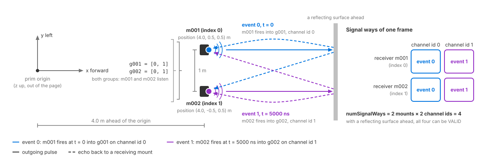

.. SPDX-FileCopyrightText: Copyright (c) 2026 NVIDIA CORPORATION & AFFILIATES. All rights reserved.
.. SPDX-License-Identifier: LicenseRef-NvidiaProprietary
..
.. NVIDIA CORPORATION, its affiliates and licensors retain all intellectual
.. property and proprietary rights in and to this material, related
.. documentation and any modifications thereto. Any use, reproduction,
.. disclosure or distribution of this material and related documentation
.. without an express license agreement from NVIDIA CORPORATION or
.. its affiliates is strictly prohibited.

.. _sensors-nonvisual-acoustic-howto-array-topology:

Lay Out a Transducer Array
==========================

An ``OmniAcoustic`` prim can represent a transducer array. Mounts locate the
transducers, receiver groups select which mounts listen, and firing sequences
schedule transmissions with channel ids. This procedure expands the sensor
from :doc:`set_up_sensor` and checks the resulting ``SignalWays`` layout.

Applying ``OmniSensorGenericAcousticWpmAPI`` supplies mount ``m001``, receiver
group ``g001`` and firing sequence ``seq001``. Override these instances and add
more as needed. See :ref:`the default topology
<sensors-nonvisual-acoustic-attributes-default-topology>` for their values.

Before you start. Start with the working one-transducer sensor from :doc:`set_up_sensor`.
See :ref:`topology attributes <sensors-nonvisual-acoustic-attributes-topology>`
for the three schema groups.

.. _sensors-nonvisual-acoustic-howto-array-topology-mounts:

Add mounts
----------

Keep both the mount count and distinct channel count at or below 255, and
keep their product (the number of signal ways) at or below 255. These limits
are not enforced by parameter validation.

Prepend ``OmniSensorWpmAcousticSensorMountAPI:m002`` to the prim's
``apiSchemas``, then ``m003`` and upwards, one instance per transducer, and
author each instance's ``position`` and ``rotation`` under its own instance
name, ``omni:sensor:WpmAcoustic:sensorMount:m002:position`` and
``omni:sensor:WpmAcoustic:sensorMount:m002:rotation``; ``m001`` is already
applied, so you override its two attributes directly. The units, the sensor
frame both values are relative to and the sense of each rotation are on
:ref:`the mount frame <sensors-nonvisual-acoustic-attributes-mount-frame>`, and
the shape of the names, with their group and instance segments, on
:ref:`namespaces <sensors-nonvisual-acoustic-attributes-namespaces>`.

.. _sensors-nonvisual-acoustic-howto-array-topology-groups:

Group the receivers
-------------------

Add ``OmniSensorWpmAcousticRxGroupAPI:g002`` for another receiver group and
set ``receiverIndices`` to its mount indices. ``[0]`` selects ``m001``;
``[0, 1]`` selects ``m001`` and ``m002``. Each event selects one group, and
each receiver that detects an echo records it. Create a group for each required
receiver subset. The default ``g001`` can be overridden directly.

Every index must name a mount that exists, counting from ``0`` in instance
order, and every group needs a non-empty list (:ref:`the index requirements
<sensors-nonvisual-acoustic-attributes-index-repair>`).

.. _sensors-nonvisual-acoustic-howto-array-topology-firing-sequence:

Write the firing sequence
-------------------------

The main schema includes ``seq001``. Set its four arrays together:
``eventTimeNs``, ``txSensorId``, ``rxGroupId`` and ``channel``. They must have
one entry per event and :ref:`equal lengths
<sensors-nonvisual-acoustic-attributes-parallel-arrays>`. Number channel ids
from zero without gaps; use separate ids for events whose echoes must remain
separable. See :ref:`channel-id requirements
<sensors-nonvisual-acoustic-attributes-channel-ids>` and
:ref:`output slots <sensors-nonvisual-acoustic-outputs-slots>`.

For a second cycle, prepend ``OmniSensorWpmAcousticFiringSeqAPI:seq002`` and
author all four of its arrays; the frames then cycle through the sequences, one
sequence per frame, as :doc:`../outputs` describes under ``cycleIndex``.

.. _sensors-nonvisual-acoustic-howto-array-topology-naming:

Instance ordering
-----------------

The indices in ``receiverIndices``, ``txSensorId`` and ``rxGroupId`` are
positions in the instance names' lexicographic order, so keep the schema's
zero-padded ``m001`` form; the ordering rule, including how names are compared,
is on :ref:`instance order <sensors-nonvisual-acoustic-attributes-instance-order>`.

.. _sensors-nonvisual-acoustic-howto-array-topology-example:

Two-mount example
-----------------

Two mounts, two receiver groups and a two-event cycle on one prim look like
this:

.. tab-set::

   .. tab-item:: USDA
      :sync: usda

      .. literalinclude:: ../../../../../tests/docs/usd/data/nonvisual/acoustic_wpm_howto_array_topology_1.usda
         :language: usda
         :start-after: # [snippet:doc-nonvisual-acoustic-wpm-howto-array-topology-1]
         :end-before: # [/snippet:doc-nonvisual-acoustic-wpm-howto-array-topology-1]

   .. tab-item:: USD Python
      :sync: python

      .. literalinclude:: ../../../../../tests/docs/usd/test_nonvisual_authoring.py
         :language: python
         :start-after: # [snippet:doc-nonvisual-acoustic-wpm-howto-array-topology-1-python]
         :end-before: # [/snippet:doc-nonvisual-acoustic-wpm-howto-array-topology-1-python]
         :dedent:

The two mounts sit 4 m ahead of the prim's origin and 0.5 m above it, one
0.5 m to the left and one 0.5 m to the right, so 1 m apart, both tilted by one
degree about the lateral axis. Both groups hold ``[0, 1]``, so both mounts
listen to every event; two groups are declared so that each event can be given
its own listening subset later, for example ``[1]`` on ``g002`` to let ``m002``
listen alone to its own pulse. The cycle fires ``m001`` at time ``0`` into
``g001`` on channel ``0`` and ``m002`` 5000 ns later into ``g002`` on channel
``1``; the two channel ids keep the two pulses apart at each receiver.

         groups listening, event 0 from the mount at +y (m001, upper in the
         figure) on channel id 0, event 1 from the mount at -y (m002, lower) on
         channel id 1, and the four signal ways they fill.
   :width: 1180

   The worked example from above: two mounts 1 m apart in the sensor frame,
   both groups listening, event 0 from ``m001`` on channel 0, event 1 from
   ``m002`` on channel 1, and the four signal ways that result, one per mount
   and channel id.

.. _sensors-nonvisual-acoustic-howto-array-topology-confirm:

Verification
------------

Render a frame and check the ``SignalWays`` output:

- ``numSignalWays`` reports the number of allocated signal ways. Two mounts
  and channel ids ``0`` and ``1`` give ``4``.
- Count the entries whose ``Flags`` contain the ``VALID`` bit to find how many
  signal ways received an echo. In this example, each firing event uses both
  mounts as receivers, so all four signal ways can be valid with a reflecting
  surface in front of the array.

See :doc:`../outputs` for the channels and parameters. After changing the
layout, compare these counts before and after the edit; :doc:`live_retuning`
explains the procedure and why the valid count may not increase.

Use :doc:`../../../common/validation` to check the sensor definition before
rendering.

.. _sensors-nonvisual-acoustic-howto-array-topology-symptoms:

Potential issues
----------------

- **An index selects the wrong mount or group.** ``receiverIndices``,
  ``txSensorId`` and ``rxGroupId`` use zero-based positions in lexicographically
  sorted instance names. Use zero-padded names so their lexical and numeric
  order agree; see :ref:`instance order
  <sensors-nonvisual-acoustic-attributes-instance-order>`.
- **A receiver index produces an error.** The index refers to a nonexistent
  mount, so the model removes it from the receiver group. Correct the index
  and ensure the group contains at least one receiver; see
  :ref:`index requirements
  <sensors-nonvisual-acoustic-attributes-index-repair>`.
- **A group index produces an error and the event uses group 0.** The event's
  ``rxGroupId`` refers to a nonexistent group, so the model substitutes group
  ``0``. Set it to the index of the intended receiver group; see
  :ref:`index requirements
  <sensors-nonvisual-acoustic-attributes-index-repair>`.

See the :doc:`Symptom Index <../../../troubleshooting/symptoms>` for other
sensor issues.

Related
-------

- :doc:`USD Attributes <../attributes>` — the three schema groups and their attribute names, the mount frame, the ordering rule, the parallel arrays and the index requirements.
- :doc:`Outputs <../outputs>` — signal ways, where each one sits in the output, the two senses of "channel", and the ``numSignalWays``, ``cycleIndex`` and ``Flags`` reads.
- :doc:`Retune the Sensor While It Runs <live_retuning>` — proving from the output that an edit reached the model.
- :doc:`Sensor Configuration <../../../common/sensor_configuration>` — applying schemas, overriding attributes and orienting any sensor prim.
- :doc:`Acoustic example <../../../../examples/python_sensor_acoustic>` — the runnable one-transducer scene.
