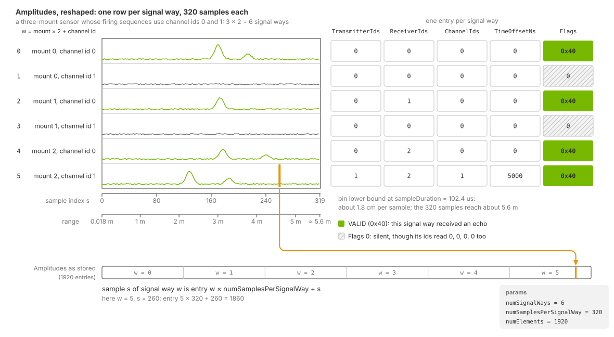

.. SPDX-FileCopyrightText: Copyright (c) 2026 NVIDIA CORPORATION & AFFILIATES. All rights reserved.
.. SPDX-License-Identifier: LicenseRef-NvidiaProprietary
..
.. NVIDIA CORPORATION, its affiliates and licensors retain all intellectual
.. property and proprietary rights in and to this material, related
.. documentation and any modifications thereto. Any use, reproduction,
.. disclosure or distribution of this material and related documentation
.. without an express license agreement from NVIDIA CORPORATION or
.. its affiliates is strictly prohibited.

.. _sensors-nonvisual-acoustic-outputs:
.. _sensors-channels-acoustic:

Outputs
=======

The Acoustic generic wpm model delivers a ``SignalWays`` composite output
containing six channels and seven parameters. Each signal way holds the sampled
echo envelope for one receiving mount on one channel id. The array topology
determines the number and order of signal ways; :doc:`attributes` describes
how to configure it.

``SignalWays`` has no
``Counts`` channel, no per-point ``VALID`` flag, no coordinates, no
coordinate-type, frame-of-reference or pose params, and no material identifier:
the frame's extent comes from its params, and nothing in it is a position. Use the layout and validity rules below when reading it.
:doc:`../../common/sensor_outputs` describes the shared output container.

.. _sensors-nonvisual-acoustic-outputs-requesting:

Requesting the output
---------------------

Request ``SignalWays`` with a single RenderVar whose ``sourceName`` is
``SignalWays``. This composite output includes all six channels and the frame
header. The model ignores the RenderVar's ``channels`` list; individual
channels cannot be selected.

Channel tensors are stored in device memory; parameters are stored on the
host. Map the output to CPU memory to read it with NumPy, or pass the device
tensors to a CUDA-aware consumer. See :doc:`../../common/sensor_outputs` for
both approaches and the :ref:`C API <c-api-sensor-types>` and
:ref:`Python API <python-api-render-outputs>` for the container definitions.

:doc:`howto/set_up_sensor` shows the complete sensor setup.
:doc:`../../common/output_configuration` explains RenderProducts and
RenderVars.

The acoustic example scene authors this request:

.. tab-set::

   .. tab-item:: USDA
      :sync: usda

      .. literalinclude:: ../../../../examples/python/acoustic/acoustic_example.usda
         :language: usda
         :start-after: # [snippet:configure-acoustic-output]
         :end-before: # [/snippet:configure-acoustic-output]
         :prepend: #usda 1.0

   .. tab-item:: USD Python
      :sync: python

      .. literalinclude:: ../../../../tests/docs/usd/test_nonvisual_authoring.py
         :language: python
         :start-after: # [snippet:doc-nonvisual-example-configure-acoustic-output-python]
         :end-before: # [/snippet:doc-nonvisual-example-configure-acoustic-output-python]
         :dedent:

The model takes its frame rate from the shared ``omni:sensor:frameRate``
attribute, which the example scene sets to 10 Hz, and it declares no
partial-output mode. How the renderer schedules captures against your
simulation steps is on :doc:`../../common/multi_rate`. The model also needs the
renderer's motion BVH active. Select ``AUTO`` or ``ENABLE`` when creating the
renderer; the
switch and its modes are under
:ref:`Motion BVH <sensors-common-output-configuration-motion-bvh>`.

.. _sensors-nonvisual-acoustic-outputs-signal-way:
.. _sensors-acoustic-signal-way:

Signal ways
-----------

A signal way contains the envelope recorded by one receiving mount on one
channel id, plus transmitter, receiver, channel and firing-time metadata.
Each firing event transmits from one mount to a receiver group. Receivers
that detect an echo populate their corresponding signal ways. For example:

.. list-table::
   :class: compact-table
   :header-rows: 1
   :widths: 30 70

   * - A firing event with
     - Produces
   * - Transmitter: sensor mount ``0``

       Receiver group: ``g001`` with receivers ``[0, 1, 2]``

       Channel id: ``0``
     - **Three signal ways**, one per receiver: 0 to 0, 0 to 1 and 0 to 2, all
       on channel id ``0``. Each holds the samples showing how the pulse reached
       that particular receiver.

Events in the same firing sequence share a signal way when they use the same
receiver and channel id, even if their transmitters differ. Their echoes
combine, while ``TransmitterIds`` and ``TimeOffsetNs`` can identify only one
event. Assign separate channel ids when events must remain distinguishable;
see :doc:`attributes` and :doc:`howto/array_topology`.

.. _sensors-nonvisual-acoustic-outputs-channel-meanings:
.. _sensors-acoustic-channel-meanings:

A *channel id* is a firing event's integer ``channel`` label. A *channel* is a
named tensor in the ``SignalWays`` output. See the
:ref:`glossary <sensors-reference-glossary-channel-senses>` for other uses.

.. _sensors-nonvisual-acoustic-outputs-slots:
.. _sensors-channels-acoustic-slots:

Signal-way layout
-----------------

Each frame reserves ``numSignalWays = mountCount * channelCount`` slots,
one for every combination of mount and distinct channel id used across all
firing sequences. Slots are allocated even for combinations that receive no
echo.

The slot index is ``receiverIndex * channelCount + channelId``:

- ``receiverIndex`` is the mount's zero-based position in
  :ref:`instance order <sensors-nonvisual-acoustic-attributes-instance-order>`.
- ``channelCount`` is the number of distinct channel ids across all firing
  sequences.
- ``channelId`` is the firing event's channel id. Channel ids must be
  contiguous from zero.

Each frame contains echoes from one firing sequence. A slot's ``Flags`` entry
has the ``VALID`` bit (``0x40``) set when its receiver received an echo in that
frame. ``numSignalWays`` describes the allocated layout, not the number of
valid echoes.

Reshape ``Amplitudes`` to ``[numSignalWays, numSamplesPerSignalWay]`` to get
one envelope per row. The five metadata channels describe those rows; their
entry at index ``w`` describes signal way ``w``. See `Channels`_ for tensor
shapes and read bounds, and the
:ref:`attribute reference <sensors-nonvisual-acoustic-attributes-index-repair>`
for configuration limits.

ry per row, and the VALID bit of Flags marks the rows that received an echo. An axis under the columns converts the sample index to range in meters.
   :align: center
   :width: 100%

   Three mounts and two channel ids allocate six signal ways, shown here with
   320 samples per envelope. Metadata entries correspond to envelope rows;
   ``Flags`` identifies rows that received echoes. The range axis uses the
   default sample duration.

.. _sensors-nonvisual-acoustic-outputs-channels:

Channels
--------

Every channel is a flat tensor of ``E`` entries, where ``E`` is the
``numElements`` param: signal ways times samples per signal way. Only
``Amplitudes`` uses all of them; the other five describe a signal way as a whole.

.. list-table::
   :class: compact-table
   :header-rows: 1
   :widths: 15 8 8 7 62

   * - Channel
     - Type
     - Shape
     - Unit
     - Meaning
   * - ``TransmitterIds``
     - ``float32``
     - ``[E]``
     - unitless
     - Index of the transmitting mount, the firing event's ``txSensorId``, for
       the signal way at this index. One entry per signal way.
   * - ``ReceiverIds``
     - ``float32``
     - ``[E]``
     - unitless
     - Index of the receiving mount for the signal way at this index: a mount
       index, not a receiver-group index. One entry per signal way.
   * - ``ChannelIds``
     - ``float32``
     - ``[E]``
     - unitless
     - Channel id of the firing event that produced the signal way, as authored
       in the firing sequence's ``channel`` array. One entry per signal way.
   * - ``Amplitudes``
     - ``float32``
     - ``[E]``
     - unitless
     - Echo amplitude of one envelope sample. The one genuinely per-sample
       channel: sample *s* of signal way *w* is entry
       ``w * numSamplesPerSignalWay + s``.
   * - ``TimeOffsetNs``
     - ``int32``
     - ``[E]``
     - ns
     - Firing time of the signal way's event within its firing sequence, the
       authored ``eventTimeNs``, in whole nanoseconds. One entry per signal way.
   * - ``Flags``
     - ``uint8``
     - ``[E]``
     - unitless
     - The ``VALID`` bit (``0x40``) at a signal way's own index when that signal
       way received an echo this frame; zero everywhere else. One entry per
       signal way, not per sample, in both operating modes. Refer to
       `Validity`_.

.. _sensors-nonvisual-acoustic-outputs-identity-layout:
.. _sensors-channels-acoustic-identity-layout:

In both operating modes, ``TransmitterIds``, ``ReceiverIds``, ``ChannelIds``,
``TimeOffsetNs`` and ``Flags`` use one entry per signal way. Entry *w*
describes row *w* of the reshaped ``Amplitudes`` tensor. Entries beyond
``numSignalWays`` are zero. A signal way with no echo also has zero metadata,
so use ``Flags`` to distinguish it from a valid echo whose identifiers and
time offset are all zero; see `Validity`_.

.. _sensors-nonvisual-acoustic-outputs-ids-are-floats:
.. _sensors-channels-acoustic-ids-are-floats:

``TransmitterIds``, ``ReceiverIds`` and ``ChannelIds`` are ``float32`` tensors.
Cast their values to integers before using them as indices, as shown in
`Reading an envelope`_.

.. _sensors-nonvisual-acoustic-outputs-params:
.. _sensors-channels-acoustic-params:

Params
------

Every frame includes the following seven CPU-resident parameters as tensors
of shape ``[1]``, including frames that were not traced.

.. list-table::
   :class: compact-table
   :header-rows: 1
   :widths: 26 9 65

   * - Param
     - Type
     - Meaning
   * - ``frameId``
     - ``uint64``
     - The model's own frame counter. It advances with every frame the renderer
       does not discard, traced or not, and a live reconfiguration does not
       reset it.
   * - ``numSignalWays``
     - ``uint32``
     - Signal ways the frame is laid out for: one for every pairing of a mount,
       as receiver, with a channel id used anywhere in the firing sequences. It
       counts signal ways with no echo too; the ``VALID`` bit says which
       ones did.
   * - ``numSamplesPerSignalWay``
     - ``uint32``
     - Envelope samples per signal way. A model constant, 320, not derived from
       ``pulseDuration`` or ``sampleDuration`` and not stated in the schema.
   * - ``numElements``
     - ``uint32``
     - ``numSignalWays * numSamplesPerSignalWay``: the length ``E`` of every
       channel.
   * - ``cycleIndex``
     - ``uint32``
     - Zero-based index of the firing sequence this frame traced, in the
       instance-name order of :doc:`attributes`, so ``seq001`` is ``0``. The
       model advances it once per traced frame and wraps it after the last
       sequence.
   * - ``centerFrequencyHz``
     - ``float32``
     - The authored ``centerFrequency``, in Hz.
   * - ``sampleDurationUs``
     - ``float32``
     - The authored ``sampleDuration``, converted from seconds to microseconds.
       The value the conversion under `Sample ranges`_ uses.

Use ``numSignalWays`` and ``numSamplesPerSignalWay`` to reshape the
``numElements`` samples. Read these dimensions from the output params.
Count valid signal ways from ``Flags``; no parameter reports this count.

In basic mode, ``sampleDuration`` controls range spacing. Mounts and distinct
firing-sequence channel ids determine ``numSignalWays``; receiver groups
determine which signal ways receive echoes. The 320-sample length and layout
are fixed. See :doc:`attributes` for these controls and the
``enableInterference`` mode selector, and `Validity`_ for the basic-mode
noise bounds ``noiseMin`` and ``noiseMax``.

.. _sensors-nonvisual-acoustic-outputs-validity:
.. _sensors-channels-acoustic-validity:

Validity
--------

Read the first ``numSignalWays`` entries of ``Flags``. Signal way *w*
received an echo when ``Flags[w] & 0x40`` is nonzero. In both operating modes,
the model sets only this ``VALID`` bit. It applies to the whole envelope,
not individual samples. Bound amplitude reads by ``numElements``.
See :doc:`../../common/sensor_outputs` for validity-bit handling.

Basic mode adds uniform noise even to envelopes with no echo. Nonzero
amplitude therefore does not establish validity; use ``Flags``.
:ref:`noiseMin and noiseMax <sensors-nonvisual-acoustic-attributes-noise>`
set the noise bounds.

.. _sensors-nonvisual-acoustic-outputs-first-frames:

Startup frames
--------------

The first frames after sensor startup contain no echo data and have no
identifying parameter. Discard a few frames before reading envelopes; the
example takes three warm-up steps (:doc:`howto/set_up_sensor`). Renderer
warm-up for texture streaming and path-tracing convergence is described in
:doc:`../../common/output_configuration`. If no frame contains echo data,
see the :doc:`Symptom Index <../../troubleshooting/symptoms>`.

.. _sensors-nonvisual-acoustic-outputs-reading:
.. _sensors-channels-acoustic-shape:

Reading an envelope
-------------------

Map ``SignalWays`` to CPU memory. Reshape ``Amplitudes`` using
``numSignalWays`` and ``numSamplesPerSignalWay``, then read the first
``numSignalWays`` identity entries and cast them to integers. This Python
example handles frames with no signal ways before reshaping. The acoustic
example has no C counterpart:

.. literalinclude:: ../../../../examples/python/acoustic/main.py
   :language: python
   :start-after: # [snippet:read-acoustic-signal-ways]
   :end-before: # [/snippet:read-acoustic-signal-ways]
   :dedent:

The function also carries ``sampleDurationUs`` out of the params, converted to
seconds, because the next step needs it. Mapping, synchronization and the
lifetime of a mapped output are the same for every composite output and are
explained on :doc:`../../common/sensor_outputs`.

.. _sensors-nonvisual-acoustic-outputs-range:

Sample ranges
-------------

In basic mode (``enableInterference`` false, the default), bin *s* covers
round-trip times from *(s + 1) Δt* up to *(s + 2) Δt*, excluding the upper
bound. Here *Δt* is ``sampleDurationUs`` converted to seconds. Multiply either
time bound by 343.21 m/s and divide by two to obtain its range bound.
Read the duration from the frame parameters because it can change at runtime.

The example plots each sample at the lower bound of its range bin:

.. literalinclude:: ../../../../examples/python/acoustic/main.py
   :language: python
   :start-after: # [snippet:acoustic-sample-index-to-range]
   :end-before: # [/snippet:acoustic-sample-index-to-range]
   :dedent:

At the default ``sampleDuration`` of 102.4 µs, samples are about 1.8 cm apart
in range, and the 320-sample envelope covers about 5.6 m. Selecting the peak
sample gives a range estimate at that spacing.

Increasing ``sampleDuration`` extends the range covered by the envelope but
increases the spacing between samples. Decreasing it gives finer spacing over
a shorter range. Coverage remains subject to the model's
:doc:`fixed propagation limits <../../troubleshooting/limitations>`.

Multiple propagation paths can produce several peaks from one pulse. Ground
or secondary-surface reflections add longer paths; different points on an
extended reflector also have different path lengths. The strongest sample can
therefore lie beyond the nearest surface. When estimating one range from the
peak, account for this ambiguity and the sample spacing. In the example, the
strongest sample identifies the concrete wall 3.0 m ahead of the sensor.

Related
-------

- :doc:`USD Attributes <attributes>` — the mounts, receiver groups and firing sequences that shape the output, the instance ordering, the channel-id rule, the operating modes and the noise bounds.
- :doc:`Set Up an Acoustic Sensor <howto/set_up_sensor>` — the RenderProduct and RenderVar that request ``SignalWays``, the warm-up steps and the first read.
- :doc:`Lay Out a Transducer Array <howto/array_topology>` — growing one transducer into an array and confirming the layout from ``numSignalWays``.
- :doc:`Retune the Sensor While It Runs <howto/live_retuning>` — proving from the params and the ``VALID`` counts that an edit reached the model.
- :doc:`Acoustic example <../../../examples/python_sensor_acoustic>` — the runnable scene and reader the snippets on this page come from.
