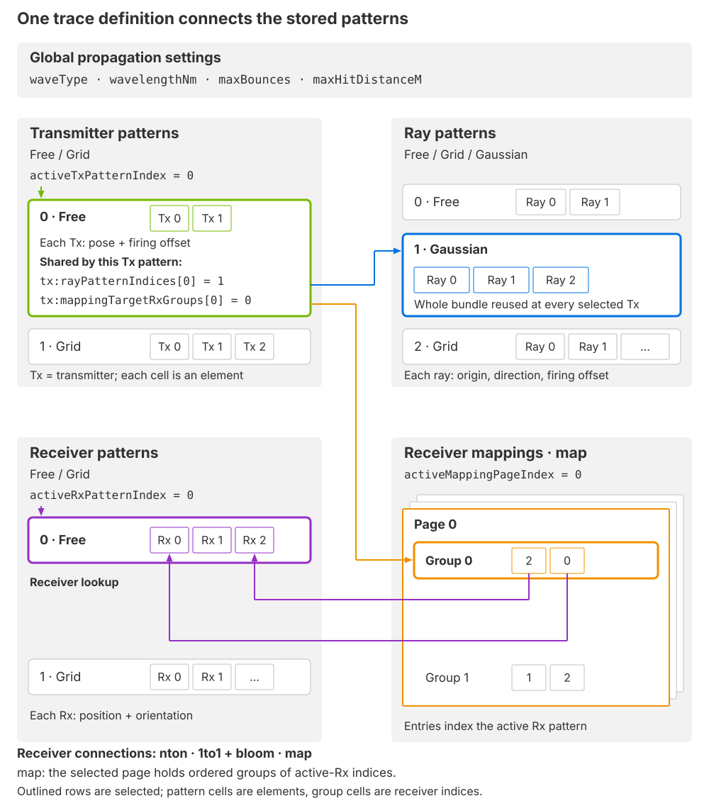
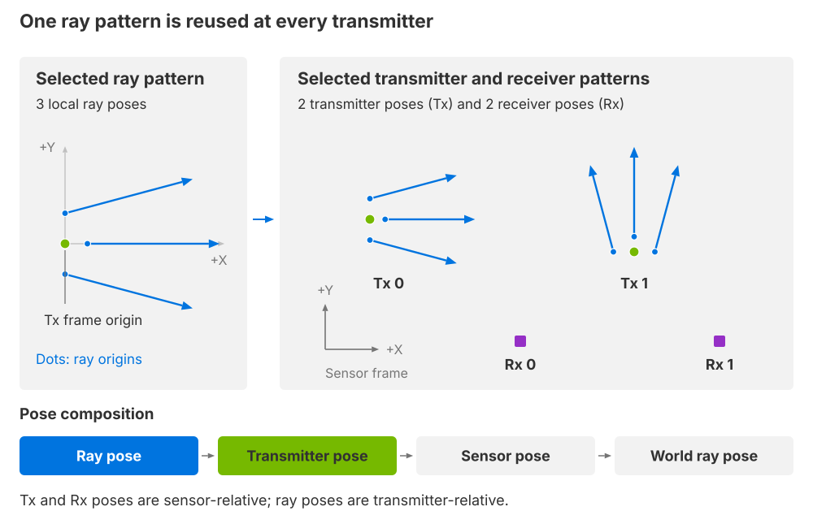

.. SPDX-FileCopyrightText: Copyright (c) 2026 NVIDIA CORPORATION & AFFILIATES. All rights reserved.
.. SPDX-License-Identifier: LicenseRef-NvidiaProprietary
..
.. NVIDIA CORPORATION, its affiliates and licensors retain all intellectual
.. property and proprietary rights in and to this material, related
.. documentation and any modifications thereto. Any use, reproduction,
.. disclosure or distribution of this material and related documentation
.. without an express license agreement from NVIDIA CORPORATION or
.. its affiliates is strictly prohibited.

.. _sensors-nonvisual-generic-wpm-attributes:

USD Attributes
==============

Author model and pattern attributes on the ``OmniGeneralSensor`` prim under
``omni:sensor:GenericWpm:``. The ``channels`` attribute belongs to the RenderVar.
Refer to :doc:`Sensor API Schemas <../../reference/schemas>` for complete
attribute declarations, types and schema defaults.

Sensor definition
-----------------

Instantiate an ``OmniGeneralSensor`` prim and apply ``OmniSensorGenericWpmAPI``.
It includes the following APIs:

* ``OmniSensorGenericWpmTxAPI`` defines transmitter patterns and their ray and receiver assignments.
* ``OmniSensorGenericWpmRxAPI`` defines receiver patterns.
* ``OmniSensorGenericWpmRayAPI`` defines ray bundles.
* ``OmniSensorGenericWpmTxRxMappingAPI`` defines explicit receiver groups.

The pattern APIs also include the Free, Grid and, for rays, Gaussian pattern
attributes. All attributes are authored on the sensor prim. Separate named API
instances are not needed.

Define at least one pattern for each role and assign a ray bundle and mapping
mode to each transmitter pattern. Empty schema arrays do not create a default
sensor. Connect the sensor to a RenderProduct through its ``camera`` relationship
and request one :doc:`Contributions <outputs>` RenderVar through
``orderedVars``.

The example base authors the sensor and its output request. The USD Python tab
assumes an existing USD ``stage``; add a pattern from :doc:`How-To <howto/index>`
to complete the sensor:

.. tab-set::

   .. tab-item:: USDA
      :sync: usda

      .. literalinclude:: ../../../../tests/docs/usd/data/generic_wpm_base.usda
         :language: usda
         :start-after: # [snippet:doc-generic-wpm-base]
         :end-before: # [/snippet:doc-generic-wpm-base]
         :prepend: #usda 1.0
         :caption: ``generic_wpm_base.usda``, from the runnable :doc:`Python example <../../../examples/python_generic_wpm>`; the C example uses the same scene.

   .. tab-item:: USD Python
      :sync: python

      .. literalinclude:: ../../../../tests/docs/usd/test_generic_wpm_usda.py
         :language: python
         :start-after: # [snippet:doc-generic-wpm-imports-python]
         :end-before: # [/snippet:doc-generic-wpm-imports-python]
         :dedent:

      .. literalinclude:: ../../../../tests/docs/usd/test_generic_wpm_usda.py
         :language: python
         :start-after: # [snippet:doc-generic-wpm-base-python]
         :end-before: # [/snippet:doc-generic-wpm-base-python]
         :dedent:

The pattern frames use the sensor coordinate convention described below;
the prim's placement follows :ref:`Sensor Configuration
<sensors-common-sensor-configuration-orientation>`.

**One RenderProduct per independently configured sensor.** Use
:ref:`independent products <sensors-common-output-configuration-independent-products>`
when configurations differ. Multiple sensor
prims on one product form pose-only tiles whose configuration comes from the
first sensor. Refer to :ref:`tiled output <sensors-nonvisual-generic-wpm-outputs-tiles>`.

Identification and scheduling
-----------------------------

Keep the schema's model name and vendor unchanged: configuration acceptance
validates both. ``marketName`` remains a descriptive label. The schema sets these
four shared attributes:

.. list-table::
   :header-rows: 1
   :widths: 60 40
   :class: compact-table

   * - USD declaration
     - Description
   * - ``string omni:sensor:modelName = "GenericWpm"``
     - Selects this model on an ``OmniGeneralSensor``.
   * - ``string omni:sensor:modelVendor = "NVIDIA"``
     - The vendor required for configuration acceptance.
   * - ``string omni:sensor:marketName = "Generic"``
     - A label for this parameterization.
   * - ``double2 omni:sensor:frameRate = (10, 1)``
     - Complete captures per second, expressed as rational Hz.

Refer to :ref:`shared attributes
<sensors-common-sensor-configuration-shared-attributes>` and
:doc:`Sensor Scheduling <../../common/multi_rate>` for the remaining shared
controls. Firing offsets describe events in each complete capture; they do not
split a scan across successive frames.

.. _sensors-nonvisual-generic-wpm-attributes-patterns:

Patterns and selection
----------------------

A pattern is an ordered collection of elements. The role determines what each
element represents:

- A **transmitter pattern** contains emitting elements, each with a position,
  orientation and firing offset.
- A **ray pattern**, or ray bundle, contains samples emitted by each transmitter.
  Each sample has a local origin, direction and firing offset.
- A **receiver pattern** contains receiving elements, each with a position and
  orientation. Receiver mapping chooses which of them participate in a path.

Store several patterns when different captures need different layouts. One
transmitter pattern and one receiver pattern are active in a capture. The
selected transmitter pattern assigns a ray bundle and a receiver-mapping rule
to every transmitter it contains. These assignments belong to the pattern,
not to individual transmitter elements. See :doc:`Switch Stored Patterns
<howto/runtime_updates>` for a complete recipe.

Together with the :ref:`propagation controls
<sensors-nonvisual-generic-wpm-attributes-propagation>`, these patterns and
receiver mappings form the **trace definition**. It specifies which rays to
launch, which receiver connections to evaluate and how far to follow paths
through the scene:

   *A trace definition combines propagation settings with selected geometry
   and receiver connections. Each transmitter, ray or receiver row is a
   stored pattern; its cells are elements. The selected transmitter pattern
   shares one ray bundle and one receiver-mapping rule across all its
   elements. Explicit mapping selects a page, then a group whose entries
   identify receivers in the selected receiver pattern. Schematic, not to
   scale.*

Pattern and element axes are logical dimensions; a Free pattern does not have
to place its elements on a spatial grid. Mapping pages add a page axis to
ordered receiver groups. Use the ray bundle's angular distribution to choose
where directions are sampled; :ref:`Directivity and ray sampling
<sensors-nonvisual-generic-wpm-howto-beam-sampling-directivity>` illustrates
this choice. Angular sampling does not provide antenna-gain tables or per-ray
weights.

Each role has its own ordered list of patterns. An index into the transmitter
list does not select the same-numbered receiver or ray pattern. A selected
pattern with two transmitters and a bundle of three rays emits six rays:
three at each transmitter pose. Receiver connections and bounce capacity
determine how many :ref:`contribution slots
<sensors-nonvisual-generic-wpm-outputs-layout>` those rays can produce.
Follow an emitted ray through scene hits and receiver connections in
:ref:`Paths and contributions <sensors-nonvisual-generic-wpm-outputs-paths>`.

.. list-table::
   :header-rows: 1
   :widths: 60 40
   :class: compact-table

   * - USD declaration
     - Description
   * - | ``token[] omni:sensor:GenericWpm:tx:patternTypes = []``
     - Transmitter alternatives, using ``free`` or ``grid``. Required and nonempty.
   * - | ``token[] omni:sensor:GenericWpm:rx:patternTypes = []``
     - Receiver alternatives, using ``free`` or ``grid``. Required and nonempty.
   * - | ``token[] omni:sensor:GenericWpm:ray:patternTypes = []``
     - Ray-bundle alternatives, using ``free``, ``grid`` or ``gaussian``. Required and nonempty.
   * - | ``uint[] omni:sensor:GenericWpm:tx:rayPatternIndices = []``
     - One valid index into ``ray:patternTypes`` per transmitter pattern.
   * - | ``uint omni:sensor:GenericWpm:activeTxPatternIndex = 0``
     - Selects the active transmitter pattern.
   * - | ``uint omni:sensor:GenericWpm:activeRxPatternIndex = 0``
     - Independently selects the active receiver pattern.
   * - | ``uint omni:sensor:GenericWpm:activeMappingPageIndex = 0``
     - Selects the mapping page in ``map`` mode. Ignored for ``nton`` and ``1to1``.

There is no separate active-ray selector. Changing ``activeTxPatternIndex``
also selects the bundle assigned by ``tx:rayPatternIndices``.

Pattern data is stored in flat family arrays. Each occurrence of a family in
``patternTypes`` consumes its next family row. For ``["free", "grid", "free"]``,
the lookup is:

.. list-table::
   :header-rows: 1
   :widths: 22 23 55
   :class: compact-table

   * - Role-pattern index
     - Family
     - Family row
   * - 0
     - ``free``
     - Free row 0, whose count identifies the first group of packed poses.
   * - 1
     - ``grid``
     - Grid row 0, whose dimensions generate its elements.
   * - 2
     - ``free``
     - Free row 1, whose poses follow Free row 0's elements.

Selectors and ``tx:rayPatternIndices`` address role-pattern indices. Family rows
locate the data used to construct those patterns; element indices identify
transmitters, receivers or rays inside one pattern. These three indices are
distinct.

.. _sensors-nonvisual-generic-wpm-attributes-frames:

Coordinate frames
-----------------

   *The selected ray bundle is reused at each transmitter pose. Its local
   origins and directions move with that transmitter. Receiver poses are
   independent of the transmitter poses. Schematic, not to scale.*

Transmitter and receiver poses are relative to the sensor. Ray poses are
relative to the transmitter. Positions must be finite and are in meters.
Orientations are finite unit quaternions in ``(x, y, z, w)`` order;
identity is ``(0, 0, 0, 1)``.
Local +X is forward. A ray orientation rotates +X into its emission direction.

For Free patterns, each element has its own pose. For Grid and Gaussian
patterns, the pose transforms the generated pattern. Ray geometry is composed
with the transmitter pose and then with the sensor prim's transform and motion.

For example, rotating one transmitter rotates its entire ray bundle; it does
not change the stored local ray directions. A nonzero ray origin offsets the
emission point from that transmitter. Receiver orientation defines the frame
used by receiver-relative output channels; it does not author a receiver gain
pattern. Refer to :ref:`output channels
<sensors-nonvisual-generic-wpm-outputs-channels>` for the coordinate frame of
each reported position.

.. _sensors-nonvisual-generic-wpm-attributes-free:

Free patterns
-------------

Free patterns explicitly place individual transmitters, receivers or rays.
Use them for irregular layouts or measured element positions. See :doc:`Connect Independent Transmitters and Receivers <howto/receiver_layouts>` for a complete recipe.

The prefix is ``freePatterns:<role>:``, where ``<role>`` is ``tx``, ``rx`` or
``ray``. For example, transmitter positions use
``omni:sensor:GenericWpm:freePatterns:tx:positions``.

.. list-table::
   :header-rows: 1
   :widths: 60 40
   :class: compact-table

   * - USD declaration
     - Description
   * - | ``uint[] omni:sensor:GenericWpm:freePatterns:tx:numElementsPerPattern = []``
       | ``uint[] omni:sensor:GenericWpm:freePatterns:rx:numElementsPerPattern = []``
       | ``uint[] omni:sensor:GenericWpm:freePatterns:ray:numElementsPerPattern = []``
     - One positive element count per Free pattern. Counts partition the packed pose arrays.
   * - | ``float3[] omni:sensor:GenericWpm:freePatterns:tx:positions = []``
       | ``float3[] omni:sensor:GenericWpm:freePatterns:rx:positions = []``
       | ``float3[] omni:sensor:GenericWpm:freePatterns:ray:positions = []``
     - One finite position per element, in meters.
   * - | ``float4[] omni:sensor:GenericWpm:freePatterns:tx:orientations = []``
       | ``float4[] omni:sensor:GenericWpm:freePatterns:rx:orientations = []``
       | ``float4[] omni:sensor:GenericWpm:freePatterns:ray:orientations = []``
     - One unit xyzw quaternion per element.

Both pose arrays must contain the sum of ``numElementsPerPattern``.
For counts ``[2, 1]``, the first two poses belong to Free pattern 0 and the third
to Free pattern 1. Empty poses do not imply an origin or identity orientation.
Firing-time attributes for Tx and ray elements are described under
:ref:`generic-wpm-timing`.

.. _sensors-nonvisual-generic-wpm-attributes-grid:

Grid patterns
-------------

Grid patterns generate regularly spaced elements. The prefix is
``gridPatterns:<role>:`` for ``tx``, ``rx`` or ``ray``.
Every geometry array below must have one entry per Grid pattern of that role. See :doc:`Sample a Depth Grid <howto/depth_sampling>` for a complete recipe.

.. list-table::
   :header-rows: 1
   :widths: 60 40
   :class: compact-table

   * - USD declaration
     - Description
   * - | ``token[] omni:sensor:GenericWpm:gridPatterns:tx:modes = []``
       | ``token[] omni:sensor:GenericWpm:gridPatterns:rx:modes = []``
       | ``token[] omni:sensor:GenericWpm:gridPatterns:ray:modes = []``
     - Geometry: ``SPHERICAL``, ``PLANAR`` or ``CYLINDRICAL``.
   * - | ``uint[] omni:sensor:GenericWpm:gridPatterns:tx:numRows = []``
       | ``uint[] omni:sensor:GenericWpm:gridPatterns:rx:numRows = []``
       | ``uint[] omni:sensor:GenericWpm:gridPatterns:ray:numRows = []``
       | ``uint[] omni:sensor:GenericWpm:gridPatterns:tx:numCols = []``
       | ``uint[] omni:sensor:GenericWpm:gridPatterns:rx:numCols = []``
       | ``uint[] omni:sensor:GenericWpm:gridPatterns:ray:numCols = []``
     - Positive row and column counts. Their product is the pattern's element count.
   * - | ``float[] omni:sensor:GenericWpm:gridPatterns:tx:startRowUnits = []``
       | ``float[] omni:sensor:GenericWpm:gridPatterns:rx:startRowUnits = []``
       | ``float[] omni:sensor:GenericWpm:gridPatterns:ray:startRowUnits = []``
       | ``float[] omni:sensor:GenericWpm:gridPatterns:tx:endRowUnits = []``
       | ``float[] omni:sensor:GenericWpm:gridPatterns:rx:endRowUnits = []``
       | ``float[] omni:sensor:GenericWpm:gridPatterns:ray:endRowUnits = []``
     - First and last row coordinates. Units depend on the grid mode.
   * - | ``float[] omni:sensor:GenericWpm:gridPatterns:tx:startColUnits = []``
       | ``float[] omni:sensor:GenericWpm:gridPatterns:rx:startColUnits = []``
       | ``float[] omni:sensor:GenericWpm:gridPatterns:ray:startColUnits = []``
       | ``float[] omni:sensor:GenericWpm:gridPatterns:tx:endColUnits = []``
       | ``float[] omni:sensor:GenericWpm:gridPatterns:rx:endColUnits = []``
       | ``float[] omni:sensor:GenericWpm:gridPatterns:ray:endColUnits = []``
     - First and last column coordinates. Units depend on the grid mode.
   * - | ``token[] omni:sensor:GenericWpm:gridPatterns:tx:layouts = []``
       | ``token[] omni:sensor:GenericWpm:gridPatterns:rx:layouts = []``
       | ``token[] omni:sensor:GenericWpm:gridPatterns:ray:layouts = []``
     - ``rowMajor`` varies columns fastest; ``columnMajor`` varies rows fastest. Also defines firing-time traversal order.
   * - | ``float3[] omni:sensor:GenericWpm:gridPatterns:tx:positions = []``
       | ``float3[] omni:sensor:GenericWpm:gridPatterns:rx:positions = []``
       | ``float3[] omni:sensor:GenericWpm:gridPatterns:ray:positions = []``
     - Pattern origin in meters, in the role's parent frame.
   * - | ``float4[] omni:sensor:GenericWpm:gridPatterns:tx:orientations = []``
       | ``float4[] omni:sensor:GenericWpm:gridPatterns:rx:orientations = []``
       | ``float4[] omni:sensor:GenericWpm:gridPatterns:ray:orientations = []``
     - Unit xyzw orientation applied to the generated pattern.

The modes produce the following local geometry, before the pattern pose:

.. csv-table::
   :header: "Mode", "Rows / columns", "Element geometry"
   :widths: 22, 33, 45
   :class: compact-table

   "``SPHERICAL``", "Elevation / azimuth, in degrees", "All origins coincide; orientations sample angular directions."
   "``PLANAR``", "Z / Y, in meters", "Origins span the YZ plane; all elements face +X."
   "``CYLINDRICAL``", "Height in meters / azimuth in degrees", "Origins lie along Z; orientations sample azimuth. Origins do not lie around a cylinder's circumference."

Nonperiodic axes include both endpoints. Full-circle azimuth excludes the
duplicate endpoint; a singleton axis uses its start value. Equal and reversed
spatial endpoints are supported. All spatial bounds must be finite.

.. _sensors-nonvisual-generic-wpm-attributes-gaussian:

Gaussian ray patterns
---------------------

Gaussian patterns sample horizontal and vertical ray angles independently.
They are available only for rays, under ``gaussianPatterns:ray:``.
Each array has one entry per Gaussian bundle, except optional arrays that are
empty to use zero for every bundle. See :doc:`Sample a Finite-Width Beam <howto/beam_sampling>` for a complete recipe.

.. list-table::
   :header-rows: 1
   :widths: 60 40
   :class: compact-table

   * - USD declaration
     - Description
   * - | ``uint[] omni:sensor:GenericWpm:gaussianPatterns:ray:numElements = []``
     - Required positive ray count. Exactly this many rays are generated.
   * - | ``float3[] omni:sensor:GenericWpm:gaussianPatterns:ray:positions = []``
     - Required bundle origin in meters, relative to the transmitter.
   * - | ``float4[] omni:sensor:GenericWpm:gaussianPatterns:ray:orientations = []``
     - Required unit xyzw orientation of the bundle.
   * - | ``uint[] omni:sensor:GenericWpm:gaussianPatterns:ray:seeds = []``
     - Optional seed for repeatable angular samples. Empty means zero.
   * - | ``float[] omni:sensor:GenericWpm:gaussianPatterns:ray:stdDevsHorizontal = []``
     - Optional horizontal angular standard deviation in degrees. Finite and nonnegative; empty means zero.
   * - | ``float[] omni:sensor:GenericWpm:gaussianPatterns:ray:stdDevsVertical = []``
     - Optional vertical angular standard deviation in degrees. Finite and nonnegative; empty means zero.

The spreads are standard deviations, not field-of-view bounds. Zero spread
retains the authored count as coincident rays; it does not collapse the bundle.
A seed makes the angular samples repeatable for the same configuration.
``sourceDivergence`` separately controls traced beam
divergence in radians.

.. _sensors-nonvisual-generic-wpm-attributes-mapping:

Receiver mapping
----------------

Receiver mapping is configured per transmitter pattern. Define receiver poses
first, then choose which receivers each path can contribute to. Connectivity
does not move a receiver, change its orientation or add emitted rays. Refer to
:doc:`Connect Independent Transmitters and Receivers <howto/receiver_layouts>`
for a complete recipe.

.. list-table::
   :header-rows: 1
   :widths: 60 40
   :class: compact-table

   * - USD declaration
     - Description
   * - | ``token[] omni:sensor:GenericWpm:tx:mappingModes = []``
     - Required mode per transmitter pattern: ``nton``, ``1to1`` or ``map``.
   * - | ``uint[] omni:sensor:GenericWpm:tx:mappingBloomFactors = []``
     - Optional neighborhood radius 0–7 per transmitter pattern, used only by ``1to1``. Empty means zero.
   * - | ``uint[] omni:sensor:GenericWpm:tx:mappingTargetRxGroups = []``
     - Page-local group index per transmitter pattern. Required at full Tx-pattern length if any stored pattern uses ``map``; entries for other modes are unused.

``nton`` connects each path to every active receiver, up to 255 receivers.
It is useful when all receiver positions must participate.

``1to1`` requires equal active transmitter and receiver counts. With zero bloom,
it pairs equal flat indices, giving one receiver per transmitter. This does not
require co-located poses or matching grid cells.

Nonzero bloom selects a square receiver neighborhood centered on the
transmitter's grid row and column, with ``groupSize = (2 * bloom + 1)^2``.
Both patterns must be grids with matching row and column counts. Each grid's
layout determines its flat indices, so the center receiver's flat index can
differ from the transmitter's when their layouts differ. Slot order is row
offset then column offset, from ``-bloom`` to ``+bloom``; radius 1 puts the center
receiver in slot 4.
Rows clip at boundaries. Columns wrap only for a full-circle receiver grid,
which must be at least ``2 * bloom + 1`` columns wide. Clipped neighbors remain
invalid slots. Bloom changes receiver connectivity, not emitted ray count.

``map`` connects each path to an explicit ordered receiver group. All elements
of the selected transmitter pattern use that group. Mapping pages are packed
under ``txRxMappings:``:

.. list-table::
   :header-rows: 1
   :widths: 60 40
   :class: compact-table

   * - USD declaration
     - Description
   * - | ``uint[] omni:sensor:GenericWpm:txRxMappings:numRxGroupsPerPages = []``
     - Positive number of groups per page. The sum equals the length of ``numRxPerGroups``.
   * - | ``uint[] omni:sensor:GenericWpm:txRxMappings:numRxPerGroups = []``
     - Receiver-slot count per group, each 1–255. The sum equals the length of ``rxIndices``.
   * - | ``uint[] omni:sensor:GenericWpm:txRxMappings:rxIndices = []``
     - Packed, ordered receiver IDs. IDs are local to the active receiver pattern; duplicates remain distinct slots.

``activeMappingPageIndex`` chooses the page and
``tx:mappingTargetRxGroups[activeTxPatternIndex]`` chooses a group within it.
Receiver IDs never address a global concatenation of stored receiver patterns.
Every ID on the selected page must fit the active receiver count, including
groups the selected transmitter does not use.

Inactive pages must have valid partitions but need not fit the active
receiver pattern. An inactive transmitter's group selector must fit at least
one stored page, not necessarily the current page.

.. _sensors-nonvisual-generic-wpm-attributes-timing:
.. _generic-wpm-timing:

Firing times
------------

Transmitter offsets are relative to capture start. Ray offsets are relative to
their transmitter's firing time. The final firing offset is their sum.
Receivers do not have firing offsets. See :doc:`Configure a Full-Circle Scan <howto/scan>` for a complete recipe.

For example, a transmitter offset of 1,000,000 ns and a ray offset of
250,000 ns fire that ray 1,250,000 ns after capture start. Every contribution
from that emitted path carries the same firing offset, regardless of its
bounce or receiver. The output reports it as ``DeltaTimeNs``; its exact
timestamp reference is on :ref:`Outputs
<sensors-nonvisual-generic-wpm-outputs-channels>`.

.. list-table::
   :header-rows: 1
   :widths: 60 40
   :class: compact-table

   * - USD declaration
     - Description
   * - | ``uint[] omni:sensor:GenericWpm:freePatterns:tx:timeOffsetsNs = []``
     - One capture-relative offset per packed Free transmitter element.
   * - | ``uint[] omni:sensor:GenericWpm:freePatterns:ray:timeOffsetsNs = []``
     - One transmitter-relative offset per packed Free ray.
   * - | ``uint[] omni:sensor:GenericWpm:gridPatterns:tx:startTimeOffsetsNs = []``
       | ``uint[] omni:sensor:GenericWpm:gridPatterns:tx:endTimeOffsetsNs = []``
     - First/last capture-relative offsets, one pair per transmitter grid.
   * - | ``uint[] omni:sensor:GenericWpm:gridPatterns:ray:startTimeOffsetsNs = []``
       | ``uint[] omni:sensor:GenericWpm:gridPatterns:ray:endTimeOffsetsNs = []``
     - First/last transmitter-relative offsets, one pair per ray grid.
   * - | ``uint[] omni:sensor:GenericWpm:gaussianPatterns:ray:globalTimeOffsetsNs = []``
     - One transmitter-relative offset per Gaussian bundle, applied to every ray. It is not an absolute or sensor-global timestamp.

All offsets are nanoseconds. Each timing array may be empty for zero or must
have its full length. Grid end times must not precede start times.
For element ordinal ``i`` in traversal order and count ``n > 1``, the offset is
``start + floor((end - start) * i / (n - 1))``. A singleton uses ``start``.
This includes both timing endpoints even when the angular grid wraps.

Each authored offset is an unsigned 32-bit value. Transmitter and ray offsets
are widened before addition, so their intended sum can exceed 32 bits.

Firing offsets select sensor and scene poses through motion interpolation.
Each is clamped to its available interpolation interval: an offset outside
that interval uses the nearest endpoint pose. The full selected pattern is
still traced in the capture; offsets do not defer rays to a later capture.
``DeltaTimeNs`` retains the summed firing offset without this motion clamping.

Firing offsets are not wave travel times. Mechanical propagation does not
advance moving geometry by acoustic travel time.

.. _sensors-nonvisual-generic-wpm-attributes-propagation:

Propagation controls
--------------------

These sensor-wide attributes apply to every selected pattern. Choose wave type
and wavelength together; changing one does not convert the other. See :doc:`Select Mechanical Propagation <howto/mechanical_propagation>` for a complete recipe.

.. list-table::
   :header-rows: 1
   :widths: 60 40
   :class: compact-table

   * - USD declaration
     - Description
   * - | ``token omni:sensor:GenericWpm:waveType = "electroMagnetic"``
     - ``electroMagnetic`` or ``mechanical``. Selects scalar electromagnetic or mechanical propagation.
   * - | ``float omni:sensor:GenericWpm:wavelengthNm = 903``
     - Positive operating wavelength in nanometers. Changing wave type does not convert this value.
   * - | ``float omni:sensor:GenericWpm:bandwidthFactor = 0.15``
     - Nonnegative, unitless spectral bandwidth factor.
   * - | ``uint omni:sensor:GenericWpm:maxBounces = 3``
     - Maximum material-hit evaluations along an emitted path, 1–255. Also sets the output bounce dimension.
   * - | ``uint omni:sensor:GenericWpm:maxContributionRayDepth = 1``
     - Maximum material evaluations between a bounce and a receiver, 0–255.
   * - | ``float omni:sensor:GenericWpm:minHitDistanceM = 0.005``
     - Nonnegative minimum hit distance for continuation rays, in meters.
   * - | ``float omni:sensor:GenericWpm:minPrimaryHitDistanceM = 0.005``
     - Nonnegative minimum primary-ray hit distance in meters.
   * - | ``float omni:sensor:GenericWpm:maxHitDistanceM = 1000``
     - Ray-hit search limit in meters; must exceed both minimum distances.
   * - | ``float omni:sensor:GenericWpm:sourceDivergence = 0.001``
     - Nonnegative beam-divergence angle in radians, independent of Gaussian sampling spread.
   * - | ``float omni:sensor:GenericWpm:contributionRayRxHitOffsetM = 0.05``
     - Nonnegative receiver-side acceptance distance for contribution rays, in meters.

All floating-point controls must be finite. Non-visual materials are used
when calculating responses. Refer to :doc:`Non-Visual Sensor Materials
<../../../materials/nonvisual_sensor_materials>`. Mechanical-mode scope
is listed under :ref:`model limits <sensors-troubleshooting-limitations-generic-wpm>`.

``maxBounces`` limits the emitted path's scene hits. The connection from one
of those hits to a receiver has a separate material-evaluation limit,
``maxContributionRayDepth``. A value of zero still tests that connection for
occlusion: an intervening surface blocks it. A positive value allows material
evaluation along the connection; it does not add another dimension or more
bounce levels to the output. See :ref:`Paths and contributions
<sensors-nonvisual-generic-wpm-outputs-paths>` for the two parts of a path.

.. _sensors-nonvisual-generic-wpm-attributes-array-requirements:

Array requirements
------------------

Required family arrays have the lengths described above. Optional numeric
arrays are empty or full length; empty means zero, not singleton broadcasting.
For example, two Gaussian patterns accept ``seeds = []`` or two seed values,
but not one. A family absent from a role's ``patternTypes`` must have empty
arrays. Clear inherited family data when replacing that family.

All stored patterns and mapping partitions must remain structurally valid,
including inactive choices. Compatibility of the active transmitter, receiver
and mapping page is checked separately. Storing several valid alternatives does
not mean every combination of selectors is valid.

.. _sensors-nonvisual-generic-wpm-attributes-live-edits:
.. _generic-wpm-live-edits:

Runtime updates
---------------

Model controls, pattern geometry, counts and selectors can change while the
sensor runs. Refer to :doc:`Runtime Parameter Updates <../../common/runtime_updates>`
for publishing related writes together.

Each proposed configuration is accepted or rejected as a whole. Before the
first valid configuration, the output is EMPTY. An invalid live edit retains
the complete last accepted configuration, including model controls, patterns
and selectors.
The model continues tracing that configuration against the current scene and
sensor motion; it does not freeze the previous output frame.

Separate attribute writes are not automatically atomic. Publish related edits
together before rendering. Compare the output's accepted selector parameters
with the requested values, and check the renderer log for rejections.
The runnable examples demonstrate coordinated updates and recovery.

Refer to :doc:`Switch Stored Patterns <howto/runtime_updates>` for a complete
accept/reject/recovery sequence. Read the accepted selector parameters and
layout in the output; authored stage values alone do not prove acceptance.

Parameter validation
--------------------

The :doc:`sensor definition check <../../common/validation>` validates model
controls and basic scheduler inputs. Pattern array structure and compatibility
are checked when the complete sensor configuration is accepted. A successful
model-controls check alone does not establish that a selected pattern is valid.

- Define every required family array with its full cardinality, including
  inactive alternatives (:ref:`array requirements <sensors-nonvisual-generic-wpm-attributes-array-requirements>`).
- Give each pose finite coordinates and a unit orientation (:ref:`coordinate frames <sensors-nonvisual-generic-wpm-attributes-frames>`).
- Keep the selected transmitter, receiver and mapping page compatible
  (:ref:`receiver mapping <sensors-nonvisual-generic-wpm-attributes-mapping>`).
- Keep model controls within their finite ranges (:ref:`propagation controls <sensors-nonvisual-generic-wpm-attributes-propagation>`).
- Keep total contribution capacity within the model's bound
  (:ref:`allocated capacity <sensors-nonvisual-generic-wpm-outputs-capacity>`).

Related
-------

- :doc:`Sensor API Schemas <../../reference/schemas>` — complete types and defaults.
- :doc:`Outputs <outputs>` — the layout produced by the selected patterns.
- :doc:`How-To <howto/index>` — complete authoring recipes.
- :doc:`Sensor Definition Validation <../../common/validation>` — check model controls before use.
- :doc:`Limitations <../../troubleshooting/limitations>` — scope and user-visible bounds.
