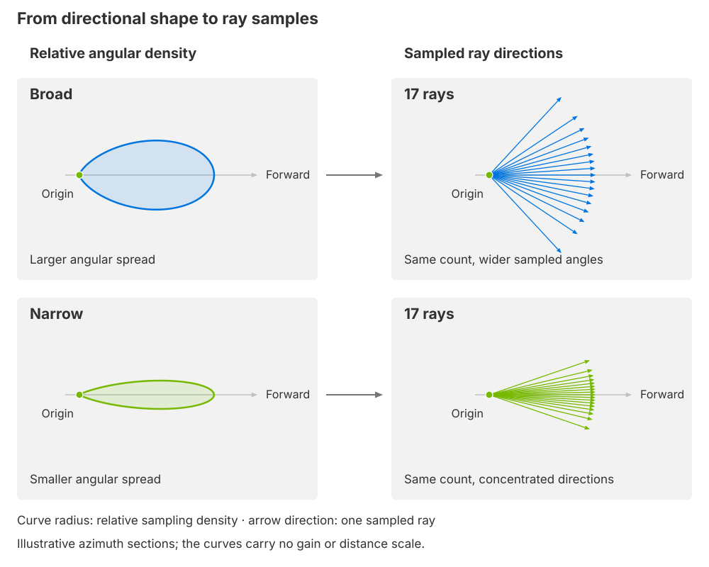

.. SPDX-FileCopyrightText: Copyright (c) 2026 NVIDIA CORPORATION & AFFILIATES. All rights reserved.
.. SPDX-License-Identifier: LicenseRef-NvidiaProprietary
..
.. NVIDIA CORPORATION, its affiliates and licensors retain all intellectual
.. property and proprietary rights in and to this material, related
.. documentation and any modifications thereto. Any use, reproduction,
.. disclosure or distribution of this material and related documentation
.. without an express license agreement from NVIDIA CORPORATION or
.. its affiliates is strictly prohibited.

.. _sensors-nonvisual-generic-wpm-howto-beam-sampling:

Sample a Finite-Width Beam
==========================

Sample several directions around each transmitter's forward axis, then
optionally connect those paths to neighboring receivers. Ray sampling and
receiver connectivity can be changed independently.

**Before you start.** Author the base and depth patterns from :doc:`Sample a Depth Grid <depth_sampling>`. The Gaussian USD Python tab modifies those patterns; the bloom tab modifies the Gaussian result.

.. _sensors-nonvisual-generic-wpm-howto-beam-sampling-directivity:

Directivity and ray sampling
----------------------------

A directivity diagram shows how emission varies with direction. Use its
angular shape to choose where to concentrate ray directions. With the same
ray count, a narrow distribution concentrates samples near the forward axis;
a broad distribution spreads them across a wider angular region. In the
model, author that distribution as a ray bundle, then reuse it at each
transmitter pose in the selected :ref:`trace definition
<sensors-nonvisual-generic-wpm-attributes-patterns>`.

   *These azimuth sections relate smooth angular shapes to discrete ray
   directions. Both bundles contain the same number of rays; narrowing the
   shape moves samples toward the forward axis. The shapes and ray lengths
   are schematic, not calibrated gain or propagation distance.*

Choose a Gaussian bundle for a concentration around the forward axis with
independent horizontal and vertical spreads. Use Free rays to specify another
set of directions explicitly, or a spherical Grid pattern for structured
angular samples.
The figure relates a directional shape to sampling density. It does not assign
a gain value to each direction: the model's ray inputs describe geometry and
firing times, without antenna-gain tables or individual ray power weights.

After launch, each sampled ray can produce :ref:`paths and contributions
<sensors-nonvisual-generic-wpm-outputs-paths>` at scene hits and connected
receivers. The bundle determines the emission directions; receiver mapping
determines the candidate receiving elements.

Gaussian ray sampling
---------------------

Use a Gaussian bundle when each transmitter should emit many rays around its
forward axis. One stored bundle is reused in the frame of every transmitter
element in the selected pattern.

Choose the sample count and angular spreads separately. More rays add samples
and output slots. Wider angular spreads change the directions sampled;
they do not change the number of rays. Keep
``omni:sensor:GenericWpm:sourceDivergence`` separate from these choices; its
meaning is described under :ref:`propagation controls
<sensors-nonvisual-generic-wpm-attributes-propagation>`.

Replace the depth example's single ray with nine Gaussian rays per transmitter
to sample a finite angular spread. Seed 7 makes the sampling repeatable; 1 degree
horizontal and 0.5 degree vertical standard deviations make the spread wider
horizontally. With zero bloom, ``15 * 9 = 135`` slots are allocated.

The override clears the inherited Free-ray data because that family is no
longer present in ``ray:patternTypes``:

.. tab-set::

   .. tab-item:: USDA
      :sync: usda

      .. literalinclude:: ../../../../../tests/docs/usd/data/generic_wpm_gaussian.usda
         :language: usda
         :start-after: # [snippet:doc-generic-wpm-gaussian]
         :end-before: # [/snippet:doc-generic-wpm-gaussian]
         :prepend: #usda 1.0

   .. tab-item:: USD Python
      :sync: python

      .. literalinclude:: ../../../../../tests/docs/usd/test_generic_wpm_usda.py
         :language: python
         :start-after: # [snippet:doc-generic-wpm-gaussian-python]
         :end-before: # [/snippet:doc-generic-wpm-gaussian-python]
         :dedent:

Setting both spreads to zero still generates nine coincident rays.
The number of samples and their angular spread are independent of
``sourceDivergence``.

Receiver bloom
^^^^^^^^^^^^^^

Add bloom when a path should contribute to neighboring grid receivers as well
as its paired receiver. Radius 1 reserves a 3 by 3 receiver neighborhood for
each ray and increases capacity to ``15 * 9 * 9 = 1,215`` slots.
It does not increase the emitted ray count or move the receivers. Choose bloom
to expand the set of receiver connections while keeping the sampled emission
directions. This layer changes only that radius:

.. tab-set::

   .. tab-item:: USDA
      :sync: usda

      .. literalinclude:: ../../../../../tests/docs/usd/data/generic_wpm_gaussian_bloom.usda
         :language: usda
         :start-after: # [snippet:doc-generic-wpm-gaussian-bloom]
         :end-before: # [/snippet:doc-generic-wpm-gaussian-bloom]
         :prepend: #usda 1.0

   .. tab-item:: USD Python
      :sync: python

      .. literalinclude:: ../../../../../tests/docs/usd/test_generic_wpm_usda.py
         :language: python
         :start-after: # [snippet:doc-generic-wpm-gaussian-bloom-python]
         :end-before: # [/snippet:doc-generic-wpm-gaussian-bloom-python]
         :dedent:

One recorded run of the enclosure produced 819 valid slots. Clipped
neighbors at the grid edges retain their positions in the dense layout.
The exact valid count is an observation of that scene, not a general guarantee.

Attribute meanings are on :doc:`USD Attributes <../attributes>`; complete
types and defaults are in :doc:`Sensor API Schemas <../../../reference/schemas>`.

Verification
------------

1. Compare accepted capacity before and after each edit: the depth pattern has 15 slots, nine rays raise it to 135, and radius-one bloom raises it to 1,215.

2. Bloom must leave ``raysPerTx`` unchanged.

3. Set both Gaussian spreads to zero to confirm that nine coincident rays remain allocated.

4. Read only valid slots when comparing sampled directions.

Potential issues
----------------

Use the :ref:`Generic wpm checks <sensors-troubleshooting-symptoms-generic-wpm>`
for confirming checks and recovery.

- **A family replacement is rejected.** Inherited arrays for the removed family must be cleared. Refer to :ref:`array requirements <sensors-nonvisual-generic-wpm-attributes-array-requirements>`.
- **Bloom is rejected.** The two grids may have different shapes or a wrapping receiver grid may be too narrow. Refer to :ref:`receiver mapping <sensors-nonvisual-generic-wpm-attributes-mapping>`.

Related
-------

- :doc:`USD Attributes <../attributes>` — the meanings and constraints of the controls.
- :doc:`Outputs <../outputs>` — contribution channels, layout and validity.
- :doc:`Limitations <../../../troubleshooting/limitations>` — model scope and bounds.
