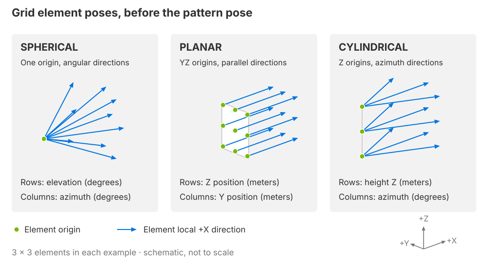

.. SPDX-FileCopyrightText: Copyright (c) 2026 NVIDIA CORPORATION & AFFILIATES. All rights reserved.
.. SPDX-License-Identifier: LicenseRef-NvidiaProprietary
..
.. NVIDIA CORPORATION, its affiliates and licensors retain all intellectual
.. property and proprietary rights in and to this material, related
.. documentation and any modifications thereto. Any use, reproduction,
.. disclosure or distribution of this material and related documentation
.. without an express license agreement from NVIDIA CORPORATION or
.. its affiliates is strictly prohibited.

.. _sensors-nonvisual-generic-wpm-howto-depth-sampling:

Sample a Depth Grid
===================

Choose angular, planar or cylindrical sampling for direct-return distances.

**Before you start.** Create the base sensor and output in :doc:`Set Up a Sensor <setup>`. The USD Python tabs below assume that base has been authored on ``stage``.

Choose a grid geometry
-----------------------

Choose whether samples vary in direction, origin or both. The modes below
generate element poses before the pattern's position and orientation are
applied. The recipes use them for matching transmitter and receiver grids:

   *Dots mark element origins and arrows mark their local +X axes. For a
   transmitter emitting one local +X ray, each arrow is an emission direction;
   for a receiver, it is a coordinate-frame axis. The illustrated 3 by 3
   patterns are schematic, not to scale.*

- Choose ``SPHERICAL`` to sample elevation and azimuth from one origin.
  Row and column bounds are angles in degrees.
- Choose ``PLANAR`` to sample parallel paths from origins spread across the
  YZ plane. Row and column bounds are Z and Y positions in meters.
- Choose ``CYLINDRICAL`` to sample azimuth at several heights. Row bounds are
  heights along Z in meters; column bounds are azimuths in degrees.

The :ref:`grid attributes <sensors-nonvisual-generic-wpm-attributes-grid>` define
bounds, element order and the pattern pose. Keep receiver connectivity separate
from this geometry choice: the recipes below explicitly pair matching flat
indices using ``1to1``.

Angular sampling
----------------

Use matching 3 by 5 spherical transmitter and receiver grids to sample elevation
from -10 to 10 degrees and azimuth from -20 to 20 degrees. One Free ray at the
transmitter origin follows each transmitter's orientation. The same single-ray
bundle is reused by all 15 transmitter elements; it is not a separate bundle
for each direction. ``1to1`` with zero bloom connects each transmitter to the
matching receiver.

This gives 15 emitted rays and 15 slots. All origins coincide, so half the
direct-return path distance is range. Uniform angular spacing is useful for
range sampling, but does not represent calibrated pinhole-camera pixels.
The layer below defines the two grids independently so their index pairing is
explicit:

.. tab-set::

   .. tab-item:: USDA
      :sync: usda

      .. literalinclude:: ../../../../../tests/docs/usd/data/generic_wpm_depth.usda
         :language: usda
         :start-after: # [snippet:doc-generic-wpm-depth]
         :end-before: # [/snippet:doc-generic-wpm-depth]
         :prepend: #usda 1.0

   .. tab-item:: USD Python
      :sync: python

      .. literalinclude:: ../../../../../tests/docs/usd/test_generic_wpm_usda.py
         :language: python
         :start-after: # [snippet:doc-generic-wpm-depth-python]
         :end-before: # [/snippet:doc-generic-wpm-depth-python]
         :dedent:

The central sample is 11 m from the front wall. Oblique rays travel farther to
reach that same plane:

.. figure:: ../../../../img/sensors/nonvisual/generic_wpm_depth_ranges.avif
   :width: 100%
   :alt: Three by five direct-return ranges from a steel wall 11 meters ahead, with longer oblique ranges than the center sample.

   *Range derived from valid direct-return contributions. A flat wall does not
   produce constant radial range under angular sampling.*

Planar and cylindrical variants
^^^^^^^^^^^^^^^^^^^^^^^^^^^^^^^

Use a planar grid when origins should be spaced across a surface and rays should
remain parallel. This layer replaces both grids with YZ-plane origins facing +X.
The dimensions and pairing stay the same, so this changes the sampling geometry
without changing the 15-slot capacity. Every direct return from the front wall
is then 11 m:

.. tab-set::

   .. tab-item:: USDA
      :sync: usda

      .. literalinclude:: ../../../../../tests/docs/usd/data/generic_wpm_planar.usda
         :language: usda
         :start-after: # [snippet:doc-generic-wpm-planar]
         :end-before: # [/snippet:doc-generic-wpm-planar]
         :prepend: #usda 1.0

   .. tab-item:: USD Python
      :sync: python

      .. literalinclude:: ../../../../../tests/docs/usd/test_generic_wpm_usda.py
         :language: python
         :start-after: # [snippet:doc-generic-wpm-planar-python]
         :end-before: # [/snippet:doc-generic-wpm-planar-python]
         :dedent:

Use a cylindrical grid when each row should have a different height while
columns scan azimuth. This keeps 15 slots but changes rows from angular elevation
to metric height. Origins move along Z, not around a cylinder:

.. tab-set::

   .. tab-item:: USDA
      :sync: usda

      .. literalinclude:: ../../../../../tests/docs/usd/data/generic_wpm_cylindrical.usda
         :language: usda
         :start-after: # [snippet:doc-generic-wpm-cylindrical]
         :end-before: # [/snippet:doc-generic-wpm-cylindrical]
         :prepend: #usda 1.0

   .. tab-item:: USD Python
      :sync: python

      .. literalinclude:: ../../../../../tests/docs/usd/test_generic_wpm_usda.py
         :language: python
         :start-after: # [snippet:doc-generic-wpm-cylindrical-python]
         :end-before: # [/snippet:doc-generic-wpm-cylindrical-python]
         :dedent:

Attribute meanings are on :doc:`USD Attributes <../attributes>`; complete
types and defaults are in :doc:`Sensor API Schemas <../../../reference/schemas>`.

Verification
------------

1. Read the accepted dimensions, then compare only nonzero ``Valid`` slots.

2. The angular recipe has capacity 15 and its central direct return has range 11 m in the example scene.

3. Oblique angular samples have longer ranges to the same front plane.

4. The planar recipe keeps 15 slots with parallel rays and 11 m direct-return ranges.

5. Compare these geometric relationships, rather than requiring an arbitrary valid-count value in a different scene.

Potential issues
----------------

Use the :ref:`Generic wpm checks <sensors-troubleshooting-symptoms-generic-wpm>`
for confirming checks and recovery.

- **Range cells do not match camera pixels.** The grid samples angles or ray origins, without a calibrated camera projection. Refer to :ref:`model limits <sensors-troubleshooting-limitations-generic-wpm>`.
- **Some slots are invalid.** An intersection alone does not establish a positive-power path visible to a receiver. Refer to :doc:`Outputs <../outputs>`.

Related
-------

- :doc:`USD Attributes <../attributes>` — the meanings and constraints of the controls.
- :doc:`Outputs <../outputs>` — contribution channels, layout and validity.
- :doc:`Limitations <../../../troubleshooting/limitations>` — model scope and bounds.
