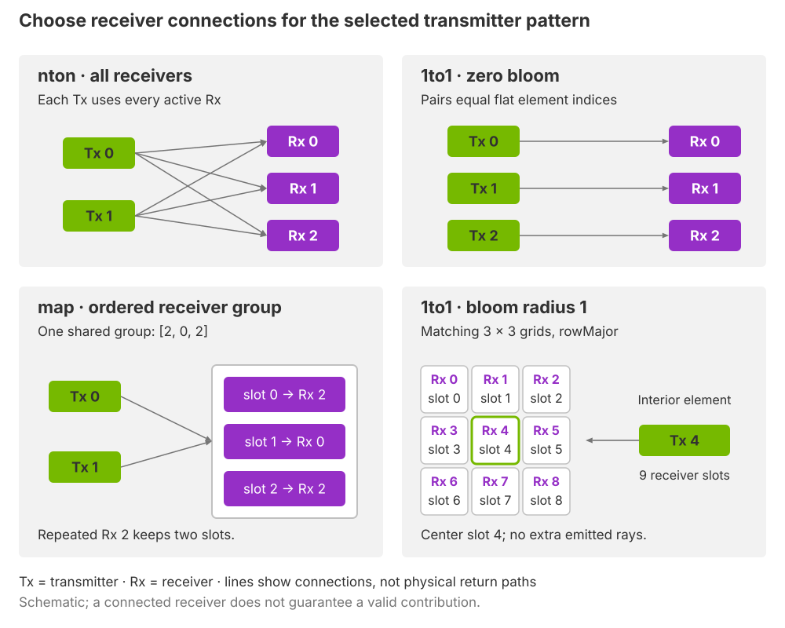

.. SPDX-FileCopyrightText: Copyright (c) 2026 NVIDIA CORPORATION & AFFILIATES. All rights reserved.
.. SPDX-License-Identifier: LicenseRef-NvidiaProprietary
..
.. NVIDIA CORPORATION, its affiliates and licensors retain all intellectual
.. property and proprietary rights in and to this material, related
.. documentation and any modifications thereto. Any use, reproduction,
.. disclosure or distribution of this material and related documentation
.. without an express license agreement from NVIDIA CORPORATION or
.. its affiliates is strictly prohibited.

.. _sensors-nonvisual-generic-wpm-howto-receiver-layouts:

Connect Independent Transmitters and Receivers
==============================================

Place transmitters and receivers independently, then choose which receivers
participate in each transmitter's paths. Physical placement and receiver
connectivity are separate choices.

**Before you start.** Create the base sensor and output in :doc:`Set Up a Sensor <setup>`. The USD Python tabs assume that base exists; the subset tab modifies the multistatic pattern.

Choose receiver connections
---------------------------

A receiver pattern defines element poses. A mapping chooses receiver elements
from that pattern; it does not place or move them. Every transmitter element in
the selected transmitter pattern uses that pattern's mapping mode:

   *Lines identify receiver connections.* ``nton`` *selects all receivers;
   zero-bloom* ``1to1`` *pairs equal flat indices. The illustrated* ``map`` *group*
   ``[2, 0, 2]`` *places receiver 2 in two distinct slots. Radius-one bloom
   expands a grid pair to nine ordered slots, with the center in slot 4.
   These illustrative connections are schematic, not to scale.*

- Use ``nton`` when every active receiver should participate. The first recipe
  below uses this mode for two transmitters and three receivers.
- Use zero-bloom ``1to1`` for paired elements with equal transmitter and receiver
  counts. Pairing follows flat indices; co-location requires matching poses as
  in :doc:`Sample a Depth Grid <depth_sampling>`.
- Use ``map`` for an explicit ordered receiver group. The second recipe below
  selects a subset without changing the receiver geometry.

A selected connection still needs a valid path through the scene. Receiver
orientation defines the frame used by receiver-relative geometry; it does not
define a receiving cone. The full mapping rules are on
:ref:`USD Attributes <sensors-nonvisual-generic-wpm-attributes-mapping>`, and
:doc:`Sample a Finite-Width Beam <beam_sampling>` adds receiver bloom to matched
grids.

Transmitter and receiver patterns
---------------------------------

Free patterns allow two transmitters and three receivers to be positioned
independently. Both elements belong to one stored transmitter pattern, so each
emits the same 3 by 3 Grid ray bundle in its own frame.
``nton`` evaluates every receiver, allocating ``2 * 9 * 3 = 54`` slots.

The example uses a 3.9 mm electromagnetic wavelength.
The configuration below separates transmitter and receiver geometry to
demonstrate bistatic path lengths:

.. tab-set::

   .. tab-item:: USDA
      :sync: usda

      .. literalinclude:: ../../../../../tests/docs/usd/data/generic_wpm_multistatic.usda
         :language: usda
         :start-after: # [snippet:doc-generic-wpm-multistatic]
         :end-before: # [/snippet:doc-generic-wpm-multistatic]
         :prepend: #usda 1.0

   .. tab-item:: USD Python
      :sync: python

      .. literalinclude:: ../../../../../tests/docs/usd/test_generic_wpm_usda.py
         :language: python
         :start-after: # [snippet:doc-generic-wpm-multistatic-python]
         :end-before: # [/snippet:doc-generic-wpm-multistatic-python]
         :dedent:

One recorded run produced two valid contributions: the central ray of each
transmitter reached its nearest receiver, with a 0.1 m transmitter–receiver
baseline. Other ray slots were invalid despite intersecting geometry.
The exact valid count is specific to that run and scene.

Half of the total path distance is not generally range in this layout.
``RxRelativePosM`` expresses the hit in each receiving element's frame.
The output remains scalar transport data, not coherent I/Q or radar detections.
The stationary scene does not exercise nonzero path velocity.

Selecting a receiver subset
^^^^^^^^^^^^^^^^^^^^^^^^^^^

Use ``map`` to choose explicit receivers and their output order. A receiver ID
is an element index in the active receiver pattern. A receiver slot is its
position in the selected group; these two indices need not match.

This layer selects receiver IDs ``[2, 0]`` from page 0, reducing capacity to
``2 * 9 * 2 = 36`` slots while preserving both nearest receivers:

.. tab-set::

   .. tab-item:: USDA
      :sync: usda

      .. literalinclude:: ../../../../../tests/docs/usd/data/generic_wpm_multistatic_map.usda
         :language: usda
         :start-after: # [snippet:doc-generic-wpm-multistatic-map]
         :end-before: # [/snippet:doc-generic-wpm-multistatic-map]
         :prepend: #usda 1.0

   .. tab-item:: USD Python
      :sync: python

      .. literalinclude:: ../../../../../tests/docs/usd/test_generic_wpm_usda.py
         :language: python
         :start-after: # [snippet:doc-generic-wpm-multistatic-map-python]
         :end-before: # [/snippet:doc-generic-wpm-multistatic-map-python]
         :dedent:

In that recorded run, two contributions remained valid. Receiver slot 0 means receiver 2
and slot 1 means receiver 0; output order follows the authored list.

Attribute meanings are on :doc:`USD Attributes <../attributes>`; complete
types and defaults are in :doc:`Sensor API Schemas <../../../reference/schemas>`.

Verification
------------

1. Confirm capacity 54 for the all-receivers layout and 36 for the ordered subset.

2. Use logical receiver-slot indices to interpret ``RxRelativePosM``: subset slot 0 addresses receiver 2 and slot 1 addresses receiver 0.

3. Compare total path distances, not half-distance range, for separated emission and receiver origins.

Potential issues
----------------

Use the :ref:`Generic wpm checks <sensors-troubleshooting-symptoms-generic-wpm>`
for confirming checks and recovery.

- **A mapping selection is rejected.** Every group on the selected page must fit the active receiver pattern, including groups unused by this transmitter. Refer to :ref:`receiver mapping <sensors-nonvisual-generic-wpm-attributes-mapping>`.
- **Receiver-slot positions appear reordered.** Slots follow the authored group order, including duplicate receiver indices. Refer to :doc:`Outputs <../outputs>`.

Related
-------

- :doc:`USD Attributes <../attributes>` — the meanings and constraints of the controls.
- :doc:`Outputs <../outputs>` — contribution channels, layout and validity.
- :doc:`Limitations <../../../troubleshooting/limitations>` — model scope and bounds.
