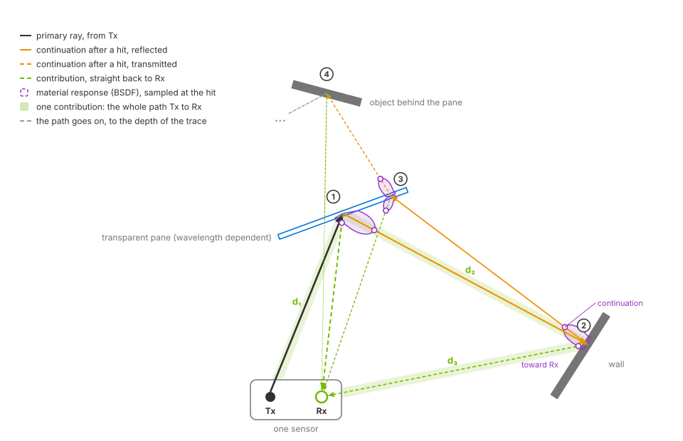
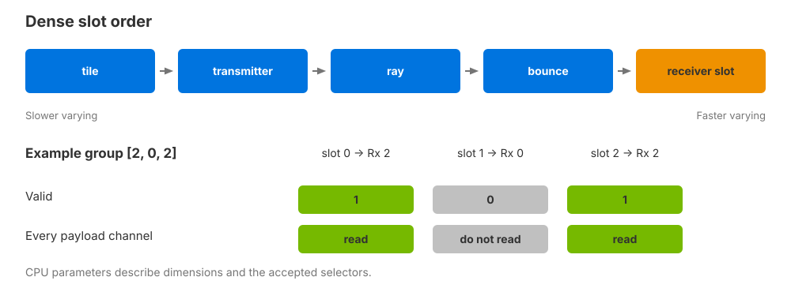

.. SPDX-FileCopyrightText: Copyright (c) 2026 NVIDIA CORPORATION & AFFILIATES. All rights reserved.
.. SPDX-License-Identifier: LicenseRef-NvidiaProprietary
..
.. NVIDIA CORPORATION, its affiliates and licensors retain all intellectual
.. property and proprietary rights in and to this material, related
.. documentation and any modifications thereto. Any use, reproduction,
.. disclosure or distribution of this material and related documentation
.. without an express license agreement from NVIDIA CORPORATION or
.. its affiliates is strictly prohibited.

.. _sensors-nonvisual-generic-wpm-outputs:
.. _generic-wpm-contributions:

Outputs
=======

The Generic wpm model delivers ``Contributions`` as a composite output. Each
valid entry describes one path from a ray's emission origin, through one or
more scene hits, to one receiver. It is raw path data for further processing.

Attribute meanings are on :doc:`USD Attributes <attributes>`. Shared mapping,
synchronization and ownership rules are on :doc:`Sensor Outputs
<../../common/sensor_outputs>`. This output uses ``Valid`` and its own
parameters; it does not use the point-cloud ``Counts`` and ``Flags`` contract.

.. _sensors-nonvisual-generic-wpm-outputs-requesting:

Requesting the output
---------------------

Request ``sourceName = "Contributions"`` in one RenderVar on the sensor's RenderProduct. The output contains named tensor channels and CPU parameters.

Set ``token[] channels`` on the RenderVar to choose its channels. An empty array
requests the twelve default channels below. An explicit list requests those
channels plus ``Valid``, which is always present. For example,
``channels = ["RoundTripDistanceM"]`` returns path distance and validity.
Requesting either optional geometry channel enables both. Repeated names are
deduplicated; unknown names are reported and ignored. Multiple Contributions
RenderVars in one RenderProduct are rejected.

The example base authors ``/World/Sensor`` and requests its output. The
USD Python tab assumes an existing USD ``stage``. Complete its pattern as shown in
:doc:`Set Up a Sensor <howto/setup>`:

.. tab-set::

   .. tab-item:: USDA
      :sync: usda

      .. literalinclude:: ../../../../tests/docs/usd/data/generic_wpm_base.usda
         :language: usda
         :start-after: # [snippet:doc-generic-wpm-base]
         :end-before: # [/snippet:doc-generic-wpm-base]
         :prepend: #usda 1.0

   .. tab-item:: USD Python
      :sync: python

      .. literalinclude:: ../../../../tests/docs/usd/test_generic_wpm_usda.py
         :language: python
         :start-after: # [snippet:doc-generic-wpm-imports-python]
         :end-before: # [/snippet:doc-generic-wpm-imports-python]
         :dedent:

      .. literalinclude:: ../../../../tests/docs/usd/test_generic_wpm_usda.py
         :language: python
         :start-after: # [snippet:doc-generic-wpm-base-python]
         :end-before: # [/snippet:doc-generic-wpm-base-python]
         :dedent:

The :doc:`base setup <howto/setup>` authors the output request alongside the
sensor. Request only the channels your consumer needs; allocation follows
that selection.

.. _sensors-nonvisual-generic-wpm-outputs-paths:

Paths and contributions
-----------------------

One emitted ray can produce several contributions: at different bounces and
for different receivers. Each contribution follows the emitted path as far as
one scene hit, then connects that hit to one receiver selected by the mapping.
The receiver connection and the continuation to the next scene hit are
different parts of the calculation.

   *The highlighted path forms one contribution: Tx to hit 1, hit 1 to hit 2,
   then hit 2 to Rx. Its total distance is d₁ + d₂ + d₃. The connection from
   hit 1 to Rx describes a separate contribution from the same emitted ray.
   Schematic, not to scale.*

With multiple connected receivers, the same scene hit can lead to a separate
contribution for each receiver. Their final path segments, total distances
and receiver-relative hit coordinates can differ. Increasing the number of
receivers therefore changes the possible contributions without adding
emitted rays. The :ref:`receiver mapping
<sensors-nonvisual-generic-wpm-attributes-mapping>` determines those connections.

The record's geometry describes the hit where that contribution branches
toward the receiver; it is not a list of every vertex on the path. Use
``RoundTripDistanceM`` for the full path length and the hit-position channels
for that hit's location. ``DeltaTimeNs`` identifies when the ray was fired,
not when a signal arrives at the receiver. The :ref:`channel reference
<sensors-nonvisual-generic-wpm-outputs-channels>` defines their units and frames.

.. _sensors-nonvisual-generic-wpm-outputs-layout:

Contribution layout
-------------------

   *Contribution slots share the same order across every channel. Receiver
   slot varies fastest. The example receiver group has duplicate receiver 2
   in two distinct slots. Schematic values illustrate ordering, not a capture.*

The logical output dimensions are
``[tile, tx, rayInTx, bounce, receiverSlot]``.
The number of allocated slots is
``N = numTiles * numTx * raysPerTx * maxBounces * groupSize``.
These dimensions describe the active patterns, not the total number of stored
alternatives. Receiver slot varies fastest, followed by bounce, ray, transmitter
and tile. Scalar channels have shape ``[N]``, position channels ``[N, 3]`` and
triangle vertices ``[N, 3, 3]``.

For example, one tile with two transmitters, three rays per transmitter,
two bounce levels and two receivers in ``nton`` mode has
``1 * 2 * 3 * 2 * 2 = 24`` allocated slots. Six rays are emitted, and each
has four possible slots: two receivers at each of two bounces. The allocation
describes where contributions can be recorded, not how many paths the scene
produces.

A receiver slot is a position in the selected receiver group, not a receiver ID.
For example, the ordered group ``[2, 0, 2]`` produces three slots, including two
separate slots targeting receiver 2. Blooming preserves its square neighborhood
layout at grid edges; clipped neighbors remain allocated but invalid.

Read a payload only when its corresponding ``Valid`` value is nonzero.
A scene hit alone does not guarantee a valid contribution: the resulting
return power must be positive and the receiver must be visible. Invalid slots have
unspecified payloads; they are not zero-valued measurements. The first bounce
has axis index 0 but reports ``NumBounces = 1``. That value counts the emitted
path's hits through the current hit. Material evaluations on the final
hit-to-receiver connection do not increase it; their separate limit is
described under :ref:`propagation controls
<sensors-nonvisual-generic-wpm-attributes-propagation>`.

.. _sensors-nonvisual-generic-wpm-outputs-channels:

Channels
--------

The following channels are enabled by default:

.. list-table::
   :header-rows: 1
   :widths: 23 10 12 12 43
   :class: compact-table

   * - Channel
     - Type
     - Shape
     - Unit
     - Meaning
   * - ``HitPosWorld``
     - ``float32``
     - ``[N, 3]``
     - world units
     - Hit in translated-world coordinates and renderer/world units. Not necessarily absolute world coordinates or meters.
   * - ``HitPosSensorM``
     - ``float32``
     - ``[N, 3]``
     - m
     - Hit in the sensor frame sampled using the firing offset, in meters. Motion sampling follows the :ref:`firing-time limits <sensors-nonvisual-generic-wpm-attributes-timing>`.
   * - ``RxRelativePosM``
     - ``float32``
     - ``[N, 3]``
     - m
     - Hit in the selected receiver's frame, in meters.
   * - ``RoundTripDistanceM``
     - ``float32``
     - ``[N]``
     - m
     - Total path length from the emission origin through the scene hits to the receiver, in meters.
   * - ``RoundTripVelocityMps``
     - ``float32``
     - ``[N]``
     - m/s
     - Path-length change rate in meters/second. Positive means increasing path length; this is not the object's speed.
   * - ``NumBounces``
     - ``uint32``
     - ``[N]``
     - count
     - One-based emitted-path hit count through the current hit. Excludes material evaluations on the final receiver connection.
   * - ``MaterialId``
     - ``uint32``
     - ``[N]``
     - ID
     - Non-visual material ID at the hit, not an object or instance ID.
   * - ``CosAngle``
     - ``float32``
     - ``[N]``
     - unitless
     - Absolute cosine between the shading normal and the incoming direction toward the previous path vertex.
   * - ``AccumBeamRangeDivergenceM``
     - ``float32``
     - ``[N]``
     - m
     - Accumulated beam range/divergence quantity in meters. It is not the Gaussian sampling spread or a range measurement.
   * - ``DeltaTimeNs``
     - ``uint64``
     - ``[N]``
     - ns
     - Firing offset from ``frameStartTimeStampNs``, constant along the path. Not propagation or arrival time; see :ref:`generic-wpm-timing`.
   * - ``Power``
     - ``float32``
     - ``[N]``
     - relative scalar power
     - Scalar return-transport power relative to unit source power, after propagation to the receiver. Not calibrated detector power or intensity.
   * - ``Valid``
     - ``uint32``
     - ``[N]``
     - validity
     - 1 for a written positive-power contribution; 0 otherwise.

The optional geometry channels describe the triangle at the current hit:

.. list-table::
   :header-rows: 1
   :widths: 23 10 12 12 43
   :class: compact-table

   * - Channel
     - Type
     - Shape
     - Unit
     - Meaning
   * - ``HitVerticesM``
     - ``float32``
     - ``[N, 3, 3]``
     - m
     - Three triangle vertices in the receiver frame, in meters.
   * - ``GeometryAreaM2``
     - ``float32``
     - ``[N]``
     - m²
     - Triangle area in square meters.

When triangle geometry is unavailable, both geometry channels contain zero even
if the contribution is valid. There is no separate geometry-valid channel.

Path length and range
^^^^^^^^^^^^^^^^^^^^^

Half of ``RoundTripDistanceM`` is range only for a direct return whose ray-emission
and receiver origins coincide. Matching transmitter and receiver positions is
insufficient if the ray has a nonzero transmitter-relative origin. For bistatic
layouts and multi-bounce paths, use the total path distance or the appropriate
hit-position channel instead.

Output transforms and delivery
^^^^^^^^^^^^^^^^^^^^^^^^^^^^^^

- :ref:`Patterns and selection <sensors-nonvisual-generic-wpm-attributes-patterns>`
  set the transmitter/ray axes and geometry. :ref:`Receiver mapping
  <sensors-nonvisual-generic-wpm-attributes-mapping>` sets ordered receiver slots.
- :ref:`Propagation controls <sensors-nonvisual-generic-wpm-attributes-propagation>`
  set bounce capacity, path search limits and scalar transport. Wavelength and
  wave type affect the response used for ``Power``.
- :ref:`Firing times <sensors-nonvisual-generic-wpm-attributes-timing>` set
  ``DeltaTimeNs`` and the motion sample used for hit positions and path velocity.

.. _sensors-nonvisual-generic-wpm-outputs-params:

Params
------

CPU parameters describe the accepted configuration and frame. Scalar parameters
have shape ``[1]``; positions and orientations use the shapes shown below.

.. list-table::
   :header-rows: 1
   :widths: 24 10 10 56
   :class: compact-table

   * - Param
     - Type
     - Shape
     - Value
   * - ``numTiles``, ``numTx``, ``raysPerTx``, ``maxBounces``, ``groupSize``
     - ``uint32``
     - ``[1]``
     - The five logical output dimensions.
   * - ``numRx``
     - ``uint32``
     - ``[1]``
     - Number of active receivers; it can differ from the receiver-slot count.
   * - ``maxContributions``
     - ``uint32``
     - ``[1]``
     - Allocated slot capacity, not the number of valid returns.
   * - ``activeTxPatternIndex``, ``activeRxPatternIndex``, ``activeMappingPageIndex``
     - ``uint32``
     - ``[1]``
     - Accepted selectors. Absent until the first valid configuration.
   * - ``frameId``
     - ``uint64``
     - ``[1]``
     - Renderer frame identifier.
   * - ``timestampNs``, ``frameStartTimeStampNs``, ``frameEndTimeStampNs``
     - ``uint64``
     - ``[1]``
     - Frame motion interval in nanoseconds. ``timestampNs`` equals its end.
   * - ``frameStartPosM``, ``frameEndPosM``
     - ``float32``
     - ``[3]``
     - Sensor start/end positions in meters, for tile 0.
   * - ``frameStartOrientation``, ``frameEndOrientation``
     - ``float32``
     - ``[4]``
     - Sensor start/end xyzw orientations, for tile 0.
   * - ``gridShape:<tx|rx|ray>:<role-pattern-index>``
     - ``uint32``
     - ``[6]``
     - Selected grid descriptor: start, cell count, rows, columns, scan order and column wrap.
   * - ``numRays``
     - ``uint32``
     - ``[1]``
     - Same value as ``raysPerTx``.
   * - ``numTxPatterns``, ``numRxPatterns``, ``numRayPatterns``, ``numRxGroupMaps``
     - ``uint32``
     - ``[1]``
     - Each is one for the generated selection.
   * - ``numGroups``, ``numTargetRxGroups``
     - ``uint32``
     - ``[1]``
     - ``numTx`` for ``1to1``; one for ``map`` or ``nton``.
   * - ``wrapCols``, ``rxFlatIndexEqualsTxFlatIndex``
     - ``uint32``
     - ``[1]``
     - Boolean layout hints, not selectors.

Selected grids also provide
``gridShape:<tx|rx|ray>:<role-pattern-index>`` as ``uint32 [6]``:
``[0, cellCount, numRows, numCols, scanOrder, wrapCols]``.
Scan order 0 means row-major and 1 means column-major.

.. _sensors-nonvisual-generic-wpm-outputs-reading:
.. _generic-wpm-runtime:

Reading the output
------------------

Wait for a completed output, read its dimensions and filter by ``Valid``.
Before the first valid configuration, output is EMPTY: channel names are
present, but their leading dimensions are zero. Pipeline warmup can also produce
zero-length channels even when accepted dimensions are available. Do not reshape
these empty tensors using the capacity parameters. A completed capture whose
allocated slots all have ``Valid = 0`` is different: it rendered but produced no
positive-power contributions.

The :doc:`Python example <../../../examples/python_generic_wpm>` and
:doc:`C example <../../../examples/c_generic_wpm>` show mapping, ownership and
synchronization. CPU parameters remain separate from the channel payloads.

Read the parameters before the payloads. For a nonempty capture, preserve
logical slot coordinates before filtering so that transmitter, ray, bounce
and receiver-slot identities remain available. The paired Python/C
:ref:`capture example <generic-wpm-example-runtime>` shows the complete
step, map, copy and filtering sequence.

The following routines consume owning CPU copies of the named channels and
parameters. The :ref:`capture example <generic-wpm-example-runtime>` shows the
preceding step, wait, map and copy operations and their lifetime rules:

.. tab-set::

   .. tab-item:: Python
      :sync: python

      .. literalinclude:: ../../../../examples/python/generic-wpm/main.py
         :caption: ``main.py``, from the runnable :doc:`Python example <../../../examples/python_generic_wpm>`.
         :language: python
         :start-after: # [snippet:doc-generic-wpm-read-output]
         :end-before: # [/snippet:doc-generic-wpm-read-output]
         :dedent:

   .. tab-item:: C
      :sync: c

      .. literalinclude:: ../../../../examples/c/generic-wpm/main.cpp
         :caption: ``main.cpp``, from the runnable :doc:`C example <../../../examples/c_generic_wpm>`.
         :language: cpp
         :start-after: // [snippet:doc-generic-wpm-valid-slots-c]
         :end-before: // [/snippet:doc-generic-wpm-valid-slots-c]
         :dedent:

For GPU consumers, request linear CUDA memory with the synchronization described
under :ref:`mapping outputs <mapping-outputs>`. ``Contributions`` is not a CUDA
image array. ``Valid`` is a validity value, not a completion signal.

.. _sensors-nonvisual-generic-wpm-outputs-tiles:

Tiled captures
--------------

Target several sensor prims from one RenderProduct to create pose-only tiles.
The first sensor supplies the complete configuration for every tile; attributes
on later sensors do not independently configure those tiles. Each tile uses
the same active pattern with its own pose. ``numTx`` is the count per tile,
and ``numTiles`` is the leading output dimension. Frame pose parameters refer
to tile 0.

Use separate RenderProducts when sensors need independent pattern or propagation
settings. Refer to :ref:`independent products
<sensors-common-output-configuration-independent-products>`.

.. _sensors-nonvisual-generic-wpm-outputs-capacity:

Allocated capacity
------------------

Storage grows with all five dimensions, including invalid slots. Default channels
use 76 bytes per slot; the geometry pair adds 40 bytes. Distance plus mandatory
``Valid`` uses 8 bytes per slot. These figures exclude pattern buffers, allocation
overhead and multiple in-flight outputs.

.. warning::

   A capture is limited to 4,194,304 slots. At that capacity, default channel
   payloads occupy 304 MiB, or 464 MiB with the geometry pair. Reduce the
   active pattern sizes, ray count, bounce count or receiver-group size to
   stay within this bound.

Related
-------

- :doc:`USD Attributes <attributes>` — the patterns and controls shaping each channel.
- :doc:`Sensor Outputs <../../common/sensor_outputs>` — synchronization and lifetime.
- :doc:`Switch Stored Patterns <howto/runtime_updates>` — verify accepted runtime edits.
- :doc:`Python example <../../../examples/python_generic_wpm>` — save and inspect the raw tensors.
- :doc:`C example <../../../examples/c_generic_wpm>` — copy channels and save valid records.
