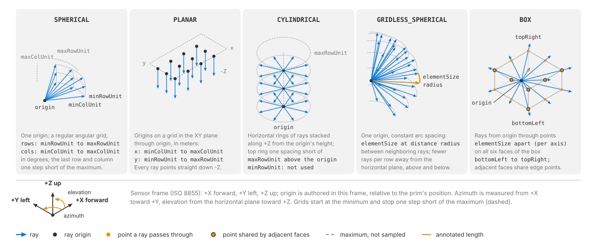

:orphan:

.. SPDX-FileCopyrightText: Copyright (c) 2026 NVIDIA CORPORATION & AFFILIATES. All rights reserved.
.. SPDX-License-Identifier: LicenseRef-NvidiaProprietary
..
.. NVIDIA CORPORATION, its affiliates and licensors retain all intellectual
.. property and proprietary rights in and to this material, related
.. documentation and any modifications thereto. Any use, reproduction,
.. disclosure or distribution of this material and related documentation
.. without an express license agreement from NVIDIA CORPORATION or
.. its affiliates is strictly prohibited.

.. _sensors-nonvisual-idealized-depth-attributes:

USD Attributes
==============

This page explains the attributes you author on an Idealized depth model prim
and what each of them does to the sensor: the schema, the
defaults and the ray budget they imply, the namespace shared with the Lidar
generic core model, the five emitter shapes with what each of them reads, and
what an edit on a running sensor does. The emitter attributes are the group
that reshapes the output: they decide how many entries a frame carries and
where each ray starts and points; :doc:`Outputs <outputs>` describes what comes
back. The generated :doc:`Sensor API Schemas <../../reference/schemas>`
reference lists every attribute with its type, default and doc string; this
page explains the ones whose meaning is not obvious from that table.

Selecting the model
-------------------

The model runs on an ``OmniIDS`` prim with ``OmniSensorGenericIDSAPI`` applied.
Applying the schema sets ``omni:sensor:modelName`` to ``"IDSCore"``,
``omni:sensor:modelVendor`` to ``"NVIDIA"`` and ``omni:sensor:marketName`` to
``"Generic"``. An ``OmniIDS`` prim always runs this model, so the three strings
are labels, as :ref:`Model identity <sensors-common-sensor-configuration-identity>`
explains; :doc:`Sensor Configuration <../../common/sensor_configuration>`
describes the prim, the schema and the shared identification attributes once,
for every model.

.. note::

   The sensor definition validation utility has no implementation for this
   model, so a prim's values cannot be checked with it before rendering;
   :doc:`Sensor Definition Validation <../../common/validation>` lists the
   models it covers. The renderer checks the ``BOX`` configuration on every
   edit, as described below.

.. _sensors-nonvisual-idealized-depth-attributes-defaults:

Defaults and the ray budget
---------------------------

The schema defaults, written out as a prim, are:

.. code-block:: usda

    def OmniIDS "depth_sensor" (
        prepend apiSchemas = ["OmniSensorGenericIDSAPI"]
    )
    {
        double2 omni:sensor:frameRate = (30, 1)
        token omni:sensor:Core:type = "SPHERICAL"
        uint omni:sensor:Core:numRows = 400
        uint omni:sensor:Core:numCols = 3600
        float omni:sensor:Core:minRowUnit = -20.0
        float omni:sensor:Core:maxRowUnit = 20.0
        float omni:sensor:Core:minColUnit = 0.0
        float omni:sensor:Core:maxColUnit = 360.0
        float3 omni:sensor:Core:origin = (0.0, 0.0, 0.0)
    }

Read as a sensor, that is a spherical grid of 400 rows by 3600 columns,
1,440,000 rays, spanning the full 360 degrees of azimuth and -20 to +20 degrees
of elevation at 0.1 degree spacing, all from one origin, thirty times a second.
The grid is authored directly rather than derived from a data sheet, so the ray
budget is entirely in your hands.

.. warning::

   The defaults are not small: they cost 1,440,000 traced rays and 1,440,000
   entries per frame, about 43 million rays per second at 30 Hz. Size the
   emitter set to what you need before the sensor starts producing;
   :doc:`Choose an Emitter Shape <howto/emitter_shape>` walks through the
   budget.

The schema sets ``omni:sensor:frameRate`` to ``(30, 1)``;
``omni:sensor:startTime`` and ``omni:sensor:frameLimit`` keep their shared
defaults of ``(0, 1)`` and ``0``. ``frameRate`` decides how often a frame is
scheduled, not how often you step the renderer;
:doc:`Sensor Scheduling <../../common/multi_rate>` explains the
scheduling. Every ray of a frame fires at the start of the frame's time window,
as the :doc:`Overview <index>` describes, so a frame has nothing partial to
deliver early, and the prim has no partial-outputs attribute. The
:ref:`shared attributes <sensors-common-sensor-configuration-shared-attributes>`
section lists the attributes every sensor schema prepends.

.. _sensors-nonvisual-idealized-depth-attributes-core-namespace:
.. _sensors-ids-core-namespace:

The shared Core namespace
-------------------------

This model's attributes share a namespace with the Lidar generic core model's:
both sit under ``omni:sensor:Core:*``. No name is used by both models, but
the shared prefix means a ``Core`` attribute's meaning follows from the prim's
model rather than from the attribute's name: ``omni:sensor:Core:type`` on an
``OmniIDS`` prim is an emitter shape, and there is no such attribute on a lidar
at all. Read the attribute rows for the model your prim runs.

.. _sensors-nonvisual-idealized-depth-attributes-emitter-shapes:
.. _sensors-ids-emitters-built-once:

Emitter shapes
--------------

An *emitter* is one ray of the sensor: an origin and a direction, the direction
given as an azimuth and an elevation, all fixed in the sensor's frame. The model
generates its emitters from the attributes in this section, so the number of
rays the sensor fires is a consequence of them rather than something you state:
there is no emitter-count attribute. This is the group that reshapes the
output. Each frame carries one entry per emitter, with that emitter's azimuth,
elevation and origin, so an edit here changes the entry count, the angles and
the origins a consumer reads; :doc:`Outputs <outputs>` describes the entries.

One token, ``omni:sensor:Core:type``, chooses the shape of the emitter set, and
it decides which of the remaining attributes are read. The row and column units
change meaning with the shape, degrees for the angular shapes and meters for the
spatial ones, so read the row for the shape you picked rather than trusting the
attribute's name. The token takes one of the five values below and nothing
else.

gs of rays stacked upward from the origin. GRIDLESS_SPHERICAL, rays from one origin whose spacing stays constant on the sphere, so the azimuth step widens as a row moves away from the horizontal plane. BOX, rays from one origin aimed at evenly spaced points on the six faces of a box around it.
   :align: center
   :width: 100%

   The five emitter shapes. ``SPHERICAL`` and ``GRIDLESS_SPHERICAL`` fan rays
   out from one origin; ``PLANAR`` spreads the origins over a plane and points
   every ray the same way; ``CYLINDRICAL`` stacks horizontal rings of rays;
   ``BOX`` aims rays from one origin at a grid of points on the faces of a box.

.. list-table::
   :header-rows: 1
   :widths: 20 46 34

   * - ``type``
     - What it generates
     - What it reads
   * - ``SPHERICAL``
     - The default. A uniform angular grid on a sphere: every ray leaves the
       same origin, rows are elevation and columns are azimuth, both in degrees.
     - ``numRows``, ``numCols``, ``minRowUnit``/``maxRowUnit`` (elevation,
       degrees), ``minColUnit``/``maxColUnit`` (azimuth, degrees), ``origin``
   * - ``PLANAR``
     - A uniform grid of origins on the sensor's horizontal plane through
       ``origin``, emitting parallel rays: every ray points straight down the
       sensor frame's ``-Z`` axis. Columns step along ``x`` and rows along
       ``y``, in meters.
     - ``numRows``, ``numCols``, ``minColUnit``/``maxColUnit`` (``x``, meters),
       ``minRowUnit``/``maxRowUnit`` (``y``, meters), ``origin``
   * - ``CYLINDRICAL``
     - A stack of horizontal rings: each row is one ring of rays at one height,
       all rays horizontal, the rings evenly spaced along the sensor frame's
       ``Z`` axis from the origin's height toward a height of ``maxRowUnit``
       above it, the last one a ring's spacing short of that; ``minRowUnit`` is
       not used.
     - ``numRows``, ``numCols``, ``minColUnit``/``maxColUnit`` (azimuth,
       degrees), ``maxRowUnit`` (height above the origin, meters), ``origin``
   * - ``GRIDLESS_SPHERICAL``
     - Spherical sampling without a grid, with constant, elevation-independent
       ray spacing: the step between rows is the angle that ``elementSize``
       spans at distance ``radius``, and within a row the azimuth step widens
       as the row moves away from the horizontal plane, upward or downward, so
       the arc between neighboring rays stays the same.
       Every ray leaves ``origin``. The ray count follows from the spans, the
       element size and the radius instead of being authored.
     - ``elementSize`` (first component only), ``radius``,
       ``minRowUnit``/``maxRowUnit`` (elevation, degrees),
       ``minColUnit``/``maxColUnit`` (azimuth, degrees), ``origin``
   * - ``BOX``
     - Aims rays from ``origin`` at points spaced ``elementSize`` apart on the
       six faces of the axis-aligned box between ``bottomLeft`` and
       ``topRight``. The box shapes the *directions*: the rays still start at
       ``origin``.
     - ``bottomLeft``, ``topRight``, ``origin``, and ``elementSize`` as per-axis
       spacing, all in meters

.. _sensors-nonvisual-idealized-depth-attributes-sampling:

**Angles and origins are in the sensor's frame.** Azimuth is counted from the
sensor frame's ``+X`` axis toward ``+Y``, and elevation from the horizontal
plane toward ``+Z``: the ISO 8855 frame that
:ref:`Orienting the prim <sensors-common-sensor-configuration-orientation>`
describes, in which a point straight ahead of the prim lies on ``+X``.
``origin`` is a point in that frame, in meters, measured from the prim's own
position; the ``PLANAR`` and ``CYLINDRICAL`` shapes spread their rays' origins
out from it along the frame's axes.

**Grids start at the minimum and stop one step short of the maximum.** For
``SPHERICAL``, ``PLANAR`` and ``CYLINDRICAL`` the step along an axis is the span
divided by the count, and the samples start at the minimum, so the last row or
column sits one step below the maximum. The default azimuth span of 0 to 360
degrees over 3600 columns gives rays at 0, 0.1, ..., 359.9 degrees, with no
second ray at 360 degrees, and the default elevation span over 400 rows runs
from -20.0 to 19.9 degrees. Author a full circle as 0 to 360, and expect the
top row of a grid to sit one step below ``maxRowUnit``, and the top ring of a
stack one step below the height ``maxRowUnit`` sets above the origin.

**Author at least one row and one column.** A ``numRows`` or ``numCols`` of
``0`` yields a grid without rays, which produces no output.

.. _sensors-nonvisual-idealized-depth-attributes-box-spacing:
.. _sensors-ids-box-spacing:

The BOX shape
^^^^^^^^^^^^^

**The box shape requires finite, positive spacing on every axis.** Author
``elementSize`` as a ``float3``; its three components set the spacing on the box
faces along ``x``, ``y`` and ``z``. The corners must be finite, with each
component of ``bottomLeft`` less than or equal to the corresponding component
of ``topRight``, and the spacing coarse enough for the box's emitter count to
fit an unsigned 32-bit integer. Along each axis the face grid starts at
``bottomLeft`` and steps by the spacing for as long as it stays inside the box.
Do not count on the far edge of a face being sampled: it is reached only when
the spacing divides the extent exactly, and a decimal spacing such as 0.2 m,
which has no exact binary representation, stops one spacing short of it. Each
of the six faces is sampled on its own, so rays through the shared edges and
corners can repeat, and each ray's azimuth and elevation follow from the
direction from ``origin`` to its point on the face. The defaults, a 20 m cube
sampled at 0.2 m, 0.2 m and 0.5 m, sample 100, 100 and 41 points per axis (the
0.2 m axes end at 9.8 m) and generate 36,400 rays. These requirements are
checked whenever the box is configured, at creation and on every edit;
:ref:`Runtime updates <sensors-nonvisual-idealized-depth-attributes-runtime-updates>`
below says what a rejected configuration does.

.. _sensors-nonvisual-idealized-depth-attributes-gridless-radius:
.. _sensors-ids-gridless-radius:

The GRIDLESS_SPHERICAL shape
^^^^^^^^^^^^^^^^^^^^^^^^^^^^

**The gridless spherical shape needs a radius you author yourself.** ``radius``
is the distance, in meters, at which ``elementSize`` is defined: the spacing
between neighboring rays, measured at that distance. The schema default is
``0.0``, which is not a usable value for a shape whose angular step is the
element size seen at that distance. Author a positive, finite ``radius`` and a
positive, finite first component of ``elementSize`` before you select this
shape; together with the spans in ``minRowUnit``/``maxRowUnit`` and
``minColUnit``/``maxColUnit`` they decide the ray count.

.. _sensors-nonvisual-idealized-depth-attributes-element-size:
.. _sensors-ids-element-size-shared:

One attribute, two meanings
^^^^^^^^^^^^^^^^^^^^^^^^^^^

``elementSize`` is a single ``float3`` that means two different things
depending on the shape: for ``BOX`` it is the per-axis spacing on the box
faces, and for ``GRIDLESS_SPHERICAL`` the model reads one scalar, its first
component. Authoring ``(0.2, 0.2, 0.5)`` and then selecting
``GRIDLESS_SPHERICAL`` uses ``0.2``; selecting ``BOX`` uses all three
components. The other three shapes do not read it.

.. _sensors-nonvisual-idealized-depth-attributes-runtime-updates:
.. _sensors-ids-emitter-change-hazard:

Runtime updates
---------------

**Every emitter attribute takes a live edit, the shape token included.** When
you change any attribute of the emitter group on a running sensor, a frame
already in flight finishes with the set it started with, and the first frame
built after the edit uses the new one. The sensor is reshaped in place rather
than recreated, whether the edit changes the ray count (a new ``numCols``, a
different shape) or only re-aims or moves the rays (a new span or a new
``origin`` at the same count). The entry count delivered with each frame always
describes the set that frame was traced with; :doc:`Outputs <outputs>` says how
to bound a read by it. This puts the model at the permissive end of the range
:doc:`Runtime Parameter Updates <../../common/runtime_updates>` describes:
nothing in the emitter group is fixed when the sensor is created.

**An invalid** ``BOX`` **configuration is rejected and the previous
configuration kept.** The whole parameter set of that edit is dropped, the
reason is logged as an error, and the sensor goes on producing from the
configuration it had; a sensor whose first configuration is an invalid box has
no emitters and produces no output until the box is corrected. The
:ref:`box requirements <sensors-nonvisual-idealized-depth-attributes-box-spacing>`
above are what the check enforces, and by
:ref:`the batch rule <sensors-common-runtime-updates-batch>` the rejected value
fails every later edit until you correct it.

A refused edit shows in the log, never in the output, so make sure the
renderer's errors reach you, as
:ref:`Refusals show in the log <sensors-common-runtime-updates-quiet-refusal>`
explains.

Related
-------

- :doc:`Idealized depth model <index>` — what the model is for and what it does not model
- :doc:`Outputs <outputs>` — one entry per emitter, with the count, the angles, the distance and the per-entry origins
- :doc:`Choose an Emitter Shape <howto/emitter_shape>` — picking a shape and sizing the ray budget
- :doc:`Sensor Configuration <../../common/sensor_configuration>` — the prim, the schema and the shared attributes
- :doc:`Runtime Parameter Updates <../../common/runtime_updates>` — the four outcomes of an edit, the batch rule and where refusals show
- :doc:`Sensor Scheduling <../../common/multi_rate>` — what ``frameRate`` does to scheduling and delivery
- :doc:`Sensor Definition Validation <../../common/validation>` — the validation utility and the models it covers
- :doc:`Sensor API Schemas <../../reference/schemas>` — the generated table of every attribute, type and default
