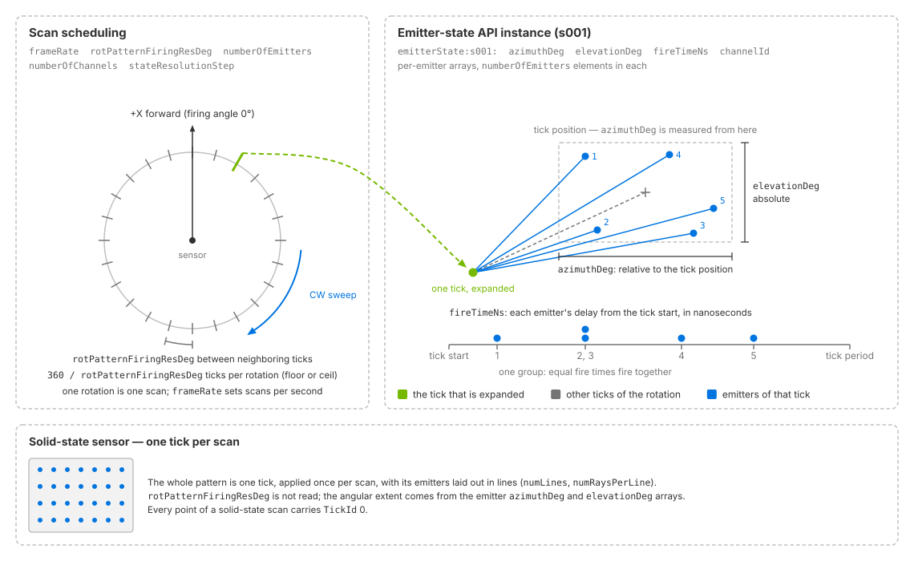
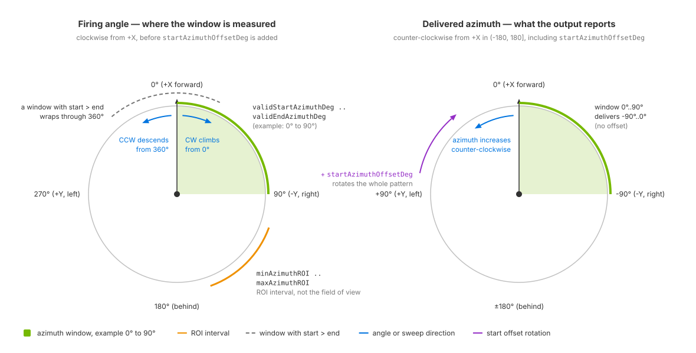

.. SPDX-FileCopyrightText: Copyright (c) 2026 NVIDIA CORPORATION & AFFILIATES. All rights reserved.
.. SPDX-License-Identifier: LicenseRef-NvidiaProprietary
..
.. NVIDIA CORPORATION, its affiliates and licensors retain all intellectual
.. property and proprietary rights in and to this material, related
.. documentation and any modifications thereto. Any use, reproduction,
.. disclosure or distribution of this material and related documentation
.. without an express license agreement from NVIDIA CORPORATION or
.. its affiliates is strictly prohibited.

.. _sensors-nonvisual-lidar-core-attributes:

USD Attributes
==============

The Lidar generic core model uses ``omni:sensor:Core:*`` attributes.
The sections below explain their units, constraints and interactions.
See :doc:`Sensor API Schemas <../../reference/schemas>` for the complete
declarations and defaults.

Sensor definition
-----------------

The model runs on an ``OmniLidar`` prim with ``OmniSensorGenericLidarCoreAPI``
applied. That schema brings the shared sensor attributes and the first emitter
state, ``s001``, with it; a sensor that alternates between firing patterns
applies ``OmniSensorGenericLidarCoreEmitterStateAPI:s002`` and upwards for the
rest, as :doc:`Configure a Firing Pattern <howto/firing_pattern>` shows in USDA.
The runnable lidar example authors the smallest useful prim: the schema, an
output coordinate system, a frame rate and a placement.

.. tab-set::

   .. tab-item:: USDA
      :sync: usda

      .. literalinclude:: ../../../../examples/python/lidar/lidar_example.usda
         :caption: lidar_example.usda
         :language: usda
         :start-after: # [snippet:configure-lidar-sensor]
         :end-before: # [/snippet:configure-lidar-sensor]
         :prepend: #usda 1.0

   .. tab-item:: USD Python
      :sync: python

      .. literalinclude:: ../../../../tests/docs/usd/test_nonvisual_authoring.py
         :language: python
         :start-after: # [snippet:doc-nonvisual-example-configure-lidar-sensor-python]
         :end-before: # [/snippet:doc-nonvisual-example-configure-lidar-sensor-python]
         :dedent:

A sensor prim looks along its
local ``-Z`` with ``+Y`` up, and :ref:`Orienting the prim
<sensors-common-sensor-configuration-orientation>` explains that camera
convention, the output frame it is mapped onto and why the example authors
``(90, 0, -90)``; the :ref:`field-of-view section
<sensors-nonvisual-lidar-core-attributes-fov>` below says what the mapping means
for azimuths.

.. _sensors-nonvisual-lidar-core-attributes-one-product-per-sensor:

**One RenderProduct per sensor.** A RenderProduct of this model names one
sensor prim in its ``rel camera``, and the model renders that sensor. To run
several sensors of this model, give each its own product, as the
:ref:`independent-products pattern <sensors-common-output-configuration-independent-products>`
shows. Step every product on every step
(:ref:`sensors-common-multi-rate-stepping`).

.. _sensors-nonvisual-lidar-core-attributes-namespaces:
.. _sensors-ref-attributes-namespaces:

Model-specific attributes use ``omni:sensor:Core:*``. Emitter-state arrays
include the schema group and instance, for example
``omni:sensor:Core:emitterState:s001:azimuthDeg``. Shared identity and
scheduling attributes use ``omni:sensor:*``. See
:ref:`attribute namespaces <sensors-common-sensor-configuration-namespaces>`
for naming rules and the effect of using an incorrect namespace.

Identification and scheduling
-----------------------------

The seven shared ``omni:sensor:*`` attributes are described on :ref:`Sensor
Configuration <sensors-common-sensor-configuration-shared-attributes>`. What is
specific to this model:

- Applying ``OmniSensorGenericLidarCoreAPI`` sets ``omni:sensor:modelName`` to
  ``"LidarCore"``, ``omni:sensor:modelVendor`` to ``"NVIDIA"``,
  ``omni:sensor:marketName`` to ``"Generic"`` and ``omni:sensor:frameRate`` to
  ``(10, 1)``. ``omni:sensor:startTime`` and ``omni:sensor:frameLimit`` keep
  the shared defaults: zero seconds and no limit.
- On an ``OmniLidar``, ``omni:sensor:modelName`` selects the lidar model, and
  the other two strings are labels the model does not read; :ref:`model identity <sensors-ref-model-identity-vs-plugin>` gives the rule. On this
  model ``"Generic"`` records that the prim carries the schema defaults, and
  the :doc:`tutorials <tutorials/index>` replace it with the device's product
  name.
- ``omni:sensor:frameRate`` is how many complete scans the sensor finishes per
  second, as a rational Hz pair ``(numerator, denominator)``; its lidar
  meaning is under :ref:`scheduling attributes <sensors-nonvisual-lidar-core-attributes-scheduling>`.

Scanning principle
------------------

``omni:sensor:Core:scanType`` selects rotary (``ROTARY``, default) or
solid-state (``SOLID_STATE``) scanning. Most attributes apply to both types;
the table lists the scan-specific controls.

.. list-table::
   :class: compact-table
   :header-rows: 1
   :widths: 18 42 40

   * - ``scanType``
     - What it means
     - What it brings with it
   * - ``ROTARY``
     - A rotating lidar. The firing pattern is applied repeatedly around a full
       revolution.
     - The angular step ``rotPatternFiringResDeg``; a rotation direction,
       ``rotationDirection``; and an azimuth field of view from
       ``validStartAzimuthDeg`` to ``validEndAzimuthDeg``.
   * - ``SOLID_STATE``
     - A solid-state lidar, flash lidars included. One tick per scan.
     - The line structure of the pattern: ``numLines``, ``numRaysPerLine`` and
       the per-emitter ``bank`` that says which line an emitter belongs to.

``omni:sensor:Core:rotationDirection`` applies to rotary sensors. ``CW``
(clockwise) is the default; ``CCW`` reverses the sweep. At the start of each
scan period, the sweep passes 0 degrees: ``CW`` increases from 0 and ``CCW``
decreases from 360. See :ref:`angle conventions
<sensors-nonvisual-lidar-core-attributes-fov>` for firing and output azimuths.

``scanType`` is fixed once the model is built: the model is built for one
principle, and an edit to the other is refused; refer to :ref:`what stays fixed
<sensors-lidar-core-no-runtime-changes>`.

.. _sensors-nonvisual-lidar-core-attributes-ray-type:

Ray type
^^^^^^^^

``omni:sensor:Core:rayType`` chooses the shape of the ray each emitter
fires: ``IDEALIZED`` (the default), ``GAUSSIAN_BEAM`` or ``UNIFORM_BEAM``.

An idealized ray either hits a surface or misses it. A beam has width, so it
can straddle an edge: part hits the object and part reaches a surface behind it.
One firing can therefore return two ranges. This is *partial beam coverage*.

The beam types distribute power differently:

- ``GAUSSIAN_BEAM`` concentrates power at the center. Losing the rim costs less
  signal than losing the center.
- ``UNIFORM_BEAM`` distributes power evenly, like a plane wave. Signal falls with
  the fraction of the footprint lost.

Partial coverage is coarse, not continuous. A partly covered beam does not
produce a proportionally dimmer return. See :doc:`howto/intensity` for return
weighting.

``maxReturns`` reads differently for the two kinds of ray. Along an idealized
ray the model keeps the first ``maxReturns`` surfaces it meets; for a beam it
keeps the ``maxReturns`` strongest returns, after hits at nearly the same range
have merged into one. Beam ray types cost substantially more to trace than
idealized rays, so start with ``IDEALIZED`` and switch only when an edge effect
or a partial return is what you are studying; the :doc:`tutorials
<tutorials/index>` do the same.

The beam geometry attributes, ``beamWaistHorM``, ``beamWaistVerM``,
``divergenceHorDeg``, ``divergenceVerDeg`` and ``Msquared``, build the beam for
the two beam ray types. They are not ignored for an idealized ray: the intensity
processing and the detection threshold read the waist, the divergence and the
beam quality factor whatever the ray type. :ref:`Beam properties
<sensors-nonvisual-lidar-core-attributes-beam>` below describes them.

``rayType`` is read when the model is built. Author it before the sensor first
produces, and recreate the sensor to change it; refer to :ref:`what stays fixed
<sensors-lidar-core-no-runtime-changes>`.

Firing pattern
--------------

A firing pattern defines the scan rate, rotary angular step, emitter count
and detector count. Per-emitter directions, firing times and detector
assignments are authored through instances of the multiple-apply
``OmniSensorGenericLidarCoreEmitterStateAPI`` schema on the same sensor prim.

- A **tick** is one application of the firing pattern. Rotary ticks are spaced
  by ``rotPatternFiringResDeg``; a solid-state scan has one tick. ``TickId``
  identifies the tick that produced each point, starting from zero.
- An **emitter** represents a laser. At each tick, every emitter in the active
  state fires with azimuth offset ``azimuthDeg``, absolute elevation
  ``elevationDeg`` and delay ``fireTimeNs`` from the tick's start. Points from
  one tick can have different measurement times, reported by ``TimeOffsetNs``.
- A **channel** represents a detector. ``numberOfChannels`` sets the detector
  count; ``channelId`` assigns each emitter to a detector. Output channels,
  such as the ``ChannelId`` tensor, are described on :doc:`outputs`.
- An **emitter state** is an instance of
  ``OmniSensorGenericLidarCoreEmitterStateAPI``. The main sensor schema includes
  ``OmniSensorGenericLidarCoreEmitterStateAPI:s001``. Apply additional instances,
  such as ``OmniSensorGenericLidarCoreEmitterStateAPI:s002``, to cycle through
  multiple sets of per-emitter values.
- A **scan** is one complete pass of the pattern.
  ``omni:sensor:frameRate`` sets the number of scans per second.
- A **return** is one detected point. A firing can produce zero or more returns.

.. _sensors-nonvisual-lidar-core-attributes-figure-firing-pattern:

         rotPatternFiringResDeg around the rotation; one tick is expanded into
         its emitters fanned out by azimuthDeg and elevationDeg, with their
         fireTimeNs offsets on a time axis beneath. Panels show scan scheduling
         and an emitter-state API instance; a lower panel shows a solid-state sensor with
         one tick per scan.
   :align: center
   :width: 90%

   Rotary ticks are spaced by ``rotPatternFiringResDeg``. The emitter state
   defines each emitter's direction and firing time within a tick.
   A solid-state sensor (lower panel) applies its pattern once per scan.

See :doc:`howto/firing_pattern` for array-length and firing-time requirements,
flash-lidar configuration and cycling through emitter states.

.. _sensors-nonvisual-lidar-core-attributes-scheduling:

Scheduling attributes
^^^^^^^^^^^^^^^^^^^^^

.. list-table::
   :class: compact-table
   :header-rows: 1
   :widths: 34 12 14 40

   * - Attribute
     - Type
     - Default
     - What it does
   * - ``omni:sensor:frameRate``
     - ``double2``
     - ``(10, 1)``
     - The scan rate, as rational Hz: how many complete scans happen per
       second.
   * - ``omni:sensor:startTime``
     - ``double2``
     - ``(0, 1)``
     - Scans are counted from it.
   * - ``rotPatternFiringResDeg``
     - ``float``
     - ``0.1``
     - The angular step, in degrees, at which a rotary sensor applies its
       pattern; a solid-state sensor does not read it.
   * - ``maxReturns``
     - ``uint``
     - ``2``
     - Caps how many returns are kept per channel for one firing.
   * - ``numberOfEmitters``
     - ``uint``
     - ``128``
     - The number of emitters per emitter state, and so the length of every
       non-empty per-emitter array.
   * - ``numberOfChannels``
     - ``uint``
     - ``128``
     - The number of detectors.
   * - ``stateResolutionStep``
     - ``uint``
     - ``1``
     - How many consecutive rotary ticks, or consecutive solid-state scans,
       reuse the same emitter state before the model advances to the next.
   * - ``numLines``
     - ``uint``
     - ``0``
     - The number of lines of a solid-state pattern; a rotary sensor leaves it
       at its default.
   * - ``numRaysPerLine``
     - ``uint[]``
     - ``[]``
     - One element per line saying how many emitters it holds, so the elements
       add up to ``numberOfEmitters``.

.. _sensors-lidar-core-frame-rate-floor:

``omni:sensor:frameRate`` is the scan rate, as rational Hz: ``(10, 1)`` is ten
complete scans per second, and scans are counted from ``omni:sensor:startTime``.
A scheduled scan needs a rate of at least 0.466 Hz; lower positive rates are
rejected, for the reason :ref:`the minimum scan rate
<sensors-lidar-min-scan-rate>` gives where the firing pattern is authored. A
rate of zero, ``(0, 1)``, is not rejected: the model treats it as unset and
flashes a whole scan in every capture, as if ``instantLidar`` were set
(:ref:`sensors-lidar-core-instant-lidar`). The renderer then captures the
sensor on its default schedule, described under
:ref:`Frame rate, step and delivery <sensors-common-multi-rate-frame-rate>`.

.. _sensors-lidar-core-tick-count:
.. _sensors-lidar-num-ticks-per-scan:

``omni:sensor:Core:rotPatternFiringResDeg`` is the angular step, in degrees, at
which a rotary sensor applies its pattern (default ``0.1``); a solid-state
sensor does not read it. The scan rate and the angular step are independent
knobs that together set the tick rate, so a finer step or a faster scan
shortens each tick. Because ``q = 360 / rotPatternFiringResDeg`` need not be a
whole number, a rotation's tick count is not fixed, and a nominal tick count
must not size a per-rotation buffer; :ref:`fractional ticks
<sensors-lidar-fractional-ticks>` on :doc:`Configure a Firing Pattern
<howto/firing_pattern>` states the rule, with the tick-rate consequence for
fire times.

``omni:sensor:Core:maxReturns`` caps how many returns are kept per channel for
one firing (default ``2``). Which ones are kept depends on the ray type, as
:ref:`ray type <sensors-nonvisual-lidar-core-attributes-ray-type>` describes.
A transmissive surface is itself a return, so seeing past it generally means
raising ``maxReturns``.

``omni:sensor:Core:numberOfEmitters`` is the number of emitters per emitter
state (default ``128``), and so the length of every non-empty per-emitter
array. ``omni:sensor:Core:numberOfChannels`` is the number of detectors
(default ``128``). The two counts do not have to agree: several emitters may
report into one detector, and a sensor may have detectors no emitter uses.

.. warning::

   A solid-state sensor needs ``numberOfChannels`` to be at least
   ``numberOfEmitters``. Keep the two equal unless the device really has more
   detectors than emitters.

``omni:sensor:Core:stateResolutionStep`` (default ``1``) is how many
consecutive rotary ticks, or consecutive solid-state scans, reuse the same
emitter state before the model advances to the next. It matters only with
several states; a sensor with a single firing pattern needs no change.

``omni:sensor:Core:numLines`` (default ``0``) and
``omni:sensor:Core:numRaysPerLine`` (default empty) describe the line structure
of a solid-state pattern: the number of lines, and one element per line saying
how many emitters it holds, so the elements add up to ``numberOfEmitters``. A
rotary sensor leaves them at their defaults. Validation holds them to each
other and to the per-emitter ``bank`` array, as :ref:`parameter validation <sensors-lidar-core-invalid-parameters>` lists.

The model counts the
instances of ``OmniSensorGenericLidarCoreEmitterStateAPI`` applied to the prim
and cycles through them in the lexicographic order of their instance names, so
keep the numbers zero-padded: ``s001``, ``s002``, ``s010``.

.. _sensors-nonvisual-lidar-core-attributes-emitter-state:

Emitter state attributes
^^^^^^^^^^^^^^^^^^^^^^^^

Every attribute of an emitter state is prefixed
``omni:sensor:Core:emitterState:s#:``, where ``s#`` is the instance name,
``s001`` for the state the model's schema applies. Four arrays are required and
hold ``numberOfEmitters`` elements each; the rest hold ``numberOfEmitters``
elements or are empty, and empty means "this state does not use that
correction". :ref:`Array-length requirements <sensors-lidar-emitter-array-lengths>`
says what the schema's 128-element defaults do when you change
``numberOfEmitters``.

.. list-table::
   :class: compact-table
   :header-rows: 1
   :widths: 34 12 14 40

   * - Attribute
     - Type
     - Default
     - What it does
   * - ``azimuthDeg``
     - ``float[]``
     - 128 elements; see the :doc:`schema reference <../../reference/schemas>`;
       full defaults are in the schema shipped in the ovrtx package
     - Required: the emitter's azimuth relative to the tick position, in
       degrees.
   * - ``elevationDeg``
     - ``float[]``
     - 128 elements; see the :doc:`schema reference <../../reference/schemas>`;
       full defaults are in the schema shipped in the ovrtx package
     - Required: the emitter's absolute elevation, in degrees.
   * - ``fireTimeNs``
     - ``uint[]``
     - 128 elements; see the :doc:`schema reference <../../reference/schemas>`;
       full defaults are in the schema shipped in the ovrtx package
     - Required: the emitter's delay from the tick's start time, in
       nanoseconds.
   * - ``channelId``
     - ``uint[]``
     - 128 elements; see the :doc:`schema reference <../../reference/schemas>`;
       full defaults are in the schema shipped in the ovrtx package
     - Required: names the detector each emitter reports into, as the vendor
       numbers it.
   * - ``bank``
     - ``uint[]``
     - ``[]``
     - The line the emitter belongs to, counted from ``0``.
   * - ``rangeId``
     - ``uint[]``
     - ``[]``
     - The range region the emitter uses, counted from ``0``.
   * - ``vertOffsetM``
     - ``float[]``
     - ``[]``
     - The emitter's origin, offset vertically from the sensor origin, in
       meters.
   * - ``horOffsetM``
     - ``float[]``
     - ``[]``
     - The emitter's origin, offset horizontally from the sensor origin, in
       meters.
   * - ``distanceCorrectionM``
     - ``float[]``
     - ``[]``
     - A per-emitter range correction, in meters, subtracted from the ranges
       that emitter reports.
   * - ``emitterPeakPowerW``
     - ``float[]``
     - ``[]``
     - Per-emitter peak power, in watts; an authored entry above 1e-5 W
       overrides the sensor-wide ``peakPowerW`` for its emitter.
   * - ``roi``
     - ``bool[]``
     - ``[]``
     - Which emitters a state flagged ``isROIState`` fires while the tick lies
       inside the interval from ``minAzimuthROI`` to ``maxAzimuthROI``.
   * - ``isROIState``
     - ``bool``
     - ``false``
     - Marks a region-of-interest state: it fires the emitters flagged in
       ``roi`` only while the tick lies inside the interval from
       ``minAzimuthROI`` to ``maxAzimuthROI``.
   * - ``focalDistM``
     - ``float[]``
     - ``[]``
     - Declared per emitter and checked for length with the other arrays, but
       nothing in ovrtx reads it.
   * - ``focalSlope``
     - ``float[]``
     - ``[]``
     - Declared per emitter and checked for length with the other arrays, but
       nothing in ovrtx reads it.

The required direction and timing arrays are:

- ``azimuthDeg`` (``float[]``): azimuth offset from the tick position, in
  degrees. The tick position rotates for rotary scans and remains aligned
  with the sensor's forward direction for solid-state scans.
- ``elevationDeg`` (``float[]``): absolute elevation, in degrees.
- ``fireTimeNs`` (``uint[]``): firing delay from the tick's start, in
  nanoseconds. Values must be nondecreasing and must not exceed the tick
  period. A solid-state tick spans one scan. Equal values fire simultaneously;
  see :ref:`firing-time requirements <sensors-lidar-fire-time-order>`.

.. _sensors-nonvisual-lidar-core-attributes-channel-ids:
.. _sensors-lidar-core-channel-ids-are-labels:

The required ``channelId`` (``uint[]``) array assigns a detector ID to each
emitter. IDs can use any numbering in ``[0, 4294967295]``, including sparse
or vendor-specific values. Across all emitter states, the number of distinct
IDs must not exceed ``numberOfChannels``. ID values do not index the model's
storage, so larger or sparse IDs do not increase memory use. Valid returns
report the authored ID unchanged in ``ChannelId``.

The default state uses IDs ``1`` through ``numberOfChannels``. If your
application indexes a table with ``ChannelId - 1``, validate that IDs fall
within that range; zero and out-of-range IDs are unsafe for this indexing
scheme. See :ref:`ChannelId output
<sensors-nonvisual-lidar-core-outputs-channel-id>` for unwritten slots and
valid-entry filtering.

The optional arrays:

- ``bank`` (``uint[]``): the line the emitter belongs to, counted from ``0``.
  Every value must be below ``numLines``, whose default is ``0``, so authoring
  ``bank`` needs ``numLines`` too, whatever the scan type.
- ``rangeId`` (``uint[]``): the range region the emitter uses, counted from
  ``0``. Every value must be below ``rangeCount``, with a ``rangeCount`` of
  ``0`` counted as ``1``; the regions themselves, ``rangesMinM`` and
  ``rangesMaxM``, are described under :ref:`field of view, range and orientation <sensors-nonvisual-lidar-core-attributes-fov>`.
- ``vertOffsetM`` and ``horOffsetM`` (``float[]``): the emitter's origin,
  offset vertically and horizontally from the sensor origin, in meters. What
  the offset does to the traced rays and to the delivered coordinates is under
  :ref:`emitter offsets <sensors-nonvisual-lidar-core-outputs-emitter-offsets>`
  on :doc:`Outputs <outputs>`.
- ``distanceCorrectionM`` (``float[]``): a per-emitter range correction, in
  meters, subtracted from the ranges that emitter reports.
- ``emitterPeakPowerW`` (``float[]``): per-emitter peak power, in watts. An
  authored entry above 1e-5 W overrides the sensor-wide ``peakPowerW`` for its
  emitter; any other entry, zero included, falls back to it.
- ``roi`` (``bool[]``) and the scalar ``isROIState`` (``bool``, default
  ``false``): a region-of-interest pattern. A state flagged ``isROIState``
  fires the emitters flagged in ``roi`` only while the tick lies inside the
  interval from ``minAzimuthROI`` to ``maxAzimuthROI``, described under
  :ref:`field of view, range and orientation <sensors-nonvisual-lidar-core-attributes-fov>`.
- ``focalDistM`` and ``focalSlope`` (``float[]``): declared per emitter and
  checked for length with the other arrays, but nothing in ovrtx reads them;
  refer to :ref:`declared but not read <sensors-nonvisual-lidar-core-attributes-not-read>`.

.. _sensors-nonvisual-lidar-core-attributes-fov:

Field of view, range and orientation
------------------------------------

This group decides which returns are delivered. Each limit is a validity limit:
a return outside it is not a valid point, so by default it is dropped from the
point cloud, and with ``includeInvalidPoints`` it arrives as an invalid entry.
The procedure, the window mechanism and how to verify what arrives are on
:doc:`Constrain the Field of View <howto/field_of_view>`.

.. list-table::
   :class: compact-table
   :header-rows: 1
   :widths: 34 12 14 40

   * - Attribute
     - Type
     - Default
     - What it does
   * - ``nearRangeM``
     - ``float``
     - ``0.3``
     - Near limit of the range band, in meters; a surface closer than it is as
       absent from the point cloud as one beyond ``farRangeM``.
   * - ``farRangeM``
     - ``float``
     - ``200.0``
     - Far limit of the range band, in meters; it also bounds how far any ray
       is traced.
   * - ``rangeCount``
     - ``uint``
     - ``0``
     - The number of range regions ``rangesMinM`` and ``rangesMaxM`` define;
       with the arrays authored, it must equal the length of each, with ``0``
       counted as ``1``.
   * - ``rangesMinM``
     - ``float[]``
     - ``[]``
     - With ``rangesMaxM``, defines the range regions an emitter's ``rangeId``
       selects, in meters, with ``rangeCount`` elements; the selected window
       is the validity test for that emitter's returns instead of the band.
   * - ``rangesMaxM``
     - ``float[]``
     - ``[]``
     - With ``rangesMinM``, defines the range regions, in meters, with
       ``rangeCount`` elements; ``farRangeM`` still bounds the trace.
   * - ``validStartAzimuthDeg``
     - ``float``
     - ``0.0``
     - Start of the rotary field of view, in degrees, measured on the firing
       angle before ``startAzimuthOffsetDeg`` is added; rotary sensors only.
   * - ``validEndAzimuthDeg``
     - ``float``
     - ``360.0``
     - End of the rotary field of view, in degrees; when the start is greater
       than the end, the window wraps through 360 degrees.
   * - ``minAzimuthROI``
     - ``float``
     - ``400.0``
     - Start of the interval in which ROI-tagged emitter states participate,
       in degrees, tested against the tick position; ``400`` means that no ROI
       is configured.
   * - ``maxAzimuthROI``
     - ``float``
     - ``400.0``
     - End of that interval, in degrees; an interval whose start is greater
       than its end wraps through 360 degrees, and authoring an ROI does not
       narrow the point cloud.
   * - ``rangeOffsetM``
     - ``float``
     - ``0.0``
     - The distance along every ray within which objects are invisible, in
       meters; the control for a sensor that sits inside another object.
   * - ``rangeAccuracyM``
     - ``float``
     - ``0.02``
     - The range error scale, in meters: the model adds Gaussian range error
       scaled by it, and the error grows with the return's distance relative
       to ``farRangeM``.
   * - ``rangeResolutionM``
     - ``float``
     - ``0.004``
     - Declared as a distance quantization step, in meters, but the model does
       not read it, so in ovrtx it has no effect.
   * - ``minDistBetweenEchosM``
     - ``float``
     - ``0.4``
     - The minimum distance between two echoes for them to be resolved
       separately, in meters; also a second near limit, because a firing's
       first return is measured against the sensor itself.
   * - ``reflectionPowerFraction``
     - ``float``
     - ``0.5``
     - Scales the material's reflected share when a firing continues past a
       surface for the next return.
   * - ``transmissionPowerFraction``
     - ``float``
     - ``1.0``
     - Scales the material's transmitted share when a firing continues past a
       surface for the next return.
   * - ``startAzimuthOffsetDeg``
     - ``float``
     - ``0.0``
     - The start azimuth offset of the sensor, in degrees; on a rotary sensor
       it is added to every firing direction, so delivered azimuths include
       it, while the valid-azimuth window is measured before it is added.

``nearRangeM`` and ``farRangeM`` define the accepted range interval in meters,
with defaults of ``0.3`` and ``200``. Returns outside it are invalid.
``farRangeM`` also limits tracing distance. See
:ref:`the range band <sensors-lidar-range-window>` for examples.

``rangeCount`` (default
``0``), ``rangesMinM`` and ``rangesMaxM`` (``float[]``, in meters, with
``rangeCount`` elements each) define range regions, and each emitter's
``rangeId`` selects one. Once you author them, the window an emitter's
``rangeId`` selects is the validity test for that emitter's returns instead of
the band; ``farRangeM`` still bounds the trace. With the arrays authored,
``rangeCount`` must equal the length of each, with ``0`` counted as ``1``, or
the whole parameter set fails validation.

``validStartAzimuthDeg``
(default ``0``) and ``validEndAzimuthDeg`` (default ``360``) apply to rotary
sensors only; a solid-state sensor takes its angular extent from the emitter
azimuth and elevation arrays. When the start is greater than the end, the
window wraps through 360 degrees. The window is measured on the *firing angle*,
the tick position plus the emitter's azimuth, clockwise from the sensor's
forward axis and before ``startAzimuthOffsetDeg`` is added, not on the azimuth
the output reports: with no offset, a window from 0 to 90 degrees delivers
azimuths from -90 to 0 degrees. :ref:`The azimuth window
<sensors-lidar-azimuth-window>` gives the conversion for checking delivered
points against it.

``minAzimuthROI`` and ``maxAzimuthROI`` (default ``400`` each, in
degrees) define the interval in which ROI-tagged emitter states participate in
a foveated or multi-state pattern, together with ``isROIState`` and the
per-emitter ``roi`` array described above. The default of ``400`` means that no
ROI is configured; author both limits to configure one, and an interval whose
start is greater than its end wraps through 360 degrees. The interval is tested
against the tick position, before the emitter's own azimuth and
``startAzimuthOffsetDeg`` are added. Authoring an ROI does not narrow the point
cloud, and the untagged states of the pattern are not confined to the interval;
the azimuth pair is what narrows the cloud.

.. _sensors-nonvisual-lidar-core-attributes-figure-angle-conventions:

         measured clockwise from the sensor's forward axis, before
         startAzimuthOffsetDeg, with the validStartAzimuthDeg to
         validEndAzimuthDeg window and the ROI interval drawn as arcs, and
         arrows showing the CW and CCW sweep directions. Right: the delivered
         azimuth measured counter-clockwise from the forward axis in the range
         (-180, 180], including startAzimuthOffsetDeg.
   :align: center
   :width: 90%

   Angle conventions of a rotary sensor seen from above. The firing angle
   (left) runs clockwise from the forward axis, before the start offset is
   added; the validity window is measured on it, the ROI interval on the tick
   position it starts from, and the sweep runs ``CW`` or ``CCW`` along it. The
   delivered azimuth (right) runs counter-clockwise from the forward axis in
   ``(-180, 180]`` and includes ``startAzimuthOffsetDeg``.

``rangeOffsetM`` (default ``0.0``) is the
distance along every ray within which objects are invisible, in meters: the
trace starts that far out from the emitter, so a surface inside the offset is
never hit, while reported ranges stay measured from the emitter. It is the
control for a sensor that sits inside another object, such as a housing or a
bumper. ``rangeAccuracyM`` (default ``0.02``) is the range error scale, in
meters: the model adds Gaussian range error scaled by it, and the error grows
with the return's distance relative to ``farRangeM``.

.. _sensors-nonvisual-lidar-core-attributes-accuracy-vs-resolution:
.. _sensors-ref-range-accuracy-vs-resolution:

``rangeAccuracyM`` controls simulated range uncertainty. ``rangeResolutionM``
is declared as a distance quantization step (default ``0.004`` m), but the
model does not read it. It has no effect on delivered coordinates.

.. _sensors-nonvisual-lidar-core-attributes-echo-separation:

``minDistBetweenEchosM`` (default ``0.4``)
is the minimum distance between two echoes for them to be resolved separately,
in meters. It is also a second near limit, because a firing's first return is
measured against the sensor itself. With ``IDEALIZED`` rays a first return
nearer than this distance is therefore dropped even inside the range window,
and nothing farther along that firing's path is reported either; whichever of
``nearRangeM`` and ``minDistBetweenEchosM`` is farther is the near limit that
applies. Later returns along the ray are measured against the previous kept
return, so two surfaces resolve separately only when they are at least this
far apart. With ``GAUSSIAN_BEAM`` or ``UNIFORM_BEAM``, whose returns are ranked
strongest first, each return is measured against the one ranked just before it
if that one was kept, and against the sensor otherwise, and the separation two
surfaces need is the larger of ``minDistBetweenEchosM`` and half the distance
light travels in ``pulseTimeNs``, so a long pulse can merge close returns.

**Multiple returns share the power.** When ``maxReturns`` allows more than one
return, a firing that meets a surface continues past it to look for the next,
by reflection or by transmission, whichever carries more power once two factors
have scaled the material's reflected and transmitted shares:
``reflectionPowerFraction`` (default ``0.5``) scales the reflected share and
``transmissionPowerFraction`` (default ``1.0``) the transmitted share. The
continuing firing carries that scaled share, so later returns come back weaker
than the first. How a surface reflects or transmits at the sensor's wavelength
comes from its material label; refer to :doc:`Non-Visual Sensor Materials
<../../../materials/nonvisual_sensor_materials>`.

**Orientation.** ``startAzimuthOffsetDeg`` (default ``0.0``) is the start
azimuth offset of the sensor, in degrees. On a rotary sensor it is added to
every firing direction, so delivered azimuths include it, while the
valid-azimuth window is measured before it is added, as the figure above shows.
A solid-state sensor's firing directions do not include it. The angles
themselves live in the sensor frame that :ref:`Sensor Outputs
<sensors-common-sensor-outputs-sensor-frame>` defines, with azimuth 0 straight
ahead and positive delivered azimuth to the left; :ref:`Orienting the prim
<sensors-common-sensor-configuration-orientation>` says how the prim's
camera-style axes are mapped onto that frame and gives the rotation the
examples author.

.. _sensors-nonvisual-lidar-core-attributes-intensity:

Intensity, detection floor, beam and detector
---------------------------------------------

These attributes control return detection and reported ``Intensity`` values.
The model applies the detection threshold before clipping the processed signal
to ``[0, 1]`` and mapping and scaling it for output. See :doc:`howto/intensity`
for configuration and verification.

Intensity output
^^^^^^^^^^^^^^^^

.. list-table::
   :class: compact-table
   :header-rows: 1
   :widths: 34 12 14 40

   * - Attribute
     - Type
     - Default
     - What it does
   * - ``intensityProcessing``
     - ``token``
     - ``"NORMALIZATION"``
     - Decides what the delivered intensity number means: ``RAW``,
       ``NORMALIZATION`` or ``CORRECTION``.
   * - ``intensityScalePercent``
     - ``float``
     - ``255.0``
     - Maps the clipped value onto the delivered one: the delivered intensity
       is the model's value times ``intensityScalePercent / 100``.
   * - ``intensityMappingType``
     - ``token``
     - ``"LINEAR"``
     - Layers a lookup on top, to emphasize particular regions of the
       intensity range; ``NONLINEAR`` and ``NONLINEAR_ENCODING_ONLY`` look the
       clipped value up before the scaling, ``LINEAR`` and
       ``NONLINEAR_DECODING_ONLY`` deliver the linear value.
   * - ``intensityMappingEncoding``
     - ``float[]``
     - ``[]``
     - The table the clipped value is looked up in before the scaling; a table
       with fewer entries than ``intensityScalePercent`` acts as a correction,
       one with at least that many entries replaces the value.
   * - ``intensityMappingDecoding``
     - ``float[]``
     - ``[]``
     - Carried on the prim for a consumer that decodes the delivered values;
       the model does not apply it to what it delivers.

``omni:sensor:Core:intensityProcessing`` selects how the detector signal is
processed relative to the calibration signal defined by ``minReflectance``
and ``minReflectionRangeM``. The detector signal depends on the pulse,
wavelength, detector parameters and the material response at that wavelength.

- ``RAW``: uses the detector signal relative to the calibration signal,
  without range normalization. Return intensity decreases with distance.
- ``NORMALIZATION`` (default): compensates for beam spreading with distance
  from ``focusDistM``.
- ``CORRECTION``: applies a range-proportional factor beyond a fixed near
  distance. Nearer returns receive no range correction.

For beam ray types, all modes normalize by the returned fraction of the beam,
so partial beam coverage does not proportionally reduce intensity. All modes
also apply an aperture factor that reduces the signal when the beam footprint
exceeds ``effectiveApertureSizeM``; this factor never increases the signal.
The processed signal is tested against the detection threshold before being
clipped to ``[0, 1]`` for output.

``intensityMappingType`` selects the mapping applied to the clipped value:

- ``LINEAR`` (default) and ``NONLINEAR_DECODING_ONLY`` leave it unchanged.
- ``NONLINEAR`` and ``NONLINEAR_ENCODING_ONLY`` use
  ``intensityMappingEncoding``. For a table with *count* entries, the lookup
  index is floor(*value* × (*count* − 1)). If *count* is less than
  ``intensityScalePercent``, the table entry is added to the clipped value.
  Otherwise, the entry replaces it.

After mapping, the value is multiplied by ``intensityScalePercent / 100``.
The default scale is ``255``, so a saturated return with linear mapping
produces an intensity of ``2.55``.

``intensityMappingDecoding`` stores a decoding table for consumers; the model
does not apply it to the output. Both mapping tables are ``float[]`` arrays
of arbitrary length, empty by default.

Detection floor
^^^^^^^^^^^^^^^

.. list-table::
   :class: compact-table
   :header-rows: 1
   :widths: 34 12 14 40

   * - Attribute
     - Type
     - Default
     - What it does
   * - ``minReflectance``
     - ``float``
     - ``0.1``
     - Reference target reflectance, expressed as a fraction. Together with
       ``minReflectionRangeM``, defines the detection-threshold calibration.
   * - ``minReflectionRangeM``
     - ``float``
     - ``200.0``
     - The range of the calibration point, in meters.

The model derives its detection threshold from a reference target with
reflectance ``minReflectance`` at distance ``minReflectionRangeM``.
See :ref:`detection thresholds <sensors-intensity-point-drops>` for the effect
of each processing mode, thresholds above the output clipping level and
other return-rejection conditions.

.. _sensors-nonvisual-lidar-core-attributes-beam:

Beam properties
^^^^^^^^^^^^^^^

Beam attributes define emitted power, wavelength, pulse duration and beam
geometry. For beam ray types, pulse duration also affects
:ref:`echo separation <sensors-nonvisual-lidar-core-attributes-echo-separation>`.

.. list-table::
   :class: compact-table
   :header-rows: 1
   :widths: 34 12 14 40

   * - Attribute
     - Type
     - Default
     - What it does
   * - ``peakPowerW``
     - ``float``
     - ``10.0``
     - Peak emitted optical power per emitter, in watts; a per-emitter
       ``emitterPeakPowerW`` entry above 1e-5 W overrides it.
   * - ``waveLengthNm``
     - ``float``
     - ``903.0``
     - Emitter wavelength, in nanometers, used in photon conversion.
   * - ``pulseTimeNs``
     - ``uint``
     - ``6``
     - Pulse duration, in nanoseconds. Scales received photon count and affects
       echo separation for beam ray types.
   * - ``focusDistM``
     - ``float``
     - ``0.15``
     - Beam focus distance, in meters; the reference distance for range
       normalization.
   * - ``Msquared``
     - ``float``
     - ``1.4``
     - Beam quality factor M², used in waist/divergence conversion and
       intensity normalization.
   * - ``beamWaistHorM``
     - ``float``
     - ``0.002``
     - Horizontal beam waist at the focus, in meters.
   * - ``beamWaistVerM``
     - ``float``
     - ``0.002``
     - Vertical beam waist at the focus, in meters.
   * - ``divergenceHorDeg``
     - ``float``
     - ``0.0``
     - Horizontal beam divergence, in degrees. Derived from the waist by
       default.
   * - ``divergenceVerDeg``
     - ``float``
     - ``0.0``
     - Vertical beam divergence, in degrees.

Specify either beam waist or divergence for each axis. The model derives the
other using wavelength and ``Msquared``; by default it derives divergence
from the waists. See :ref:`waist and divergence
<sensors-intensity-divergence-or-waist>` for the calculation and precedence
when both are authored, and :ref:`ray types
<sensors-nonvisual-lidar-core-attributes-ray-type>` for their use in tracing.
Per-emitter power overrides are listed under
:ref:`emitter-state attributes <sensors-nonvisual-lidar-core-attributes-emitter-state>`.

Detector properties
^^^^^^^^^^^^^^^^^^^

Detector attributes control conversion of received light into a signal. Use
device specifications or calibration measurements where available.

.. list-table::
   :class: compact-table
   :header-rows: 1
   :widths: 34 12 14 40

   * - Attribute
     - Type
     - Default
     - What it does
   * - ``aspectRatio``
     - ``float``
     - ``1.0``
     - The aspect ratio of the detector; it scales the detector area that
       collects the received signal and the background light.
   * - ``effectiveApertureSizeM``
     - ``float``
     - ``0.01``
     - Effective receiver aperture, in meters. Reduces the signal when the
       beam footprint exceeds it.
   * - ``quantumEfficiency``
     - ``float``
     - ``0.9``
     - The detector's quantum efficiency.
   * - ``pixelPitch``
     - ``float``
     - ``40.0``
     - The detector's pixel pitch, in micrometers.
   * - ``calibrationGain``
     - ``float``
     - ``40.0``
     - The detector's calibration gain.
   * - ``bitDepthResolution``
     - ``float``
     - ``65536.0``
     - The detector's bit-depth resolution.

.. _sensors-nonvisual-lidar-core-attributes-mechanical-noise:
.. _sensors-intensity-mechanical-noise:

Mechanical noise
^^^^^^^^^^^^^^^^

Mechanical noise perturbs beam direction and origin. Each component has a
mean and standard deviation. A nonzero mean introduces a fixed bias; a
nonzero standard deviation adds random variation. Origin noise can model
vibration.

.. list-table::
   :class: compact-table
   :header-rows: 1
   :widths: 34 12 14 40

   * - Attribute
     - Type
     - Default
     - What it does
   * - ``azimuthErrorMean``
     - ``float``
     - ``0.0``
     - Mean emitter azimuth error, in degrees.
   * - ``azimuthErrorStd``
     - ``float``
     - ``0.005``
     - Standard deviation of emitter azimuth error, in degrees.
   * - ``elevationErrorMean``
     - ``float``
     - ``0.0``
     - Mean of the emitter's elevation error, in degrees.
   * - ``elevationErrorStd``
     - ``float``
     - ``0.0``
     - Standard deviation of the emitter's elevation error, in degrees.
   * - ``originErrorMean``
     - ``float[]``
     - ``[0.0,0.0,0.0]``
     - Mean of the emitter's origin error as ``[x, y, z]``, in meters.
   * - ``originErrorStd``
     - ``float[]``
     - ``[0.0,0.0,0.0]``
     - Standard deviation of the emitter's origin error as ``[x, y, z]``, in
       meters.

.. _sensors-nonvisual-lidar-core-attributes-output-shaping:

Output shaping and cadence
--------------------------

These attributes select output coordinates, reference frame, motion
compensation, invalid-point handling and scan delivery. See :doc:`outputs`
for tensor layouts, timestamps and frame metadata, and
:doc:`howto/output_shaping` for configuration examples.

.. list-table::
   :class: compact-table
   :header-rows: 1
   :widths: 34 12 14 40

   * - Attribute
     - Type
     - Default
     - What it does
   * - ``elementsCoordsType``
     - ``token``
     - ``"SPHERICAL"``
     - The coordinate system of the ``Coordinates`` channel only,
       ``CARTESIAN`` or ``SPHERICAL``; ``HitNormal`` and ``Velocity`` stay
       Cartesian.
   * - ``outputFrameOfReference``
     - ``token``
     - ``"SENSOR"``
     - The frame every output is expressed in: ``SENSOR``, ``WORLD`` or
       ``CUSTOM``.
   * - ``customFrameOfReferenceTrafo``
     - ``float[]``
     - ``[0,0,0,0,0,0]``
     - The custom frame as ``[x, y, z, roll, pitch, yaw]``, the position in
       meters and the three angles in radians; read only when
       ``outputFrameOfReference`` is ``CUSTOM``.
   * - ``outputMotionCompensationState``
     - ``token``
     - ``"NONCOMPENSATED"``
     - Whether the sensor's own motion during the scan is removed from the
       delivered coordinates; it does not enable the renderer's motion BVH by
       itself.
   * - ``includeInvalidPoints``
     - ``bool``
     - ``false``
     - Include invalid output entries.
   * - ``partialOutputs``
     - ``bool``
     - ``false``
     - Deliver partial scans on each step instead of waiting for a complete scan.
   * - ``instantLidar``
     - ``bool``
     - ``false``
     - Trace a complete scan at each step's start time. Uses the start pose
       with motion BVH enabled, or the frame-end pose otherwise.

Coordinate representation and reference frame are independent.
``elementsCoordsType`` affects only ``Coordinates``. ``HitNormal`` and
``Velocity`` remain Cartesian and are rotated into ``outputFrameOfReference``
without translation. See :ref:`output coordinates
<sensors-nonvisual-lidar-core-howto-output-shaping-meaning>`.

.. _sensors-nonvisual-lidar-core-attributes-motion-compensation:

``outputMotionCompensationState`` selects whether to compensate for the
sensor's motion during a scan:

- ``NONCOMPENSATED`` (default) retains motion distortion.
- ``COMPENSATED`` uses each point's timestamp and the sensor's motion to
  transform it into the requested output frame. ``HitNormal`` and ``Velocity``
  follow the same compensation state.

Motion effects require the renderer's :ref:`motion BVH <sensors-common-output-configuration-motion-bvh>`, selected at renderer
creation. See :doc:`howto/motion_artifacts` for configuring both settings.

``includeInvalidPoints = false`` delivers valid returns only. With ``true``,
all slots are delivered; use ``Flags`` to select valid entries as described
on :doc:`outputs`.

``partialOutputs = false`` accumulates a complete scan and delivers it on the
step that finishes it. Intermediate steps produce no output for the product.
With ``true``, each step delivers the portion covered by that step's time
interval. ``omni:sensor:frameRate`` sets the scan period; see
:doc:`../../common/multi_rate` for scheduling and delivery.

``instantLidar = true`` traces an entire scan at the start of each step.
With motion BVH enabled, tracing uses the step's start pose; otherwise it
uses the frame-end pose. Authored firing times are ignored during tracing
but still validated. A solid-state sensor can trace a zero-length interval if its end
time is greater than zero; a rotary sensor requires a positive-length interval.
In this mode, ``partialOutputs`` controls which steps deliver the complete
scan. See :ref:`instant lidar <sensors-lidar-core-instant-lidar>` for usage
and :doc:`outputs` for ``timestampNs`` and ``TimeOffsetNs`` behavior.

Runtime updates
---------------

See :doc:`../../common/runtime_updates` for submitting edits, rejected
updates and changes to output requests. The following rules apply to this
lidar model.

.. _sensors-nonvisual-lidar-core-attributes-runtime-edits:
.. _sensors-lidar-core-runtime-edits:

Output settings, including ``includeInvalidPoints`` and ``partialOutputs``,
and intensity-mapping tables support runtime edits. Changes to ``maxReturns``,
emitter/channel counts, ``rotPatternFiringResDeg``, frame rate or table lengths
can rebuild buffers without resetting the frame counter.

Accumulated points are retained unless an edit changes tick or channel
identity; those edits discard the partial scan. With ``partialOutputs = false``,
mid-scan edits to coordinate type, reference frame, custom transform or motion
compensation apply to the entire delivered scan. See
:ref:`runtime output changes <sensors-output-shaping-runtime-changes>`.

.. _sensors-nonvisual-lidar-core-attributes-no-runtime-changes:
.. _sensors-lidar-core-no-runtime-changes:

``scanType`` and ``rayType`` require model recreation:

- Changing ``scanType`` is rejected with an error, along with all other edits
  in that update. The rejected value may remain authored. Later updates are
  checked against the active scan type and can apply if otherwise valid.
- ``rayType`` is read during initialization. A running model cannot switch
  between ``IDEALIZED`` and beam ray types.

Recreate the sensor to change these settings. A RenderVar change that rebuilds
the model reads both from the current authored values. A buffer rebuild
caused by resizing retains the existing scan and ray types.

.. _sensors-nonvisual-lidar-core-attributes-invalid-parameters:
.. _sensors-lidar-core-invalid-parameters:

Parameter validation
--------------------

The model validates attribute types and the complete parameter set at
creation and on every update. It checks these constraints:

- every non-empty per-emitter array holds ``numberOfEmitters`` elements
  (:ref:`array-length requirements <sensors-lidar-emitter-array-lengths>`);
- fire times never decrease within a state, and the last one fits inside one
  firing period: one tick for a rotary sensor, one scan for a solid-state one
  (:ref:`fire-time order <sensors-lidar-fire-time-order>`);
- the emitter states together use no more distinct channel ids than
  ``numberOfChannels`` (:ref:`channel ids <sensors-lidar-channel-ids>`);
- ``rangesMinM`` and ``rangesMaxM``, when authored, have ``rangeCount`` entries,
  with a ``rangeCount`` of ``0`` counted as ``1``, and every ``rangeId`` is
  below ``rangeCount`` (:ref:`the range band <sensors-lidar-range-window>`);
- every ``bank`` is below ``numLines``, and on a solid-state sensor
  ``numRaysPerLine`` has ``numLines`` entries whose sum equals
  ``numberOfEmitters`` (:ref:`scheduling attributes <sensors-nonvisual-lidar-core-attributes-scheduling>` and :ref:`emitter state attributes <sensors-nonvisual-lidar-core-attributes-emitter-state>`);
- a positive frame rate is at least 0.466 Hz (:ref:`the minimum scan rate
  <sensors-lidar-min-scan-rate>`).

For a valid definition, the :doc:`validation utility <../../common/validation>`
reports the authored frame rate and start time, capture duration, frame limit
and partial-output policy. Capture duration is one scan period, or zero with
:ref:`instant lidar <sensors-lidar-core-instant-lidar>`.

A rejected runtime update preserves the previous parameters and output
layout. The :doc:`validation utility <../../common/validation>` reports the
reason when run on the same parameter set; see
:doc:`../../common/runtime_updates`.

Invalid initial parameters prevent initialization and produce no output.
The reason is logged as an error. Correct the parameters to initialize the
sensor on the next step.

.. _sensors-nonvisual-lidar-core-attributes-not-read:

Declared but not read
---------------------

The following attributes are declared but have no effect in this model:

- ``omni:sensor:Core:emitterStatesFile`` (``string``, default empty).
  Use emitter-state API instances instead; see :doc:`howto/firing_pattern`.
- ``omni:sensor:Core:rangeResolutionM`` adds no error and changes no delivered
  coordinate; refer to :ref:`accuracy versus resolution
  <sensors-ref-range-accuracy-vs-resolution>`.
- ``focalDistM`` and ``focalSlope``: per-emitter arrays checked for length
  but not used in simulation.
- ``omni:sensor:encryption:params``: see
  :ref:`shared sensor attributes <sensors-common-sensor-configuration-shared-attributes>`.

Tick rate is derived from ``omni:sensor:frameRate`` and
``rotPatternFiringResDeg``; there is no separate tick-rate attribute. See
:ref:`scan scheduling <sensors-nonvisual-lidar-core-attributes-scheduling>`.

Related
-------

- :doc:`Outputs <outputs>` — the channels, params and cadence the attributes above shape.
- :doc:`Configure a Firing Pattern <howto/firing_pattern>` — authoring the scheduling attributes and emitter states.
- :doc:`Constrain the Field of View <howto/field_of_view>` — the range band, the azimuth window and the ROI in practice.
- :doc:`Sensor Configuration <../../common/sensor_configuration>` — the shared attributes and prim orientation.
