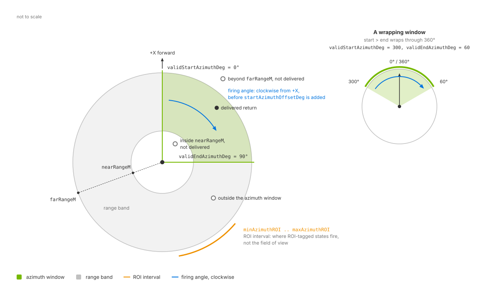

.. SPDX-FileCopyrightText: Copyright (c) 2026 NVIDIA CORPORATION & AFFILIATES. All rights reserved.
.. SPDX-License-Identifier: LicenseRef-NvidiaProprietary
..
.. NVIDIA CORPORATION, its affiliates and licensors retain all intellectual
.. property and proprietary rights in and to this material, related
.. documentation and any modifications thereto. Any use, reproduction,
.. disclosure or distribution of this material and related documentation
.. without an express license agreement from NVIDIA CORPORATION or
.. its affiliates is strictly prohibited.

.. _sensors-nonvisual-lidar-core-howto-field-of-view:

Constrain the Field of View
===========================

The Lidar generic core model filters returns by range and, for rotary scans,
azimuth. These limits define the accepted field of view; they do not aim the
emitters. A separate region of interest applies different distance limits
within part of the scan.

Before you start, use a sensor configured using :doc:`firing_pattern`. The firing
pattern determines ray directions; the limits below filter its returns.

Field-of-view controls
----------------------

The example sets the schema defaults for range and rotary azimuth limits.
They accept a full turn and ranges up to 200 m. With the default ray type,
``minDistBetweenEchosM`` also limits the minimum range; see
:ref:`range limits <sensors-lidar-range-window>`.

.. tab-set::

   .. tab-item:: USDA
      :sync: usda

      .. literalinclude:: ../../../../../tests/docs/usd/data/nonvisual/lidar_core_howto_field_of_view_1.usda
         :language: usda
         :start-after: # [snippet:doc-nonvisual-lidar-core-howto-field-of-view-1]
         :end-before: # [/snippet:doc-nonvisual-lidar-core-howto-field-of-view-1]

   .. tab-item:: USD Python
      :sync: python

      .. literalinclude:: ../../../../../tests/docs/usd/test_nonvisual_authoring.py
         :language: python
         :start-after: # [snippet:doc-nonvisual-lidar-core-howto-field-of-view-1-python]
         :end-before: # [/snippet:doc-nonvisual-lidar-core-howto-field-of-view-1-python]
         :dedent:

The meaning, units and relations of every attribute named on this page are on
:doc:`../attributes`; the type and default of each is in the generated
:doc:`../../../reference/schemas`.

Four validity limits
~~~~~~~~~~~~~~~~~~~~

``nearRangeM`` and ``farRangeM`` bound the return distance.
``validStartAzimuthDeg`` and ``validEndAzimuthDeg`` bound rotary firing angles.
Returns outside these limits are invalid and dropped by default. With
``includeInvalidPoints = true``, their slots remain in the output with the
validity bit clear; see :doc:`../outputs`.

o a second, wrapping example that passes through 360 degrees. A separate arc marks the region of interest between minAzimuthROI and maxAzimuthROI.
   :width: 1180

   The three windows seen from above: the range band between ``nearRangeM``
   and ``farRangeM``, the azimuth window from ``validStartAzimuthDeg`` to
   ``validEndAzimuthDeg`` with a second example that wraps through 360
   degrees, and the region of interest as a separate arc. The window is drawn
   on the firing angle; :ref:`the angle-conventions figure
   <sensors-nonvisual-lidar-core-attributes-figure-angle-conventions>` on the
   attributes page relates it to the delivered azimuth.

.. _sensors-nonvisual-lidar-core-howto-field-of-view-range-band:
.. _sensors-lidar-range-window:

Range limits
~~~~~~~~~~~~

Returns must lie between ``nearRangeM`` and ``farRangeM``. For the default
``IDEALIZED`` rays, ``minDistBetweenEchosM`` imposes an additional near limit;
its default of 0.4 m exceeds the default ``nearRangeM``.

For per-emitter range windows, set ``rangeCount``, provide ``rangesMinM`` and
``rangesMaxM`` arrays of that length, and select a window for each emitter
with ``emitterState:s#:rangeId``. These windows replace the range band for
the emitters using them. See :doc:`firing_pattern` for emitter arrays and
:ref:`range attributes <sensors-nonvisual-lidar-core-attributes-fov>` for
defaults and validation rules.

.. _sensors-nonvisual-lidar-core-howto-field-of-view-azimuth-window:
.. _sensors-lidar-azimuth-window:

Rotary azimuth limits
~~~~~~~~~~~~~~~~~~~~~

``validStartAzimuthDeg`` and ``validEndAzimuthDeg`` restrict rotary scans.
Solid-state angular coverage comes from the emitter arrays; see
:doc:`firing_pattern`. Both boundaries are inclusive.

The limits apply to the firing angle, which differs from the delivered
azimuth. See the :ref:`angle-conventions figure
<sensors-nonvisual-lidar-core-attributes-figure-angle-conventions>` and the
:ref:`verification procedure
<sensors-nonvisual-lidar-core-howto-field-of-view-verify>` below. Defaults,
wrapping and sweep direction are described under
:ref:`field-of-view attributes <sensors-nonvisual-lidar-core-attributes-fov>`.

Filtering is independent of delivery cadence. With ``partialOutputs = false``
(default), each completed scan contains all accepted returns, including those
in a window that wraps through 360 degrees. With ``true``, each step delivers
accepted returns from its portion of the scan; see :doc:`output_shaping`.

.. _sensors-nonvisual-lidar-core-howto-field-of-view-roi-window:
.. _sensors-lidar-roi-window:

Region of interest
~~~~~~~~~~~~~~~~~~

``minAzimuthROI`` and ``maxAzimuthROI`` do not narrow the point cloud: they
confine the emitter states tagged with ``emitterState:s#:isROIState`` to an
interval of the rotation and leave the untagged states unconfined. To narrow
what the sensor delivers, use :ref:`the azimuth pair
<sensors-lidar-azimuth-window>`; the defaults, the wrap rule, which angle the
interval is tested against and the tagging arrays are under :ref:`field of view, range and orientation <sensors-nonvisual-lidar-core-attributes-fov>`.

.. _sensors-nonvisual-lidar-core-howto-field-of-view-verify:

Verification
------------

Request ``Coordinates`` on the ``PointCloud`` RenderVar and read entries
``[0, Counts[0])``; see :doc:`../../../common/sensor_outputs`. Use the defaults
``outputFrameOfReference = SENSOR`` and
``outputMotionCompensationState = NONCOMPENSATED`` for these checks; see
:doc:`output_shaping`.

Read ``coordsType`` from each frame to determine its representation. For
``1``, coordinates are azimuth and elevation in degrees, followed by distance
in meters. For ``0``, calculate range from the vector norm and heading with
``atan2(y, x)``. Output parameters describe the settings actually used; an
authored runtime edit may not yet apply to an in-flight frame. See
:doc:`../outputs` for parameter definitions. Check the resulting values:

- Every delivered range lies within ``[nearRangeM, farRangeM]`` or, when the
  profile authors ``rangesMinM`` and ``rangesMaxM``, within the window its
  emitter's ``emitterState:s#:rangeId`` selects. Request ``EmitterId`` and
  ``TickState`` to identify the emitter and the state an entry came from, and
  read its ``rangeId`` from that state's array.
- On a rotary sensor, every delivered azimuth lies inside :ref:`the azimuth
  window <sensors-lidar-azimuth-window>` once it is taken back to the angle
  the window is measured in. The delivered azimuth is measured the other way
  round and includes ``startAzimuthOffsetDeg``, as :doc:`../outputs` states, so
  reduce ``-azimuth - startAzimuthOffsetDeg`` modulo 360 into ``[0, 360)`` for
  each entry, and check that the result falls in the interval from
  ``validStartAzimuthDeg`` to ``validEndAzimuthDeg``, which wraps through 360
  degrees when the start is greater than the end.

Allow a small boundary tolerance. Filtering follows range and azimuth error,
so those errors do not move accepted returns outside the windows. However,
filtering measures from the emitter while output coordinates reference the
sensor prim. Emitter offsets and coordinate-rounding errors can therefore
put delivered coordinates slightly beyond a limit.

Narrow one limit and repeat the check with partial outputs both enabled and
disabled. The corresponding data boundary should move. Counts can vary with
noise and :doc:`intensity filtering <intensity>`, but accepted returns must
still satisfy the windows.

If ``compactionType = 1``, invalid slots are included. Select entries with
the ``Flags`` valid bit before testing either window; see :doc:`../outputs`.

Potential issues
----------------

See the :doc:`Symptom Index <../../../troubleshooting/symptoms>` for
additional causes and checks.

- A nearby object never appears while distant ones do: it is inside
  :ref:`the near range <sensors-lidar-range-window>`, or nearer than
  ``minDistBetweenEchosM``.
- The point cloud covers the whole turn although an ROI was authored: the ROI
  attributes do not narrow the field of view. Use :ref:`the azimuth pair
  <sensors-lidar-azimuth-window>` for that, and see :ref:`what the ROI window
  does <sensors-lidar-roi-window>`.
- An authored ROI does not take effect: an ROI needs both ``minAzimuthROI``
  and ``maxAzimuthROI`` authored below 400 and at least one emitter state
  tagged with ``emitterState:s#:isROIState``. Leave any of the three out and
  no ROI is configured; see :ref:`what the ROI window does
  <sensors-lidar-roi-window>`.
- An ROI that appears to cover the opposite side of the sensor: a
  ``minAzimuthROI`` greater than ``maxAzimuthROI`` is a wrapping interval rather
  than an error.
- The azimuth limits do nothing at all: the sensor is solid state, where they do
  not apply.

Related
-------

- :doc:`Configure a Firing Pattern <firing_pattern>` — where the sensor aims; the emitter arrays, ``rangeId``, ``isROIState`` and ``roi``.
- :doc:`Configure Lidar Output <output_shaping>` — ``partialOutputs``, ``elementsCoordsType``, the output frame, and what a runtime edit changes.
- :doc:`Tune Intensity and Point Drops <intensity>` — why the delivered point count varies from scan to scan.
- :doc:`Lidar generic core model <../index>` — what the model simulates and when to choose it.
