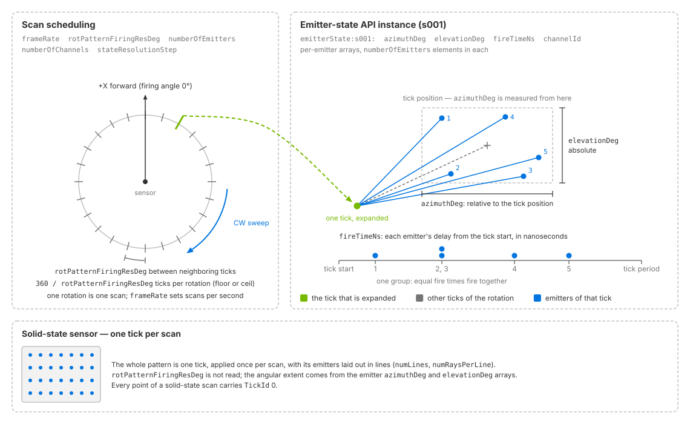
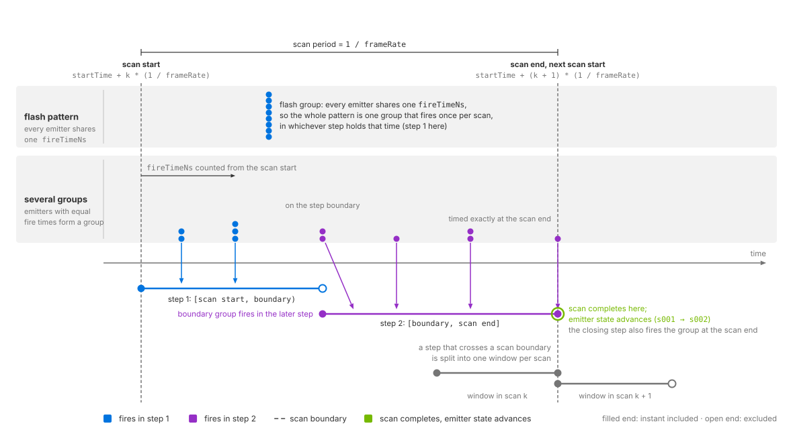

.. SPDX-FileCopyrightText: Copyright (c) 2026 NVIDIA CORPORATION & AFFILIATES. All rights reserved.
.. SPDX-License-Identifier: LicenseRef-NvidiaProprietary
..
.. NVIDIA CORPORATION, its affiliates and licensors retain all intellectual
.. property and proprietary rights in and to this material, related
.. documentation and any modifications thereto. Any use, reproduction,
.. disclosure or distribution of this material and related documentation
.. without an express license agreement from NVIDIA CORPORATION or
.. its affiliates is strictly prohibited.

.. _sensors-nonvisual-lidar-core-howto-firing-pattern:

Configure a Firing Pattern
==========================

A firing pattern defines when each emitter fires and where it points. The
Lidar generic core model combines scan scheduling with one or more emitter
states to repeat that pattern. This procedure covers rotary and solid-state
patterns, validation rules and output checks. See :doc:`../attributes` for
attribute definitions and :doc:`../outputs` for firing identifiers.

Before you start, configure a sensor and RenderProduct; see :doc:`../index` and
:doc:`../../../common/output_configuration`.

Pattern authoring
-----------------

Scan attributes set the pattern size and repetition rate. Emitter states
provide per-emitter directions, firing times and channel IDs.
``OmniSensorGenericLidarCoreAPI`` includes emitter state ``s001``. Apply
additional instances, ``s002`` and above, to alternate between patterns.
See :doc:`../attributes` for definitions of scans, ticks, emitters and channels.

The example configures two emitters and their first state. Each required
array contains ``numberOfEmitters`` entries:

.. tab-set::

   .. tab-item:: USDA
      :sync: usda

      .. literalinclude:: ../../../../../tests/docs/usd/data/nonvisual/lidar_core_howto_firing_pattern_1.usda
         :language: usda
         :start-after: # [snippet:doc-nonvisual-lidar-core-howto-firing-pattern-1]
         :end-before: # [/snippet:doc-nonvisual-lidar-core-howto-firing-pattern-1]

   .. tab-item:: USD Python
      :sync: python

      .. literalinclude:: ../../../../../tests/docs/usd/test_nonvisual_authoring.py
         :language: python
         :start-after: # [snippet:doc-nonvisual-lidar-core-howto-firing-pattern-1-python]
         :end-before: # [/snippet:doc-nonvisual-lidar-core-howto-firing-pattern-1-python]
         :dedent:

         rotPatternFiringResDeg around the rotation; one tick is expanded into
         its emitters fanned out by azimuthDeg and elevationDeg, with their
         fireTimeNs offsets on a time axis beneath. Panels show scan scheduling
         and an emitter-state API instance; a lower panel shows a solid-state
         sensor with one tick per scan.
   :align: center
   :width: 90%

   Rotary ticks are spaced by ``rotPatternFiringResDeg``, with ``frameRate``
   setting the scan rate. An ``OmniSensorGenericLidarCoreEmitterStateAPI``
   instance defines each emitter's direction (``azimuthDeg``, ``elevationDeg``)
   and firing time (``fireTimeNs``) within a tick. A solid-state sensor
   (lower panel) applies its pattern once per scan.

Scan scheduling
^^^^^^^^^^^^^^^

``omni:sensor:frameRate`` sets complete scans per second. For rotary scans,
``rotPatternFiringResDeg`` sets the angular step between ticks; solid-state
scans do not use it. ``numberOfEmitters`` sets the number of firings per tick
and the length of each required emitter-state array.

``numberOfChannels`` sets the detector count. It can differ from the emitter
count, but solid-state scans require at least ``numberOfEmitters`` channels.
``stateResolutionStep`` controls cycling between multiple emitter states.
``numLines`` and ``numRaysPerLine`` describe solid-state line patterns.
See :doc:`../attributes` and the :doc:`generated schema reference
<../../../reference/schemas>` for types, defaults and constraints.

Scan rate and angular step
^^^^^^^^^^^^^^^^^^^^^^^^^^

``omni:sensor:frameRate`` controls complete scans per second, while
``rotPatternFiringResDeg`` controls the angular spacing of ticks within each
rotary scan. Together they set the tick rate: on average a rotary sensor fires
``frameRate * (360 / rotPatternFiringResDeg)`` ticks per second. A faster scan or
a finer step therefore shortens each tick, and a pattern's last fire time still
has to fit inside one tick period (refer to :ref:`the fire-time rules
<sensors-lidar-fire-time-order>`). With the schema's defaults, a step of 0.1
degrees, which is 3,600 ticks per rotation, and a pattern whose last emitters
fire 24.5 microseconds into the tick, a rotary sensor fails validation above
about 11.3 Hz, and the renderer logs the reason as an error; what a rejected
parameter set does is under :ref:`a rejected parameter set
<sensors-lidar-core-invalid-parameters>`.

.. _sensors-lidar-fractional-ticks:

A rotation does not hold a whole number of ticks unless you choose an angular
step that divides 360. Let ``q = 360 / rotPatternFiringResDeg``. If ``q`` is
not a whole number, the model carries the fractional phase across rotations, so
completed rotations contain either ``floor(q)`` or ``ceil(q)`` ticks while the
long-run firing rate is preserved.

.. warning::

   Allow for ``ceil(q)`` ticks when allocating per-rotation storage. If
   ``rotPatternFiringResDeg`` does not divide 360 exactly, successive rotations
   can contain different tick counts. Delivered ``TickId`` values are a subset
   of ``[0, that rotation's tick count)``; they do not report the count.
   See :doc:`../outputs`.

Emitter states
^^^^^^^^^^^^^^

An emitter state is the firing pattern applied at every tick, written as
parallel arrays with one entry per emitter under
``omni:sensor:Core:emitterState:s###:``. Four arrays are required:

- ``azimuthDeg``: the emitter's azimuth relative to the tick position.
- ``elevationDeg``: its absolute elevation.
- ``fireTimeNs``: its firing delay from the start of the tick, in nanoseconds.
- ``channelId``: the detector it reports into, in any numbering.

Optional per-emitter arrays include:

- ``bank``: the line a solid-state emitter belongs to.
- ``rangeId``: the range window applied to the emitter.
- ``vertOffsetM`` and ``horOffsetM``: offsets of the emitter's origin.
- ``distanceCorrectionM``: a correction subtracted from the reported range, in meters.
- ``focalDistM`` and ``focalSlope``: arrays checked for length but not used by ovrtx.
- ``emitterPeakPowerW``: per-emitter peak power, in watts.
- ``roi``: region-of-interest flags, used with the per-state flag ``isROIState``.

The meaning, units and constraints of each array are on :doc:`../attributes`
under the emitter-state attributes. The range windows ``rangeId`` selects, and
the region of interest that ``roi`` and ``isROIState`` take part in, are on
:doc:`field_of_view` (:ref:`the range window <sensors-lidar-range-window>`). The
emitter-origin offsets move both the traced rays and the published points, and
the output coordinates already include them in every output frame; refer to
:doc:`../outputs` before you add an offset of your own.

.. _sensors-nonvisual-lidar-core-howto-firing-pattern-rules:

Rules the model checks
^^^^^^^^^^^^^^^^^^^^^^

The model checks the following rules at creation and on every update.
:ref:`Parameter validation <sensors-lidar-core-invalid-parameters>` also lists
bounds for ``bank``, ``rangeId`` and ``numRaysPerLine``. Run
:doc:`../../../common/validation` to check a layer before rendering.

.. _sensors-lidar-emitter-array-lengths:

Each required array — ``azimuthDeg``, ``elevationDeg``, ``fireTimeNs`` and
``channelId`` — must contain ``numberOfEmitters`` entries. Optional arrays
must be empty or have that same length. An empty optional array disables its
correction for that emitter state. The schema defaults contain 128 entries
in each required array and leave optional arrays empty. Changing
``numberOfEmitters`` therefore requires replacing the required arrays.

.. _sensors-lidar-fire-time-order:

``fireTimeNs`` must be nondecreasing within each emitter state. Equal values
define simultaneous firings, which are always processed together in one step.
The final value must not exceed the tick period, including equality. For a
solid-state sensor, one tick spans the entire scan period. A violation rejects
the complete parameter set.

.. _sensors-lidar-channel-ids:

Channel IDs are reported exactly as authored. Across all emitter states,
the number of distinct IDs must not exceed ``numberOfChannels``. Exceeding
it rejects the complete parameter set. See
:ref:`channel labels <sensors-lidar-core-channel-ids-are-labels>` for default
numbering and :ref:`ChannelId <sensors-nonvisual-lidar-core-outputs-channel-id>`
for output behavior, including unwritten entries.

.. _sensors-lidar-min-scan-rate:

A positive ``omni:sensor:frameRate`` must evaluate to at least 0.466 Hz. Lower positive
rates are rejected, because the per-point ``TimeOffsetNs`` is a signed 32-bit
nanosecond value and a slower scan cannot be expressed in it. The rule applies
to positive rates only; what a rate of ``(0, 1)`` does is under
:ref:`omni:sensor:frameRate <sensors-lidar-core-frame-rate-floor>` on
:doc:`../attributes`.

.. _sensors-nonvisual-lidar-core-howto-firing-pattern-broken-rule:

A failed check rejects the entire parameter set and logs an error. A running
sensor retains its previous values, including values for otherwise valid edits
in the same update; see :ref:`update outcomes
<sensors-common-runtime-updates-outcomes>`. Invalid initial parameters
:ref:`prevent initialization until corrected <sensors-lidar-core-invalid-parameters>`. See
:ref:`runtime restrictions <sensors-lidar-core-no-runtime-changes>` for
settings that require model recreation.

.. _sensors-lidar-emitter-state-cycle:

Add a second emitter state
^^^^^^^^^^^^^^^^^^^^^^^^^^

A second emitter state is a second instance of the emitter-state API.
``OmniSensorGenericLidarCoreAPI`` already applies
``OmniSensorGenericLidarCoreEmitterStateAPI`` as instance ``s001``; apply
``s002`` next to it and author that instance's own arrays, each with
``numberOfEmitters`` entries. With ``stateResolutionStep = 1`` a rotary lidar
alternates between the two states on every tick, and a solid-state lidar on
every completed scan. The example below adds the second instance and its four
required arrays:

.. tab-set::

   .. tab-item:: USDA
      :sync: usda

      .. literalinclude:: ../../../../../tests/docs/usd/data/nonvisual/lidar_core_howto_firing_pattern_2.usda
         :language: usda
         :start-after: # [snippet:doc-nonvisual-lidar-core-howto-firing-pattern-2]
         :end-before: # [/snippet:doc-nonvisual-lidar-core-howto-firing-pattern-2]

   .. tab-item:: USD Python
      :sync: python

      .. literalinclude:: ../../../../../tests/docs/usd/test_nonvisual_authoring.py
         :language: python
         :start-after: # [snippet:doc-nonvisual-lidar-core-howto-firing-pattern-2-python]
         :end-before: # [/snippet:doc-nonvisual-lidar-core-howto-firing-pattern-2-python]
         :dedent:

Apply an additional emitter-state API instance for each pattern and author
its arrays under the matching instance name (``s003`` and so on). States run
in instance-name order, advancing every ``stateResolutionStep`` ticks on a
rotary sensor or scans on a solid-state sensor. See
:ref:`scheduling attributes <sensors-nonvisual-lidar-core-attributes-scheduling>`
for ordering and zero-padding rules. Partial outputs retain the state of their
solid-state scan. Each point's :doc:`TickState <../outputs>` reports the
zero-based index of the state that fired it.

Solid-state timing
^^^^^^^^^^^^^^^^^^

A rotary sensor distributes its pattern over the rotation, one tick per angular
step. A solid-state sensor has one tick per scan and processes its pattern in
fire-time order, one window per simulation step.

Scan boundaries occur at ``omni:sensor:startTime`` plus whole scan periods.
Fire times are relative to the scan's start. The window rules are:

- Include its start and exclude its end. A group on a boundary between steps
  fires in the later step only.
- The window that closes a scan also includes a group exactly at the scan's end;
  validation permits that fire time.
- A window containing no fire times fires nothing, including after the last group.

For a flash lidar, give every emitter the same ``fireTimeNs``. They form one
group that fires in the step containing that time. ovrtx splits a step crossing
a scan boundary into one window per scan, so each group fires once per scan.

With ``instantLidar = false``, the scan completes and its emitter state
advances when the step reaches the period boundary, even if no emitter fires
in that step. With ``instantLidar = true``, the whole pattern fires at each
traced window's start and completes a scan. Authored firing times are ignored
during tracing but remain subject to validation; see
:ref:`instant lidar <sensors-lidar-core-instant-lidar>`.

``partialOutputs`` controls delivery independently. By default, only the
completing step returns the scan; see
:ref:`steps without completed scans <sensors-output-shaping-empty-step>`.

eting the scan and advancing the emitter state
   :align: center
   :width: 1180

   A solid-state scan over two simulation steps. Each step fires the groups
   inside its window, start included and end excluded, so the group on the
   shared boundary fires in the second step; the step whose window reaches the
   end of the scan period completes the scan and advances the emitter state.

Verification
------------

Request ``TickId`` and ``ChannelId`` on the ``PointCloud`` RenderVar, and
``EmitterId`` too on a solid-state sensor, run the sensor, and read the
delivered entries ``[0, Counts[0])``, selecting the real returns by the
``Flags`` valid bit, as :doc:`../../../common/sensor_outputs` describes under
:ref:`reading a variable-size output <sensors-common-sensor-outputs-reading>`.
What each channel means is on :doc:`../outputs`. Three things must hold:

- Every valid point's ``ChannelId`` is one of the ids authored in the emitter
  states' ``channelId`` arrays, unchanged, so no more than ``numberOfChannels``
  distinct values appear.
- On a rotary sensor, accumulated over one completed rotation, every ``TickId``
  is below that rotation's tick count (:ref:`fractional ticks
  <sensors-lidar-fractional-ticks>`). A tick that found nothing contributes no
  point, so the distinct values are a subset of that range and never wider than
  it.
- On a solid-state sensor every ``TickId`` is ``0``, one tick per scan, so check
  the schedule with ``EmitterId`` instead: with ``partialOutputs`` off and
  ``includeInvalidPoints`` on, every scan the sensor traced in full carries each
  ``EmitterId`` from ``0`` through ``numberOfEmitters - 1``, each exactly once
  when ``numberOfChannels`` equals ``numberOfEmitters`` and ``maxReturns`` is
  ``1``.

Return counts depend on scene geometry and filtering. Each channel can
produce up to ``maxReturns`` returns, and invalid points are dropped by
default. Check tick and channel bounds independently of the valid-return count.
With ``partialOutputs = false`` (default), the model accumulates a complete
scan; with ``true``, the consumer accumulates it across frames.
See :ref:`output timing <sensors-output-shaping-lidar-timing>`.

Potential issues
----------------

- Per-rotation buffers overrun or come up one tick short: a fractional ``q`` was
  read as a fixed tick count. Refer to :ref:`fractional ticks
  <sensors-lidar-fractional-ticks>`.
- Points attributed to the neighboring detector: the consumer reads
  ``ChannelId`` as a zero-based index. The output is the authored id; refer to
  :ref:`channel ids <sensors-lidar-channel-ids>`.
- An emitter state appears to be ignored: the extra state's API schema instance
  is not applied to the prim, or its arrays are authored under a prefix that
  does not match the instance name. Refer to :ref:`the emitter-state cycle
  <sensors-lidar-emitter-state-cycle>`.
- A parameter update or scan rate is rejected: check
  :ref:`pattern constraints <sensors-nonvisual-lidar-core-howto-firing-pattern-rules>`,
  including the :ref:`minimum scan rate <sensors-lidar-min-scan-rate>`.
  Run :doc:`../../../common/validation` to identify the cause. Invalid initial
  parameters prevent output; see
  :ref:`rejection behavior <sensors-nonvisual-lidar-core-howto-firing-pattern-broken-rule>`.

More symptoms, with their causes and remedies across every model, are in the
:doc:`../../../troubleshooting/symptoms`.

Related
-------

- :doc:`USD Attributes <../attributes>` — scheduling, emitter states, parameter validation, and :ref:`what stays fixed on a running sensor <sensors-lidar-core-no-runtime-changes>`.
- :doc:`Outputs <../outputs>` — what ``TickId``, ``ChannelId``, ``EmitterId``, ``TickState`` and ``TimeOffsetNs`` report, and how the emitter-origin offsets enter the coordinates.
- :doc:`Constrain the Field of View <field_of_view>` — the range windows ``rangeId`` selects and the region of interest.
- :doc:`Configure Lidar Output <output_shaping>` — partial outputs, the empty mid-scan step and instant lidar.
- :doc:`Parameterize a Rotary Lidar: Velodyne Alpha Prime <../tutorials/velodyne_alpha_prime>` — a complete rotary firing pattern derived from a manual.
- :doc:`Parameterize a Solid-State Lidar: Blickfeld Cube 1 <../tutorials/blickfeld_cube1>` — a solid-state pattern with its line structure and fire times.
- :doc:`Parameterize One Sensor Two Ways: SICK TiM781 <../tutorials/sick_tim781>` — the same sensor as a rotary and as a solid-state profile.
