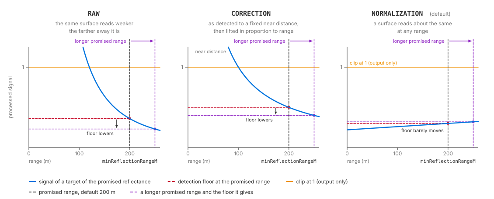
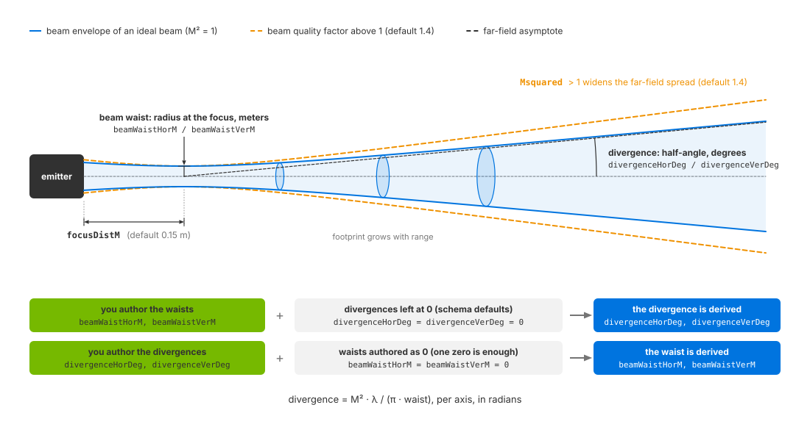

.. SPDX-FileCopyrightText: Copyright (c) 2026 NVIDIA CORPORATION & AFFILIATES. All rights reserved.
.. SPDX-License-Identifier: LicenseRef-NvidiaProprietary
..
.. NVIDIA CORPORATION, its affiliates and licensors retain all intellectual
.. property and proprietary rights in and to this material, related
.. documentation and any modifications thereto. Any use, reproduction,
.. disclosure or distribution of this material and related documentation
.. without an express license agreement from NVIDIA CORPORATION or
.. its affiliates is strictly prohibited.

.. _sensors-nonvisual-lidar-core-howto-intensity:
.. _sensors-do-intensity:

Tune Intensity and Point Drops
==============================

The Lidar generic core model lets you control reported intensity separately
from the detection threshold that removes weak returns. Choose an intensity
processing mode and output scale, then calibrate the detection threshold,
beam and detector against the device you are modeling. Attribute definitions
are on :doc:`../attributes`.

Before you start, configure a lidar that produces points; see :doc:`Your First Lidar Sensor
<../../../first_sensor>` or the :doc:`model overview <../index>`.

.. note::

   The Lidar generic wpm model has intensity controls of its own under
   ``omni:sensor:LidarWpm:*``, with different names, modes and scale; refer to
   its :doc:`USD attributes <../../lidar_wpm/attributes>`. Everything on this
   page is about the Lidar generic core model and its ``omni:sensor:Core:*``
   attributes.

Intensity controls
------------------

The example sets intensity scale, processing mode and detection-threshold
calibration on the sensor prim, using their schema defaults:

.. tab-set::

   .. tab-item:: USDA
      :sync: usda

      .. literalinclude:: ../../../../../tests/docs/usd/data/nonvisual/lidar_core_howto_intensity_1.usda
         :language: usda
         :start-after: # [snippet:doc-nonvisual-lidar-core-howto-intensity-1]
         :end-before: # [/snippet:doc-nonvisual-lidar-core-howto-intensity-1]

   .. tab-item:: USD Python
      :sync: python

      .. literalinclude:: ../../../../../tests/docs/usd/test_nonvisual_authoring.py
         :language: python
         :start-after: # [snippet:doc-nonvisual-lidar-core-howto-intensity-1-python]
         :end-before: # [/snippet:doc-nonvisual-lidar-core-howto-intensity-1-python]
         :dedent:

How intensity is computed
-------------------------

The detector integrates received light. Intensity processing transforms this
signal, then mapping and scaling determine the output value. The detection
threshold is applied before output clipping and scaling.

.. _sensors-intensity-scale:
.. _sensors-nonvisual-lidar-core-howto-intensity-scale:

Scale and mapping
~~~~~~~~~~~~~~~~~

The model computes an intensity between 0 and 1, which
``omni:sensor:Core:intensityScalePercent`` scales for delivery and the
``omni:sensor:Core:intensityMappingType`` modes can reshape first; the scale,
the modes and their tables are defined under
:ref:`Intensity, detection floor, beam and detector <sensors-nonvisual-lidar-core-attributes-intensity>`
on :doc:`../attributes`.

.. _sensors-intensity-processing:
.. _sensors-nonvisual-lidar-core-howto-intensity-processing:

Processing mode
~~~~~~~~~~~~~~~

Choose ``omni:sensor:Core:intensityProcessing`` to match the device's
reported quantity. See :ref:`intensity processing
<sensors-nonvisual-lidar-core-attributes-intensity>` for the calculations:

- ``NORMALIZATION`` (the default) when the sensor reports a calibrated
  reflectivity: a surface of a given reflectance reads about the same at any
  range.
- ``RAW`` when the sensor reports its detector signal as it is: the same
  surface reads weaker the farther away it is.
- ``CORRECTION`` when calibration data shows that the device lifts distant
  returns by a range-dependent factor rather than normalizing them fully.

.. _sensors-nonvisual-lidar-core-howto-intensity-beam-coverage:

``GAUSSIAN_BEAM`` and ``UNIFORM_BEAM`` trace a finite footprint. At an
object's edge, one firing can produce returns at two distances. In every
processing mode, each return's intensity is normalized to the portion of the
beam returned across all surfaces reached by that firing. A beam crossing
an edge can therefore produce two returns rather than a single dimmed one.
Coverage changes in discrete steps; Gaussian beams weight the footprint
center more strongly. See ``rayType`` on :doc:`../attributes` for beam
coverage and power distribution.

.. _sensors-intensity-point-drops:
.. _sensors-nonvisual-lidar-core-howto-intensity-point-drops:

Detection threshold
-------------------

The detection threshold is calculated for a target with reflectance
``minReflectance`` at distance ``minReflectionRangeM`` in meters. Reflectance
is a fraction: 0.1 represents a 10% target. Lowering it permits weaker
returns. See :ref:`detection attributes
<sensors-nonvisual-lidar-core-attributes-intensity>`.

Range limits and ``minDistBetweenEchosM`` can also reject returns. See
:ref:`range windows <sensors-lidar-range-window>` on :doc:`field_of_view`
and echo separation on :doc:`../attributes`.

Use a published reflectance/range pair, such as 10% at 300 m. If several
pairs are available, select one for calibration and retain the others as
validation targets, as in the :doc:`Velodyne tutorial
<../tutorials/velodyne_alpha_prime>`. Preserve the test conditions associated
with each claim. The :doc:`Blickfeld tutorial <../tutorials/blickfeld_cube1>`
uses the published point that specifies target reflectance and records
conditions the model cannot reproduce.

The effect of ``minReflectionRangeM`` depends on the processing mode.
Increasing it lowers the threshold under ``RAW`` and, with the default beam,
``CORRECTION``. Under ``NORMALIZATION`` with ``IDEALIZED`` rays, range
normalization largely cancels the reference target's falloff, and increasing
``minReflectionRangeM`` raises the threshold slightly. Adjust
``minReflectance`` to change sensitivity in that configuration.

   How the processed signal of a target of the reference reflectance changes
   with range under each processing mode. The floor is derived at
   ``minReflectionRangeM``: under ``RAW`` and ``CORRECTION`` a longer reference
   range meets a weaker signal and so lowers the floor, while under
   ``NORMALIZATION`` the normalized signal is nearly flat and the floor barely
   moves. The clip at 1 applies to the output only. Schematic, not to scale.

Detection precedes output clipping to 1. If the threshold exceeds 1, strong
returns can still pass, but all report the maximum output intensity. Narrow
beam divergence can produce this condition for beam ray types; high
``calibrationGain`` can produce it for any ray type.

.. note::

   Surface response depends on its non-visual material label. See
   :doc:`Non-Visual Sensor Materials <../../../../materials/nonvisual_sensor_materials>`
   for configuration.

.. _sensors-nonvisual-lidar-core-howto-intensity-transmissive:

A return behind a transmissive surface must exceed the detection threshold
after transmission losses on both the outward and return paths. Low
transmission can prevent detection. The front surface also produces a return,
so increase ``maxReturns`` to report surfaces behind it; see :doc:`../attributes`.

Beam properties
---------------

``peakPowerW`` and ``pulseTimeNs`` affect received energy. For beam ray types,
``pulseTimeNs`` also affects echo separation; see ``minDistBetweenEchosM`` on
:doc:`../attributes`. ``focusDistM``, ``Msquared``, divergence and beam waist
define beam geometry. Intensity processing and detection thresholds use these
parameters for every ray type, including ``IDEALIZED``. Units and definitions
are on :doc:`../attributes`.

The *beam waist* is the beam's radius at its
focus, in meters. The *divergence* is the angle at which the beam spreads
beyond the focus, authored in degrees per axis. The *beam quality factor*
``Msquared`` (M²) scales divergence relative to an ideal beam of the same
waist; 1 is ideal and the default is 1.4.

.. _sensors-intensity-divergence-or-waist:
.. _sensors-nonvisual-lidar-core-howto-intensity-divergence-or-waist:

Divergence or beam waist
~~~~~~~~~~~~~~~~~~~~~~~~

Beam waist and divergence are related, per axis, by
``divergence = M² · λ / (π · waist)``. Use the same length unit for wavelength
and waist. The result is in radians; convert it to degrees for comparison
with ``divergenceHorDeg`` and ``divergenceVerDeg``.

If either value in one pair is zero and both values in the other pair are
nonzero, the model derives both values of the incomplete pair. The default
waists are 0.002 m and divergences are zero, so divergence is derived by default.

To specify divergence, set both angles and set the waists to zero. One zero
waist is sufficient to derive both. Setting only one divergence angle while
leaving the other zero causes both to be derived from the default waists,
replacing the authored angle. At least one pair must be complete for this
calculation.

If all four values are nonzero, the model retains them without reconciling
them. Intensity processing and ``IDEALIZED`` rays use those stored values.
``GAUSSIAN_BEAM`` and ``UNIFORM_BEAM`` tracing uses divergence and a waist
derived from it, which can differ from the stored waist. To keep tracing and
intensity consistent, specify one pair and set the other to zero.

   Waist, divergence and beam quality factor describe one beam. The waist is
   the radius at the focus distance ``focusDistM``; beyond it the footprint
   grows along the divergence angle, and a beam quality factor above 1 widens
   the far-field spread. Author one pair and the model derives the other
   through divergence = M² · λ / (π · waist). Schematic, not to scale.

Detector and mechanical noise
-----------------------------

Use measured or published detector values for aperture, quantum efficiency,
pixel pitch (micrometers), calibration gain and bit depth. ``aspectRatio``
and ``pixelPitch`` determine collecting area. ``calibrationGain`` multiplies
the signal and can raise the detection threshold above the output clipping
level. See :doc:`../attributes` for definitions.

Mechanical-noise attributes perturb emitter direction and origin. See
:ref:`mechanical noise <sensors-intensity-mechanical-noise>` for controls,
units and defaults.

.. _sensors-nonvisual-lidar-core-howto-intensity-verify:

Verification
------------

Read ``Intensity`` over ``[0, Counts[0])`` and check for a nonzero value.
An empty output cannot satisfy this check. Count valid points using the
``Flags`` bit ``0x40``, including when ``includeInvalidPoints`` is enabled.
See :doc:`../outputs` for channel definitions, :doc:`output_shaping` for
invalid-point handling and :doc:`Sensor Outputs <../../../common/sensor_outputs>`
for bounds on array reads.

Then move the detection floor and re-run against the same scene: raise
``minReflectance`` and the valid count falls, lower it and the count rises, the
dimmest and most distant surfaces changing first. How many points a sweep
produces is scene-dependent and not reproducible; the direction of the change
is.

.. figure:: ../../../../img/sensors/nonvisual/lidar_core_intensity_floor_sweep.avif
   :alt: Two renders of the same lidar sweep over the asphalt plane and the concrete cube, colored by Intensity. Left, at the default floor, the rings reach the horizon; right, with minReflectance raised to 0.5, the far rings are gone while the cube keeps every point.
   :width: 1608

   The same sweep colored by ``Intensity``, on the left at the default floor
   (``minReflectance`` 0.1 at 200 m), on the right after raising
   ``minReflectance`` to 0.5. The distant asphalt rings disappear first; the
   cube, bright and near, keeps all of its points.

.. _sensors-nonvisual-lidar-core-howto-intensity-symptoms:

Potential issues
----------------

See the :doc:`Symptom Index <../../../troubleshooting/symptoms>` for
additional causes and checks.

- No returns from surfaces you know are within range: the detection floor is
  above them. ``minReflectance`` is too high, or, under ``RAW`` (and
  ``CORRECTION`` with the default beam), ``minReflectionRangeM`` is shorter
  than the distances in the scene. Under the default ``NORMALIZATION`` with
  ``IDEALIZED`` rays the range barely moves the floor, so lower
  ``minReflectance`` instead. Refer to :ref:`the calibration pair
  <sensors-intensity-point-drops>`.
- Intensities outside the expected numeric range: check
  ``intensityScalePercent`` and the :ref:`processing mode <sensors-intensity-processing>` before changing beam or detector parameters.
- Every kept return reports the same, largest intensity
  (``intensityScalePercent`` / 100 under ``LINEAR`` mapping): every kept signal
  reached the clip at 1, as it must when the detection floor itself is above
  1. With a beam ``rayType`` a very narrow divergence can put the floor there,
  and a high detector gain can with any ray type. ``intensityScalePercent``
  only rescales the clipped value; look at the beam and detector numbers and at
  :ref:`the calibration pair <sensors-intensity-point-drops>`.
- Intensity changed after a change that "only" set the wavelength: expected.
  ``waveLengthNm`` feeds the photon conversion.
- Beam-derived quantities not what you computed by hand: both the divergence
  and the waist were non-zero, so neither was derived. Authoring only the
  divergence is enough for this, because the waists default to non-zero. Refer
  to :ref:`divergence and beam waist <sensors-intensity-divergence-or-waist>`.
- Two close surfaces arriving as one return: they are closer together than the
  separation the ray type resolves. Refer to ``minDistBetweenEchosM`` on
  :doc:`../attributes`.

Related
-------

- :doc:`Lidar generic core model <../index>` — the model overview
- :doc:`USD Attributes <../attributes>` — the processing modes, the detection floor, beam, detector and mechanical-noise groups, ``rayType``, ``maxReturns`` and ``minDistBetweenEchosM``
- :doc:`Outputs <../outputs>` — the ``Intensity`` channel, ``Counts`` and the ``VALID`` bit
