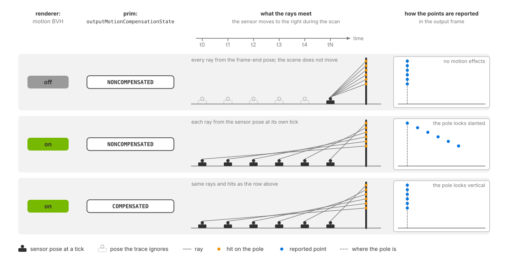

.. SPDX-FileCopyrightText: Copyright (c) 2026 NVIDIA CORPORATION & AFFILIATES. All rights reserved.
.. SPDX-License-Identifier: LicenseRef-NvidiaProprietary
..
.. NVIDIA CORPORATION, its affiliates and licensors retain all intellectual
.. property and proprietary rights in and to this material, related
.. documentation and any modifications thereto. Any use, reproduction,
.. disclosure or distribution of this material and related documentation
.. without an express license agreement from NVIDIA CORPORATION or
.. its affiliates is strictly prohibited.

.. _sensors-nonvisual-lidar-core-howto-motion-artifacts:

Motion Artifacts
================

Motion during a scan can distort a lidar point cloud. Motion BVH enables
tracing against changing sensor and scene transforms. The Lidar generic core
model can then compensate the output for sensor motion using
``omni:sensor:Core:outputMotionCompensationState``.

The Lidar generic wpm model carries the same control as a bool,
``omni:sensor:LidarWpm:outputMotionCompensationState``
(:doc:`../../lidar_wpm/attributes`), and needs the motion BVH in the same way.
The Radar generic wpmDmat model has no compensation attribute
(:doc:`../../radar_wpm_dmat/outputs`).

Before you start, you should have a lidar rendering points
(:doc:`../../../first_sensor`), know the renderer options a sensor scene depends on
(:doc:`../../../common/output_configuration`) and know the attributes that shape the
lidar's output (:doc:`output_shaping`).

Motion settings
---------------

The following example retains motion distortion with the default
``NONCOMPENSATED`` setting:

.. tab-set::

   .. tab-item:: USDA
      :sync: usda

      .. literalinclude:: ../../../../../tests/docs/usd/data/nonvisual/lidar_core_howto_motion_artifacts_1.usda
         :language: usda
         :start-after: # [snippet:doc-nonvisual-lidar-core-howto-motion-artifacts-1]
         :end-before: # [/snippet:doc-nonvisual-lidar-core-howto-motion-artifacts-1]

   .. tab-item:: USD Python
      :sync: python

      .. literalinclude:: ../../../../../tests/docs/usd/test_nonvisual_authoring.py
         :language: python
         :start-after: # [snippet:doc-nonvisual-lidar-core-howto-motion-artifacts-1-python]
         :end-before: # [/snippet:doc-nonvisual-lidar-core-howto-motion-artifacts-1-python]
         :dedent:

Motion BVH is selected when creating the renderer. It enables tracing at
the sensor and scene poses corresponding to each firing time. Motion
compensation transforms the resulting coordinates into the requested output
frame. These are separate operations, illustrated below.

 and the points keep that spread as a distortion. Bottom row, motion BVH on and COMPENSATED: the same points are re-expressed in one frame and the distortion is gone.
   :width: 1110

   Effect of motion BVH and motion compensation on a scan. From top to bottom:
   motion BVH disabled; enabled with ``NONCOMPENSATED`` output; enabled with
   ``COMPENSATED`` output. Schematic, not to scale.

.. _sensors-nonvisual-lidar-core-howto-motion-artifacts-without-bvh:
.. _sensors-lidar-core-motion-bvh:

Without motion BVH, rays use the sensor's frame-end pose and a fixed scene.
The model still produces points but omits motion during the scan and logs a
warning once.

``instantLidar`` fires the entire scan at one instant, leaving no within-scan
motion to compensate. Without motion BVH, it also uses the frame-end pose.
See :doc:`output_shaping` for instant-lidar timing.

.. _sensors-nonvisual-lidar-core-howto-motion-artifacts-both-settings:
.. _sensors-motion-both-settings:

Setting ``COMPENSATED`` does not enable motion BVH. With motion BVH off,
compensation still runs, but the trace contains no within-scan motion. Output
metadata does not identify this mismatch. Configure both settings when
validating a moving sensor.

.. _sensors-nonvisual-lidar-core-howto-motion-artifacts-enable-bvh:
.. _sensors-motion-enabling-bvh:

Enable motion BVH when you create the renderer
----------------------------------------------

Select ``ENABLE`` when creating the renderer. See :ref:`Motion BVH
<sensors-common-output-configuration-motion-bvh>` for Python and C examples,
GPU support, available modes and requirements for other sensors, including
rolling-shutter cameras.

.. _sensors-nonvisual-lidar-core-howto-motion-artifacts-states:
.. _sensors-motion-compensation-tokens:

Motion compensation
-------------------

``NONCOMPENSATED`` (default) reports detections without correcting sensor
motion, retaining the distortion of a physical scanning sensor.
``COMPENSATED`` uses each point's timestamp and sensor motion to transform
detections into the requested output frame. This can improve alignment for
mapping and localization. For application-side deskewing, request firing
times through ``TimeOffsetNs``.

See :doc:`../attributes` for the controls and :doc:`../outputs` for
``motionCompensationState``, which identifies the state used for each frame.

Two examples show what the states do to a scene:

- A rotary lidar moving forward and scanning a circle on the ground. Non-compensated,
  the circle comes back as a complete closed circle, every point at the same range,
  the sensor-to-ground distance. Compensated, the circle has a tear in it, because
  the sensor has moved by the time the scan closes.
- A moving solid-state line-scanning lidar seeing a vertical pole. Non-compensated,
  the pole looks slanted. Compensated, the pole looks vertical.

.. figure:: ../../../../img/sensors/common/motion_compensation.avif
   :width: 340
   :alt: Motion compensation example (orange: compensated, gray: non-compensated).

   Lidar points from the circle and pole, with motion compensation (orange)
   and without (gray).

.. figure:: ../../../../img/sensors/nonvisual/lidar_sweep_compensated_vs_noncompensated.avif
   :alt: Two top-down renders of one sweep of the panel scene from a lidar moving forward at 8 m/s, points colored by TimeOffsetNs from dark at the start of the scan to light at its end. Left, NONCOMPENSATED: closed rings on the ground, and the glass pane ahead doubled, its early and late points 0.8 m apart. Right, COMPENSATED: the rings torn where the scan wraps, the pane whole.
   :width: 1608

   One sweep of the panel scene from a lidar moving forward at 8 m/s,
   delivered ``NONCOMPENSATED`` (left) and ``COMPENSATED`` (right), seen from
   above, points colored by ``TimeOffsetNs``. With the motion kept in, the
   ground rings close and the pane ahead, scanned at the start of the sweep
   and again at its end, comes back twice, 0.8 m apart; with the motion taken
   out, the rings tear where the scan wraps and the pane is whole.

Compensation supports runtime updates. Frames already in flight retain
their previous state. With ``partialOutputs = false``, conversion happens
on the completing step, so a mid-scan edit applies to the entire delivered
scan. See :doc:`../../../common/runtime_updates` for update handling,
:doc:`output_shaping` for output configuration and :doc:`../outputs` for
state metadata.

.. _sensors-nonvisual-lidar-core-howto-motion-artifacts-verify:

Verification
------------

Test motion BVH and compensation separately.

For motion BVH, animate the sensor or a target during a scan and compare
runs with BVH enabled and disabled. Without it, within-step motion does not
distort the trace. A nonzero point count alone cannot verify motion BVH: the
model produces points in both cases; see
:ref:`behavior without motion BVH
<sensors-nonvisual-lidar-core-howto-motion-artifacts-without-bvh>`.

The runnable lidar scene is static. Add time-sampled sensor or target
transforms and advance USD time each step, as the radar example does for its
approaching target. See the attached update loop and clock descriptions in
:doc:`../../../../core/ovstage_integration`.

For compensation, compare ``Coordinates`` with ``NONCOMPENSATED`` and
``COMPENSATED`` in the same moving-sensor scene. Check each frame's
``motionCompensationState`` on :doc:`../outputs` to confirm the requested
state applied. If coordinates are identical, check whether the sensor moved
during the scan and whether the edit reached the model. Compensation removes
sensor motion only; moving targets retain their distortion. ``instantLidar``
has no within-scan motion to compensate.

.. _sensors-nonvisual-lidar-core-howto-motion-artifacts-symptoms:

Potential issues
----------------

See the :doc:`Symptom Index <../../../troubleshooting/symptoms>` for
additional causes and checks.

- A moving sensor or target leaves the points of each step undistorted: the motion
  BVH is off, because it was not requested or because the GPU cannot trace against
  motion. Refer to :ref:`Motion BVH
  <sensors-common-output-configuration-motion-bvh>` and to :ref:`what the lidar does
  without it <sensors-nonvisual-lidar-core-howto-motion-artifacts-without-bvh>`.
  Symptom Index: :ref:`points in the wrong place
  <sensors-troubleshooting-symptoms-wrong-place>`.
- The point cloud is smeared or sheared while the platform moves: that is
  ``NONCOMPENSATED`` behaving as designed. Author ``COMPENSATED``, or deskew
  downstream from ``TimeOffsetNs``. Symptom Index: :ref:`points in the wrong place
  <sensors-troubleshooting-symptoms-wrong-place>`.
- ``COMPENSATED`` is authored and the smearing is unchanged: read the
  ``motionCompensationState`` param. ``0`` means the authored state is not the one in
  force: the attribute never reached the model. ``1`` means compensation ran: either
  the motion BVH is off and there was no sensor motion in the trace to compensate
  (refer to :ref:`both settings <sensors-motion-both-settings>`), or the smear
  belongs to a moving target, which compensation leaves in place. Symptom Index:
  :ref:`points in the wrong place <sensors-troubleshooting-symptoms-wrong-place>`.
- Scan-to-scan alignment degrades in a mapping or localization stage: the scans are
  motion-distorted. Compensate at the sensor, or deskew before the mapper. Symptom
  Index: :ref:`points in the wrong place <sensors-troubleshooting-symptoms-wrong-place>`.
- The attribute was changed while the sensor was running and nothing happened: read
  the ``motionCompensationState`` param of a later frame. If it still reports the old
  state, the edit did not reach the model; :doc:`../../../common/runtime_updates` says
  how an edit reaches a running sensor and which outcomes it can have. Symptom Index:
  :ref:`Runtime edits have no effect <sensors-troubleshooting-symptoms-retune>`.

Related
-------

- :doc:`USD Attributes <../attributes>` — the output attribute group, ``outputMotionCompensationState`` among them, with its tokens and default.
- :doc:`Outputs <../outputs>` — the ``motionCompensationState`` param, ``TimeOffsetNs`` and the frame window params.
- :doc:`Configure Lidar Output <output_shaping>` — coordinate system, frame of reference, ``partialOutputs`` and ``instantLidar``.
- :doc:`Python: Lidar Sensor <../../../../examples/python_sensor_lidar>` — the runnable Python example that creates its renderer with the motion BVH enabled.
- :doc:`C: Lidar Sensor <../../../../examples/c_sensor_lidar>` — the runnable C example that does the same.
