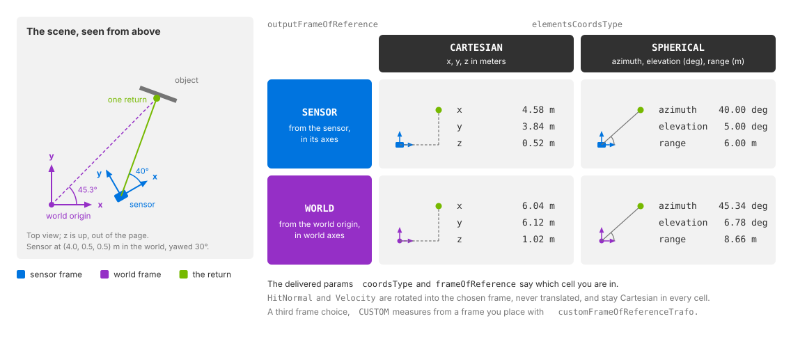
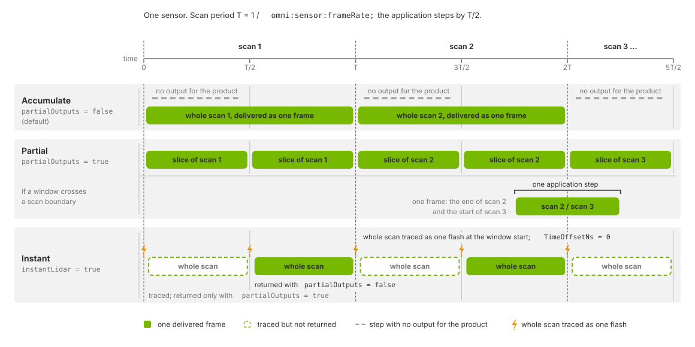

.. SPDX-FileCopyrightText: Copyright (c) 2026 NVIDIA CORPORATION & AFFILIATES. All rights reserved.
.. SPDX-License-Identifier: LicenseRef-NvidiaProprietary
..
.. NVIDIA CORPORATION, its affiliates and licensors retain all intellectual
.. property and proprietary rights in and to this material, related
.. documentation and any modifications thereto. Any use, reproduction,
.. disclosure or distribution of this material and related documentation
.. without an express license agreement from NVIDIA CORPORATION or
.. its affiliates is strictly prohibited.

.. _sensors-nonvisual-lidar-core-howto-output-shaping:
.. _sensors-do-output-shaping:

Configure Lidar Output
======================

The Lidar generic core model can report Cartesian or spherical coordinates in
a sensor, world or custom frame. It can deliver complete scans or partial
outputs during a scan. Configure both on the sensor prim; output parameters
identify the coordinate settings used for each frame.

Before you start, see :doc:`../../../common/output_configuration` for requesting outputs and
:doc:`../../../common/sensor_outputs` for reading them.

.. note::

   The attribute names on this page are the Lidar generic core model's
   ``omni:sensor:Core:*`` set. The Lidar generic wpm model carries all of them
   under ``omni:sensor:LidarWpm:*``, not always with the same type; the Radar
   generic wpmDmat model carries the coordinate system, the frame of reference
   and the custom transform under ``omni:sensor:WpmDmat:*``. Refer to their USD
   attributes pages: :doc:`Radar generic wpmDmat model <../../radar_wpm_dmat/attributes>`
   and :doc:`Lidar generic wpm model <../../lidar_wpm/attributes>`.

Output controls
---------------

The following example configures Cartesian world coordinates, drops invalid
entries and delivers complete scans (``partialOutputs = false``):

.. tab-set::

   .. tab-item:: USDA
      :sync: usda

      .. literalinclude:: ../../../../../examples/python/multi-rate-sensors/multi_rate.usda
         :language: usda
         :start-after: # [snippet:doc-multi-rate-lidar-usda]
         :end-before: # [/snippet:doc-multi-rate-lidar-usda]
         :dedent:
         :prepend: #usda 1.0

   .. tab-item:: USD Python
      :sync: python

      .. literalinclude:: ../../../../../tests/docs/usd/test_usd_python_examples.py
         :language: python
         :start-after: # [snippet:doc-multi-rate-lidar-python]
         :end-before: # [/snippet:doc-multi-rate-lidar-python]
         :dedent:

With ``includeInvalidPoints = false``, point arrays contain valid returns
only. With ``true``, all slots are delivered; use ``Flags`` to identify valid
entries. See :doc:`../attributes` for types, allowed values and defaults of
these controls, ``outputMotionCompensationState``,
``customFrameOfReferenceTrafo`` and ``instantLidar``.

.. _sensors-nonvisual-lidar-core-howto-output-shaping-meaning:

Coordinates and reference frame
^^^^^^^^^^^^^^^^^^^^^^^^^^^^^^^

   One return, two independent choices: ``elementsCoordsType`` picks the
   components, ``outputFrameOfReference`` the frame they are measured in. The
   values alone do not say which combination you are holding; the
   ``coordsType`` and ``frameOfReference`` params do. The values are
   illustrative.

``elementsCoordsType`` selects Cartesian or spherical ``Coordinates``.
``outputFrameOfReference`` selects the sensor, world or custom frame. For
``CUSTOM``, ``customFrameOfReferenceTrafo`` defines the frame with a
six-element transform.

``outputMotionCompensationState`` independently controls correction for sensor
motion during the scan; see :doc:`motion_artifacts`. Reference-frame and
compensation settings also transform ``HitNormal`` and ``Velocity``. These
vectors remain Cartesian regardless of ``elementsCoordsType`` and are
rotated without translation. See :doc:`../outputs` for channel definitions.

.. _sensors-output-shaping-runtime-changes:
.. _sensors-nonvisual-lidar-core-howto-output-shaping-runtime-changes:

Runtime updates
^^^^^^^^^^^^^^^

Coordinate type, reference frame, custom transform, compensation,
``includeInvalidPoints`` and ``partialOutputs`` support runtime updates.
Frames already in flight retain their previous settings.

With ``partialOutputs = false``, the model retains raw sensor coordinates
until the completing step. It then transforms all points using that step's
coordinate type, reference frame, custom transform and compensation state.
A mid-scan edit to these settings applies to the entire delivered scan,
including points traced before the edit.

See :doc:`../../../common/runtime_updates` for update and rejection behavior.
``scanType`` and ``rayType`` require recreation; see :doc:`../attributes`.

.. _sensors-output-shaping-params:
.. _sensors-nonvisual-lidar-core-howto-output-shaping-params:

Output parameters
^^^^^^^^^^^^^^^^^

Read the :ref:`output parameters <sensors-nonvisual-lidar-core-outputs-params>`
to identify the settings used for each frame. The
:ref:`verification procedure
<sensors-nonvisual-lidar-core-howto-output-shaping-verify>` uses them to check
that edits took effect.

.. _sensors-output-shaping-lidar-timing:
.. _sensors-nonvisual-lidar-core-howto-output-shaping-cadence:

Delivery cadence
^^^^^^^^^^^^^^^^

``partialOutputs`` controls scan delivery. ``instantLidar`` changes tracing
to a simultaneous flash:

- With ``partialOutputs = false`` and ``instantLidar = false`` (defaults),
  the model accumulates a scan and returns it on the completing step.
  Intermediate steps return no output for the product.
- With ``partialOutputs = true``, each advancing step returns its portion of
  the scan. A window with no firing still returns an output with
  ``Counts[0] = 0``. A window crossing a scan boundary includes the end of one
  scan and the start of the next. Output rate can exceed scan rate.
- With ``instantLidar = true``, each trace produces a complete scan.
  ``partialOutputs`` selects which steps deliver it, as described below.

``omni:sensor:frameRate`` sets complete scans per second as rational Hz.
See :doc:`../../../common/multi_rate` for its relationship to simulation
steps and delivery policy.

   Each application step spans half the scan period set by
   ``omni:sensor:frameRate``:

   - **Accumulated output:** returns a complete scan every second step,
     with no output on intermediate steps.
   - **Partial output:** returns the points captured during each step.
     A step crossing a scan boundary includes points from both scans.
   - **Instant lidar:** traces a complete scan at each step's start time.
     ``partialOutputs = true`` returns it every step; ``false`` returns it
     only when the step completes a scan period.

.. _sensors-output-shaping-empty-step:
.. _sensors-nonvisual-lidar-core-howto-output-shaping-empty-step:

Steps without completed scans
^^^^^^^^^^^^^^^^^^^^^^^^^^^^^

With ``partialOutputs = false``, output is returned only when a step
completes a scan period. Intermediate steps omit the product or return it
with an empty frame list. This is expected.

Iterate the products and frames actually returned. Request the product on
every step: omitting it discards the accumulated scan; see
:ref:`Sensor Scheduling <sensors-common-multi-rate-stepping>`. When a frame
arrives, bound each per-point read by ``Counts[0]`` as described in
:ref:`Sensor Outputs <sensors-common-sensor-outputs-counts-bound>`.

.. _sensors-lidar-core-instant-lidar:
.. _sensors-nonvisual-lidar-core-howto-output-shaping-instant-lidar:

Instant lidar
^^^^^^^^^^^^^

``instantLidar`` traces a complete scan as one flash at the step's start
time and pose. All firings are simultaneous. ``partialOutputs`` controls
which steps return the complete scan.
With ``partialOutputs`` false, the default, ovrtx schedules the sensor in frames
of one scan period exactly as for an accumulated scan, so the whole scan is
returned only on the step that completes the period, and the flash traced on a
step in between is not returned. Author ``partialOutputs = true`` to receive a
whole scan on every step that advances time, or step at the scan period, which
makes every step a completing one.

.. warning::

   Instant lidar suits a demonstration, a unit test or a first look at a scene.
   It is not representative of a time-resolved scan: nothing in the scan takes
   time, so a result obtained with it does not transfer to a sensor scanning in
   real time. Do not validate motion handling or timing with it.

Which steps flash, the zero-length-window rule for each scanning principle
included, and that validation still checks the authored fire times, are on
:doc:`USD Attributes <../attributes>`; an advancing first step flashes at time
zero.

The frame reports the window's start as its ``timestampNs`` and every point
carries a ``TimeOffsetNs`` of ``0``; what the frame-start and frame-end params and
``COMPENSATED`` output do under instant lidar is on :doc:`the Outputs page
<../outputs>`. Without motion BVH the start pose the flash uses is the frame-end
pose, as :doc:`Motion Artifacts <motion_artifacts>` explains.

.. _sensors-output-shaping-channels:
.. _sensors-nonvisual-lidar-core-howto-output-shaping-channels:

Channel selection
^^^^^^^^^^^^^^^^^

Use the ``PointCloud`` RenderVar's ``channels`` list to request channels.
See :ref:`channel selection <sensors-common-output-configuration-channels>`
for automatically included channels and unrecognized names, and
:doc:`../outputs` for available channels, types and shapes.

.. _sensors-nonvisual-lidar-core-howto-output-shaping-verify:

Verification
------------

Check the frame parameters before interpreting its arrays. ``coordsType``,
``frameOfReference`` and ``motionCompensationState`` report the settings used.
After an edit, read a newly produced frame; frames already in flight retain
the old values. A persistent mismatch can mean the attributes are not reaching
the model or the parameter set was rejected. Check these causes before
investigating the consumer.

To check delivery timing:

1. Set ``partialOutputs = false``.
2. Step at half the scan period.
3. Check that complete scans arrive every second step, with no output for
   the product on intermediate steps. Use a scene that produces detections
   to check for a non-zero ``Counts[0]`` on completed scans.

This applies to rotary and solid-state sensors. Solid-state scans are
returned at the end of the scan period, regardless of the emitter fire times;
see :doc:`Configure a Firing Pattern <firing_pattern>`.
:ref:`Point counts can vary between runs <sensors-common-sensor-outputs-counts-vary>`;
check the delivery timing rather than an exact count.

The :doc:`lidar example <../../../../examples/python_sensor_lidar>` prints
one summary per run:
``valid points=..., mean intensity=..., max time offset=... ns``.
A non-zero count confirms that a scan produced points; this run-level summary
does not show the delivery timing of individual steps.

.. _sensors-nonvisual-lidar-core-howto-output-shaping-troubleshooting:

Potential issues
----------------

- Coordinates do not behave like Cartesian positions: ``elementsCoordsType`` is at
  its default, ``SPHERICAL``, and the consumer assumed ``CARTESIAN``. Set it
  explicitly rather than relying on the default being what you expect.
- Points sit in a sensible shape but in the wrong place, or move when the sensor
  moves and should not: ``outputFrameOfReference``. Refer to :doc:`Motion
  Artifacts <motion_artifacts>` when the sensor is moving.
- The custom transform has no effect: ``customFrameOfReferenceTrafo`` is read only
  when ``outputFrameOfReference = CUSTOM``. Its six values are ``x``, ``y`` and
  ``z`` in meters followed by roll, pitch and yaw in radians, so a rotation
  authored in degrees lands far from where you meant it.
- A value authored on a running sensor changes nothing: read the params of a later
  frame, because the frame in flight when you authored it keeps the old value. If
  the params never change, the whole parameter set was rejected. A running sensor
  keeps its previous values and output layout, and the reason is logged as an
  error; :doc:`Sensor Definition Validation <../../../common/validation>` names
  the cause before you render. One sure cause is an edit to ``scanType``: it
  cannot change on a running sensor, so an update that changes it is rejected
  whole. Recreate the sensor to change the principle; :doc:`the model's USD
  attributes <../attributes>` list what else stays fixed and what happens to the
  rejected value.
- Some steps deliver no points, or no output for the product at all: refer to
  :ref:`a mid-scan step <sensors-output-shaping-empty-step>`.
- An instant lidar delivers on some steps only: ``partialOutputs`` is false and
  your step is shorter than the scan period, so the flash traced on a step that
  does not complete the period is not returned. Author ``partialOutputs = true``
  or step at the scan period; refer to :ref:`instant lidar <sensors-lidar-core-instant-lidar>`.
- A channel you expected is absent from the mapped output: it was not listed in
  the RenderVar's ``channels``. Refer to :ref:`channel selection
  <sensors-output-shaping-channels>`.

Related
-------

- :doc:`Motion Artifacts <motion_artifacts>` — motion compensation, the motion BVH and what a moving sensor does to a scan.
- :doc:`Configure a Firing Pattern <firing_pattern>` — fire times, flash lidars and when a scan completes.
- :doc:`Constrain the Field of View <field_of_view>` — the azimuth and elevation limits that decide which returns exist at all.
