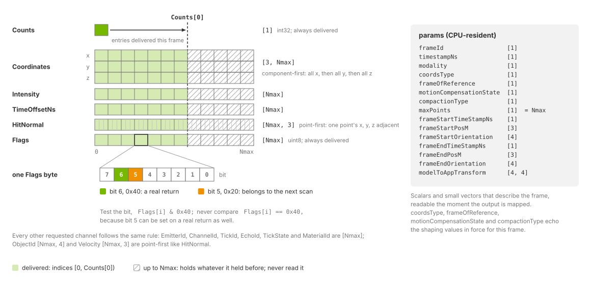
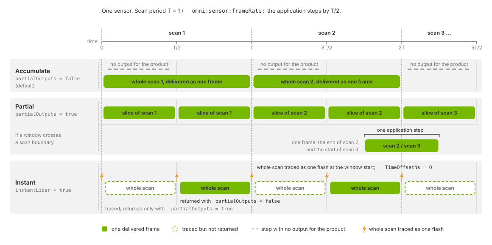

.. SPDX-FileCopyrightText: Copyright (c) 2026 NVIDIA CORPORATION & AFFILIATES. All rights reserved.
.. SPDX-License-Identifier: LicenseRef-NvidiaProprietary
..
.. NVIDIA CORPORATION, its affiliates and licensors retain all intellectual
.. property and proprietary rights in and to this material, related
.. documentation and any modifications thereto. Any use, reproduction,
.. disclosure or distribution of this material and related documentation
.. without an express license agreement from NVIDIA CORPORATION or
.. its affiliates is strictly prohibited.

.. _sensors-nonvisual-lidar-core-outputs:

Outputs
=======

The Lidar generic core model delivers a ``PointCloud`` composite output for
each requesting RenderVar. Each entry is one return from an emitter firing.
This page defines the channels, parameters, layouts and delivery timing.
See :doc:`attributes` for controls, and :doc:`../../common/sensor_outputs`
for mapping, DLPack access, synchronization and lifetime.

The Lidar generic wpm model publishes its own channel set and layout, listed on
:doc:`../lidar_wpm/outputs`.

   One mapped ``PointCloud`` output of this model: the per-point channels
   with their shapes (``Coordinates`` component-first, ``HitNormal``
   point-first), the delivered range ``[0, Counts[0])`` against the capacity
   ``Nmax``, the two ``Flags`` bits, and the params beside the tensors.

.. _sensors-nonvisual-lidar-core-outputs-requesting:

Requesting the output
---------------------

Set the RenderVar's ``sourceName`` to ``PointCloud`` and list the desired
``channels``. ``Counts`` and ``Flags`` are always included. Unrecognized
channel names are ignored with a warning. See
:doc:`../../common/output_configuration` and
:ref:`channel selection <sensors-common-output-configuration-channels>`.

Channels such as ``Coordinates`` and ``Intensity`` are available only inside
``PointCloud``. A RenderVar that uses a channel name as its ``sourceName``
receives no output.

Each RenderProduct supports one sensor, selected by ``rel camera``.
``Counts`` has shape ``[1]``. Give each additional sensor
:ref:`its own RenderProduct <sensors-common-output-configuration-independent-products>`;
see :ref:`sensor configuration
<sensors-nonvisual-lidar-core-attributes-one-product-per-sensor>`.

The lidar example scene authors this request:

.. tab-set::

   .. tab-item:: USDA
      :sync: usda

      .. literalinclude:: ../../../../examples/python/lidar/lidar_example.usda
         :language: usda
         :start-after: # [snippet:configure-lidar-pointcloud-output]
         :end-before: # [/snippet:configure-lidar-pointcloud-output]
         :prepend: #usda 1.0

   .. tab-item:: USD Python
      :sync: python

      .. literalinclude:: ../../../../tests/docs/usd/test_nonvisual_authoring.py
         :language: python
         :start-after: # [snippet:doc-nonvisual-example-configure-lidar-pointcloud-output-python]
         :end-before: # [/snippet:doc-nonvisual-example-configure-lidar-pointcloud-output-python]
         :dedent:

.. _sensors-nonvisual-lidar-core-outputs-channels:

Channels
--------

A firing can produce zero, one or multiple returns. ``EchoId`` identifies
returns from the same firing. ``maxReturns`` limits the number retained per
channel, and ``minDistBetweenEchosM`` sets their minimum resolved separation;
see :doc:`attributes`. The available channels are:

.. list-table::
   :class: compact-table
   :header-rows: 1
   :widths: 13 8 12 7 60

   * - Channel
     - Type
     - Shape
     - Unit
     - Meaning
   * - ``Counts``
     - ``int32``
     - ``[1]``
     - points
     - Number of point entries delivered this frame; bounds every other
       per-point channel. Delivered whether or not requested.
   * - ``Flags``
     - ``uint8``
     - ``[Nmax]``
     - unitless
     - Per-point status bits. The ``VALID`` bit (``0x40``) marks a real return,
       and a real return can also carry
       :ref:`the new-scan bit (0x20) <sensors-common-sensor-outputs-new-scan-bit>`.
       Delivered whether or not requested.
   * - ``Coordinates``
     - ``float32``
     - ``[3, Nmax]``
     - m, deg
     - Position of the return, component-first.
       ``omni:sensor:Core:elementsCoordsType`` selects Cartesian or spherical
       components; ``omni:sensor:Core:outputFrameOfReference`` selects the
       frame they are expressed in.
   * - ``Intensity``
     - ``float32``
     - ``[Nmax]``
     - unitless
     - Return strength after ``omni:sensor:Core:intensityProcessing``,
       clipped to ``[0, 1]`` and scaled by
       ``omni:sensor:Core:intensityScalePercent`` / 100.
   * - ``TimeOffsetNs``
     - ``int32``
     - ``[Nmax]``
     - ns
     - Firing time of this return relative to the frame's ``timestampNs``.
       Always ``0`` with ``omni:sensor:Core:instantLidar``.
   * - ``EmitterId``
     - ``uint32``
     - ``[Nmax]``
     - unitless
     - Zero-based index of the emitter within its emitter state.
   * - ``ChannelId``
     - ``uint32``
     - ``[Nmax]``
     - unitless
     - The detector id of the emitter that produced the point, exactly as
       authored in the emitter state's ``channelId``: a label, not an index.
   * - ``TickId``
     - ``uint32``
     - ``[Nmax]``
     - unitless
     - Zero-based, scan-local index of the tick the point came from. ``0`` on
       a solid-state sensor.
   * - ``EchoId``
     - ``uint8``
     - ``[Nmax]``
     - unitless
     - Index of this return within its firing, counting from ``0``, in the
       order ``omni:sensor:Core:rayType`` keeps returns.
   * - ``TickState``
     - ``uint8``
     - ``[Nmax]``
     - unitless
     - Zero-based index of the emitter state that fired the point.
   * - ``MaterialId``
     - ``uint32``
     - ``[Nmax]``
     - unitless
     - Encoded non-visual material identifier of the hit geometry; ``0`` for
       an unlabeled surface.
   * - ``ObjectId``
     - ``uint32``
     - ``[Nmax, 4]``
     - unitless
     - 128-bit stable identifier of the hit object, point-first, four values
       per point.
   * - ``HitNormal``
     - ``float32``
     - ``[Nmax, 3]``
     - unitless
     - Unit surface normal at the hit point, point-first.
   * - ``Velocity``
     - ``float32``
     - ``[Nmax, 3]``
     - m/s
     - Velocity of the hit point relative to the sensor, point-first.

.. _sensors-nonvisual-lidar-core-outputs-validity:

Counts and validity
^^^^^^^^^^^^^^^^^^^

Read entries within ``[0, Counts[0])``. With invalid points included, select
returns using the ``Flags`` bit ``0x40``. This model can also set the
:ref:`new-scan bit (0x20) <sensors-common-sensor-outputs-new-scan-bit>`,
so test the valid bit rather than comparing the entire value. See
:ref:`reading the output <sensors-nonvisual-lidar-core-outputs-reading>`.

.. _sensors-nonvisual-lidar-core-outputs-coordinates:

Coordinates and frames
^^^^^^^^^^^^^^^^^^^^^^

``elementsCoordsType`` selects Cartesian or spherical components.
``outputFrameOfReference`` selects ``SENSOR``, ``WORLD`` or ``CUSTOM``;
``customFrameOfReferenceTrafo`` defines the custom frame.
``outputMotionCompensationState`` controls compensation for sensor motion.
See :doc:`attributes` for these controls. Read ``coordsType`` and
``frameOfReference`` to identify the representation used for a delivered
frame; an authored edit may not yet apply to that frame.

Cartesian components are x, y and z in meters; spherical components are
azimuth, elevation and distance, in that order. The ``SENSOR`` frame, with the
units and ranges of the spherical components, is what
:ref:`sensors-common-sensor-outputs-sensor-frame` defines for every non-visual
output; the ``modelToAppTransform`` param carries the rotation from that frame
to the application's axes.

.. _sensors-nonvisual-lidar-core-outputs-azimuth-convention:

The delivered azimuth and the firing angle are two conventions. A
delivered azimuth runs counter-clockwise from +X in ``(-180, 180]`` and
includes ``omni:sensor:Core:startAzimuthOffsetDeg``. The firing angle that the
azimuth window of a rotary sensor is measured in runs clockwise from +X,
before that offset is added. Compare a delivered azimuth with
``validStartAzimuthDeg`` and ``validEndAzimuthDeg`` only after converting it;
the conversion recipe and the window check are on
:doc:`howto/field_of_view` under :ref:`the azimuth window
<sensors-lidar-azimuth-window>`, and the angle diagram is on
:doc:`attributes`.

.. _sensors-nonvisual-lidar-core-outputs-emitter-offsets:

Emitter offsets ``horOffsetM`` and ``vertOffsetM`` affect both traced rays
and delivered positions. The horizontal offset rotates with a rotary head.
Detection and range limits measure distance from the emitter, while output
coordinates include its displacement from the sensor prim's origin. This
applies in every reference frame and representation, including spherical
``SENSOR`` coordinates. Do not add the offset again. See
:doc:`howto/firing_pattern` for configuration.

Both front and back faces of a surface can produce returns.

.. _sensors-nonvisual-lidar-core-outputs-intensity:

Intensity
^^^^^^^^^

``Intensity`` reports return strength after processing, clipping, mapping
and scaling. ``intensityProcessing`` selects ``RAW``, ``NORMALIZATION``
(default) or ``CORRECTION``. ``intensityMappingType`` and
``intensityScalePercent`` control the output transfer and scale; see
:ref:`intensity attributes <sensors-nonvisual-lidar-core-attributes-intensity>`.
Compare values only between runs with compatible intensity settings and materials.

Detection uses the signal before clipping. A threshold above 1 therefore
retains sufficiently strong returns, but all report the maximum intensity:
``intensityScalePercent / 100`` under ``LINEAR`` mapping. See
:ref:`detection thresholds <sensors-intensity-point-drops>` in
:doc:`howto/intensity`.

.. _sensors-nonvisual-lidar-core-outputs-time-offset:

Timing: TimeOffsetNs
^^^^^^^^^^^^^^^^^^^^

``TimeOffsetNs`` measures firing time relative to ``timestampNs``, which
equals ``frameStartTimeStampNs`` for this model. Emitters can fire at
different times within one tick, according to ``fireTimeNs``. With
``instantLidar``, all offsets are zero; see
:ref:`instant lidar <sensors-nonvisual-lidar-core-outputs-instant>`.

The signed 32-bit nanosecond representation limits scan duration and imposes
the :ref:`minimum positive scan rate <sensors-lidar-min-scan-rate>`.
Request this channel for application-side deskewing of ``NONCOMPENSATED``
output; see :doc:`howto/motion_artifacts`. Other models can use a different
reference instant for the same channel name; see
:ref:`shared names <sensors-common-sensor-outputs-shared-names>`.

.. _sensors-nonvisual-lidar-core-outputs-identity:

Firing identifiers
^^^^^^^^^^^^^^^^^^

The following channels identify each point's position in the firing pattern.

``EmitterId``
~~~~~~~~~~~~~

``EmitterId`` is the zero-based index of the emitter within its emitter state,
the position of its entries in the state's per-emitter arrays. On a
solid-state sensor it is the complete record of the pattern: with
``partialOutputs`` off and ``includeInvalidPoints`` on, every scan the sensor
traced in full carries each ``EmitterId`` from ``0`` through
``numberOfEmitters - 1``, each exactly once when ``numberOfChannels`` equals
``numberOfEmitters`` and ``maxReturns`` is ``1``. That invariant is the
verification :doc:`howto/firing_pattern` uses.

.. _sensors-nonvisual-lidar-core-outputs-channel-id:
.. _sensors-lidar-core-channel-meanings:

``ChannelId``
~~~~~~~~~~~~~

``ChannelId`` reports the emitter state's authored ``channelId`` unchanged.
It is a label; zero-based and one-based numbering are both possible. Consumers
that index tables with ``ChannelId - 1`` require one-based profiles. See
:ref:`channel labels <sensors-lidar-core-channel-ids-are-labels>`,
:ref:`authoring rules <sensors-lidar-channel-ids>` and the
:ref:`channel glossary <sensors-reference-glossary-channel-senses>`.

Unwritten slots contain zero. With invalid points included, each rotary tick
has a slot for every channel, including channels with no emitter firing into
them. A zero can therefore identify an unwritten slot or an authored detector
label. Use ``Flags`` to select valid entries before interpreting ``ChannelId``.

Channel order can differ from emitter order, so do not expect ``ChannelId`` to
rise with ``EmitterId`` within a tick.

``TickId``
~~~~~~~~~~

``TickId`` is the zero-based, scan-local index of the tick the point came from.
A rotation's tick count varies between rotations, and a tick that found nothing
contributes no point, so read a rotation's values as a subset of ``[0, that
rotation's tick count)`` and never size a buffer from them, as :ref:`fractional
ticks <sensors-lidar-fractional-ticks>` on :doc:`howto/firing_pattern`
explains. A solid-state sensor has one tick per scan, so every one of its
points carries ``0``.

``EchoId``
~~~~~~~~~~

``EchoId`` numbers a firing's returns in the order the model keeps them, from
``0``, and that order depends on ``omni:sensor:Core:rayType``. With
``IDEALIZED`` rays it is the position along the ray's path: ``0`` is the first
surface, and each later echo is a surface the continuing ray reached farther
along, so nothing merges two surfaces into one echo. With ``GAUSSIAN_BEAM`` or
``UNIFORM_BEAM`` the beam's hits at nearly the same range are merged into
peaks and the peaks are ranked by their strength, strongest first, so an
``EchoId`` of ``0`` is the strongest return and need not be the nearest.
``omni:sensor:Core:maxReturns`` caps how many are kept per channel either way.

``TickState``
~~~~~~~~~~~~~

``TickState`` is the zero-based index of the emitter state that fired the
point. On a rotary sensor each tick can carry its own state, so the value can
change from tick to tick within one scan. On a solid-state sensor all points
of a scan carry the state selected for that scan, and partial outputs from one
scan keep that scan's state. The states follow a cycle set by
``stateResolutionStep`` and the lexicographic order of the state instance
names, described under :ref:`scheduling attributes <sensors-nonvisual-lidar-core-attributes-scheduling>` on :doc:`attributes`.

.. _sensors-nonvisual-lidar-core-outputs-material-id:

MaterialId and ObjectId
^^^^^^^^^^^^^^^^^^^^^^^

``MaterialId`` reports the identifier the hit geometry carries, encoded from
the non-visual material labels authored on its material. Requesting the
channel fills it for every valid return. ``0`` is a surface classified as
``none``, for any of the reasons :doc:`../../../materials/nonvisual_sensor_materials` lists; that page
also says what to check when every return reads ``0`` or every object reports
the same value. The labels and their numbers are defined by the SimReady
specification linked from that page.

The value is a ``uint32`` of which only the low 16 bits are populated, and the
three authored labels sit in fixed fields. Bits 0-7 hold the base material's
index as a plain number occupying the whole byte; bits 8-10 hold the coating's
index, also a plain number; bits 11-15 are a bit field with one bit per
attribute, where the attribute with SimReady index *n* sets bit *n* - 1 of the
field, so ``emissive`` contributes ``1``, ``retroreflective`` ``2``,
``single_sided`` ``4`` and ``visually_transparent`` ``8``, and several can be
set at once. Unpack it by masking the low byte for the base material, shifting
down 8 and masking 3 bits for the coating, and shifting down 11 and masking 5
bits for the attributes. A steel object (base 2) with a paint coating
(coating 1) and the ``retroreflective`` attribute (bit value 2) encodes as::

    attributes  coating  base material
    00010       001      00000010        = 0b0001000100000010 = 4354 = 0x1102

Only the two lidar models report a material id: the Lidar generic wpm model's
``MaterialId`` uses the same encoding and :doc:`../lidar_wpm/outputs` links
here for it, while the radar and acoustic outputs carry none.

.. _sensors-nonvisual-lidar-core-outputs-object-id:

``ObjectId`` is the 128-bit stable identifier of the hit object, carried as
four ``uint32`` values per point, point-first in a ``[Nmax, 4]`` tensor; the
renderer adds the hit mesh part's number, or the primitive's for procedural
geometry, to the last of the four. The channel identifies an object only
while the renderer's stable ids are active, and rendering any RenderProduct in
the scene that requests a stable-id output, ``StableIdMap``,
``StableIdMapDeltas``, ``StableIdSegmentation``, ``StableIdSemanticIdMap`` or
``SemanticInstanceSegmentation`` (all on :doc:`../../cameras/outputs`), is what
activates them for the whole scene. Requesting ``ObjectId`` alone does not:
the first three values are then ``0`` on every point and the last is only the
part or primitive number, ``0`` for a mesh in one part.

.. _sensors-nonvisual-lidar-core-outputs-hit-normal-velocity:

HitNormal and Velocity
^^^^^^^^^^^^^^^^^^^^^^

``HitNormal`` is the unit surface normal at the hit point.

``Velocity`` is the velocity of the hit point relative to the sensor: the hit
point's own velocity minus the sensor's linear velocity and minus the velocity
the sensor's rotation gives that point, expressed in the sensor's axes at the
pose the ray was fired from, then rotated into the output frame in the same
way as ``HitNormal``. The rotation does not add the sensor's motion back, so
in the ``WORLD`` frame the value is still relative to the sensor, not a
world-frame velocity.

Both are computed whenever the RenderVar requests them, and nothing else gates
them. Computing them costs memory and tracing work, so request them only when
a consumer reads them.

.. _sensors-nonvisual-lidar-core-outputs-shaping:

Output transforms and delivery
^^^^^^^^^^^^^^^^^^^^^^^^^^^^^^

Requested identity channels — ``EmitterId``, ``ChannelId``, ``TickId``,
``EchoId``, ``TickState``, ``MaterialId`` and ``ObjectId`` — are written for
every valid return. No additional attribute enables them.

``outputFrameOfReference`` and ``outputMotionCompensationState`` apply to
``Coordinates``, ``HitNormal`` and ``Velocity``. The latter two are rotated
without translation and remain Cartesian regardless of ``elementsCoordsType``.
With ``SENSOR`` and ``NONCOMPENSATED``, they use the sensor axes at the firing
pose.

``includeInvalidPoints`` controls whether invalid entries are retained; see
:ref:`validity <sensors-nonvisual-lidar-core-outputs-validity>`.
``partialOutputs`` and ``instantLidar`` control scan delivery; see
:ref:`cadence <sensors-nonvisual-lidar-core-outputs-cadence>`. Attribute
definitions are on :doc:`attributes`; configuration examples are on
:doc:`howto/output_shaping`.

.. _sensors-nonvisual-lidar-core-outputs-params:

Params
------

Each frame also provides CPU-resident parameters, available as soon as the
output is mapped. These describe its timing, pose, layout and settings.
Thirteen parameter names are shared with the Radar generic wpmDmat model;
the definitions below apply specifically to this model. See
:ref:`shared parameters <sensors-common-sensor-outputs-shared-params>` for
the common interface.

.. list-table::
   :class: compact-table
   :header-rows: 1
   :widths: 24 10 10 56

   * - Param
     - Type
     - Shape
     - Value
   * - ``frameId``
     - ``uint64``
     - ``[1]``
     - The model's frame counter. It advances with every frame the model
       renders, mid-scan frames that deliver no points included, so it is not
       a count of delivered scans; see :ref:`the frame counter
       <sensors-nonvisual-lidar-core-outputs-frame-counter>`.
   * - ``timestampNs``
     - ``uint64``
     - ``[1]``
     - The instant every ``TimeOffsetNs`` is measured from. With
       ``partialOutputs`` true it is the frame's start time; with
       ``partialOutputs`` false it is the start of the scan the frame
       completed; with ``instantLidar`` it is the start of the supplied
       interval, the instant the whole scan is traced, and every
       ``TimeOffsetNs`` is then ``0``. It always equals
       ``frameStartTimeStampNs``.
   * - ``modality``
     - ``uint32``
     - ``[1]``
     - ``1``, lidar. The composite output defines ``0`` undefined, ``2``
       radar, ``3`` acoustic and ``4`` the Idealized depth model.
   * - ``frameOfReference``
     - ``uint16``
     - ``[1]``
     - ``0`` sensor, ``1`` world, ``2`` custom, as
       ``omni:sensor:Core:outputFrameOfReference`` selected it. The composite
       output also defines ``3``, parent, which none of that attribute's
       allowed tokens (``SENSOR``, ``WORLD``, ``CUSTOM``) selects.
   * - ``coordsType``
     - ``uint32``
     - ``[1]``
     - ``0`` Cartesian, ``1`` spherical, as
       ``omni:sensor:Core:elementsCoordsType`` selected it. Spherical is the
       default, so an output whose sensor never set the attribute reads
       ``1``. The composite output also defines ``2``, not applicable, which
       this model never publishes.
   * - ``modelToAppTransform``
     - ``float32``
     - ``[4, 4]``
     - Rotation from the ISO 8855 sensor frame to the application's axes,
       stored row by row as a 4x4 matrix with a bottom row of ``0, 0, 0, 1``;
       for this model the translation entries are ``0``.
   * - ``frameStartTimeStampNs``
     - ``uint64``
     - ``[1]``
     - Start of the window the frame covers, in nanoseconds. With
       ``partialOutputs`` and ``instantLidar`` both off, the start of the
       scan; with ``instantLidar``, the start of the supplied interval.
   * - ``frameStartPosM``
     - ``float32``
     - ``[3]``
     - Sensor position at that start, in meters, in the world frame. With
       ``partialOutputs`` and ``instantLidar`` both off, the pose at the start
       of the scan's first frame; with ``instantLidar``, the supplied start
       pose.
   * - ``frameStartOrientation``
     - ``float32``
     - ``[4]``
     - Sensor orientation at that start, as a world-frame unit quaternion
       ordered x, y, z, w, taken at the same instant as ``frameStartPosM``.
   * - ``frameEndTimeStampNs``
     - ``uint64``
     - ``[1]``
     - End of the window the frame covers, in nanoseconds: the end of the
       step's slice with ``partialOutputs`` true, the end of the frame that
       completed the scan with it false, the end of the supplied interval with
       ``instantLidar``.
   * - ``frameEndPosM``
     - ``float32``
     - ``[3]``
     - Sensor position at that end, in meters, in the world frame.
   * - ``frameEndOrientation``
     - ``float32``
     - ``[4]``
     - Sensor orientation at that end, as a world-frame unit quaternion
       ordered x, y, z, w.
   * - ``maxPoints``
     - ``uint32``
     - ``[1]``
     - The capacity ``Nmax``, duplicating the bound already in the per-point
       tensors' shapes.
   * - ``motionCompensationState``
     - ``uint16``
     - ``[1]``
     - ``0`` non-compensated, ``1`` compensated, as
       ``omni:sensor:Core:outputMotionCompensationState`` selected it; ``2``,
       not applicable, is defined but not published by this model.
   * - ``compactionType``
     - ``uint32``
     - ``[1]``
     - ``2`` compacted, ``1`` uncompacted: the inverse of
       ``omni:sensor:Core:includeInvalidPoints`` as the model applied it.
       Compacted means invalid returns were dropped before output, so the
       delivered range is also the valid range. ``0``, unspecified, is defined
       but not published by this model.

The last two params are lidar-only: the Lidar generic wpm model publishes them
as well; the Radar generic wpmDmat model publishes neither.

.. _sensors-nonvisual-lidar-core-outputs-pose-without-motion-bvh:

Without motion BVH, each trace uses the sensor's frame-end pose. Its
``frameStartPosM`` and ``frameStartOrientation`` therefore match the end-pose
parameters, while the timestamps retain the frame interval.

For an accumulated scan traced over several frames, the start parameters
retain the first frame's end pose with the scan's start timestamp. End
parameters use the completing frame's end pose. These poses can differ if
the sensor moved between frames.

Instant lidar retains the supplied interval and endpoint poses even though
all firings occur at the interval's start. See
:ref:`Motion BVH <sensors-common-output-configuration-motion-bvh>` for
renderer configuration and :doc:`howto/motion_artifacts` for compensation.

``coordsType``, ``frameOfReference``, ``motionCompensationState`` and
``compactionType`` report the settings used for this frame. Check these values
after a runtime edit. Frames already in flight retain their previous settings.
See :doc:`howto/output_shaping` for verification and :doc:`attributes` and
:doc:`../../common/runtime_updates` for update behavior.

.. _sensors-nonvisual-lidar-core-outputs-reading:

Reading the output
------------------

The :doc:`Python lidar example <../../../examples/python_sensor_lidar>` and
:doc:`C lidar example <../../../examples/c_sensor_lidar>` map the output to CPU
memory and read ``Coordinates``, ``Counts``, ``Intensity`` and ``TimeOffsetNs``
by name. They read only the first ``Counts[0]`` entries of each per-point channel.

The example scene sets ``omni:sensor:Core:includeInvalidPoints = false``, so
all returned points are valid and the reader does not check ``Flags``.

.. tab-set::

   .. tab-item:: Python
      :sync: python

      .. literalinclude:: ../../../../examples/python/lidar/main.py
         :language: python
         :start-after: # [snippet:read-lidar-pointcloud]
         :end-before: # [/snippet:read-lidar-pointcloud]
         :dedent:

   .. tab-item:: C
      :sync: c

      .. literalinclude:: ../../../../examples/c/lidar/main.cpp
         :language: cpp
         :start-after: // [snippet:read-lidar-pointcloud]
         :end-before: // [/snippet:read-lidar-pointcloud]
         :dedent:

Follow the shared :ref:`output-reading rules
<sensors-common-sensor-outputs-reading>` with these model-specific details:

- Bound reads by ``Counts[0]``. When invalid entries are retained, use
  ``Flags[i] & 0x40`` to select returns. Do not compare ``Flags`` with a fixed
  value because the :ref:`new-scan bit
  <sensors-common-sensor-outputs-new-scan-bit>` may also be set. See
  :ref:`read bounds <sensors-common-sensor-outputs-counts-bound>` and
  :ref:`validity <sensors-common-sensor-outputs-valid-bit>`.
- ``compactionType = 2`` means invalid entries were dropped
  (``includeInvalidPoints = false``, the default). Every delivered entry is
  then valid, as the example assumes. With ``compactionType = 1``, filter
  ``Coordinates``, ``Intensity``, ``HitNormal`` and ``Velocity`` by ``Flags``.
- ``Coordinates`` is component-first, ``[3, Nmax]``. ``HitNormal`` and
  ``Velocity`` are point-first, ``[Nmax, 3]``; ``ObjectId`` is ``[Nmax, 4]``.
  Read the mapped shape and strides; see
  :ref:`tensor layouts <sensors-common-sensor-outputs-packing>`.
- Map to CPU or linear CUDA memory. CUDA-array mapping is for images and is
  unavailable for ``PointCloud``. See :ref:`mapping modes <sensors-common-sensor-outputs-mapping-modes>` for synchronization and
  lifetime requirements.

The example prints one summary line per run: the valid point count, the mean
intensity and the largest time offset. The count is not reproducible from run
to run (see :ref:`why the count varies <sensors-common-sensor-outputs-counts-vary>`); that geometry inside
the range window yields a non-zero count is. :doc:`../../first_sensor` walks
through the runnable :doc:`Python <../../../examples/python_sensor_lidar>` and
:doc:`C <../../../examples/c_sensor_lidar>` examples end to end.

.. _sensors-nonvisual-lidar-core-outputs-cadence:

Scans, frames and steps
-----------------------

A *scan* is one complete pass of the firing pattern, as :doc:`attributes`
defines it under Firing pattern; a *frame* is one delivery of the
RenderProduct's outputs. The two are not the same thing: a step can return
several frames for a product or none
(:ref:`sensors-common-sensor-outputs-frames`), and how a scan maps onto frames
is authored by two attributes on the sensor prim, both on :doc:`attributes`.

   Which steps return a frame: only the completing step with
   ``partialOutputs`` false; every step with it true, a window that crosses a
   scan boundary carrying the end of one scan and the start of the next; with
   ``instantLidar`` a whole scan flashed at the
   start of every step, returned on every step or only on the completing one
   as ``partialOutputs`` decides.

.. _sensors-nonvisual-lidar-core-outputs-mid-scan-step:

With ``partialOutputs = false`` (default), the model accumulates a complete
scan and returns it on the step that finishes it. ``timestampNs`` is the
scan's start. Intermediate steps provide no output; see
:ref:`steps without completed scans <sensors-output-shaping-empty-step>`
and :doc:`../../common/multi_rate`. The completing step's output settings
apply to the entire scan, including points traced before a runtime edit.
The parameters report those settings.

With ``partialOutputs = true``, each step delivers its portion of the scan,
with a timestamp at that frame's start. The consumer accumulates the scan if
needed. A frame crossing a scan boundary contains the end of one scan and
the start of the next. See :doc:`../../common/multi_rate` for choosing a
delivery policy and its relation to scan rate.

.. _sensors-nonvisual-lidar-core-outputs-instant:

With ``instantLidar = true``, the entire pattern fires at the start of each
step's interval. ``partialOutputs`` controls which steps return that scan.
See :doc:`attributes` for scheduling details and
:ref:`instant lidar <sensors-lidar-core-instant-lidar>` for uses and limitations.

For a returned interval ``[S, T]``, ``timestampNs`` is ``S`` and every
``TimeOffsetNs`` is zero. Start/end parameters retain ``S``, ``T`` and their
endpoint poses. ``COMPENSATED`` output also references ``S``; the flash
contains no within-scan motion to remove.

.. _sensors-nonvisual-lidar-core-outputs-frame-counter:

The frame counter counts rendered frames, not delivered scans. ``frameId``
advances with every frame the model renders, including the mid-scan frames
that deliver nothing with ``partialOutputs`` false. A live edit that only
rebuilds the model's buffers, such as a change to ``maxReturns``, keeps the
counter running; whether a scan being accumulated survives such an edit is on
:doc:`attributes` under :ref:`the runtime-edit rules
<sensors-nonvisual-lidar-core-attributes-runtime-edits>`. A change to what the
RenderProduct requests rebuilds the model instead, and ``frameId`` restarts
with it; :doc:`../../common/runtime_updates` states that rule for every model.

Related
-------

- :doc:`USD Attributes <attributes>` — the attributes that shape this output
- :doc:`Sensor Outputs <../../common/sensor_outputs>` — mapping, the container, lifetime and the reading rules shared by every model
- :doc:`Output Configuration <../../common/output_configuration>` — RenderProducts, RenderVars and requesting channels
