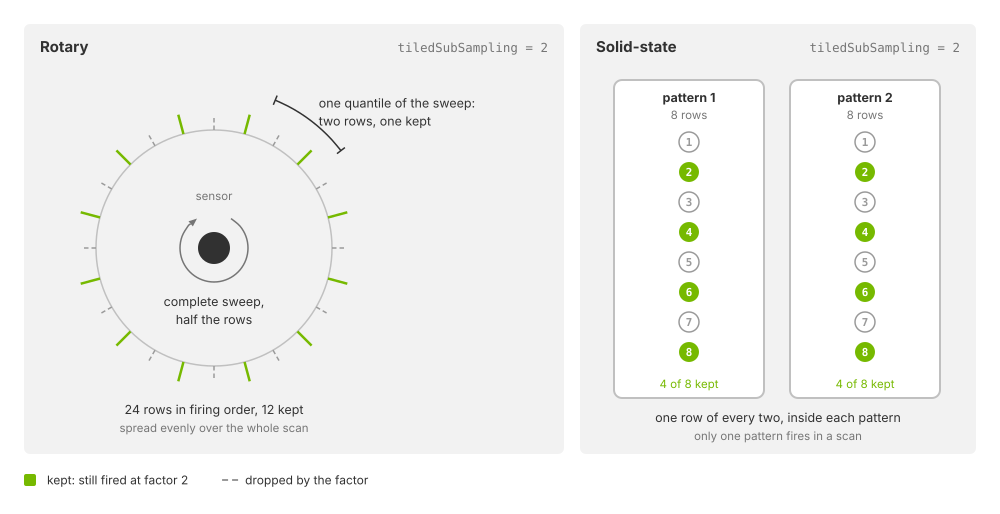

.. SPDX-FileCopyrightText: Copyright (c) 2026 NVIDIA CORPORATION & AFFILIATES. All rights reserved.
.. SPDX-License-Identifier: LicenseRef-NvidiaProprietary
..
.. NVIDIA CORPORATION, its affiliates and licensors retain all intellectual
.. property and proprietary rights in and to this material, related
.. documentation and any modifications thereto. Any use, reproduction,
.. disclosure or distribution of this material and related documentation
.. without an express license agreement from NVIDIA CORPORATION or
.. its affiliates is strictly prohibited.

.. _sensors-nonvisual-lidar-wpm-attributes:

USD Attributes
==============

The Lidar generic wpm model provides attributes for scan timing, beam and
detector properties, return processing, material inputs and output encoding.
Subsampling and capacity limits control computational cost and memory use.
See :doc:`Sensor API Schemas <../../reference/schemas>` for complete attribute
declarations and defaults.

.. _sensors-nonvisual-lidar-wpm-attributes-namespace:

Namespace and identity
----------------------

Apply ``OmniSensorGenericLidarWpmAPI`` to an ``OmniLidar`` prim. It includes
``OmniSensorGenericLidarWpmFiringPatternAPI:p001`` for the first firing pattern.
Apply additional instances, such as ``p002``, to alternate between patterns.

.. _sensors-nonvisual-lidar-wpm-attributes-identity:

The schema defaults ``omni:sensor:modelName`` to ``"LidarWpm"``,
``omni:sensor:modelVendor`` to ``"NVIDIA"`` and ``omni:sensor:marketName``
to ``"Generic"``. These use the shared ``omni:sensor:*`` namespace, as do
``omni:sensor:frameRate``, ``omni:sensor:startTime`` and
``omni:sensor:frameLimit``. On an ``OmniLidar``, the model name selects the
lidar implementation; see :ref:`Model identity
<sensors-ref-model-identity-vs-plugin>` and the shared attributes in
:doc:`Sensor Configuration <../../common/sensor_configuration>`.

Model-specific attributes use ``omni:sensor:LidarWpm:*``. The model ignores
``omni:sensor:Core:*`` attributes. Its scan-type tokens are ``rotary`` and
``solidState``, not the Lidar generic core model's ``ROTARY`` and ``SOLID_STATE``.
See :ref:`the lidar comparison <sensors-nonvisual-index-which-lidar>`.

.. _sensors-nonvisual-lidar-wpm-attributes-tile-zero:

.. note::

   When a RenderProduct lists multiple lidars in ``rel camera``, the first
   sensor (tile zero) supplies the attributes for all tiles. See
   :ref:`Tile Lidars <sensors-nonvisual-lidar-wpm-howto-tile-lidars-tile-zero>`
   for configuration details.

.. _sensors-nonvisual-lidar-wpm-attributes-scan-schedule:

Scan schedule
-------------

These attributes decide how often a scan completes, how a rotary scan sweeps,
and how many returns one firing may yield.

.. list-table::
   :class: compact-table
   :header-rows: 1
   :widths: 34 66

   * - Attribute
     - Meaning and constraints
   * - ``omni:sensor:frameRate``
     - Scans per second, as a rational pair ``(numerator, denominator)`` with
       both values positive; the schema sets ``(10, 1)``. It is the scheduling
       attribute every sensor shares, described on
       :doc:`Sensor Configuration <../../common/sensor_configuration>` and
       :doc:`Sensor Scheduling <../../common/multi_rate>`. The model
       accepts positive rates only. A rate of ``(0, 1)`` fails validation, so a
       sensor created with it publishes nothing until it has a positive rate. A
       live edit to ``(0, 1)`` is rejected. The sensor then keeps its last valid
       parameter set. Keep the scan rate at or above about 0.47 Hz:
       ``TimeOffsetNs`` cannot represent a point fired more than about 2.147 s
       into a scan (see
       :ref:`the TimeOffsetNs bound <sensors-nonvisual-lidar-wpm-outputs-time-offset>`).
   * - ``omni:sensor:LidarWpm:scanType``
     - ``rotary``, the default, or ``solidState``. A rotary sensor steps its
       firing pattern around an azimuth window, one tick per step; a
       solid-state sensor fires one whole pattern per scan, and that scan is
       its one tick.
   * - ``omni:sensor:LidarWpm:nearRangeM``
     - Near end of the range window, in meters; at least ``0``. Default
       ``0.3``.
   * - ``omni:sensor:LidarWpm:farRangeM``
     - Far end of the range window, in meters; greater than ``nearRangeM``.
       Default ``200``.
   * - ``omni:sensor:LidarWpm:startAzimuthOffsetDeg``
     - Offset, in degrees, added to both ends of the rotary azimuth window; it
       turns the whole sweep about the sensor's vertical axis. Default ``0``.
   * - ``omni:sensor:LidarWpm:validStartAzimuthDeg``
     - Start of the rotary azimuth window, in degrees. Default ``0``.
   * - ``omni:sensor:LidarWpm:validEndAzimuthDeg``
     - End of the rotary azimuth window, in degrees; default ``360``. A window
       whose end is at or below its start wraps through 360 degrees, so ``350``
       to ``10`` is a 20-degree window across the zero azimuth.
   * - ``omni:sensor:LidarWpm:rotPatternFiringResDeg``
     - Nominal angular spacing of the rotary ticks, in degrees; positive,
       default ``0.1``. The window's span divided by this spacing, rounded up,
       is the number of ticks in a rotary scan.
   * - ``omni:sensor:LidarWpm:firingPatternDwellTicks``
     - Number of consecutive ticks a firing pattern stays selected before the
       next pattern in order takes over; positive, default ``1``. ``scanType``
       above says what one tick is.
   * - ``omni:sensor:LidarWpm:maxReturns``
     - Number of returns one receiver may report for one firing; positive,
       default ``2``. A *receiver* is the detector side of one emitter row of
       the schedule, so the schedule has one receiver per kept row, whatever
       the rows' ``channelId`` values; ``receiversPerTile`` on
       :doc:`Outputs <outputs>` counts receivers in that sense. At most
       ``255``, because the ``EchoId`` channel that carries the return index is
       one byte, and constrained further by the return-processing mode (below).
       It also sets how many surfaces an outgoing path may interact with; refer
       to :ref:`the derived depth
       <sensors-nonvisual-lidar-wpm-attributes-derived-depth>`.
   * - ``omni:sensor:LidarWpm:tiledSubSampling``
     - Workload-reduction factor; ``0``, the default, and ``1`` both mean no
       reduction. Refer to :ref:`Tiling and subsampling
       <sensors-nonvisual-lidar-wpm-attributes-tiled-subsampling>`.

A rotary scan sweeps from ``validStartAzimuthDeg`` to ``validEndAzimuthDeg``,
both shifted by ``startAzimuthOffsetDeg``, within one scan period. Its ticks
are spread evenly over the window and the period, the first at the start of
the window and the last at its end, and every emitter row's ``fireTimeNs``
counts from the start of its tick. Which pattern a tick fires follows from the
tick index, ``firingPatternDwellTicks`` and the pattern count, in the order
described next; :doc:`Configure a Firing Pattern <howto/firing_pattern>`
states the selection rule and works through examples.

.. _sensors-nonvisual-lidar-wpm-attributes-firing-patterns:

Firing patterns
---------------

A firing pattern is five parallel arrays under one instance name. It is the
counterpart of the Lidar generic core model's *emitter state*: the emitter rows
fired in one tick, not the two-layer schedule that model calls a firing pattern
(:ref:`Emitter state attributes
<sensors-nonvisual-lidar-core-attributes-emitter-state>` on
:doc:`its USD attributes <../lidar_core/attributes>`). The namespace is exactly
``omni:sensor:LidarWpm:firingPattern:<instance>:<property>``, and each array
entry describes one emitter row: one emitter that fires at a given time within
the tick, in a given direction, into a given detector channel.

.. list-table::
   :class: compact-table
   :header-rows: 1
   :widths: 22 78

   * - Property
     - Meaning
   * - ``azimuthDeg``
     - Azimuth of the row, in degrees, relative to the tick's azimuth.
   * - ``elevationDeg``
     - Elevation of the row, in degrees.
   * - ``fireTimeNs``
     - Firing time of the row, in nanoseconds, relative to the start of its
       tick; non-negative.
   * - ``channelId``
     - Detector channel the row fires into: any unsigned integer, the vendor's
       own label. The output reports it exactly as authored.
   * - ``rangeId``
     - Optional per-row range identifier; empty by default. An empty array
       selects the default range for every row.

The four required arrays, ``azimuthDeg``, ``elevationDeg``, ``fireTimeNs`` and
``channelId``, must have the same non-zero row count, and ``rangeId`` must be
empty or that same length. An instance name starts with a letter or an
underscore and continues with letters, digits and underscores, so it may not
start with a numeral. Pattern instances are ordered lexicographically, so use
zero-padded names such as ``p001``, ``p002`` and ``p010``; ``p10`` would sort
before ``p2``. At most 256 patterns are supported. The arrays are validated as
one set with the rest of the profile, so one malformed array keeps the whole
edit from being applied; :doc:`Sensor Definition Validation
<../../common/validation>` describes the check you can run on a layer before
you render.

.. _sensors-nonvisual-lidar-wpm-attributes-channel-ids:

``channelId`` accepts any ``uint`` value, including sparse and vendor-specific
labels, up to ``4294967295``. Memory use depends on the number of distinct
ids, not their numeric values. Point capacity depends on emitter rows retained
after subsampling, across every rotary tick or solid-state pattern. Rows
sharing an id still consume separate slots. Valid points report the authored
id unchanged; see :doc:`outputs`.

.. _sensors-nonvisual-lidar-wpm-attributes-emitter-beam:

Emitter and beam
----------------

These attributes describe the pulse that leaves the sensor. The numeric ones
must all be positive.

.. list-table::
   :class: compact-table
   :header-rows: 1
   :widths: 34 66

   * - Attribute
     - Meaning and constraints
   * - ``omni:sensor:LidarWpm:rayType``
     - ``idealized``, the default, traces one infinitely thin ray per emitter
       row. ``gaussianBeam`` traces a beam of finite width whose cross-section
       follows from the divergence, beam-quality and wavelength attributes
       below, so a surface that intercepts only part of the beam returns
       only part of the energy; partial coverage is coarse rather than
       continuous. Constrained by the return-processing mode (below).
   * - ``omni:sensor:LidarWpm:peakPowerW``
     - Peak power of one emitter, in watts. Default ``5.35``.
   * - ``omni:sensor:LidarWpm:waveLengthNm``
     - Wavelength of the emitted light, in nanometers; default ``903``. It
       selects how the scene's materials answer; refer to the paragraph below
       the table.
   * - ``omni:sensor:LidarWpm:pulseTimeNs``
     - Duration of the pulse, in nanoseconds; a whole number, default ``2``.
   * - ``omni:sensor:LidarWpm:focusDistM``
     - Focus distance of the sensor, in meters; default ``0.15``. It enters the
       detector's response and the nominal signal of the calibration point, not
       the beam's cross-section. The receiver captures the whole returning spot
       from a hit at this distance and a shrinking share of it the farther a
       hit lies from it.
   * - ``omni:sensor:LidarWpm:Msquared``
     - Beam-quality factor M²; ``1`` describes a diffraction-limited beam,
       larger values a less ideal one. Default ``1.4``.
   * - ``omni:sensor:LidarWpm:beamDivergenceHorDeg``
     - Horizontal divergence of the beam, in degrees. Default ``0.024``.
   * - ``omni:sensor:LidarWpm:beamDivergenceVerDeg``
     - Vertical divergence of the beam, in degrees. Default ``0.018``.

The peak power, wavelength, pulse duration, focus distance and divergences
also enter the nominal signal the detection thresholds are expressed against;
refer to :ref:`the calibration point
<sensors-nonvisual-lidar-wpm-attributes-min-detectable-reflectance>`.

.. _sensors-nonvisual-lidar-wpm-attributes-wavelength:

Changes to ``waveLengthNm`` take effect on the next scan.

.. _sensors-nonvisual-lidar-wpm-attributes-angular-noise:

Angular noise
-------------

Angular noise changes each ray's firing direction. The attributes under
``omni:sensor:LidarWpm:`` specify four mean/standard-deviation pairs:

- ``jitterAzimuthMeanDeg`` and ``jitterAzimuthStdDevDeg``: azimuth jitter.
- ``jitterElevationMeanDeg`` and ``jitterElevationStdDevDeg``: elevation jitter.
- ``offsetAzimuthMeanDeg`` and ``offsetAzimuthStdDevDeg``: azimuth offset.
- ``offsetElevationMeanDeg`` and ``offsetElevationStdDevDeg``: elevation offset.

For each ray, the model samples each pair's normal distribution, adds the
jitter and offset deviations for each axis, and rotates the ray accordingly.
Both groups behave the same way:

- A non-zero mean adds a constant angular bias.
- A non-zero standard deviation adds per-ray noise.

All values are in degrees. Standard deviations must be non-negative.
All defaults are zero except ``jitterAzimuthStdDevDeg``, which defaults to
``0.005`` degrees. Set it to ``0`` to disable the default angular noise.

.. _sensors-nonvisual-lidar-wpm-attributes-detector:

Detector and detection thresholds
---------------------------------

These attributes describe the receiver and decide what counts as a return.
Several of them matter only in one return-processing mode; the mode is
described in the next section.

.. list-table::
   :class: compact-table
   :header-rows: 1
   :widths: 34 66

   * - Attribute
     - Meaning and constraints
   * - ``omni:sensor:LidarWpm:effectiveApertureSizeM``
     - Effective aperture of the receiver, in meters; positive, default
       ``0.01``.
   * - ``omni:sensor:LidarWpm:quantumEfficiency``
     - Fraction of the arriving photons the detector converts, in ``[0, 1]``;
       default ``0.9``.
   * - ``omni:sensor:LidarWpm:pixelPitch``
     - Pitch of the detector pixels, in micrometers; positive, default ``40``.
   * - ``omni:sensor:LidarWpm:calibrationGain``
     - Signal gain applied in a mode-specific way; non-negative, default
       ``40``. In ``directMaterial`` mode it scales the return, as described
       below.
   * - ``omni:sensor:LidarWpm:bitDepthResolution``
     - Resolution of the detector in counts, ``65536`` being 16 bits;
       positive, default ``65536``.
   * - ``omni:sensor:LidarWpm:detectorNoiseVariance``
     - Shot-noise variance coefficient of the detector; non-negative, default
       ``0.135``. ``0`` disables detector noise.
   * - ``omni:sensor:LidarWpm:tofBinWidthNs``
     - Width of one time-of-flight histogram bin in ``waveform`` mode, in
       nanoseconds; non-negative. ``0``, the default, derives the width from
       the pulse.
   * - ``omni:sensor:LidarWpm:sparseTofBinCapacity``
     - Number of time-of-flight bins kept per receiver in ``waveform`` mode;
       positive, default ``32``. It also enters one of the :ref:`capacity limits <sensors-nonvisual-lidar-wpm-attributes-capacity-limits>`.
   * - ``omni:sensor:LidarWpm:pulseDepositSupportSigma``
     - How far, in standard deviations of the pulse's Gaussian shape, the
       arriving pulse is deposited into neighboring bins; positive, default
       ``3``.
   * - ``omni:sensor:LidarWpm:pulseDepositWeightEpsilon``
     - Smallest deposited weight that still creates a bin; non-negative,
       default ``0.0001``.
   * - ``omni:sensor:LidarWpm:peakPhotonThreshold``
     - Strict per-bin floor on the time-of-flight record, the one that forms
       and splits its lobes, a lobe being a contiguous bump of that record;
       non-negative, default ``0``. How it combines with the thresholds derived
       from the calibration point in each mode is stated below the table.
   * - ``omni:sensor:LidarWpm:peakSumThresholdScale``
     - Multiplier on the derived lobe-sum threshold in ``waveform`` mode;
       positive, default ``1``. Refer to the calibration point below the
       table.
   * - ``omni:sensor:LidarWpm:detectorFovHorizontalDeg``
     - Full horizontal field of view of the detector, in degrees, in
       ``(0, 180)``; default ``1.5``.
   * - ``omni:sensor:LidarWpm:detectorFovVerticalDeg``
     - Full vertical field of view of the detector, in degrees, in
       ``(0, 180)``; default ``1.5``.
   * - ``omni:sensor:LidarWpm:minDetectableReflectance``
     - Nominal Lambertian reflectance of the calibration case, in ``[0, 1]``;
       default ``0.1``. ``0`` disables the derived threshold.
   * - ``omni:sensor:LidarWpm:minDetectableReflectanceRangeM``
     - One-way range of the calibration case, in meters; positive, default
       ``200``.
   * - ``omni:sensor:LidarWpm:minDistBetweenReturnsM``
     - Minimum separation between two selected returns of one firing, in
       meters; non-negative, default ``0.4``.

The detector field of view is rectangular in azimuth and elevation around
the receiver's boresight. Contributions outside either half-angle are rejected.
Inside the field, sensitivity tapers smoothly from one at boresight to zero
at the boundary, independently along each axis. Narrowing the field therefore
reduces both coverage and sensitivity near its edges.

.. _sensors-nonvisual-lidar-wpm-attributes-min-detectable-reflectance:

``minDetectableReflectance`` and ``minDetectableReflectanceRangeM`` define a
noise-free Lambertian reference target at normal incidence. These attributes
specify reflectance and one-way range, not a detection probability. The model
uses the emitter, beam, aperture, detector and calibration parameters to derive
a nominal signal for this target.

- ``waveform`` applies the nominal signal multiplied by ``peakSumThresholdScale``
  as the accumulated-lobe threshold.
- ``directDetector`` applies the unscaled nominal signal to each complete return.
- ``directMaterial`` requires a return to reach the nominal threshold and exceed
  ``directMaterialIntensityThreshold``.

``peakPhotonThreshold`` is independent: it forms and splits waveform lobes and
sets a strict floor for each direct-detector return. Setting
``minDetectableReflectance = 0`` disables the derived threshold but preserves
explicit thresholds. See :doc:`howto/return_processing` for a comparison using
transmissive surfaces.

.. _sensors-nonvisual-lidar-wpm-attributes-return-processing:

Return processing mode
----------------------

``omni:sensor:LidarWpm:returnProcessingMode`` selects ``waveform`` (default),
``directDetector`` or ``directMaterial``. The direct modes require
``rayType = idealized`` and ``maxReturns`` between ``1`` and ``8``.
``waveform`` accepts either ray type and ``maxReturns`` between ``1`` and
``255``. Zero returns is invalid in every mode. See
:doc:`howto/return_processing` for signal processing and transmission behavior.

.. _sensors-nonvisual-lidar-wpm-attributes-derived-depth:

The outgoing path can interact with up to ``maxReturns`` surfaces in direct
modes, or ``min(2 * maxReturns, 10)`` surfaces in ``waveform`` mode. There is
no separate trace-depth control. Whether transmitted paths produce returns
also depends on the mode; see :doc:`howto/return_processing`.

``directMaterial`` adds two attributes of its own, read in that mode only.

.. list-table::
   :class: compact-table
   :header-rows: 1
   :widths: 34 66

   * - Attribute
     - Meaning and constraints
   * - ``omni:sensor:LidarWpm:directMaterialReferenceDistanceM``
     - One-way reference distance of the mode's range attenuation, in meters;
       positive, default ``1``.
   * - ``omni:sensor:LidarWpm:directMaterialIntensityThreshold``
     - Normalized base-intensity threshold a return must exceed, in
       ``[0, 1]``; default ``0``.

Beyond ``directMaterialReferenceDistanceM``, return strength falls with the
square of range. Closer hits use that reference distance for attenuation.
``calibrationGain`` scales the result. A return must exceed
``directMaterialIntensityThreshold`` and meet the calibration-point threshold.

.. _sensors-nonvisual-lidar-wpm-attributes-material-inputs:

Material inputs
---------------

Surface response uses :doc:`non-visual material labels
<../../../materials/nonvisual_sensor_materials>`.
``omni:sensor:LidarWpm:useVisualMaterialInputs`` defaults to ``false``.
When enabled, it also supplies the visual material's diffuse reflectance,
roughness and shading normal to the non-visual material evaluation. Otherwise,
the model uses fallback values for these inputs. This is the model's only
visual-material control.

.. warning::

   ``useVisualMaterialInputs = true`` has a significant performance cost:
   every material evaluation queries the visual material as well. Turn it on
   when the visual material's reflectance, roughness or normal detail is part
   of what you model, and measure the cost on your own scene.

Changing the attribute while the sensor runs discards the scan in progress,
like any edit that is not presentation-only, and needs no new start-up wait.
Until the model is ready at start-up it publishes a well-formed empty output;
:doc:`Outputs <outputs>` describes it.

.. _sensors-nonvisual-lidar-wpm-attributes-output-shaping:

Output shaping
--------------

These attributes control coordinates, motion compensation, invalid-point
storage and publication timing. They do not change return detection.

.. list-table::
   :class: compact-table
   :header-rows: 1
   :widths: 34 66

   * - Attribute
     - Meaning and constraints
   * - ``omni:sensor:LidarWpm:elementsCoordsType``
     - ``CARTESIAN`` emits ``[xM, yM, zM]``; ``SPHERICAL``, the default, emits
       ISO 8855 ``[azimuthDeg, elevationDeg, rangeM]``. The conversion happens
       after frame and motion processing. Presentation-only.
   * - ``omni:sensor:LidarWpm:outputFrameOfReference``
     - ``SENSOR``, the default, ``WORLD`` or ``CUSTOM``. Presentation-only.
   * - ``omni:sensor:LidarWpm:customFrameOfReferenceTrafo``
     - Six finite values ``[xM, yM, zM, rollRad, pitchRad, yawRad]``: a
       translation in meters and a rotation in radians, composed as XYZ Euler
       angles; all zero by default. Read only when the frame is ``CUSTOM``.
       Presentation-only.
   * - ``omni:sensor:LidarWpm:outputMotionCompensationState``
     - ``false``, the default, encodes every point against the pose at the
       start of the scan; ``true`` processes each point with the sensor pose
       interpolated at its own fire time. Presentation-only. Needs the
       renderer's motion BVH; refer to the paragraph below.
   * - ``omni:sensor:LidarWpm:includeInvalidPoints``
     - ``false``, the default, publishes the valid points only, compacted into
       a stable prefix; ``true`` publishes the full capacity layout, with
       validity carried by ``Flags``.
   * - ``omni:sensor:LidarWpm:partialOutputs``
     - ``false``, the default, defers publication until a scan is complete;
       ``true`` publishes what each frame has accumulated.
   * - ``omni:sensor:LidarWpm:instantLidar``
     - ``true`` traces the complete scan in one frame and publishes it at the
       frame timestamp instead of advancing through frame-time windows;
       ``false`` by default.

See :doc:`outputs` for the six combinations of reference frame and motion
compensation, coordinate encoding, and compact and dense layouts. The four
coordinate attributes are presentation-only: updates re-encode detected returns
at the next publication and preserve the scan. Editing any of the other three
attributes discards the scan in progress. See :doc:`howto/runtime_updates`.

Motion compensation, and motion effects in general, need the renderer's motion
BVH; refer to :ref:`sensors-common-output-configuration-motion-bvh` and to the
motion passage of :doc:`Outputs <outputs>`.

.. note::

   The other models carry their output controls under their own namespaces.
   The Lidar generic core model has the same seven controls under
   ``omni:sensor:Core:*``, with a token-valued motion-compensation state
   (:doc:`Configure Lidar Output <../lidar_core/howto/output_shaping>`); the Radar
   generic wpmDmat model has ``elementsCoordsType``, ``outputFrameOfReference``
   and ``customFrameOfReferenceTrafo`` under ``omni:sensor:WpmDmat:*`` and no
   motion-compensation attribute
   (:doc:`its USD attributes <../radar_wpm_dmat/attributes>`).

.. _sensors-nonvisual-lidar-wpm-attributes-intensity:

Intensity presentation
----------------------

Four attributes shape ``Intensity``; all four are presentation-only, because
intensity is computed after detection (:ref:`Intensity encoding <sensors-nonvisual-lidar-wpm-howto-intensity-presentation-only>`).

.. list-table::
   :class: compact-table
   :header-rows: 1
   :widths: 34 66

   * - Attribute
     - Meaning and constraints
   * - ``omni:sensor:LidarWpm:intensityProcessing``
     - ``rangeNormalized``, the default, reports an apparent reflectivity;
       ``raw`` reports the range-dependent normalized detector response.
   * - ``omni:sensor:LidarWpm:intensityMappingType``
     - ``linear``, the default, ``nonlinear``, ``nonlinearEncodingOnly`` or
       ``nonlinearDecodingOnly``.
   * - ``omni:sensor:LidarWpm:intensityScale``
     - Output full scale after processing and mapping; finite and
       non-negative, ``2.55`` by default.
   * - ``omni:sensor:LidarWpm:intensityMappingEncoding``
     - Lookup values for the non-linear mapping types; every value finite,
       empty by default. ``nonlinear`` and ``nonlinearEncodingOnly`` require a
       non-empty table.

The formulas, the apparent-reflectivity convention, the lookup rule and the
worked numbers are on :doc:`Tune Intensity <howto/intensity>`.

.. _sensors-nonvisual-lidar-wpm-attributes-tiled-subsampling:

Tiling and subsampling
----------------------

``omni:sensor:LidarWpm:tiledSubSampling`` reduces emitter rows without
shortening the scan. The retained count is the original row count divided by
the factor, rounded down. Selection spreads retained rows across the complete
rotary scan, or independently across each solid-state pattern. Only one
solid-state pattern fires per scan. Values ``0`` and ``1`` disable reduction.
Tiled products use tile zero's factor for every sensor.

   What a factor of ``2`` keeps: one emitter row of every two across the complete
   sweep of a rotary scan (left), and one of every two inside each pattern of a
   solid-state scan, of which one pattern fires per scan (right). Schematic; the
   row counts are illustrative.

.. figure:: ../../../img/sensors/nonvisual/lidar_wpm_tiled_subsampling_density.avif
   :alt: Two renders of the lidar example scene swept by one rotary Lidar generic wpm model sensor, colored by Intensity, from above and behind the sensor. Left, at tiledSubSampling 1, dense rings on the asphalt and a dense cube face, 13,779 valid points. Right, at 4, about a quarter of the rings and of the cube's points spread over the same sweep, 3,619 valid points.
   :align: center
   :width: 1608

   The same scene swept by one rotary sensor at ``tiledSubSampling = 1``
   (left) and at ``4`` (right), colored by ``Intensity``: the right-hand
   cloud keeps about a quarter of the rows, spread over the complete sweep, so
   it is sparser but covers the same ground; each half states its valid point
   count.

The factor must leave at least one row in each solid-state pattern or in the
whole rotary scan. An invalid initial factor prevents publication. An invalid
runtime edit is logged and rejected; the last valid profile remains active.
Subsampling also reduces point capacity. See :doc:`outputs` for layouts and
:doc:`howto/tile_lidars` for product configuration and tile ordering.

.. _sensors-nonvisual-lidar-wpm-attributes-capacity-limits:

Capacity limits
---------------

A configuration must stay within these bounds, which hold for the product as
a whole. The point capacity, the emitter rows the schedule keeps times
``maxReturns`` times the number of tiles, may not exceed ``2147483647`` in
compact output (``includeInvalidPoints = false``) or ``4294967295`` in dense
output. In ``waveform`` mode the kept rows times the number of tiles times
``sparseTofBinCapacity`` may not exceed ``4294967295`` either. Keep a
configuration within the bounds by lowering ``maxReturns``,
``sparseTofBinCapacity`` or the row counts, or by raising ``tiledSubSampling``.

.. _sensors-nonvisual-lidar-wpm-attributes-live-edits:

Runtime updates
---------------

All ``omni:sensor:LidarWpm:*`` attributes support runtime edits. The eight
presentation-only attributes preserve the scan in progress. See
:doc:`howto/runtime_updates` for update effects and rejection behavior.

.. _sensors-nonvisual-lidar-wpm-attributes-costs:

Performance
-----------

.. warning::

   These controls have the largest deliberate effect on the workload:

   - ``useVisualMaterialInputs = true`` adds a visual-material query to every
     material evaluation.
   - ``rayType = gaussianBeam`` traces a beam of finite width rather than one
     idealized ray per emitter row.
   - A smaller ``rotPatternFiringResDeg``, larger firing-pattern row counts, a
     larger ``maxReturns`` and a larger ``sparseTofBinCapacity`` each add
     tracing work or storage.
   - ``tiledSubSampling`` reduces the retained workload.
   - ``includeInvalidPoints`` at its default ``false`` adds a compaction step
     but reduces consumer work on sparse outputs; ``true`` trades the
     compaction for a dense copy of every channel.

   What each of these costs depends on the scene and the release, so measure
   it on your own workload.

Related
-------

- :doc:`Outputs <outputs>` — the point cloud these attributes shape, its channels, params and layouts.
- :doc:`Retune the Sensor While It Runs <howto/runtime_updates>` — runtime update behavior, presentation-only edits and rejected updates.
- :doc:`Tile Lidars <howto/tile_lidars>` — how tile zero defines a tiled aggregate and how the factor thins it.
