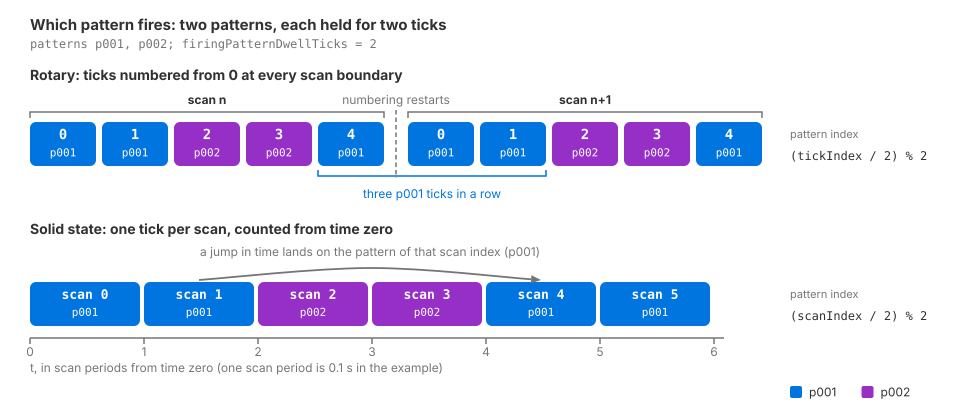

.. SPDX-FileCopyrightText: Copyright (c) 2026 NVIDIA CORPORATION & AFFILIATES. All rights reserved.
.. SPDX-License-Identifier: LicenseRef-NvidiaProprietary
..
.. NVIDIA CORPORATION, its affiliates and licensors retain all intellectual
.. property and proprietary rights in and to this material, related
.. documentation and any modifications thereto. Any use, reproduction,
.. disclosure or distribution of this material and related documentation
.. without an express license agreement from NVIDIA CORPORATION or
.. its affiliates is strictly prohibited.

.. _sensors-nonvisual-lidar-wpm-howto-firing-pattern:

Configure a Firing Pattern
==========================

A Lidar generic wpm model firing pattern defines each emitter row's direction,
firing time and channel. Rotary scans repeat one pattern around the scan
window; solid-state scans can cycle through several patterns. The examples
below configure both and identify the active pattern from the output.

The :doc:`Lidar generic core model firing pattern <../../lidar_core/howto/firing_pattern>`
uses emitter states and a different scheduling scheme.

Before you start. Start with a sensor and ``PointCloud`` RenderProduct. See
:doc:`../../../first_sensor` for the shared workflow and
:doc:`../../../common/output_configuration` for product setup.
:ref:`Firing-pattern attributes
<sensors-nonvisual-lidar-wpm-attributes-firing-patterns>` defines array lengths,
instance names and ordering.

A *tick* is one application of a pattern, one step at the
nominal resolution ``omni:sensor:LidarWpm:rotPatternFiringResDeg`` for a rotary
sensor and the whole scan for a solid-state one, as :ref:`the scan schedule
<sensors-nonvisual-lidar-wpm-attributes-scan-schedule>` defines it. A *firing
pattern* is the set of emitter rows that fire during one tick: each row is
offset in azimuth from the tick by its ``azimuthDeg``, aimed at its own
``elevationDeg``, and fired at its own ``fireTimeNs`` after the tick starts.

.. _sensors-nonvisual-lidar-wpm-howto-firing-pattern-rotary-example:

Rotary example
--------------

This sensor fires two rows at each rotary tick at a nominal one-degree resolution with ``maxReturns``
2 and requests the default point cloud channels. The file is the model's
example scene: a complete stage with the sensor, its RenderProduct and its
``PointCloud`` RenderVar, which you load and step like any other scene. It
carries no geometry, so add the surfaces the sensor should see before you look
for returns.

.. tab-set::

   .. tab-item:: USDA
      :sync: usda

      .. literalinclude:: ../../../../../tests/docs/usd/data/lidar_wpm_firing_pattern_rotary.usda
         :language: usda
         :prepend: #usda 1.0
         :start-after: # [snippet:doc-lidar-wpm-firing-pattern-rotary]
         :end-before: # [/snippet:doc-lidar-wpm-firing-pattern-rotary]

   .. tab-item:: USD Python
      :sync: python

      .. literalinclude:: ../../../../../tests/docs/usd/test_usd_python_examples.py
         :language: python
         :start-after: # [snippet:doc-lidar-wpm-firing-pattern-rotary-python]
         :end-before: # [/snippet:doc-lidar-wpm-firing-pattern-rotary-python]
         :dedent:

``rotPatternFiringResDeg = 1`` requests 360 ticks over the 360° window.
The ticks include both angular endpoints, so their actual spacing is 360/359°;
the requested resolution is nominal. Pattern ``p001`` is applied at each tick,
and its fire times, ``0`` and ``1000`` ns, count from the tick's start. The two
rows share the azimuth of the tick and sit one degree below and above the
horizon, on detector channels ``1`` and ``2``; the empty ``rangeId`` selects
the default range. The ``PointCloud`` RenderVar's empty ``channels`` list asks
for all eight channels this model produces; :doc:`Outputs <../outputs>` lists
them and the rules for requesting a subset.

.. _sensors-nonvisual-lidar-wpm-howto-firing-pattern-solid-state-example:

Solid-state example
-------------------

Solid-state sensors have one logical tick per scan. This example applies
two patterns and holds each selected pattern for two scans. The file is a
complete stage like the rotary one, and you run it the same way.

.. tab-set::

   .. tab-item:: USDA
      :sync: usda

      .. literalinclude:: ../../../../../tests/docs/usd/data/lidar_wpm_firing_pattern_solid_state.usda
         :language: usda
         :prepend: #usda 1.0
         :start-after: # [snippet:doc-lidar-wpm-firing-pattern-solid-state]
         :end-before: # [/snippet:doc-lidar-wpm-firing-pattern-solid-state]

   .. tab-item:: USD Python
      :sync: python

      .. literalinclude:: ../../../../../tests/docs/usd/test_usd_python_examples.py
         :language: python
         :start-after: # [snippet:doc-lidar-wpm-firing-pattern-solid-state-python]
         :end-before: # [/snippet:doc-lidar-wpm-firing-pattern-solid-state-python]
         :dedent:

The second pattern is a second instance of the multiple-apply schema,
``OmniSensorGenericLidarWpmFiringPatternAPI:p002``, with its own five arrays
under ``firingPattern:p002:``; the two patterns need not have the same row
count. ``firingPatternDwellTicks = 2`` keeps each pattern selected for two
consecutive ticks, which on a solid-state sensor means two scans. The RenderVar
names six channels explicitly and leaves out ``MaterialId`` and ``EchoId``;
:ref:`Requesting the output <sensors-nonvisual-lidar-wpm-outputs-requesting>` on
:doc:`Outputs <../outputs>` says which channels arrive whether or not they are
named.

.. _sensors-nonvisual-lidar-wpm-howto-firing-pattern-selection:
.. _sensors-lidar-wpm-pattern-selection:

Which pattern fires
-------------------

Which pattern fires at a tick follows from the tick's position alone. For a
rotary scan, ticks are numbered from zero at the start of every scan, and the
pattern of tick ``tickIndex`` is

::

    (tickIndex / firingPatternDwellTicks) % patternCount

with integer division: the first pattern holds for the first
``firingPatternDwellTicks`` ticks, the second for the next, and the sequence
wraps after ``firingPatternDwellTicks * patternCount`` ticks. Because the
numbering restarts at each scan boundary, every rotary scan begins with the
first pattern, whatever tick the previous scan ended on.

For a solid-state scan one logical tick is one scan, and the tick index is the
absolute scan index: scans are counted in whole scan periods from time zero, so
the scan that starts at time ``t`` is scan number ``t / scanPeriod``, where the
scan period is the inverse of ``omni:sensor:frameRate`` (0.1 s in the examples
above), and the same formula gives its pattern. A jump in simulation time
therefore advances the pattern deterministically: the pattern of a scan depends
only on when the scan happens, not on how many scans were rendered before it.

In the solid-state example above, two patterns and a dwell of two give scans 0
and 1 to ``p001``, scans 2 and 3 to ``p002``, scans 4 and 5 to ``p001`` again,
and so on. With a dwell of 1 the patterns alternate on every scan; with a single
pattern the dwell changes nothing. ``firingPatternDwellTicks`` must be positive:
a value of zero fails validation, and a running sensor keeps the dwell it had.

   Pattern selection with two patterns and ``firingPatternDwellTicks = 2``.
   Top: a rotary sensor numbers its ticks from zero at every scan boundary, so
   each scan starts with ``p001``. Bottom: a solid-state sensor's tick is the
   scan itself, counted from time zero, so scans 2 and 3 fire ``p002`` whatever
   was rendered before them.

Each point reports the pattern that fired it in ``FiringPatternIndex``, its
zero-based position in the lexicographic order of the instance names rather
than a stable identifier;
:ref:`FiringPatternIndex <sensors-nonvisual-lidar-wpm-outputs-firing-pattern-index>`
on :doc:`Outputs <../outputs>` has the rule.

.. _sensors-nonvisual-lidar-wpm-howto-firing-pattern-edit:

Add, rename or remove patterns
------------------------------

To add a pattern, apply the next instance of
``OmniSensorGenericLidarWpmFiringPatternAPI`` to the prim and author its four
required arrays, and ``rangeId`` if you need it, under the matching instance
name. Adding a pattern, or editing the arrays of one that exists, is a live edit
on this model: an accepted update becomes active as one complete profile and
drops a scan that was in progress, and an update that fails validation leaves
the last valid profile active. :doc:`Retune the Sensor While It Runs
<runtime_updates>` describes update behavior. The following rules apply to firing patterns:

- An array that is present but empty is an update, not an omission. Emptying a
  pattern's arrays does not remove the pattern: it leaves the pattern with no
  rows, which fails validation, and the previous profile stays in force.
- Deleting or renaming a pattern instance is not a live edit. Recreate the
  sensor after you delete or rename an instance.
- Zero-padded names keep the order you intend: ``p010`` sorts after ``p002``,
  while ``p10`` would sort before ``p2``.
- On a product that tiles several sensors, only the first sensor's patterns are
  read, so edit that one; refer to :doc:`Tile Lidars <tile_lidars>`.

.. _sensors-nonvisual-lidar-wpm-howto-firing-pattern-verify:

Verification
------------

Request ``ChannelId`` and ``FiringPatternIndex`` on the ``PointCloud``
RenderVar, or leave the list empty to receive both, run the sensor for several
scans and read each published point cloud as :doc:`Sensor Outputs
<../../../common/sensor_outputs>` describes: bound every per-point read by
``Counts[0]`` and keep only the points whose ``Flags`` carry the valid bit.
Select by ``Flags`` before you read ids, because in dense output every invalid
slot carries a ``ChannelId`` of ``0``; :ref:`ChannelId
<sensors-nonvisual-lidar-wpm-outputs-channel-id>` on :doc:`Outputs <../outputs>`
has the rule. The first outputs after the sensor starts may be empty while the
model prepares itself; :doc:`Outputs <../outputs>` describes that empty output.

Check the following:

- Every valid point's ``ChannelId`` is one of the ids you wrote in the patterns'
  ``channelId`` arrays, exactly as written: the ids are labels, not indices.
- On a solid-state sensor all valid points of one scan share one
  ``FiringPatternIndex``, and consecutive scans follow the dwell. For the
  example above the index holds for two scans and then switches, a sequence such
  as ``0, 0, 1, 1, 0``, and after an edit to ``firingPatternDwellTicks = 1`` it
  alternates on every scan. The valid points of a scan carry only the channel
  ids of the pattern that fired: ``1`` and ``2`` for ``p001``, ``2`` alone for
  ``p002``.
- On a rotary sensor a completed scan with at least
  ``firingPatternDwellTicks * patternCount`` ticks contains firings of every
  pattern, so ``FiringPatternIndex`` takes every value from ``0`` to
  ``patternCount - 1`` among the patterns whose rays returned something; the
  single-pattern example reports ``0`` everywhere.

The number of points is not the invariant: a row whose ray meets nothing within
range contributes no valid point, so a pattern aimed at empty sky can be absent
from a scan. The ids and indices of the points that are present are still
exactly the ones you authored.

.. _sensors-nonvisual-lidar-wpm-howto-firing-pattern-symptoms:

Potential issues
----------------

These are the symptoms a firing-pattern configuration causes. The reason for a
rejected parameter set is logged as an error, and the :doc:`sensor definition
validation utility <../../../common/validation>` names it for a layer before you
render.

- **The sensor has never published anything.** The initial parameter set
  failed validation, and this model publishes nothing until its parameters
  validate. In the patterns, look for arrays of unequal length, a required
  array that is missing or empty, an instance name that starts with a digit or
  holds a character other than letters, digits and underscores, more than 256
  patterns, or a ``firingPatternDwellTicks`` of zero.
- **An edit to a pattern appears to do nothing.** The whole parameter set was
  refused, or the edit was made on a sensor other than the first one of a tiled
  product; refer to :doc:`Retune the Sensor While It Runs <runtime_updates>`.
- **The patterns do not alternate.** With one pattern there is nothing to
  alternate. With several, a dwell above one holds each pattern for that many
  ticks, and a rotary sensor begins every scan with the first pattern, so two
  consecutive scans start alike by design; refer to :ref:`which pattern fires <sensors-nonvisual-lidar-wpm-howto-firing-pattern-selection>`.
- **Points land on the neighboring detector.** The consumer treats ``ChannelId``
  as an index; it is the authored label. Refer to :ref:`channel ids are labels
  <sensors-nonvisual-lidar-wpm-attributes-channel-ids>`.

Related
-------

- :doc:`USD Attributes <../attributes>` — the firing-pattern array rules, instance ordering, channel ids as labels and the scan-schedule attributes.
- :doc:`Outputs <../outputs>` — requesting channels, ``ChannelId``, ``FiringPatternIndex`` and the empty output while the model starts.
- :doc:`Retune the Sensor While It Runs <runtime_updates>` — live edits, rejected updates and recreating the sensor after removing an instance.
