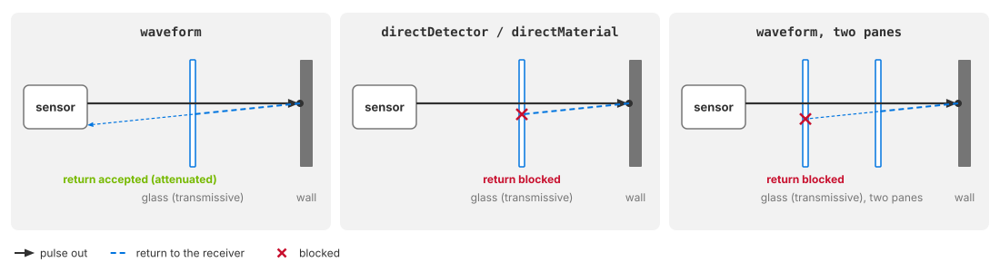

.. SPDX-FileCopyrightText: Copyright (c) 2026 NVIDIA CORPORATION & AFFILIATES. All rights reserved.
.. SPDX-License-Identifier: LicenseRef-NvidiaProprietary
..
.. NVIDIA CORPORATION, its affiliates and licensors retain all intellectual
.. property and proprietary rights in and to this material, related
.. documentation and any modifications thereto. Any use, reproduction,
.. disclosure or distribution of this material and related documentation
.. without an express license agreement from NVIDIA CORPORATION or
.. its affiliates is strictly prohibited.

.. _sensors-nonvisual-lidar-wpm-howto-return-processing:

Choose a Return-Processing Mode
===============================

The Lidar generic wpm model provides three return-processing modes. They
differ in how they convert arriving pulse energy into detections, handle
transmissive surfaces and limit propagation depth. Choose a mode with a
compatible ray type and return count; :doc:`../attributes` defines the controls.

Before you start. Start with a configured :doc:`wpm lidar <../index>` and a RenderProduct
requesting ``PointCloud``. :doc:`../../../first_sensor` demonstrates the shared
render-and-read workflow with a Lidar generic core model sensor; :doc:`../../../common/output_configuration`
explains product setup. Check the :ref:`ray-type and return-count constraints
<sensors-nonvisual-lidar-wpm-attributes-return-processing>` before changing modes.
The default is ``waveform``.

A *firing* is one emitter row releasing one pulse. A
*return* is one arrival of that pulse's energy that the model accepts and
reports as a point; one receiver reports up to ``maxReturns`` of them per
firing, numbered in the ``EchoId`` channel of :doc:`Outputs <../outputs>`.

Signal processing modes
-----------------------

.. list-table::
   :class: compact-table
   :header-rows: 1
   :widths: 18 20 62

   * - Mode
     - Ray type
     - Processing
   * - ``waveform``
     - ``idealized`` or ``gaussianBeam``
     - Accumulates each pulse's arrivals at a receiver over time into a
       time-of-flight histogram, the record of when and how strongly the
       pulse's energy came back, normalizes it for the detector's response,
       finds the lobes of the histogram and selects up to ``maxReturns``
       returns from them.
   * - ``directDetector``
     - ``idealized``
     - Converts each arrival through the detector, with the detector's noise,
       and accepts it against the nominal detection threshold; no accumulation
       over time, no histogram, no lobe detection.
   * - ``directMaterial``
     - ``idealized``
     - Takes the material's backscatter at the hit and applies its own range
       attenuation, a reference-divergence factor and its own intensity
       thresholds, together with the shared ``calibrationGain`` and the
       detector field of view; bypasses the detector's photon conversion and
       noise and every waveform stage.

Use ``waveform`` for finite-width beams, time-resolved arrivals or detection
through transmissive surfaces. It has the highest processing cost. Increasing
``sparseTofBinCapacity`` adds histogram storage; increasing ``maxReturns`` or
using beam rays adds work and storage.

Use ``directDetector`` for detector sensitivity and noise at lower cost when
transmission is unnecessary. Use ``directMaterial`` for material-response
studies without photon conversion or detector noise. See :doc:`intensity` for
how normalization differs between modes.

With nothing between the sensor and a target, all three modes report that
target at the same range. What differs is the signal they attach to it, the
thresholds they apply, and what they report from behind a surface.

.. _sensors-nonvisual-lidar-wpm-howto-return-processing-see-through:
.. _sensors-lidar-wpm-trace-depth:

Surface transmission
--------------------

Each surface interaction produces at most one continuation ray, either
reflected or transmitted. :doc:`Non-visual materials
<../../../../materials/nonvisual_sensor_materials>` determine the direction
and remaining energy. Transmission can reach surfaces behind glass or water.
Each hit also contributes along a straight path back to the receiver. The
modes differ in how they handle obstructions on that return path:

- In ``waveform`` mode the way back may pass through one transmissive surface.
  The surface attenuates the return; it does not bend it. A second transmissive
  surface on the way back, or any opaque one, blocks the return.
- In ``directDetector`` and ``directMaterial`` mode any surface between the hit
  and the receiver blocks the return, transmissive or opaque, whatever
  ``maxReturns`` is.

So a target behind one glass pane is reported in ``waveform`` mode and not in
the direct modes, which report at most the pane itself; a target behind two
panes is reported in no mode. A return that comes through a pane is weaker than
the same target seen directly, and it must still clear the mode's thresholds on
its own.

   What each mode can see through. Left: in ``waveform`` mode a return from
   behind one transmissive pane reaches the receiver, attenuated by the pane.
   Middle: in a direct mode the pane blocks the way back, so only the pane
   itself can be reported. Right: two panes block the return even in
   ``waveform`` mode.

Propagation depth
-----------------

A path that reaches a target behind a pane meets at least two surfaces, the
pane and the target, so give the receiver at least two returns when you want
both reported; how many surfaces a path may meet follows from
``omni:sensor:LidarWpm:maxReturns`` and the mode, and :ref:`the derived depth
<sensors-nonvisual-lidar-wpm-attributes-derived-depth>` on :doc:`USD
Attributes <../attributes>` gives the numbers.

Which thresholds apply
----------------------

Each mode has its own detection floor, and all three are expressed against one
calibration point, the nominal signal derived from ``minDetectableReflectance``
and its reference range; :ref:`the calibration point
<sensors-nonvisual-lidar-wpm-attributes-min-detectable-reflectance>` on
:doc:`USD Attributes <../attributes>` states the rule per mode.

Verification
------------

Build a scene with a plain target, a single pane in front of it whose material
transmits the pulse (a ``clear_glass`` pane, for example; the labels that
permit transmission are listed above), and the sensor looking through the pane
at the target. Request ``Coordinates``,
``Flags`` and ``EchoId`` on the ``PointCloud`` RenderVar, or leave the list
empty to receive all eight channels, and read each published point cloud as
:doc:`Sensor Outputs <../../../common/sensor_outputs>` describes: bound every
per-point read by ``Counts[0]`` and keep the points whose ``Flags`` carry the
valid bit. Run the scene once per mode; switching the mode on a running sensor
is a live edit that becomes a new validated parameter set, a *profile* in the
sense of :doc:`Retune the Sensor While It Runs <runtime_updates>`. Then check:

- In ``waveform`` mode, valid points stand at the target's range behind the
  pane. If the pane also produces a return, the pane and the target are two returns of
  the same firing with different ``EchoId`` values: in this mode ``EchoId`` 0
  is the return with the strongest detected signal and 1 the next, the nearer
  one first when they tie, so which of the two is 0 depends on which produces
  the stronger return, not on which is nearer. In the direct modes the returns of a
  firing are numbered in the order the pulse's path produced them. The order
  is stated with the ``EchoId`` channel on :doc:`Outputs <../outputs>`.
- In ``directDetector`` and ``directMaterial`` mode, no valid point stands at
  the target's range; what remains is at most the pane's own return.
- Remove the pane and every mode reports the target at the same range; add a
  second pane and no mode reports the target.

Potential issues
----------------

The reason for a rejected parameter set is logged as an error, and the
:doc:`sensor definition validation utility <../../../common/validation>` names
it for a layer before you render.

- **The sensor has never published anything, or an edit to the mode appears to
  do nothing.** A direct mode paired with ``rayType = gaussianBeam``, or a
  direct mode with ``maxReturns`` above 8, fails validation. So does a
  ``maxReturns`` of 0, or one above 255, in any mode. An invalid initial
  parameter set keeps the sensor from publishing until it validates; an invalid
  later edit leaves the last valid profile active, so the mode you see is the
  one you had. Change both constrained attributes together with the mode; refer
  to :doc:`Retune the Sensor While It Runs <runtime_updates>`.
- **No returns from behind a transmissive surface in a direct mode.**
  That is the mode's design: the way back is blocked by any surface. Use
  ``waveform`` mode when you need the target behind the pane.
- **No returns from behind the surface in waveform mode either.** Check
  that the surface's material transmits the pulse (:doc:`Non-Visual Sensor Materials
  <../../../../materials/nonvisual_sensor_materials>`). Check that only one such surface lies on the way
  back, and that ``maxReturns`` gives the path the depth it needs. A pane that
  transmits little can also leave the return under the detection floor.
- **Fewer returns than expected in waveform mode.** Raise ``maxReturns``, then
  look at the detection floor, ``minDetectableReflectance`` with its reference
  range and ``peakSumThresholdScale``, and at the detector field of view, which
  rejects arrivals outside its half-angles; all on :doc:`USD Attributes
  <../attributes>`.
- **The same target reads a different Intensity in each mode.** Expected: what
  the number means depends on the mode and on the presentation attributes;
  refer to :doc:`Tune Intensity <intensity>`.

Related
-------

- :doc:`USD Attributes <../attributes>` — ``returnProcessingMode``, the ray-type and ``maxReturns`` constraints, the derived path depth and the detection thresholds.
- :doc:`Outputs <../outputs>` — the ``EchoId`` channel and the rest of the point cloud this model delivers.
- :doc:`Tune Intensity <intensity>` — how a detected return's strength is presented in each mode.
- :doc:`Symptom Index <../../../troubleshooting/symptoms>` — the cross-model list of symptoms and their causes.
