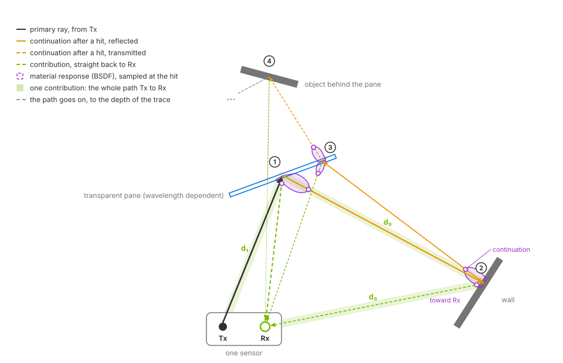
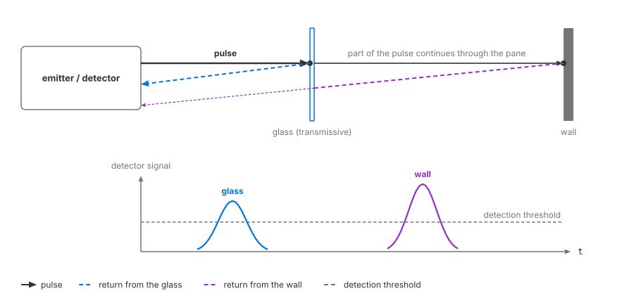

.. SPDX-FileCopyrightText: Copyright (c) 2026 NVIDIA CORPORATION & AFFILIATES. All rights reserved.
.. SPDX-License-Identifier: LicenseRef-NvidiaProprietary
..
.. NVIDIA CORPORATION, its affiliates and licensors retain all intellectual
.. property and proprietary rights in and to this material, related
.. documentation and any modifications thereto. Any use, reproduction,
.. disclosure or distribution of this material and related documentation
.. without an express license agreement from NVIDIA CORPORATION or
.. its affiliates is strictly prohibited.

.. _sensors-nonvisual-lidar-wpm:
.. _sensors-nonvisual-lidar-wpm-index:

Lidar generic wpm model
=======================

The Lidar generic wpm model simulates pulsed time-of-flight lidar. It models
pulse propagation, surface interactions and detector response to predict return
strength and timing. Paths can cross multiple surfaces, including transmissive
ones.

The :doc:`Lidar generic core model <../lidar_core/index>` uses geometric ray
intersections instead. Choose the wpm model when wave propagation and detector
behavior matter. WPM stands for *wave propagation model*; see the
:doc:`glossary <../../reference/glossary>`.

o an object behind it at hit 4 and fades out toward the depth of the trace. Dashed green contribution rays run from every hit straight back to Rx, the one from hit 4 crossing the pane again. Purple lobes at hits 1 and 2 show the surface's material response with two sampled directions, the continuation and the direction of Rx; at hit 3 the lobe sits on both sides of the pane. The path Tx, pane, wall, Rx is highlighted with its segment lengths d1, d2 and d3; the rays thin with every hit.
   :width: 960

   A propagation path from transmitter Tx through a pane, wall and pane to
   an object behind the glass. Each hit generates one reflected or transmitted
   continuation and a contribution toward receiver Rx. The highlighted
   Tx → pane → wall → Rx path has length d₁ + d₂ + d₃, which determines its
   arrival time. The contribution from behind the pane crosses it again on
   the return path.

   At each hit, the bidirectional scattering distribution function (BSDF) is
   evaluated for the continuation and receiver directions. Surface interactions
   reduce the remaining energy; transmission also depends on wavelength.
   The diagram shows refraction toward the pane's normal and traces the path
   to the configured depth.

Simulation
----------

A rotary or solid-state scan schedule defines each emitter's firing time and
direction. Each pulse is traced as an idealized ray or a finite-width beam,
using the configured power, wavelength, duration, angular jitter and offsets.
See :doc:`howto/firing_pattern` and :doc:`attributes`.

Surface scattering and transmission use
:doc:`non-visual materials <../../../materials/nonvisual_sensor_materials>`.
The model can also use the visual material's diffuse reflectance, roughness
and shading normal. Transmitted paths can produce returns from behind glass;
indirect paths can produce ghost returns.

The detector processes arrivals in ``waveform`` (default), ``directDetector``
or ``directMaterial`` mode. The mode determines how arrivals become returns
and how transmissive surfaces are handled. Each receiver can report up to
``omni:sensor:LidarWpm:maxReturns`` returns per tick; a receiver corresponds
to an emitter row in the firing pattern.
See :doc:`howto/return_processing` for the modes and :doc:`attributes` for
detector controls.

Intensity can report raw detector response or range-normalized apparent
reflectivity. This choice changes the reported strength without changing
which returns are detected; see :doc:`howto/intensity`.

         it; two arrivals come back to the detector at different times and
         strengths, and a time axis shows the two returns, one from the glass
         and one from the wall.
   :width: 900

   *In waveform mode, one pulse can produce returns from a glass pane and the
   wall behind it, with separate EchoIds. Return strength depends on material,
   incidence angle and distance; the diagram shows one example.*

Outputs
-------

The model produces :doc:`PointCloud <outputs>` outputs with one entry per
return. Eight channels are selectable: ``Coordinates``, ``Intensity``,
``TimeOffsetNs``, ``Flags``, ``ChannelId``, ``MaterialId``, ``EchoId`` and
``FiringPatternIndex``. See the
:ref:`channel reference <sensors-nonvisual-lidar-wpm-outputs-channels>`.

Both :ref:`compact <sensors-nonvisual-lidar-wpm-outputs-compact>` and
:ref:`dense <sensors-nonvisual-lidar-wpm-outputs-dense>` layouts include
``Counts``. Compact output also includes two tile tensors. Multiple sensors
on one RenderProduct produce a single
:ref:`aggregate point cloud <sensors-nonvisual-lidar-wpm-outputs-tiled>`.

Capabilities
------------

Output coordinates can be Cartesian or spherical, in the sensor, world or a
custom reference frame. Motion compensation can correct sensor movement during
a scan; motion effects require the renderer's motion BVH. See :doc:`attributes`,
:doc:`outputs` and :doc:`../../common/output_configuration`.

All model attributes support runtime edits. Rejected updates retain the last
valid profile; see :doc:`howto/runtime_updates`. For multiple sensors on one
RenderProduct, see :doc:`howto/tile_lidars`.

Applications
------------

Use this model to study how materials, beam geometry, detector parameters and
multipath propagation affect lidar returns. Examples include returns through
glass, strong returns from retroreflective signs, and loss of dark surfaces
at long range. Aperture, efficiency, noise, pulse and threshold settings can
be varied to evaluate detector response.

For lower-cost geometric point clouds, use the
:doc:`Lidar generic core model <../lidar_core/index>`.
See :ref:`Performance <sensors-nonvisual-lidar-wpm-attributes-costs>` for
controls that affect the wpm model's cost.

.. figure:: ../../../img/sensors/nonvisual/lidar_wpm_glass_retroreflective_scan.avif
   :align: center
   :alt: A perspective view of a lidar point cloud colored from blue for weak to red for strong returns: rings of ground points around the sensor at the left, a glass bus shelter ahead whose front pane appears as a dense sheet of points, sparser points on the bench inside and on the wall behind the pane, the same wall brighter above and beside the shelter, and a small saturated red sign on a post at the right; an inset at the bottom right shows the same scene rendered by a camera, with the lidar's position marked by a white dot.
   :width: 1000

   *A waveform-mode scan with maxReturns = 2. Points use rangeNormalized
   intensity, linear mapping and full scale 2.55, displayed on a square-root
   color scale. The glass pane produces returns, as do the bench and wall
   behind it. Returns through glass are weaker than direct returns from the
   exposed wall. The sign and metal frame saturate the scale. The inset shows
   the same camera view.*

Sensor definition
-----------------

Apply ``OmniSensorGenericLidarWpmAPI`` to an ``OmniLidar`` prim.
The schema sets ``omni:sensor:modelName = "LidarWpm"`` to select this model
and supplies the first firing pattern, ``p001``.

To alternate patterns, apply additional instances of
``OmniSensorGenericLidarWpmFiringPatternAPI``. Name them in firing order:
``p002``, ``p003``, and so on. Model controls use ``omni:sensor:LidarWpm:*``;
identity and scheduling use the shared sensor attributes.
See :doc:`attributes` and :ref:`model identity <sensors-ref-model-identity-vs-plugin>`.

Create a RenderProduct with a ``PointCloud`` RenderVar, then load, step and read
it as in :doc:`../../first_sensor`. This model has no runnable project in the
:doc:`example gallery <../../../examples/index>`. Instead, start from the complete
rotary scene in :doc:`howto/firing_pattern`; the other how-tos build on it.

The following scene defines a sensor, its ``p001`` firing pattern and a
RenderProduct requesting ``PointCloud``:

.. tab-set::

   .. tab-item:: USDA
      :sync: usda

      .. literalinclude:: ../../../../tests/docs/usd/data/lidar_wpm_firing_pattern_rotary.usda
         :language: usda
         :start-after: # [snippet:doc-lidar-wpm-firing-pattern-rotary]
         :end-before: # [/snippet:doc-lidar-wpm-firing-pattern-rotary]
         :prepend: #usda 1.0

   .. tab-item:: USD Python
      :sync: python

      .. literalinclude:: ../../../../tests/docs/usd/test_usd_python_examples.py
         :language: python
         :start-after: # [snippet:doc-lidar-wpm-firing-pattern-rotary-python]
         :end-before: # [/snippet:doc-lidar-wpm-firing-pattern-rotary-python]
         :dedent:

.. _sensors-nonvisual-lidar-wpm-index-which-lidar:
.. _sensors-wpm-which-lidar:

Comparison with the core model
------------------------------

Both lidar models use ``OmniLidar`` prims. The applied API schema selects the
model through ``omni:sensor:modelName``; see
:ref:`model identity <sensors-ref-model-identity-vs-plugin>`.
The wpm model uses ``omni:sensor:LidarWpm:*`` controls and ignores
``omni:sensor:Core:*`` controls. See :doc:`attributes`.

Configuration and outputs
-------------------------

Use :doc:`attributes` for controls, bounds and costs, and :doc:`howto/index`
to configure a working sensor. Read :doc:`outputs` before consuming point clouds:
it defines compact and dense layouts, tiled aggregates, coordinate frames and
empty startup output.

.. toctree::
   :maxdepth: 1

   attributes
   howto/index
   outputs

Related
-------

- :doc:`Lidar generic core model <../lidar_core/index>` — lower-cost geometric lidar simulation.
- :doc:`Output Configuration <../../common/output_configuration>` — authoring the RenderProduct and RenderVar, and the renderer options sensors depend on.
- :doc:`Sensor Outputs <../../common/sensor_outputs>` — reading returns back and telling valid points from invalid ones.
- :doc:`Limitations <../../troubleshooting/limitations>` — model limits.
