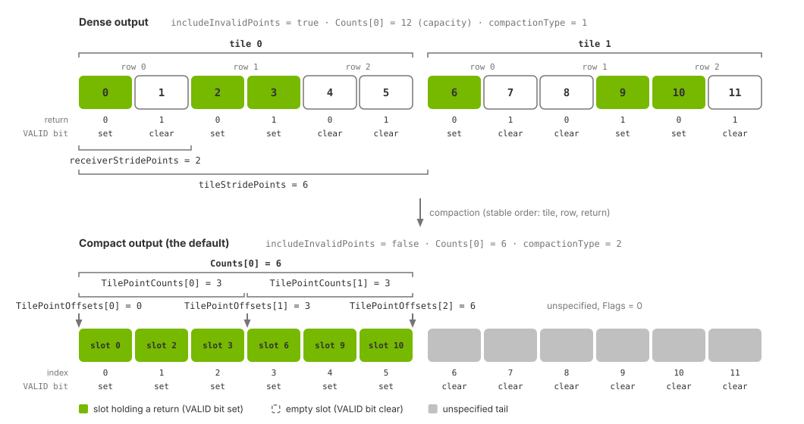

.. SPDX-FileCopyrightText: Copyright (c) 2026 NVIDIA CORPORATION & AFFILIATES. All rights reserved.
.. SPDX-License-Identifier: LicenseRef-NvidiaProprietary
..
.. NVIDIA CORPORATION, its affiliates and licensors retain all intellectual
.. property and proprietary rights in and to this material, related
.. documentation and any modifications thereto. Any use, reproduction,
.. disclosure or distribution of this material and related documentation
.. without an express license agreement from NVIDIA CORPORATION or
.. its affiliates is strictly prohibited.

.. _sensors-nonvisual-lidar-wpm-outputs:

Outputs
=======

The Lidar generic wpm model delivers one ``PointCloud`` composite output per
requesting RenderVar. It supports no other output type. Each entry is one
return from a pulse sent by an emitter row of the firing pattern. This page
lists the channels, parameters and compact, dense and tiled layouts. See
:doc:`attributes` for the controls that select them.

:doc:`../../common/sensor_outputs` explains mapping, DLPack tensors, params,
``Counts`` and validity flags. See :doc:`../../common/output_configuration`
for RenderProduct and RenderVar setup, and the :ref:`C API <c-api-sensor-types>`
or :ref:`Python API <python-api-render-outputs>` for container definitions.

The model supports eight selectable channels:

- ``Coordinates``
- ``Intensity``
- ``TimeOffsetNs``
- ``Flags``
- ``ChannelId``
- ``MaterialId``
- ``EchoId``
- ``FiringPatternIndex``

Every output also includes ``Counts``. Compact output additionally includes
``TilePointCounts`` and ``TilePointOffsets``.

The model does not provide ``EmitterId``, ``TickId``, ``TickState``,
``ObjectId``, ``HitNormal``, ``Velocity``, backscatter or ``Reflectivity``.
See :doc:`Lidar generic core outputs <../lidar_core/outputs>` for that model's
channels, tensor layouts and parameters.

.. _sensors-nonvisual-lidar-wpm-outputs-requesting:

Requesting the output
---------------------

You request the output with a RenderVar whose ``sourceName`` is
``PointCloud``. :ref:`How channels are requested
<sensors-common-output-configuration-channels>` on Output Configuration
explains the ``channels`` attribute in general; this model reads the list as
follows.

- An empty ``channels`` list selects all eight channels.
- An explicit list selects the channels you named, and ``Flags`` is added
  whether or not you named it.
- ``Counts``, an ``int32`` tensor of shape ``[1]``, is published with every
  output whether or not it was asked for. In compact output, the default,
  ``TilePointCounts`` and ``TilePointOffsets`` are published as well; see
  :ref:`sensors-nonvisual-lidar-wpm-outputs-compact`.
- Only the eight names are produced. A name from another model's set, or a
  misspelling, is not delivered, so when a channel is missing from the mapped
  output, check its spelling and case against the table below.
- An explicit list must name at least one of the eight channels; ``Counts``,
  ``TilePointCounts`` and ``TilePointOffsets`` come with every output but do
  not count as names here. A list that names none of the eight is rejected and
  the reason is logged as an error; correct the list before the sensor can
  publish.

For an existing WPM lidar at ``/Lidar``, this example requests coordinates,
intensity and firing-time offsets. ``Flags`` and ``Counts`` are included
automatically, along with the tile tensors when using compact output.

.. tab-set::

   .. tab-item:: USDA
      :sync: usda

      .. literalinclude:: ../../../../tests/docs/usd/data/lidar_wpm_output_request.usda
         :language: usda
         :prepend: #usda 1.0
         :start-after: # [snippet:doc-lidar-wpm-output-request]
         :end-before: # [/snippet:doc-lidar-wpm-output-request]

   .. tab-item:: USD Python
      :sync: python

      .. literalinclude:: ../../../../tests/docs/usd/test_usd_python_examples.py
         :language: python
         :start-after: # [snippet:doc-lidar-wpm-output-request-python]
         :end-before: # [/snippet:doc-lidar-wpm-output-request-python]
         :dedent:

The :ref:`rotary example <sensors-nonvisual-lidar-wpm-howto-firing-pattern-rotary-example>`
on :doc:`howto/firing_pattern` requests the default set with
``token[] channels = []``; its :ref:`solid-state example <sensors-nonvisual-lidar-wpm-howto-firing-pattern-solid-state-example>` names
six channels explicitly.

.. _sensors-nonvisual-lidar-wpm-outputs-several-point-clouds:
.. _sensors-lidar-wpm-several-point-clouds:

Multiple PointCloud outputs
---------------------------

One RenderProduct can request several ``PointCloud`` RenderVars with separate
``channels`` lists. The model runs one scan and computes their combined channel
set, then publishes each RenderVar's selected channels with ``Flags``,
``Counts`` and, for compact output, tile tensors. All outputs contain the same
points: counts and slot indices agree. Outputs are identified by
:ref:`RenderVar prim path <sensors-common-sensor-outputs-identity>`.

.. _sensors-nonvisual-lidar-wpm-outputs-channels:

Channels
--------

In the shapes below, ``Nmax`` is the point capacity, published as the
``maxPoints`` param: the number of slots the output has room for, not the
number of returns it holds. Which slots carry a return depends on the layout:
in compact output read the first ``Counts[0]`` slots, in dense output select by
``Flags``. Both layouts are described further down.

.. list-table::
   :class: compact-table
   :header-rows: 1
   :widths: 18 8 10 7 57

   * - Channel
     - Type
     - Shape
     - Unit
     - Meaning
   * - ``Coordinates``
     - ``float32``
     - ``[Nmax, 3]``
     - m, deg
     - Cartesian ``[xM, yM, zM]`` or ISO 8855 spherical
       ``[azimuthDeg, elevationDeg, rangeM]``, in the configured frame of
       reference; point-first.
   * - ``Intensity``
     - ``float32``
     - ``[Nmax]``
     - unitless
     - Presented intensity in the configured processing mode.
   * - ``TimeOffsetNs``
     - ``int32``
     - ``[Nmax]``
     - ns
     - Firing time of the return relative to the output's ``timestampNs``.
   * - ``Flags``
     - ``uint8``
     - ``[Nmax]``
     - unitless
     - Validity: the valid bit is set on a slot that holds a return.
   * - ``ChannelId``
     - ``uint32``
     - ``[Nmax]``
     - unitless
     - The detector channel id of the emitter row, exactly as authored on the
       firing pattern.
   * - ``MaterialId``
     - ``uint32``
     - ``[Nmax]``
     - unitless
     - Encoded non-visual material identifier of the hit surface.
   * - ``EchoId``
     - ``uint8``
     - ``[Nmax]``
     - unitless
     - Index of the return among the returns of its emitter row, from ``0``,
       in the order the return-processing mode defines
       (:ref:`below <sensors-nonvisual-lidar-wpm-outputs-echo-id>`).
   * - ``FiringPatternIndex``
     - ``uint8``
     - ``[Nmax]``
     - unitless
     - Zero-based position of the pattern that fired the return, in the
       lexicographic order of the pattern instance names.

.. _sensors-nonvisual-lidar-wpm-outputs-coordinates-packing:
.. _sensors-lidar-wpm-coordinates-packing:

``Coordinates`` has shape ``[Nmax, 3]``, with each point's three components
adjacent in memory. Use the descriptor's strides when reading it.
``SPHERICAL`` encoding (default) stores ``[azimuthDeg, elevationDeg, rangeM]``;
``CARTESIAN`` stores ``[xM, yM, zM]``. Both use the configured
:ref:`reference frame <sensors-nonvisual-lidar-wpm-outputs-frame-contract>`.
See :ref:`the ISO 8855 sensor convention
<sensors-common-sensor-outputs-sensor-frame>` for axes and angular units.

The Lidar generic core model uses :ref:`component-first packing
<sensors-nonvisual-lidar-core-outputs-coordinates>` (``[3, Nmax]``).
A reader must account for this difference when switching models; see
:ref:`tensor packing <sensors-common-sensor-outputs-packing>`.

``Intensity`` uses the configured processing, mapping and scale. These
settings are not reported in the output, so the consumer must retain them.
``omni:sensor:LidarWpm:intensityProcessing`` selects ``rangeNormalized``
(default) or ``raw``; :ref:`mapping and scale
<sensors-nonvisual-lidar-wpm-attributes-intensity>` control the reported value.
There is no separate reflectivity or backscatter channel.
See :doc:`howto/intensity` for the conventions. These settings
:ref:`do not change return detection
<sensors-nonvisual-lidar-wpm-howto-intensity-presentation-only>`.

.. _sensors-nonvisual-lidar-wpm-outputs-time-offset:
.. _sensors-lidar-wpm-timeoffset-saturates:

``TimeOffsetNs`` records each return's firing time relative to ``timestampNs``,
the scan start. Request it when the consumer performs motion compensation.
The signed 32-bit nanosecond count has a maximum of 2147483647 ns, about
2.147 s. Keep the scan rate at or above roughly 0.47 Hz to avoid exceeding
that range. Other models use different reference times for this channel;
see :ref:`shared channel names <sensors-common-sensor-outputs-shared-names>`.

``Flags`` marks valid returns with the ``VALID`` bit (``0x40``). This model
sets no other bits. Test the bit as described in
:ref:`sensors-common-sensor-outputs-valid-bit`; see the
:ref:`compact <sensors-nonvisual-lidar-wpm-outputs-compact>` and
:ref:`dense <sensors-nonvisual-lidar-wpm-outputs-dense>` layouts for which
slots to read.

.. _sensors-nonvisual-lidar-wpm-outputs-channel-id:

``ChannelId`` reports the detector channel id authored on the firing pattern.
Ids are labels, not indices; see :ref:`channel-id constraints and cost
<sensors-nonvisual-lidar-wpm-attributes-channel-ids>` on :doc:`attributes`.
Dense output writes ``0`` to invalid slots, but ``0`` is also a valid detector
id. Select valid slots with ``Flags`` before reading ``ChannelId``.

.. _sensors-nonvisual-lidar-wpm-outputs-material-id:

``MaterialId`` identifies the hit surface's non-visual material. It uses the
same encoding as the Lidar generic core model; see its
:ref:`bit layout and decoding example
<sensors-nonvisual-lidar-core-outputs-material-id>`. Only the two lidar models
report material ids. See :doc:`../../../materials/nonvisual_sensor_materials`
for the meaning of ``0`` and how to verify material labels.

.. _sensors-nonvisual-lidar-wpm-outputs-echo-id:
.. _sensors-lidar-wpm-echoid-bounds-maxreturns:

``EchoId`` numbers the returns retained by an emitter row, from ``0`` to
``maxReturns - 1``. In ``waveform`` mode, returns are ordered by decreasing
detected signal strength, with nearer returns first on ties, including
saturation. This signal is the value reported by ``raw`` intensity processing
(:doc:`howto/intensity`); ``rangeNormalized`` intensity need not decrease with
``EchoId``. In the two direct modes, returns follow the order in which the
pulse's path encountered their surfaces. ``EchoId`` is a ``uint8``, which
limits ``omni:sensor:LidarWpm:maxReturns``; see the
:ref:`scan-schedule table <sensors-nonvisual-lidar-wpm-attributes-scan-schedule>`
on :doc:`attributes`.

.. _sensors-nonvisual-lidar-wpm-outputs-firing-pattern-index:
.. _sensors-lidar-wpm-firingpatternindex-not-stable:

``FiringPatternIndex`` is the zero-based position of the firing-pattern
instance in lexicographic order, which also determines
:ref:`firing order <sensors-nonvisual-lidar-wpm-howto-firing-pattern-selection>`.
Adding, removing or renaming an earlier instance shifts later indices. Do
not use it as a persistent pattern identifier. Dense output fills it for every
slot, including invalid slots, using the pattern of that slot's emitter row.

.. _sensors-nonvisual-lidar-wpm-outputs-frame-contract:
.. _sensors-lidar-wpm-frame-contract:

Coordinates and motion compensation
-----------------------------------

Four attributes under ``omni:sensor:LidarWpm:`` control the returned coordinates:

- ``elementsCoordsType``: Cartesian or spherical coordinates.
- ``outputFrameOfReference``: sensor, world or custom reference frame.
- ``customFrameOfReferenceTrafo``: the transform used for the custom frame.
- ``outputMotionCompensationState``: whether to compensate for sensor motion
  during the scan.

See :ref:`coordinate attributes
<sensors-nonvisual-lidar-wpm-attributes-output-shaping>` for values, units and
defaults.

Each point is reconstructed in Cartesian sensor coordinates from the receiver's
direction and the detected range. The reference-frame and compensation settings
then determine its transform, as shown below. The transformed point is returned
in the selected Cartesian or spherical representation.

The table uses two sensor poses:

- **Scan-start pose:** the sensor pose at the output's ``timestampNs``.
- **Fire-time pose:** the sensor pose at the return's firing time, interpolated
  over the scan's motion interval.

Set ``outputMotionCompensationState`` to ``true`` to enable compensation or
``false`` to disable it.

.. list-table::
   :class: compact-table
   :header-rows: 1
   :widths: 14 43 43

   * - Reference frame
     - Compensation disabled
     - Compensation enabled
   * - ``SENSOR``
     - Return the point in its original sensor coordinates.
     - Transform the point to world coordinates using its fire-time pose,
       then into the scan-start sensor frame. This removes distortion caused
       by sensor motion during the scan (deskewing).
   * - ``WORLD``
     - Transform all points using the scan-start pose.
     - Transform each point using its fire-time pose.
   * - ``CUSTOM``
     - Apply the custom transform to the point's original sensor coordinates.
     - Compensate as for ``SENSOR``, then apply the custom transform.

The defaults are ``SPHERICAL`` coordinates in the ``SENSOR`` frame with
compensation disabled. Azimuth, elevation and range then come directly from
the receiver direction and detected range, without a sensor-motion correction.
Other settings transform the point before encoding it. Spherical coordinates
in ``WORLD`` or ``CUSTOM`` are measured from the selected frame's origin.

Compensation corrects sensor motion, not target motion. It has no effect when
the sensor is stationary. The output parameters ``coordsType``,
``frameOfReference`` and ``motionCompensationState`` report the settings used.

.. _sensors-nonvisual-lidar-wpm-outputs-one-encoding:
.. _sensors-lidar-wpm-one-encoding-per-output:

An accepted edit to these four attributes applies to all detected and deferred
returns in the next published output. Each point cloud uses one coordinate
encoding. The edit preserves validity, ``Counts``, ``ChannelId``, ``EchoId``,
``FiringPatternIndex`` and return order. See
:ref:`presentation-only updates
<sensors-nonvisual-lidar-wpm-howto-runtime-updates-presentation-only>` for these
updates and :doc:`howto/runtime_updates` for rejection behavior.

.. _sensors-nonvisual-lidar-wpm-outputs-motion:
.. _sensors-lidar-wpm-motion-bvh:

Motion
------

Motion within a frame requires the renderer's motion BVH, selected at renderer
creation. See :ref:`motion BVH configuration
<sensors-common-output-configuration-motion-bvh>` and
:doc:`../lidar_core/howto/motion_artifacts` for examples with and without it.

Without motion BVH, the model still publishes outputs. Each frame traces from
the sensor's end pose against a static scene, so its points contain no
intra-frame motion effects, even though ``TimeOffsetNs`` retains the firing
times. Tile start poses come from the end of the scan's first frame; end poses
come from the end of its latest contributing frame. These can differ across
a multi-frame scan, and motion compensation interpolates between them. Enable
motion BVH when evaluating motion effects or deskewing.

.. _sensors-nonvisual-lidar-wpm-outputs-params:

Params
------

Output parameters apply to the entire point cloud and are stored in CPU memory.
See :ref:`parameter access <sensors-common-sensor-outputs-params>`. This model
publishes the :ref:`thirteen shared params
<sensors-common-sensor-outputs-shared-params>`, the lidar-specific
``compactionType`` and ``motionCompensationState``, and additional tile and
layout params listed below. Read params by name and ignore unrecognized names.

.. list-table::
   :class: compact-table
   :header-rows: 1
   :widths: 26 10 14 50

   * - Param
     - Type
     - Shape
     - Meaning
   * - ``maxPoints``
     - ``uint32``
     - ``[1]``
     - The point capacity ``Nmax``: ``tileCount`` x ``receiversPerTile`` x
       ``maxReturns``. Every point channel has room for this many slots.
   * - ``frameId``
     - ``uint64``
     - ``[1]``
     - Always ``0`` for this model. Order outputs by ``timestampNs``.
   * - ``timestampNs``
     - ``uint64``
     - ``[1]``
     - The start time of the scan the returns belong to, in nanoseconds;
       ``TimeOffsetNs`` is measured from it. With ``instantLidar`` it is the
       end of the frame, the instant at which the whole scan is traced.
   * - ``modality``
     - ``uint32``
     - ``[1]``
     - ``1``, lidar.
   * - ``compactionType``
     - ``uint32``
     - ``[1]``
     - ``2`` compacted (``includeInvalidPoints`` false, the default) or ``1``
       uncompacted (``true``): the inverse of the attribute.
   * - ``frameStartTimeStampNs``
     - ``uint64``
     - ``[1]``
     - Start of the first frame window that contributed to the published scan.
       For a scan delivered whole and stepped at its own period or a divisor of
       it, this is ``timestampNs``. With ``instantLidar`` it is the frame's end.
   * - ``frameEndTimeStampNs``
     - ``uint64``
     - ``[1]``
     - End of the latest frame window that contributed. For a completed scan
       with ``instantLidar`` off it is ``timestampNs`` plus the scan period;
       with ``instantLidar`` it is the frame's end. With ``partialOutputs``
       true it advances with every published window.
   * - ``frameStartPosM``, ``frameEndPosM``
     - ``float32``
     - ``[3]``
     - Tile zero's position at the two bounds of the interval, in meters, in
       the world frame.
   * - ``frameStartOrientation``, ``frameEndOrientation``
     - ``float32``
     - ``[4]``
     - Tile zero's orientation at the two bounds, as a unit quaternion ordered
       ``x, y, z, w``.
   * - ``tileFrameStartPosM``, ``tileFrameEndPosM``
     - ``float32``
     - ``[tileCount, 3]``
     - One start and one end position per tile, in meters, in ``rel camera``
       order: the scan-wide motion interval that compensated conversion
       interpolates over.
   * - ``tileFrameStartOrientation``, ``tileFrameEndOrientation``
     - ``float32``
     - ``[tileCount, 4]``
     - One start and one end orientation per tile, ``x, y, z, w``, in the same
       order.
   * - ``frameOfReference``
     - ``uint16``
     - ``[1]``
     - ``0`` ``SENSOR``, ``1`` ``WORLD``, ``2`` ``CUSTOM``.
   * - ``modelToAppTransform``
     - ``float32``
     - ``[4, 4]``
     - The identity for this model.
   * - ``motionCompensationState``
     - ``uint16``
     - ``[1]``
     - ``0`` non-compensated, ``1`` compensated.
   * - ``coordsType``
     - ``uint32``
     - ``[1]``
     - ``0`` Cartesian, ``1`` spherical (the default).
   * - ``tileIndex``
     - ``uint32``
     - ``[1]``
     - Always ``0``: the whole aggregate is one output.
   * - ``tileCount``
     - ``uint32``
     - ``[1]``
     - The number of sensors in the product's ``rel camera``; ``1`` for a
       single sensor.
   * - ``receiversPerTile``
     - ``uint32``
     - ``[1]``
     - The number of emitter rows the schedule keeps for one sensor, every
       tick of a rotary scan and every pattern of a solid-state one, after
       :ref:`subsampling
       <sensors-nonvisual-lidar-wpm-attributes-tiled-subsampling>`.
   * - ``maxReturns``
     - ``uint32``
     - ``[1]``
     - The return capacity per emitter row, the authored
       ``omni:sensor:LidarWpm:maxReturns``.
   * - ``validPointCount``
     - ``uint32``
     - ``[1]``
     - The slot capacity of the published layout, equal to ``maxPoints``, or
       ``0`` in the empty output. It is not the number of valid returns; that
       is ``Counts[0]``.
   * - ``tileStridePoints``
     - ``uint32``
     - ``[1]``
     - Dense output: the slot distance between tiles, ``receiversPerTile`` x
       ``maxReturns``. ``0`` in compact output.
   * - ``receiverStridePoints``
     - ``uint32``
     - ``[1]``
     - Dense output: the slot distance between emitter rows, ``maxReturns``.
       ``0`` in compact output.

Which steps deliver an output follows from
``omni:sensor:LidarWpm:partialOutputs`` and
``omni:sensor:LidarWpm:instantLidar``, explained under :ref:`output shaping <sensors-nonvisual-lidar-wpm-attributes-output-shaping>` on :doc:`attributes`.
:doc:`../../common/multi_rate` covers stepping sensors that deliver at
different rates.

.. _sensors-nonvisual-lidar-wpm-outputs-compact:

Compact layout
--------------

Compact output is the default (``omni:sensor:LidarWpm:includeInvalidPoints = false``).
Valid returns occupy slots ``[0, Counts[0])``, ordered by tile, then emitter row,
then return within the row. Compaction preserves that order.

Read only the first ``Counts[0]`` entries. The remaining slots have zero
``Flags`` and unspecified channel values; see :ref:`read bounds
<sensors-common-sensor-outputs-counts-bound>`. Point tensors retain their
capacity shapes, ``[Nmax]`` or ``[Nmax, 3]``, regardless of the return count.
``compactionType`` is ``2``.

Two additional tensors locate each tile's returns in ``rel camera`` order:

- ``TilePointCounts``: a ``uint64`` tensor of shape ``[tileCount]`` containing
  the number of returns from each tile. Its entries sum to ``Counts[0]``.
- ``TilePointOffsets``: a ``uint64`` tensor of shape ``[tileCount + 1]``.
  Tile *t* occupies slots ``[TilePointOffsets[t], TilePointOffsets[t + 1])``.
  The first offset is ``0`` and the last is ``Counts[0]``.

For one sensor, these tensors contain ``[Counts[0]]`` and ``[0, Counts[0]]``,
respectively.

ts drawn above it and the unspecified tail grayed out
   :align: center
   :width: 1060

   Dense (top) and compact (bottom) layouts for two tiles, each with three
   emitter rows and two return slots per row. Dense output retains all 12
   slots, ordered by tile, emitter row and return; ``Flags`` identifies valid
   returns. ``tileStridePoints = 6`` and ``receiverStridePoints = 2`` locate
   tiles and rows. Compact output packs valid returns into the first
   ``Counts[0]`` slots. For tile counts ``c0`` and ``c1``,
   ``TilePointCounts = [c0, c1]`` and ``TilePointOffsets = [0, c0, Counts[0]]``.
   Gray slots are unused and their values are unspecified.

.. _sensors-nonvisual-lidar-wpm-outputs-dense:

Dense layout
------------

Set ``includeInvalidPoints = true`` to retain a slot for every possible
return. Each point channel has capacity
``tileCount * receiversPerTile * maxReturns``, with slots indexed as follows:

.. code-block:: text

    slot = tile * tileStridePoints + emitterRow * receiverStridePoints + return

The index uses:

- ``tileStridePoints``: ``receiversPerTile * maxReturns``, reported as an output
  parameter.
- ``receiverStridePoints``: ``maxReturns``, also reported as an output parameter.
- ``emitterRow``: the row index among those retained by the tile's scan schedule.

Filter slots using the :ref:`Flags valid bit
<sensors-common-sensor-outputs-valid-bit>`. ``Counts[0]`` reports capacity,
not the number of valid returns. ``compactionType`` is ``1``.

Invalid slots contain zero in ``Coordinates``, ``Intensity``, ``TimeOffsetNs``,
``ChannelId``, ``MaterialId`` and ``EchoId``. ``FiringPatternIndex`` is populated
for every slot. Dense output has no ``TilePointCounts`` or ``TilePointOffsets``
tensors; use the strides to locate each tile.

.. _sensors-nonvisual-lidar-wpm-outputs-tiled:

Tiled aggregates
----------------

When several WPM lidars share a RenderProduct's ``camera`` relationship, they
use one scan schedule and the :ref:`first sensor's attributes
<sensors-nonvisual-lidar-wpm-howto-tile-lidars-tile-zero>`. Each ``PointCloud``
RenderVar returns one combined point cloud. See :doc:`howto/tile_lidars` for
setup and :ref:`verification
<sensors-nonvisual-lidar-wpm-howto-tile-lidars-verify>`.

Locate each sensor's returns using :ref:`compact-layout tile tensors
<sensors-nonvisual-lidar-wpm-outputs-compact>` or :ref:`dense-layout strides
<sensors-nonvisual-lidar-wpm-outputs-dense>`. For separate point clouds, use
:ref:`one RenderProduct per sensor
<sensors-common-output-configuration-independent-products>`. The
:doc:`Lidar generic core model <../lidar_core/attributes>` requires separate
RenderProducts.

.. _sensors-nonvisual-lidar-wpm-outputs-empty-output:
.. _sensors-lidar-wpm-empty-output:

Startup outputs
---------------

During initialization, accepted ``PointCloud`` requests return empty outputs:

- ``Coordinates`` has shape ``[0, 3]``; other point channels have shape ``[0]``.
- ``Counts[0]`` and ``validPointCount`` are zero.
- Compact output includes zeroed ``TilePointCounts`` and ``TilePointOffsets``.
- ``maxPoints`` reports the configured capacity.
- ``timestampNs`` is the frame end time.

Other layout parameters, coordinate settings and channel types match the
configured sensor. Unlike normal outputs, startup point tensors have zero
length rather than capacity-sized shapes. Readers bounded by the count or
tensor length need no special case.

Initialization performs no tracing or return accumulation, but scan timing
continues to follow the simulation clock. The first populated output therefore
belongs to the scan window active when initialization finishes. Empty startup
outputs are expected.

.. _sensors-nonvisual-lidar-wpm-outputs-reading:

Reading the output
------------------

Follow the :ref:`mapping <sensors-common-sensor-outputs-mapping>`,
:ref:`synchronization <sensors-common-sensor-outputs-synchronization>` and
:ref:`lifetime <sensors-common-sensor-outputs-lifetime>` rules for CPU or CUDA
access. Read each tensor's data type, shape and strides from its :ref:`DLPack descriptor
<sensors-common-sensor-outputs-dlpack-reading>` and :ref:`bound point reads
<sensors-common-sensor-outputs-reading>` by ``Counts[0]``.

- :ref:`Compact output <sensors-nonvisual-lidar-wpm-outputs-compact>` stores
  valid returns in ``[0, Counts[0])``; tile tensors locate each tile's range.
- :ref:`Dense output <sensors-nonvisual-lidar-wpm-outputs-dense>` reports
  capacity in ``Counts[0]``. Filter by the ``Flags`` valid bit and locate
  tiles and emitter rows using strides.
- :ref:`Startup output <sensors-nonvisual-lidar-wpm-outputs-empty-output>` has
  zero-length point tensors and a zero count.

Read ``coordsType``, ``frameOfReference`` and ``motionCompensationState`` to
interpret the coordinates; see :ref:`coordinate conversion
<sensors-nonvisual-lidar-wpm-outputs-frame-contract>`. The
:ref:`rotary example <sensors-nonvisual-lidar-wpm-howto-firing-pattern-rotary-example>`
produces this output. Read its coordinates with
:ref:`point-first indexing <sensors-nonvisual-lidar-wpm-outputs-coordinates-packing>`.

Related
-------

- :doc:`USD Attributes <attributes>` — output settings, values, units and defaults
- :doc:`Sensor Outputs <../../common/sensor_outputs>` — mapping an output, the container, ``Counts``, the ``Flags`` valid bit and the ISO 8855 frame
- :doc:`Output Configuration <../../common/output_configuration>` — RenderProducts, RenderVars, requesting channels and the motion BVH
