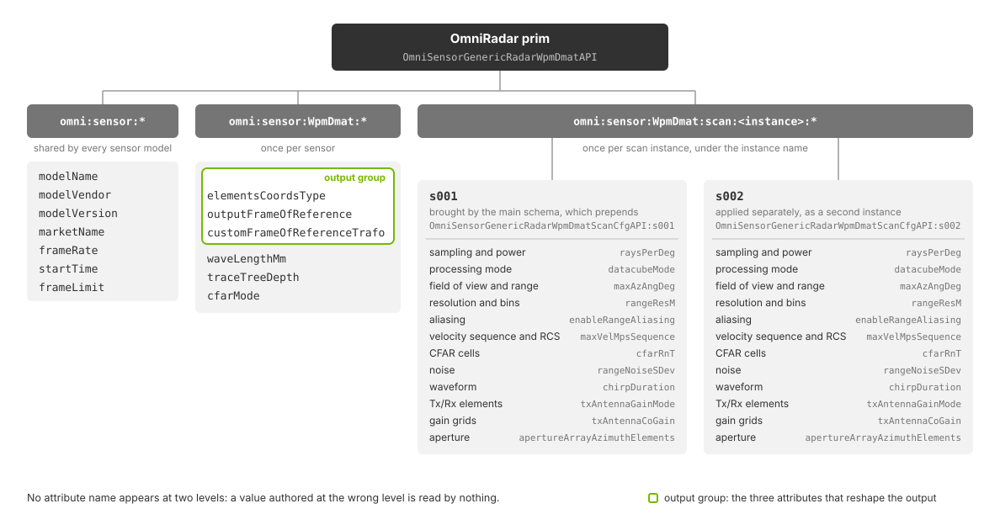
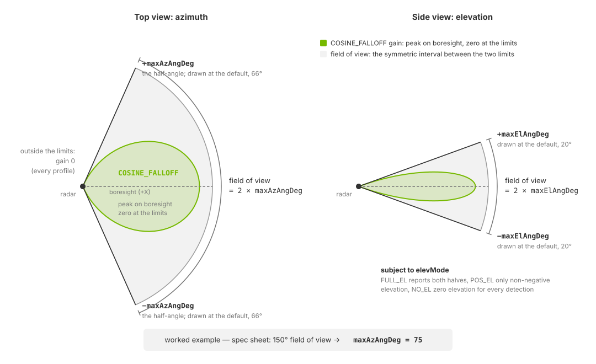
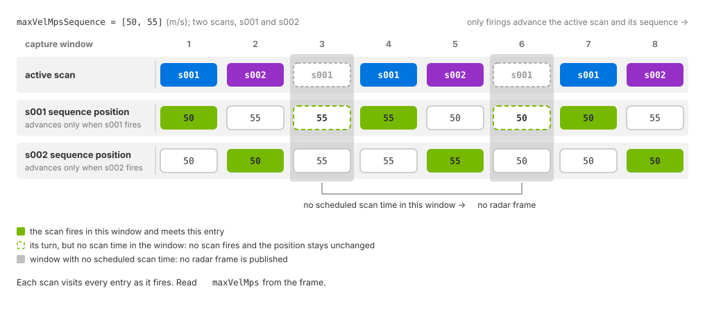
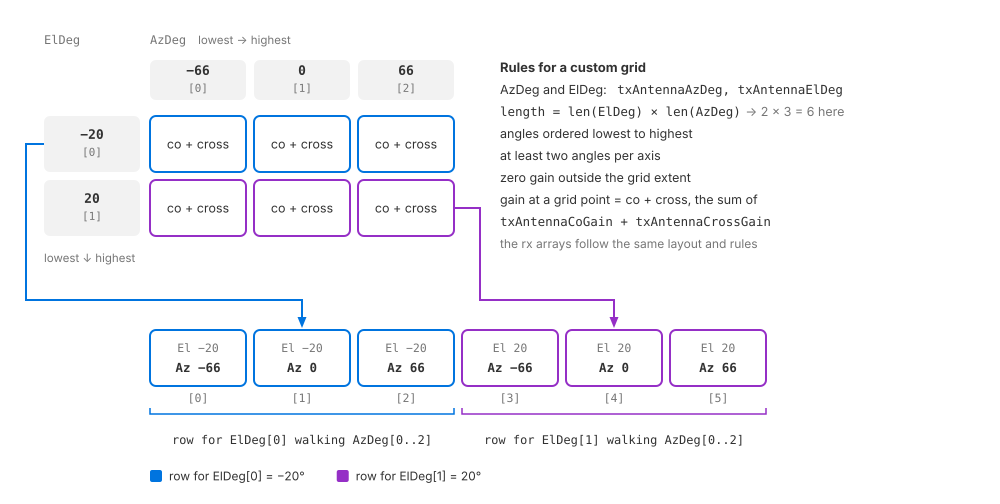

.. SPDX-FileCopyrightText: Copyright (c) 2026 NVIDIA CORPORATION & AFFILIATES. All rights reserved.
.. SPDX-License-Identifier: LicenseRef-NvidiaProprietary
..
.. NVIDIA CORPORATION, its affiliates and licensors retain all intellectual
.. property and proprietary rights in and to this material, related
.. documentation and any modifications thereto. Any use, reproduction,
.. disclosure or distribution of this material and related documentation
.. without an express license agreement from NVIDIA CORPORATION or
.. its affiliates is strictly prohibited.

.. _sensors-nonvisual-radar-attributes:

USD Attributes
==============

The sections below explain the Radar generic wpmDmat model's attribute groups,
units, interactions and processing-mode dependencies. See
:doc:`Sensor API Schemas <../../reference/schemas>` for complete declarations,
defaults and allowed tokens.

Sensor definition
-----------------

Apply ``OmniSensorGenericRadarWpmDmatAPI`` to an ``OmniRadar`` prim. The
schema applies only to this prim type and includes the shared sensor
attributes, ``OmniSensorGenericRadarWpmDmatScanCfgAPI:s001`` and
``omni:sensor:modelName = "RadarWPMDMAT"``. Its defaults configure one
``FAST`` scan at 20 Hz, with 200 m range and angular limits of ±66° azimuth
and ±20° elevation. Add scan-schema instances such as ``s002`` for
:doc:`multiple scan configurations <howto/scan_configurations>`.

The Python and C examples use the same sensor definition below. It selects
``CARTESIAN`` output instead of the ``SPHERICAL`` default, sets the frame
rate to ``(10, 1)`` and positions the sensor with ``xformOp`` attributes.

.. tab-set::

   .. tab-item:: USDA
      :sync: usda

      .. literalinclude:: ../../../../examples/python/radar/radar_example.usda
         :caption: radar_example.usda
         :language: usda
         :start-after: # [snippet:configure-radar-sensor]
         :end-before: # [/snippet:configure-radar-sensor]
         :prepend: #usda 1.0

   .. tab-item:: USD Python
      :sync: python

      .. literalinclude:: ../../../../tests/docs/usd/test_nonvisual_authoring.py
         :language: python
         :start-after: # [snippet:doc-nonvisual-example-configure-radar-sensor-python]
         :end-before: # [/snippet:doc-nonvisual-example-configure-radar-sensor-python]
         :dedent:

The prim is oriented like every sensor prim, looking along its local ``-Z``,
which is why the example rotates it with ``rotateXYZ = (90, 0, -90)`` to look
along world ``+X``; :ref:`Orienting the prim
<sensors-common-sensor-configuration-orientation>` explains the convention and
the output frame it maps onto.

Author the remaining controls in the following namespaces on the same prim.

.. _sensors-nonvisual-radar-attributes-namespaces:
.. _sensors-radar-namespaces:
.. _sensors-ref-radar-namespaces:

Attribute namespaces
--------------------

Radar attributes use separate namespaces for shared sensor settings,
radar-wide settings and individual scan configurations.

.. list-table::
   :class: compact-table
   :header-rows: 1
   :widths: 34 66

   * - Namespace
     - Controls
   * - ``omni:sensor:*``
     - Identification and rate: ``modelName``, ``modelVendor``,
       ``marketName``, ``frameRate``, ``startTime`` and ``frameLimit``. These controls are shared by all sensor models.
   * - ``omni:sensor:WpmDmat:*``
     - The six attributes that are set once per sensor and hold for all of its
       scans: the three output attributes ``elementsCoordsType``,
       ``outputFrameOfReference`` and ``customFrameOfReferenceTrafo``, and
       ``waveLengthMm``, ``traceTreeDepth`` and ``cfarMode``.
   * - ``omni:sensor:WpmDmat:scan:<instance>:*``
     - Per-scan field of view, range, resolution, bin counts, CFAR cells and
       thresholds, noise, RCS calibration, waveform and antenna geometry.

Use the full namespace shown above. The radar ignores attributes at the
wrong level, such as ``omni:sensor:WpmDmat:maxRangeM``, or missing a scan
instance, such as ``omni:sensor:WpmDmat:scan:maxRangeM``. It also ignores
other model prefixes: the coordinate controls use ``omni:sensor:Core:*`` on
:doc:`the Lidar generic core model <../lidar_core/attributes>` and ``omni:sensor:LidarWpm:*`` on
:doc:`the Lidar generic wpm model <../lidar_wpm/attributes>`. Use ``omni:sensor:WpmDmat:*`` for
radar.

   Shared sensor settings and radar-wide settings apply to all scans. Each scan
   instance has its own configuration attributes. The highlighted attributes
   control output coordinates and the reference frame.

.. _sensors-nonvisual-radar-attributes-scan-instances:
.. _sensors-ref-radar-scan-instances:

Scan instances
~~~~~~~~~~~~~~

``OmniSensorGenericRadarWpmDmatAPI`` includes the scan-schema instance
``OmniSensorGenericRadarWpmDmatScanCfgAPI:s001`` with its defaults. This
satisfies the requirement for at least one scan. Each additional instance
adds per-scan attributes under its own name. The model discovers scans from
these attribute names; there is no separate scan-count attribute.

Scan names are compared in lowercase and sorted lexicographically. Names
that differ only in case configure the same scan. Each name must be an
identifier that does not start with a numeral. Use zero-padded names such
as ``s001`` and ``s002`` to preserve numeric order: ``s10`` would otherwise
sort between ``s1`` and ``s2``.

The output's ``scanIdx`` parameter reports the position in this order, from
zero: ``s001`` is index ``0`` and ``s002`` index ``1``. See
:doc:`howto/scan_configurations` for authoring and output verification.

.. _sensors-nonvisual-radar-attributes-identification:

Identification and rate
-----------------------

The radar schema sets ``omni:sensor:modelName`` to ``"RadarWPMDMAT"``,
``omni:sensor:frameRate`` to ``(20, 1)`` and ``omni:sensor:startTime`` to
``(0, 1000)``. The start time is a rational offset in seconds; this default
is zero seconds. Vendor, market name and frame limit retain the shared
values ``"NVIDIA"``, ``"Generic"`` and ``0``. See
:ref:`shared attributes <sensors-common-sensor-configuration-shared-attributes>`
for their definitions.

.. _sensors-nonvisual-radar-attributes-frame-rate:
.. _sensors-radar-frame-rate:

``omni:sensor:frameRate`` sets the scan rate as rational Hz
``(numerator, denominator)``. The radar schema defaults to ``(20, 1)``:
20 scans per second. Fractional and positive sub-Hz rates are supported.
This rate is independent of the renderer's step size.

**Scan time** advances by one scan period from ``omni:sensor:startTime``.
**Acquisition time** is scan time plus the scan's ``timeOffsetUsec`` delay,
in microseconds. The step's ``delta_time`` advances the shared simulation clock;
see :ref:`Frame rate, step and delivery <sensors-common-multi-rate-frame-rate>`.

Each returned frame covers a window of that clock and contains one scan.
A scan fires when its acquisition time falls in the window. A time exactly on
the boundary belongs to the later window. A step longer than the scan period
can return several frames; inspect :ref:`every frame
<sensors-common-sensor-outputs-frames>`.

Rays, scene motion, sensor pose and ``timestampNs`` use the acquisition time.
For a moving radar, the pose is interpolated between the frame window's start
and end poses, reported in :doc:`outputs`.

Scans take turns. After one fires, the next waits for the next scan time,
regardless of its delay. Two scans never share a scan time, and a missed scan
time is not made up later. A time window with no scan produces no radar frame.
A scan that fires but detects nothing is published with ``Counts[0] = 0``
and its acquisition timestamp. See :doc:`outputs` for handling it.

An authored rate of ``(0, 1)`` means unset. This is the shared base default,
not the radar schema's default. The renderer uses its
:ref:`default capture schedule <sensors-common-multi-rate-frame-rate>`;
the radar scans at the end of every capture and ignores ``timeOffsetUsec``.

With multiple scans, ``frameRate`` is the combined scan rate, not the
repetition rate of each scan. See :doc:`howto/scan_configurations` for the
cycle and stepping procedure, and :doc:`../../common/multi_rate` for the
relationship between sensor rates, renderer steps and output delivery.

.. _sensors-nonvisual-radar-attributes-output-group:

Output coordinates
------------------

These attributes control output coordinates for all scans:

- ``omni:sensor:WpmDmat:elementsCoordsType`` (``token``, ``CARTESIAN`` or
  ``SPHERICAL``, default ``SPHERICAL``) is the coordinate system of the
  ``Coordinates`` channel. Spherical rows are azimuth and elevation in degrees
  followed by range in meters; Cartesian rows are x, y and z in meters.
- ``omni:sensor:WpmDmat:outputFrameOfReference`` (``token``, ``SENSOR``,
  ``WORLD`` or ``CUSTOM``, default ``SENSOR``) is the frame of the detection
  coordinates. Doppler remains sensor-relative and scan angular limits remain
  in the sensor frame. It applies to either coordinate representation: a spherical detection in
  the ``WORLD`` frame has its azimuth and elevation measured about the world
  axes, not about the sensor.
- ``omni:sensor:WpmDmat:customFrameOfReferenceTrafo`` (``float[]``, default
  ``[0, 0, 0, 0, 0, 0]``) is the custom frame as ``[x, y, z, roll, pitch,
  yaw]``: the position in meters and the three angles in radians. It is read
  only when ``outputFrameOfReference`` is ``CUSTOM``.

Check the output's ``coordsType`` and ``frameOfReference`` parameters before
interpreting ``Coordinates``. :doc:`outputs` lists their values and units.
The same choices use different attribute prefixes on
:ref:`core lidar <sensors-nonvisual-lidar-core-howto-output-shaping-meaning>`.

.. note::

   The model re-reads all three attributes whenever it accepts a parameter
   update and applies the new coordinate system, frame of reference and custom
   transform from the next frame on. A frame already in flight finishes with the
   values it started with. :ref:`Runtime updates <sensors-nonvisual-radar-attributes-runtime>` covers the rest of the prim.

Select the output channels on the ``PointCloud`` RenderVar, separately
from these coordinate controls. See :ref:`requesting channels
<sensors-common-output-configuration-channels>` and the radar's
:doc:`channel descriptions <outputs>`.

Sensor-level parameters
-----------------------

The following attributes under ``omni:sensor:WpmDmat:`` apply to all scans.

.. _sensors-nonvisual-radar-attributes-wavelength:

``omni:sensor:WpmDmat:waveLengthMm`` (``float``, default ``3.9``) is the
operating wavelength in millimeters, shared by every scan in both processing
modes. It sets the wavelength for propagation, antenna gain, material response
and RCS normalization. ``WAVEFORM`` processing derives its carrier frequency
from this value. A published carrier frequency is authored as this wavelength;
:doc:`Choose Parameter Values <howto/choose_parameters>` shows the conversion.

The non-visual materials of the scene are evaluated at this wavelength;
:doc:`Non-Visual Sensor Materials <../../../materials/nonvisual_sensor_materials>` covers how the labels are
authored.

.. _sensors-nonvisual-radar-attributes-trace-depth:

``omni:sensor:WpmDmat:traceTreeDepth`` (``uint``, default ``3``) limits surface
interactions per propagation path. Each interaction can contribute energy to
the receiver, with delay determined by the round-trip path length; see
:doc:`../../reference/glossary`.
A depth of ``1`` restricts propagation to a single surface interaction.
Higher depths allow indirect paths and ghost detections at greater tracing
cost. See :doc:`howto/validate_parameterization` for the multipath check.
The model traces to the largest ``maxRangeM`` among its scans. Other
propagation limits are fixed; see :doc:`../../troubleshooting/limitations`.

.. _sensors-nonvisual-radar-attributes-cfar-mode-scope:
.. _sensors-ref-radar-cfar-mode-scope:

``omni:sensor:WpmDmat:cfarMode`` (``token``, ``2D`` or ``4D``, default ``2D``)
selects how many dimensions the detection test covers for the sensor's ``FAST``
scans. The model gathers contributions into a range-velocity-azimuth-elevation
detection matrix and extracts detections from the cells that pass a threshold,
as :ref:`CFAR <sensors-nonvisual-radar-attributes-cfar>` describes. In ``2D``
the test runs over range-velocity cells, and a cell that passes yields at most
one detection, taken from its strongest azimuth-elevation bin, so two targets
in the same range-velocity cell cannot be separated in angle. In ``4D`` every
cell of the matrix is tested on its own. A ``WAVEFORM`` scan always runs the
four-dimensional test, regardless of ``cfarMode``.

One CFAR mode governs every ``FAST`` scan. ``cfarMode`` is a sensor-level
attribute while the test and guard cell counts it switches on are per scan, so a
sensor whose ``FAST`` scans want different dimensionality cannot express that.
The azimuth and elevation cell counts of every ``FAST`` scan are inert while
``cfarMode`` is ``2D``; a ``WAVEFORM`` scan always reads them.

.. _sensors-nonvisual-radar-attributes-mode-split:
.. _sensors-radar-mode-decides-which-values-matter:

Per-scan parameters by mode
---------------------------

Author per-scan controls under
``omni:sensor:WpmDmat:scan:<instance>:<name>``. The processing mode determines
which controls apply.

``datacubeMode`` is a token that selects the detection-processing mode:

- ``FAST`` (default) maps each contribution directly into range, velocity,
  azimuth and elevation bins, then extracts detections from those bins.
- ``WAVEFORM`` generates a sampled signal using the chirp, sampling, padding,
  window and aperture settings, then extracts detections from its spectrum.
  A chirp is one frequency-swept pulse. This mode includes signal-sampling
  effects and the main lobe and sidelobes produced by transforming a
  finite-duration signal.

All scans on one sensor prim must use the same mode. Mixing ``FAST`` and
``WAVEFORM`` scans is not supported.

The table shows which controls apply to each mode:

.. list-table::
   :class: compact-table
   :header-rows: 1
   :widths: 40 30 30

   * - Attribute group
     - ``FAST`` scan
     - ``WAVEFORM`` scan
   * - Sampling and limits: ``raysPerDeg``, ``timeOffsetUsec``, ``powerFactor``,
       ``elevMode``, ``maxRangeM``, ``maxAzAngDeg``, ``maxElAngDeg``
     - read
     - read
   * - Aliasing switches: ``enAngAliasing``, ``enableRangeAliasing``
     - read; folds when on
     - read; discards when off, folds nothing
   * - Resolution and bins: ``rangeResM``, ``velResMps``, ``boreAzResDeg``,
       ``boreElResDeg``, ``binsFromSpec``, ``rBins``, ``vBins``, ``azBins``,
       ``elBins``, ``detValFromBinIdx``
     - read
     - ignored
   * - ``maxVelMpsSequence``
     - read; folds radial velocity
     - ignored; bounds come from the waveform
   * - RCS calibration and the eight measurement-noise attributes
     - read
     - read
   * - CFAR range and velocity cells, ``cfarMinVal``, ``cfarOffset``,
       CFAR noise
     - read
     - read
   * - CFAR azimuth and elevation cells
     - read when ``cfarMode`` is ``4D``
     - always read
   * - Waveform attributes: samples, padding, chirp,
       ``supportFactor``, ``windowSlowTime``, ``windowFastTime``,
       ``waveformMode``
     - ignored
     - read
   * - Receiving aperture: the six ``aperture*`` attributes
     - ignored
     - read
   * - Tx and Rx element attributes
     - gated by ``txAntennaGainMode`` and ``rxAntennaGainMode``, not by
       ``datacubeMode``
     - the same

``waveformMode`` (``uint``) selects how a ``WAVEFORM`` scan computes its spectrum:

- ``0`` (default): evaluate each contribution separately.
- ``1``: evaluate each bin separately.
- ``2``: accumulate sampled signal values, then transform the accumulated signal.

Modes ``0`` and ``1`` are intended to produce equivalent results. Their
performance depends on the scene; neither is consistently faster. Mode ``2``
is not guaranteed to produce equivalent results. ``FAST`` scans ignore
``waveformMode``.

Use the following controls for each effect:

.. list-table::
   :class: compact-table
   :header-rows: 1
   :widths: 30 70

   * - Phenomenon
     - Primary controls
   * - Field of view and antenna sensitivity
     - ``maxAzAngDeg``, ``maxElAngDeg``, the gain modes, custom gain grids,
       steering and aperture attributes (:ref:`field of view
       <sensors-nonvisual-radar-attributes-fov>`, :ref:`antenna
       <sensors-nonvisual-radar-attributes-antenna>`)
   * - Return strength and RCS
     - the non-visual materials, ``waveLengthMm``,
       ``powerFactor``, ``rcsTuningCoefficients`` (:ref:`wavelength
       <sensors-nonvisual-radar-attributes-wavelength>`, :ref:`RCS calibration
       <sensors-nonvisual-radar-attributes-rcs-tuning>`)
   * - Multipath and ghost detections
     - ``traceTreeDepth``, the materials, the antenna patterns and the CFAR
       attributes (:ref:`trace depth
       <sensors-nonvisual-radar-attributes-trace-depth>`)
   * - Motion and Doppler
     - scene motion and the renderer's motion BVH, ``velResMps``,
       ``maxVelMpsSequence``, velocity noise (:ref:`velocity cycle
       <sensors-nonvisual-radar-attributes-velocity-cycle>`)
   * - Range, angle and velocity ambiguity
     - ``enableRangeAliasing``, ``enAngAliasing``, ``maxRangeM``, the angular
       limits, ``maxVelMpsSequence``; for a ``WAVEFORM`` scan
       ``waveLengthMm`` and ``chirpRepetitionTimeSequence`` (:ref:`aliasing
       <sensors-nonvisual-radar-attributes-aliasing>`)
   * - Detection and false alarms
     - ``cfarMode``, the test and guard cells, ``cfarMinVal``, ``cfarOffset``,
       CFAR noise and the measurement-noise attributes (:ref:`CFAR
       <sensors-nonvisual-radar-attributes-cfar>`, :ref:`noise <sensors-nonvisual-radar-attributes-noise>`)
   * - Fidelity and frame time
     - ``raysPerDeg``, ``traceTreeDepth``, ``datacubeMode``, the bin counts,
       sample counts, padding and aperture dimensions

.. _sensors-nonvisual-radar-attributes-sampling:

Scan sampling and power
~~~~~~~~~~~~~~~~~~~~~~~

- ``raysPerDeg`` (``float``, default ``8.0``) is the geometric sampling density
  of the scan, in rays per degree across its field of view; the total ray count
  also follows ``maxAzAngDeg`` and ``maxElAngDeg``. Raising it improves
  geometric coverage at more cost per frame. It is not an angular-resolution
  setting: it does not sharpen the configured angular resolution, so tune it for
  stable coverage at an acceptable frame time.
- ``powerFactor`` (``float``, default ``1.0``) is a unitless scaling of the
  scan's transmit power. It scales contribution strength before detection and
  is not a value in watts.
- ``timeOffsetUsec`` (``uint``, default ``0``) delays this scan's acquisition
  by that many microseconds after its scan time. :ref:`The frame rate
  <sensors-nonvisual-radar-attributes-frame-rate>` says what the delayed time
  moves and when the delay is not applied.
- ``detValFromBinIdx`` (``bool``, default ``false``) makes a ``FAST`` scan
  report range and radial velocity from the index of the detection bin instead
  of the contribution-weighted values within it.
- ``elevMode`` (``token``, default ``FULL_EL``) is the scan's elevation
  coverage: ``FULL_EL`` reports positive and negative elevation, ``NO_EL`` zero
  elevation for every detection, ``POS_EL`` non-negative values only.

.. _sensors-nonvisual-radar-attributes-fov:

Field of view, range and resolution
~~~~~~~~~~~~~~~~~~~~~~~~~~~~~~~~~~~

These are the values most often published for a real sensor, and the first ones
to copy from a specification sheet; :doc:`Build a Profile from a Spec Sheet
<howto/spec_sheet_profile>` maps the fields.

``maxRangeM`` (``float``, default ``200``) is the scan's maximum unambiguous
range, in meters. Contributions beyond it are discarded or folded, as
``enableRangeAliasing`` decides. The sensor traces the scene out to the largest
``maxRangeM`` among its scans.

.. _sensors-nonvisual-radar-attributes-half-angles:
.. _sensors-radar-half-angles:

``maxAzAngDeg`` (``float``, default ``66``) and ``maxElAngDeg`` (``float``,
default ``20``) are positive *half*-angles in degrees. The azimuth field of view
runs from ``-maxAzAngDeg`` to ``+maxAzAngDeg``, so the total is twice the value,
and the elevation field of view is symmetric in the same way, subject to
``elevMode``. A 150° field of view is therefore authored as ``75``; :doc:`Choose
Parameter Values <howto/choose_parameters>` describes the transcription mistake
and its symptom. Every antenna gain profile is zero outside these limits, and
the default profile, ``COSINE_FALLOFF``, falls to zero at the limit itself;
refer to :ref:`the antenna <sensors-nonvisual-radar-attributes-antenna>`.

s labeled as authored with maxAzAngDeg = 75. The side view shows the same symmetric interval for elevation, from minus maxElAngDeg to plus maxElAngDeg.
   :width: 1080

   The angular limits are half-angles. The field of view is the symmetric
   interval from the negative to the positive half-angle in each direction, and
   the ``COSINE_FALLOFF`` gain profile falls to zero at the limits, so a
   specification sheet's 150° field of view is authored as ``maxAzAngDeg = 75``.

``rangeResM`` (``float``, default ``0.4`` m), ``velResMps`` (``float``, default
``0.147`` m/s), ``boreAzResDeg`` (``float``, default ``1.3`` degrees) and
``boreElResDeg`` (``float``, default ``5.0`` degrees) are the scan's separation and bin
resolution in range, radial velocity, and azimuth and elevation at boresight,
the sensor's look direction, where azimuth and elevation are zero. They are
active in ``FAST`` mode when ``binsFromSpec`` is true, where they decide how
finely the detection matrix is divided.

.. _sensors-nonvisual-radar-attributes-resolution-vs-accuracy:
.. _sensors-radar-resolution-vs-accuracy:
.. _sensors-ref-radar-resolution-vs-accuracy:
.. _sensors-radar-resolution-not-accuracy:

The four resolution attributes control detection-matrix bin sizes. Target
separation also depends on placement within bins, return strength and detection
filtering. The :ref:`noise attributes
<sensors-nonvisual-radar-attributes-noise>` add measurement noise; they do not
set resolution. Zero noise does not remove binning or estimation error.
Angular separation in a ``FAST`` scan also needs ``cfarMode`` set to ``4D``
(:ref:`cfarMode <sensors-nonvisual-radar-attributes-cfar-mode-scope>`).

.. _sensors-nonvisual-radar-attributes-bins:

Bins
~~~~

The bin counts of a ``FAST`` scan's detection matrix are either derived or
explicit. With ``binsFromSpec`` (``bool``, default ``true``) the model derives
the range, velocity, azimuth and elevation bin counts from the configured
limits and the four resolution attributes, and ignores the explicit counts. With
it false, ``rBins`` (``uint``, default ``112``), ``vBins`` (``uint``, default
``160``), ``azBins`` (``uint``, default ``12``) and ``elBins`` (``uint``,
default ``2``) are read as the counts. A ``WAVEFORM`` scan reads none of the
five; its matrix is sized by the padding attributes instead.

.. _sensors-nonvisual-radar-attributes-aliasing:
.. _sensors-radar-aliasing:

Aliasing and the unambiguous intervals
~~~~~~~~~~~~~~~~~~~~~~~~~~~~~~~~~~~~~~

In ``FAST`` mode, contributions outside the configured range, velocity or
angular intervals are discarded or folded before detection processing:

- ``enableRangeAliasing`` (``bool``, default ``false``): when false,
  contributions beyond ``maxRangeM`` are discarded, in either processing mode.
  When true, a ``FAST`` scan folds them into the unambiguous range, so a target
  beyond ``maxRangeM`` comes back at a plausible shorter range.
- ``enAngAliasing`` (``bool``, default ``false``): when false, contributions
  outside the azimuth and elevation limits are discarded, in either mode. When
  true, a ``FAST`` scan folds them into the angular interval.
- Radial velocity has no switch; a ``FAST`` scan always folds it
  (:ref:`velocity sequence <sensors-nonvisual-radar-attributes-velocity-cycle>`).

In ``WAVEFORM`` mode, ambiguity results from waveform sampling. With ``frequencyStepBetweenChirps`` at its
default of ``0``, its radial velocity comes back within
±λ / (4 × T) before velocity noise is added, where λ is ``waveLengthMm``
converted to meters and T is the selected ``chirpRepetitionTimeSequence`` entry;
at the schema defaults that bound is about ±27.9 m/s. The reported
``minVelMps`` and ``maxVelMps`` describe this waveform velocity envelope before
noise. Nonzero ``frequencyStepBetweenChirps`` couples range and velocity and
can make the bounds asymmetric.

The output does not identify folded detections; they contain finite range,
velocity and RCS values like other detections. Enable range or angular aliasing
only when the real operating mode has the corresponding ambiguity;
:doc:`Choose Parameter Values <howto/choose_parameters>` places the switches
among the values that describe the device rather than the simulation.

.. _sensors-nonvisual-radar-attributes-velocity-cycle:
.. _sensors-radar-velocity-cycle:

Velocity sequence and RCS calibration
~~~~~~~~~~~~~~~~~~~~~~~~~~~~~~~~~~~~~

``maxVelMpsSequence`` (``float[]``, default ``[50.0, 55.0]``) is a non-empty
sequence of finite, positive maximum unambiguous radial velocities, in meters
per second, for a device whose velocity ambiguity changes from frame to frame.
The active entry defines the symmetric interval into which a ``FAST`` scan
folds Doppler values, and the frame reports it as ``maxVelMps``, with
``minVelMps`` as its negative. ``WAVEFORM`` scans derive their bounds from the
waveform instead. An empty list, or an entry that is not finite and positive,
fails validation whichever processing mode the scan uses; :ref:`Runtime updates <sensors-nonvisual-radar-attributes-runtime>`
says what a rejected update does.

Each scan advances its own sequence only when it fires: ``maxVelMpsSequence``
for ``FAST``, ``chirpRepetitionTimeSequence`` for ``WAVEFORM``. Firings of
other scans and time windows with no acquisition leave its entry unchanged. Every
sequence starts at its first entry, and the scan cycle at its first scan, when
the sensor is created; both restart there after every accepted attribute
update (:ref:`Runtime updates <sensors-nonvisual-radar-attributes-runtime>`) and whenever the renderer clears
its accumulated rendering history, as it does on
:py:meth:`~ovrtx.Renderer.reset` (:c:func:`ovrtx_reset` in C) and after new
scene content has streamed in (:ref:`warm-up
<sensors-common-output-configuration-warmup>`). With two scans and a two-entry
sequence, each scan therefore visits both entries in order. Read the active
bounds from the frame's ``minVelMps`` and ``maxVelMps`` params; :doc:`Outputs
<outputs>` lists the params.

he pending scan and both sequence entries stay unchanged.
   :width: 1016

   Firings advance the scan cycle and only the firing scan's velocity sequence.
   Both scans visit 50 and 55 m/s in order. Windows with no acquisition publish
   no radar frame and leave the pending scan and both sequence positions unchanged.

.. _sensors-nonvisual-radar-attributes-rcs-tuning:

``rcsTuningCoefficients`` (``float[]``, default ``[-12, 150, 0.0]``) must hold
exactly three RCS calibration values, where RCS, the radar cross section, is
the per-detection measure of how detectable a target is, in dBsm:

- Element 0 is the minimum accepted RCS in dBsm. After the clamp the :ref:`RCS
  channel <sensors-nonvisual-radar-outputs-channels>` describes, the model
  drops the detections whose RCS is below this minimum.
- Element 1 is a scale applied to the RCS before its conversion to dBsm, where
  ``1`` means no scaling. The default, ``150``, is not a neutral value: a
  calibration against measured return strength starts from the default, not
  from ``1``.
- Element 2 is the standard deviation of the noise added to the RCS, in dBsm,
  where ``0`` adds no noise.

The RCS a detection carries depends on the materials, the antenna gains, the
distance and the incidence geometry as well as on these coefficients;
:doc:`Validate a Parameterization <howto/validate_parameterization>` describes
the material and antenna check.

.. _sensors-nonvisual-radar-attributes-cfar:

CFAR
~~~~

CFAR, constant false alarm rate, is the test that decides which cells of the
detection matrix become detections. For each candidate cell the model estimates
the local background from the cells around it, the *test cells*, leaving out a
ring of *guard cells* immediately around the candidate so that the candidate's
own energy does not raise its own threshold. The sensor-level
:ref:`cfarMode <sensors-nonvisual-radar-attributes-cfar-mode-scope>` decides
whether that neighborhood covers range and velocity only, or all four
dimensions, for a ``FAST`` scan; a ``WAVEFORM`` scan always uses all four.

- ``cfarRnT``, ``cfarVnT``, ``cfarAznT`` and ``cfarElnT`` (``uint``, default
  ``1`` each) are the numbers of test cells on each side of the candidate in
  range, velocity, azimuth and elevation, and ``cfarRnG``, ``cfarVnG``,
  ``cfarAznG`` and ``cfarElnG`` (``uint``, default ``0`` each) the numbers of
  guard cells excluded. The azimuth and elevation counts are read when
  ``cfarMode`` is ``4D``, and always by a ``WAVEFORM`` scan.
- ``cfarOffset`` (``float``, default ``1.0``) multiplies the estimated
  background to form the detection threshold. Raising it reduces false alarms
  and increases missed detections.
- ``cfarMinVal`` (``float``, default ``7e-17``) is an absolute floor: a
  candidate cell whose value does not exceed it is discarded before the
  threshold is formed, whatever its neighborhood holds.
- ``cfarNoiseMean`` and ``cfarNoiseSDev`` (``float``, default ``0.0`` each)
  describe noise that the model adds, as a magnitude, to the test cells while it
  estimates the background. The noise therefore raises the threshold; it never
  adds energy to the candidate, so it never creates a detection in a cell that
  received no contribution.

.. note::

   Indirect energy in neighboring cells can raise the CFAR threshold and
   suppress a direct-path detection. In :ref:`2D mode
   <sensors-nonvisual-radar-attributes-cfar-mode-scope>`, a range-velocity cell
   produces at most one detection, using its strongest angular bin. A stronger
   indirect return can therefore determine the reported angle. Cells without
   contributions cannot pass CFAR, so an empty scene cannot test false alarms.
   See :doc:`howto/validate_parameterization` for the filtering check.

.. _sensors-nonvisual-radar-attributes-noise:

Noise
~~~~~

These attributes add noise to the measured range, velocity and angles.
They are independent of the :ref:`resolution controls
<sensors-nonvisual-radar-attributes-resolution-vs-accuracy>`.
All eight default to zero, so no measurement noise is added. Binning and
estimation can still introduce error.

- ``azimuthRadNoiseMean`` and ``azimuthRadNoiseSDev``: the mean and standard
  deviation of the azimuth angle noise at boresight, in radians.
- ``elevationRadNoiseMean`` and ``elevationRadNoiseSDev``: the same for
  elevation at boresight, in radians.
- ``velocityNoiseMean`` and ``velocityNoiseSDev``: the same for radial
  velocity, in meters per second.
- ``rangeNoiseMean`` and ``rangeNoiseSDev``: the same for range, in meters.

The four angle values are boresight values. At boresight the reported angle is
offset by the mean and spreads by the standard deviation you authored. Away
from boresight the same noise moves the angle further, by a factor of about
1/cos(angle) for small noise: 1.4 times as far at 45°, twice as far at 60°.
Range and velocity noise are added to the measured value directly, in meters
and meters per second.

All eight are ``float``; a mean may be any value and a standard deviation is
non-negative. Where the values come from is on :doc:`Choose Parameter Values
<howto/choose_parameters>`.

.. _sensors-nonvisual-radar-attributes-waveform:

Waveform processing
~~~~~~~~~~~~~~~~~~~

A ``WAVEFORM`` scan reads the attributes below; a ``FAST`` scan ignores them.
Both modes use the sensor-level ``waveLengthMm`` for their wavelength.

- ``slowTimeSamples`` (``uint``, default ``379``) and ``fastTimeSamples``
  (``uint``, default ``625``) are the numbers of slow-time samples, across the
  chirps of a frame, and of fast-time samples, within a chirp.
- ``chirpDuration`` (``float``, default ``25e-6``) is the duration of one
  chirp in seconds, ``chirpBandwidth`` (``float``, default ``375e6``) its
  bandwidth in hertz.
- ``chirpRepetitionTimeSequence`` (``float[]``, default ``[35e-6]``) supplies
  the times from one chirp to the next, in seconds. The sequence must be
  non-empty, with finite positive entries. On a ``WAVEFORM`` scan each entry
  must also be at least ``chirpDuration`` and must differ from
  ``frequencyStepBetweenChirps`` × ``chirpDuration`` / ``chirpBandwidth``; at
  the default step of ``0`` every positive entry qualifies. One entry holds for
  every chirp of a firing; the next firing of that scan uses the next entry,
  wrapping at the end. A single entry gives fixed timing.
- ``frequencyStepBetweenChirps`` (``float``, default ``0.0``) is the frequency
  step between consecutive chirps, in hertz. At the default of
  zero the velocity ambiguity of the scan is the symmetric bound given under
  :ref:`aliasing <sensors-nonvisual-radar-attributes-aliasing>`; a nonzero step
  of either sign makes the reported ``minVelMps`` and ``maxVelMps`` asymmetric,
  as described there.
- ``supportFactor`` (``float``, default ``1.0``) is the spectral support of a
  contribution in units of main-lobe width; ``1`` is one main lobe.
- ``windowSlowTime`` and ``windowFastTime`` (``token``, default ``RECT``) are
  the separable window functions for slow-time (Doppler) and fast-time (range)
  processing, from the shared token set ``RECT``, ``HANN``, ``HAMMING`` and
  ``BLACKMAN`` that the Tx, Rx and aperture windows use as well.

.. _sensors-nonvisual-radar-attributes-padding:
.. _sensors-ref-radar-padding-samples:

``azimuthPaddingSamples`` (``uint``, default ``128``),
``elevationPaddingSamples`` (``uint``, default ``32``),
``slowTimePaddingSamples`` (``uint``, default ``512``) and
``fastTimePaddingSamples`` (``uint``, default ``1024``) are transform lengths:
each is the number of samples the scan transforms over in that dimension
*after* zero padding, and together they size the ``WAVEFORM`` scan's detection
matrix. Author each at least as large as the sample or element count it
transforms: the slow-time padding at least ``slowTimeSamples``, the fast-time
padding at least ``fastTimeSamples``, and the azimuth and elevation padding at
least the aperture's element counts. The defaults satisfy this.

See the :doc:`77 GHz waveform example <howto/choose_parameters>` for these
controls in use.

.. _sensors-nonvisual-radar-attributes-antenna:

Antenna configuration
~~~~~~~~~~~~~~~~~~~~~

The model gives a scan a transmitting (Tx) element, a receiving (Rx) element
and, for ``WAVEFORM`` processing, a receiving aperture. Each element has its own
gain profile over direction, and the profiles shape how strongly a contribution
from a given direction counts.

``txAntennaGainMode`` and ``rxAntennaGainMode`` (``token``, default
``COSINE_FALLOFF``) select the gain profile of the Tx and the Rx element from
four modes. ``CONSTANT`` is a uniform gain over the scan's field of view.
``COSINE_FALLOFF`` is highest at boresight and falls off as a cosine towards the
angular limits, reaching zero at the limit itself. ``CUSTOM`` interpolates a gain
grid you author, described below. ``PATCH_ARRAY_MODEL`` models a rectangular
patch array from the element counts, spacings, steering angles and windows
below, at the sensor's ``waveLengthMm`` wavelength. Every profile is
zero outside the scan's ``maxAzAngDeg`` and ``maxElAngDeg``.

``PATCH_ARRAY_MODEL`` uses separate transmit (``tx*``) and receive (``rx*``)
settings. Each set applies only when that side's gain mode is
``PATCH_ARRAY_MODEL``:

- **Element counts:** ``txArrayAzimuthElements`` and
  ``txArrayElevationElements``; receive equivalents ``rxArrayAzimuthElements``
  and ``rxArrayElevationElements``. Type: ``uint``; default: ``0``.
- **Element spacing:** ``txAzimuthElementSpacing`` and
  ``txElevationElementSpacing``; receive equivalents ``rxAzimuthElementSpacing``
  and ``rxElevationElementSpacing``. Type: ``float``; units: meters;
  default: ``0.0``.
- **Array-factor windows:** ``txWindowAzimuth`` and ``txWindowElevation``;
  receive equivalents ``rxWindowAzimuth`` and ``rxWindowElevation``.
  Default: ``RECT``; values use the shared window token set.
- **Steering angles:** ``txAzimuthSteeringAngleDeg`` and
  ``txElevationSteeringAngleDeg``; receive equivalents
  ``rxAzimuthSteeringAngleDeg`` and ``rxElevationSteeringAngleDeg``.
  Units: degrees; default: ``0.0``.

Transmit and receive attributes have the same types, defaults and behavior.

.. _sensors-nonvisual-radar-attributes-array-defaults:
.. _sensors-ref-radar-array-defaults:

.. warning::

   The element counts and spacings of the Tx element, the Rx element and the
   receiving aperture all default to ``0`` or ``0.0``, while each requires a
   positive value. The defaults are placeholders rather than a working array:
   selecting ``PATCH_ARRAY_MODEL``, or ``WAVEFORM`` processing, means authoring
   the geometry as well. Left at zero, a ``PATCH_ARRAY_MODEL`` element has zero
   gain in every direction, and a ``WAVEFORM`` scan whose aperture element
   spacing is zero yields no detections.

.. _sensors-nonvisual-radar-attributes-gain-grid:
.. _sensors-ref-radar-gain-grid-layout:
.. _sensors-ref-radar-gain-grid-sizes:

**Custom gain grids.** ``CUSTOM`` gain mode interpolates element gain from
separate transmit and receive grids. Each grid uses four ``float[]`` arrays:

- ``txAntennaAzDeg`` / ``rxAntennaAzDeg``: azimuth angles in degrees,
  ordered from lowest to highest. Default: ``[-66.0, 66.0]``.
- ``txAntennaElDeg`` / ``rxAntennaElDeg``: elevation angles in degrees,
  ordered from lowest to highest. Default: ``[-20.0, 20.0]``.
- ``txAntennaCoGain`` / ``rxAntennaCoGain``: linear co-polarization gains
  at the grid points. Default: ``[0.8, 0.7, 0.6, 0.9]``.
- ``txAntennaCrossGain`` / ``rxAntennaCrossGain``: linear cross-polarization
  gains at the grid points. Default: ``[0.2, 0.3, 0.4, 0.1]``.

Each gain array contains ``len(ElDeg) × len(AzDeg)`` values, ordered by
increasing elevation, then increasing azimuth within each elevation row.
The model adds the co- and cross-polarization gains at each grid point,
then interpolates the summed gain.

See :doc:`Choose Parameter Values <howto/choose_parameters>` for choosing
a gain mode from the available antenna data.

   The layout of a custom gain array. The grid has one row per elevation angle
   and one column per azimuth angle; the array lists the rows one after the
   other, each walking the azimuth angles, and the gain at a grid point is the
   sum of its co- and cross-polarization values.

.. warning::

   Each angle vector must have at least two finite,
   strictly increasing entries. Each gain array must hold exactly
   ``len(ElDeg) × len(AzDeg)`` finite, nonnegative values. A grid that breaks
   these rules is rejected and the reason is logged as an error. A valid grid
   still has zero gain outside its angular extent, which can reduce detections
   or suppress them entirely.

.. _sensors-nonvisual-radar-attributes-aperture:

**Receiving aperture.** ``WAVEFORM`` processing uses a receiving aperture
configured separately from the transmit and receive elements. ``FAST`` scans
ignore these aperture settings.

The aperture can represent either:

- A physical array with one transmitter and N receivers.
- A virtual array formed by M transmitters and N receivers, equivalent to one
  transmitter with M × N receivers. The model assumes an L-shaped arrangement
  of physical transmit and receive elements, producing a uniform planar
  virtual array.

Configure the aperture with:

- ``apertureArrayAzimuthElements`` and ``apertureArrayElevationElements``:
  element counts along each axis. Type: ``uint``; default: ``0``.
- ``apertureAzimuthElementSpacing`` and ``apertureElevationElementSpacing``:
  element spacing in meters. Type: ``float``; default: ``0.0``.
- ``apertureWindowAzimuth`` and ``apertureWindowElevation``: array windows.
  Type: ``token``; default: ``RECT``; values use the shared window token set.

.. _sensors-nonvisual-radar-attributes-runtime:
.. _sensors-ref-radar-runtime-changes:

Runtime updates
---------------

The :doc:`runtime-update procedure <../../common/runtime_updates>` describes
:ref:`update outcomes <sensors-common-runtime-updates-outcomes>` and
:ref:`batch rejection <sensors-common-runtime-updates-batch>`. For this model:

- The three :ref:`output attributes
  <sensors-nonvisual-radar-attributes-output-group>`, the sensor-level
  parameters and the per-scan parameters are re-read on every accepted update
  and take effect from the next frame; a frame already in flight finishes with
  the values it started with. That includes a change to the number of scans, to
  a scan's ``datacubeMode`` or to an antenna gain mode.
- An update that fails validation is logged as an error, and the model keeps
  its accepted configuration and its output layout: none of the edits in that
  update is applied, and the sensor goes on producing from the configuration
  that was in force before it.

To confirm that an edit reached the model, read the scan limits back from the
output params as :ref:`configuration verification
<sensors-nonvisual-radar-howto-choose-parameters-reach-the-model>` describes;
:doc:`Outputs <outputs>` lists the params.

The model has no motion-compensation attribute: motion effects, radial
velocity above all, need the renderer's motion BVH, a renderer-creation choice
(:ref:`Motion BVH <sensors-common-output-configuration-motion-bvh>` describes
``AUTO`` and the recommended ``ENABLE`` mode; :ref:`Simulate Moving Targets
<sensors-nonvisual-radar-howto-moving-targets-motion-bvh>` says what a radar
does without it). This and the other by-design limits of the model, the fixed
propagation limits among them, are listed on
:doc:`Limitations <../../troubleshooting/limitations>`.

Related
-------

- :doc:`Outputs <outputs>` — the channels and params a radar frame carries, and how to read them
- :doc:`Choose Parameter Values <howto/choose_parameters>` — which values come from a specification sheet and which from calibration
- :doc:`Run More Than One Scan Pattern <howto/scan_configurations>` — authoring a second scan and telling which scan produced a frame
- :doc:`Simulate Moving Targets <howto/moving_targets>` — the motion BVH and animated targets, for Doppler
- :doc:`Sensor Configuration <../../common/sensor_configuration>` — prims, schemas and the shared attributes
