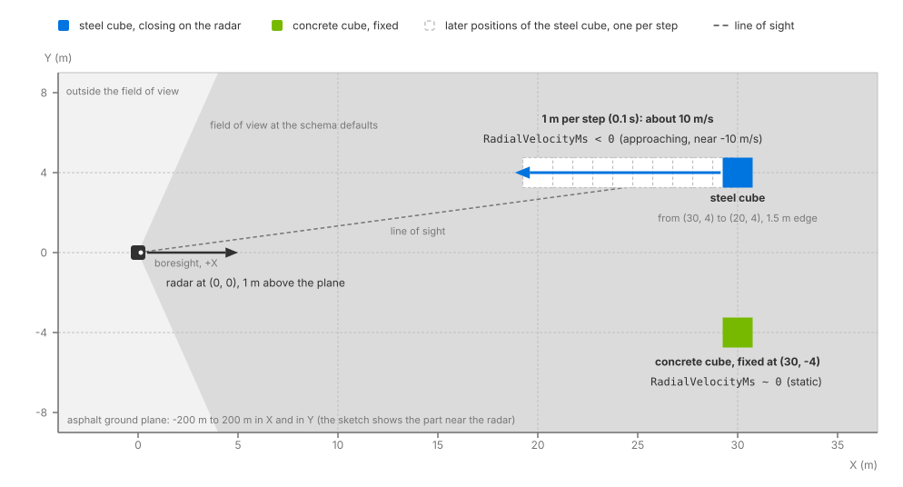

.. SPDX-FileCopyrightText: Copyright (c) 2026 NVIDIA CORPORATION & AFFILIATES. All rights reserved.
.. SPDX-License-Identifier: LicenseRef-NvidiaProprietary
..
.. NVIDIA CORPORATION, its affiliates and licensors retain all intellectual
.. property and proprietary rights in and to this material, related
.. documentation and any modifications thereto. Any use, reproduction,
.. disclosure or distribution of this material and related documentation
.. without an express license agreement from NVIDIA CORPORATION or
.. its affiliates is strictly prohibited.

.. _sensors-nonvisual-radar-howto-moving-targets:

Simulate Moving Targets
=======================

The Radar generic wpmDmat model measures Doppler from motion of the targets,
the sensor or both. Enable the renderer's motion BVH and advance scene animation
with every step so the model can account for motion during a scan.

Before you start, you should know the model (:doc:`../index`), how its output is
read (:doc:`../outputs`) and the renderer options a sensor scene depends on, the
motion BVH among them (:doc:`../../../common/output_configuration`).

.. _sensors-nonvisual-radar-howto-moving-targets-shape:

Motion setup
------------

Set the renderer's motion BVH to ``ENABLE`` or ``AUTO`` when creating it.
Both examples use ``ENABLE``. See :ref:`motion BVH configuration
<sensors-common-output-configuration-motion-bvh>` for API settings and
supported modes.

Animate the target with time-sampled transforms. The scene both examples load,
``radar_example.usda``, is Z-up and authored in meters, and holds:

- a radar at ``(0, 0, 1)``, rotated to look along world +X, with
  ``omni:sensor:frameRate`` at ``(10, 1)`` and
  ``omni:sensor:WpmDmat:elementsCoordsType`` at ``CARTESIAN``;
- an asphalt ground plane spanning -200 m to 200 m in X and in Y;
- a steel cube with an edge of 1.5 m whose ``xformOp:translate`` is time-sampled
  from ``(30, 4, 0.75)`` at time code 0 to ``(20, 4, 0.75)`` at time code 10, one
  meter closer to the radar at every time code, on a stage that runs 10 time codes
  per second;
- a concrete cube of the same size, fixed at ``(30, -4, 0.75)``.

The three materials are non-visual labels alone, with no surface shader
(:doc:`../../../../materials/nonvisual_sensor_materials`). The RenderVar lists ``Coordinates``, ``Counts``
and ``RadialVelocityMs``; the C example's copy of the scene lists ``RCS`` as well,
and the model adds ``Counts`` and ``Flags`` whether or not they are listed
(:doc:`../outputs`).

         looks along +X. The steel cube travels along the line y = 4 from x = 30
         to x = 20, with an arrow toward the radar labeled "1 m per step" and
         "RadialVelocityMs < 0". The concrete cube stays at (30, -4), labeled
         "RadialVelocityMs ~ 0". The asphalt plane fills the background.
   :width: 994

   The example scene from above. The steel cube closes on the radar along the
   line of sight and reports a negative ``RadialVelocityMs``; the concrete cube
   holds still and its detections report a radial velocity near zero.

.. _sensors-nonvisual-radar-howto-moving-targets-motion-bvh:
.. _sensors-radar-motion-bvh-required:

Motion BVH
----------

The :ref:`motion BVH <sensors-common-output-configuration-motion-bvh>`
allows the trace to account for target motion within a frame.

Without it, the radar runs without an error, tracing from its pose at the
acquisition time against a static scene for that frame. Animated targets can
change position between steps, but contribute no target velocity; a stationary
radar therefore measures radial velocities near zero. Sensor velocity is still
computed from its movement since the previous step, so a moving radar can
report Doppler even when motion BVH is disabled.

If scene updates are not reaching rendering, check the update sequence in
:doc:`ovstage Integration <../../../../core/ovstage_integration>`. When using
time-sampled USD animation, that includes advancing its evaluation time.

The output does not report whether motion BVH was active. Compare enabled and
disabled runs as described below. Unlike :doc:`the Lidar generic core model
<../../lidar_core/howto/motion_artifacts>`, radar has no motion-compensation
attribute; see :ref:`Doppler measurements
<sensors-nonvisual-radar-howto-moving-targets-reports>`.

.. _sensors-nonvisual-radar-howto-moving-targets-reports:

Doppler measurements
--------------------

``RadialVelocityMs`` is signed, and a detection approaching the
radar reads negative (:doc:`../outputs`). For a direct-path return, it is the component of relative motion along the
radar's line of sight, so purely transverse motion produces no Doppler.
Multipath returns also depend on motion along the other path segments. Moving or
articulated parts whose motion is in the scene produce velocity contributions of
their own, separable when the scan's velocity resolution allows (:doc:`../index`).
Velocities beyond the unambiguous interval are folded into it. The interval
depends on the processing mode; see :ref:`aliasing
<sensors-nonvisual-radar-attributes-aliasing>`. The model has no
motion-compensation attribute or per-detection timing
(:ref:`Timestamps <sensors-nonvisual-radar-outputs-time-offset>`).

The :ref:`example scene's <sensors-nonvisual-radar-howto-moving-targets-shape>`
steel cube moves 1 m every 0.1 s, giving a speed of 10 m/s. Its radial speed
is slightly lower because it travels 4 m to the side of the radar. Expect
``RadialVelocityMs`` near -10 m/s for the cube, within the default unambiguous
velocity interval, and near zero for the stationary concrete cube and ground.
The radar is stationary. Detection counts can vary.

.. _sensors-nonvisual-radar-howto-moving-targets-verify:

Verification
------------

Run either example. Each prints one line per animated step: ten in the C example,
ten by default in the Python example (``--steps``). The Python example prints
``step N: valid points=..., radial velocity min/max=[..., ...] m/s``; the C example
prints the same line with an ``RCS min/max=[..., ...]`` interval before the
velocity interval, and closes with ``Observed ... detections with |radial
velocity| > 0.1 m/s; max |radial velocity| = ... m/s``, counting across all steps
the detections whose velocity magnitude exceeds 0.1 m/s. Both count only the
entries within ``Counts[0]`` whose ``Flags`` carry the ``VALID`` bit
(:doc:`../outputs`).

On steps that detect the steel cube, expect a minimum radial velocity near
−10 m/s and a maximum near zero from stationary surfaces. The C summary's
``max |radial velocity|`` should be near 10 m/s. Exact detection counts vary.

Python prints ``valid points=0`` for frames without a scan; C treats them as
an error and stops. Step at the :doc:`scan period <scan_configurations>` to
avoid these gaps. See :doc:`../outputs` for the distinction between a frame
without a scan and a fired scan without detections.

Repeat the run with the motion BVH configuration entry omitted. With the
radar stationary, radial velocities should be near zero even though the
cube changes position between steps. Compare velocities between the runs;
both runs can produce nonzero detection counts.

The Python example also draws every detection in a rerun viewer, colored by signed
radial velocity: blue approaching, green near zero, red receding. The steel cube's
detections come out blue while the concrete cube's stay green.

.. figure:: ../../../../../img/example-sensor-radar.avif
   :alt: Viewer screenshot of the radar example: a dark gridded ground plane, a
         yellow arrow labeled "Radar +X" marking the radar's position and look
         direction, three blue points in the distance for the approaching steel
         cube and one green point to their right for the fixed concrete cube.
   :width: 1265

   The Python radar example's view, with each detection colored by its signed
   ``RadialVelocityMs``: blue for the approaching steel cube, green for the fixed
   concrete cube.

For the systematic version of this check, with known radial velocities below and
beyond the unambiguous limit and an isolated, direct-path transverse run that should produce no Doppler,
follow checks 3 and 7 of :doc:`validate_parameterization`.

.. _sensors-nonvisual-radar-howto-moving-targets-symptoms:

Potential issues
----------------

- A target you animated shows no motion effects and the radar raised no error: the
  renderer was created without the motion BVH, or on a GPU that cannot trace
  against motion, so the radar ran without it as described under :ref:`the motion
  BVH <sensors-nonvisual-radar-howto-moving-targets-motion-bvh>`. Recreate the
  renderer with ``ENABLE`` or ``AUTO`` (:ref:`Motion BVH
  <sensors-common-output-configuration-motion-bvh>`); the Motion BVH column of
  :ref:`driver-requirements` lists the GPU support.
- The sign is reversed from what you expected: approaching is negative by
  convention (:doc:`../outputs`).
- A plausible velocity at the wrong value: the true radial velocity lies beyond the
  scan's unambiguous interval and folded back into it. For a ``FAST`` scan raise
  the active ``maxVelMpsSequence`` entry; for a ``WAVEFORM`` scan the interval
  follows ``waveLengthMm``, its selected ``chirpRepetitionTimeSequence`` entry
  and its other chirp attributes; or author the scan to
  the device's real ambiguity (:ref:`aliasing
  <sensors-nonvisual-radar-attributes-aliasing>`).
- A moving radar reports radial velocity in a static scene: that is its own motion,
  by design, with the motion BVH or without it. A static scene seen from a moving
  radar is a Doppler scene.

Related
-------

- :doc:`Radar generic wpmDmat model <../index>` — the model, and radial velocity as motion along the line of sight.
- :doc:`USD Attributes <../attributes>` — aliasing and the unambiguous velocity interval of each processing mode, ``maxVelMpsSequence``, ``frameRate``.
- :doc:`Outputs <../outputs>` — ``RadialVelocityMs`` and its sign, ``Counts``, ``Flags``, ``TimeOffsetNs`` and the params.
