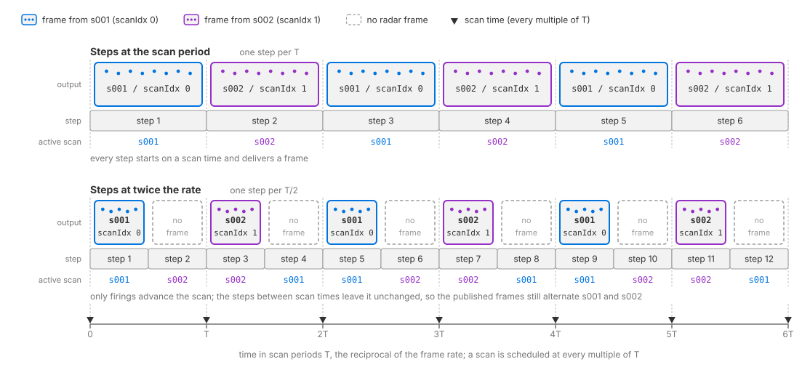

.. SPDX-FileCopyrightText: Copyright (c) 2026 NVIDIA CORPORATION & AFFILIATES. All rights reserved.
.. SPDX-License-Identifier: LicenseRef-NvidiaProprietary
..
.. NVIDIA CORPORATION, its affiliates and licensors retain all intellectual
.. property and proprietary rights in and to this material, related
.. documentation and any modifications thereto. Any use, reproduction,
.. disclosure or distribution of this material and related documentation
.. without an express license agreement from NVIDIA CORPORATION or
.. its affiliates is strictly prohibited.

.. _sensors-nonvisual-radar-howto-scan-configurations:
.. _sensors-do-scan-configurations:

Run More Than One Scan Pattern
==============================

Configure multiple scans when the device alternates between operating modes,
such as near-range and far-range scans. Each scan has its own parameters.
The model cycles through them, and each output identifies the scan with
``scanIdx``. :ref:`Scan instances
<sensors-nonvisual-radar-attributes-scan-instances>` explains instance naming
and ordering.

Before you start, you should know how a sensor prim gets its applied schemas
and attribute overrides (:doc:`Sensor Configuration
<../../../common/sensor_configuration>`), what the model simulates (:doc:`Radar
generic wpmDmat model <../index>`) and how its ``PointCloud`` output is read
(:doc:`Outputs <../outputs>`).

.. _sensors-nonvisual-radar-howto-scan-configurations-default-scan:
.. _sensors-radar-default-scan:

Scan authoring
--------------

Each scan configuration contains field of view, range, resolution, bins,
waveform, antenna and noise settings. Apply one instance of
``OmniSensorGenericRadarWpmDmatScanCfgAPI`` per scan. The main schema
already includes ``s001``; override its attributes without applying it again
(:ref:`scan instances <sensors-nonvisual-radar-attributes-scan-instances>`).

The example adds ``s002`` and sets a different range and sampling density
for each scan:

.. tab-set::

   .. tab-item:: USDA
      :sync: usda

      .. literalinclude:: ../../../../../tests/docs/usd/data/nonvisual/radar_wpm_dmat_howto_scan_configurations_1.usda
         :language: usda
         :start-after: # [snippet:doc-nonvisual-radar-wpm-dmat-howto-scan-configurations-1]
         :end-before: # [/snippet:doc-nonvisual-radar-wpm-dmat-howto-scan-configurations-1]

   .. tab-item:: USD Python
      :sync: python

      .. literalinclude:: ../../../../../tests/docs/usd/test_nonvisual_authoring.py
         :language: python
         :start-after: # [snippet:doc-nonvisual-radar-wpm-dmat-howto-scan-configurations-1-python]
         :end-before: # [/snippet:doc-nonvisual-radar-wpm-dmat-howto-scan-configurations-1-python]
         :dedent:

Keep each scan's values within one :ref:`published operating mode
<sensors-nonvisual-radar-howto-choose-parameters-one-operating-mode>`.

Explicit default scan
---------------------

You may also list ``OmniSensorGenericRadarWpmDmatScanCfgAPI:s001`` in
``apiSchemas``, or call
``radar.AddAppliedSchema("OmniSensorGenericRadarWpmDmatScanCfgAPI:s001")``
in Python. Explicitly listing the default instance makes both scans visible
in the schema list but produces the same two instances as the example above.

.. _sensors-nonvisual-radar-howto-scan-configurations-naming:
.. _sensors-radar-scan-namespace:
.. _sensors-radar-scan-discovery:

Attribute namespaces
--------------------

Per-scan attributes use the pattern
``<parameterType> omni:sensor:WpmDmat:scan:<instanceName>:<parameterName> = <value>``.
Include the instance name for every per-scan attribute. Names such as
``omni:sensor:WpmDmat:scan:maxRangeM`` and ``omni:sensor:WpmDmat:maxRangeM``
are ignored. Only the shared ``omni:sensor:*`` and sensor-level
``omni:sensor:WpmDmat:*`` controls omit the instance segment; see
:ref:`attribute namespaces <sensors-nonvisual-radar-attributes-namespaces>`.

The model discovers scans from these names rather than a separate scan count.
See :ref:`scan instances <sensors-nonvisual-radar-attributes-scan-instances>`.

.. _sensors-nonvisual-radar-howto-scan-configurations-order:
.. _sensors-radar-scan-order:

Scan ordering
-------------

The scans run in lexicographic order of the instance name, so ``s001`` is scan
index 0 and ``s002`` is scan index 1; the rules for the names, how they are
compared and why to zero-pad them, are under :ref:`Scan instances
<sensors-nonvisual-radar-attributes-scan-instances>` on the attributes page.

.. _sensors-nonvisual-radar-howto-scan-configurations-cycle:
.. _sensors-radar-scan-cycle:
.. _sensors-radar-scan-per-frame:
.. _sensors-radar-scan-cycles-per-step:

Scan cycle
----------

The sensor cycles through its scan configurations in instance order, using
one configuration per firing. The next configuration is the *pending scan*.

- All configurations share the sensor's :ref:`frame rate
  <sensors-nonvisual-radar-attributes-frame-rate>`. Each firing occupies one
  frame; the next configuration waits for the next scheduled scan time.
  Different ``timeOffsetUsec`` delays do not allow multiple configurations
  to fire from the same scheduled scan time.
- A step with no radar firing returns no radar ``PointCloud`` frame and does
  not advance the pending scan or its entry in the velocity sequence. A scan
  that fires but detects no targets is still :ref:`published with a zero count
  <sensors-nonvisual-radar-outputs-empty-scan>` and advances the sequence.
- The cycle starts at scan index ``0``. Events that restart the
  :ref:`velocity sequence <sensors-nonvisual-radar-attributes-velocity-cycle>`
  also reset the scan cycle to ``0``.

Read the scan index from each output containing a scan, as described below.

hat carry a scan still alternate scans.
   :align: center
   :width: 1114

   The scan cycle against the stepping cadence. Top: steps at the scan period
   deliver a scan on every step, alternating ``s001`` (``scanIdx`` 0) and
   ``s002`` (``scanIdx`` 1). Bottom: at twice the rate only every other step
   starts on a scan time; the steps in between deliver no radar frame and
   leave the pending scan unchanged, so the delivered scans still alternate
   ``s001`` and ``s002``.

Only the scan that fires advances its ``maxVelMpsSequence`` (``FAST``) or
``chirpRepetitionTimeSequence`` (``WAVEFORM``);
:ref:`Velocity sequence <sensors-nonvisual-radar-attributes-velocity-cycle>` on
the attributes page explains what that does to the interval each frame
reports.

.. _sensors-nonvisual-radar-howto-scan-configurations-stepping:
.. _sensors-radar-scan-cycle-vs-delivery:

Step at the scan period
-----------------------

Stepping faster than the frame rate produces steps without a radar firing;
they return no radar frame and do not consume a scan configuration. A frame
carries at most one scan, and a step longer than the scan period returns several frames, so inspect
every returned frame (:ref:`Frame delivery <sensors-common-sensor-outputs-frames>`).

Stepping the RenderProduct at the
scan period, the reciprocal of ``omni:sensor:frameRate``, lands every step on
one scan time once ``omni:sensor:startTime`` has passed.

With a nonzero
``timeOffsetUsec`` the acquisition falls that much later than the scan time,
inside whichever step spans it, and the frame's ``timestampNs`` reports it.
Read the scan index from the
output rather than inferring it from a step counter.

The shipped radar
examples author a frame rate of ``(10, 1)`` and step by 0.1 s, which lands on
every scan.

:ref:`The frame rate <sensors-nonvisual-radar-attributes-frame-rate>`
on the attributes page defines ``omni:sensor:frameRate`` itself, and
:ref:`Frame rate, step and delivery <sensors-common-multi-rate-frame-rate>`
covers the scheduling that every sensor shares.

.. _sensors-nonvisual-radar-howto-scan-configurations-frame-params:
.. _sensors-radar-scan-index-in-aux:

Verification
------------

Every radar ``PointCloud`` output carries the index of the scan that produced
it, ``scanIdx``, a cycle count, ``cycleCnt``, and that scan's unambiguous
limits as params; :ref:`Scan parameters <sensors-nonvisual-radar-outputs-scan-params>` on the Outputs page lists them
with their types and units. These params are present even when the scan detects
no targets. Read ``scanIdx`` from the output rather than counting frames.

To verify both scans, configure different ranges and compare the output
parameters. Author
``maxRangeM = 50`` on ``s001`` and ``maxRangeM = 300`` on ``s002``, request a
radar ``PointCloud`` RenderVar, and step the RenderProduct at least four times
with a delta time equal to the scan period, so that every step contains one
scan time and produces a frame. Inspect the metadata of every returned frame,
including scans whose ``Counts[0]`` is 0. A timestamp of zero is valid for a
scan acquired at time zero (:ref:`empty scans
<sensors-nonvisual-radar-outputs-empty-scan>`).

The scan index must alternate between 0 and 1 from one frame to the next, and
the maximum range must alternate in step with it, 50 with index 0 and 300 with
index 1. The first firing after the sensor starts, after a renderer reset or
after an accepted attribute update uses index 0 (:ref:`the cycle
<sensors-nonvisual-radar-howto-scan-configurations-cycle>`); firings before
your check change which scan you first observe. A single-scan radar always
reports index 0. Verify ``cycleCnt`` independently per scan: the first four
frames that carry a scan report
``(scanIdx, cycleCnt)`` as ``(0, 0)``, ``(1, 0)``, ``(0, 1)``, ``(1, 1)``.
If observed indices skip values, check that every returned frame is inspected;
refer to :ref:`stepping
<sensors-nonvisual-radar-howto-scan-configurations-stepping>`.

Check range rejection as well as the reported parameters.
With ``enableRangeAliasing = false`` on both, place a strong target at 200 m,
beyond the near scan's ``maxRangeM`` and within the far scan's. Detections of
that target must appear only on the frames whose scan index is 1, and never
on the frames whose index is 0. How many detections it produces is not
reproducible, because sampling and noise change the count between frames, but
which frames it is absent from is.

Potential issues
----------------

- Every frame reports scan index 0: only one scan configuration was found,
  because the extra ``OmniSensorGenericRadarWpmDmatScanCfgAPI:<name>`` was not
  applied. Refer to :ref:`Scan instances
  <sensors-nonvisual-radar-attributes-scan-instances>` on the attributes page.
- The second instance is applied, but every frame still reports scan index 0:
  check that every returned frame is inspected, including outputs with
  ``Counts[0] == 0``, as :ref:`stepping
  <sensors-nonvisual-radar-howto-scan-configurations-stepping>` describes. An
  applied instance counts as a scan even when the attributes meant for it lack
  the instance segment; that mistake shows up as the next symptom instead.
- Two scans exist but behave identically: the parameters were authored on one
  instance only. The other instance remains active with schema defaults.
  Refer to :doc:`the per-scan attributes and their defaults <../attributes>`.
- The scans run in an order you did not intend: the order is lexicographic on
  the instance name, not authoring order. Refer to :ref:`Scan instances
  <sensors-nonvisual-radar-attributes-scan-instances>` on the attributes page.
- Some steps return no radar frame: your application may be stepping faster
  than ``omni:sensor:frameRate``, so some steps hold no acquisition time. Such
  steps leave the pending scan and its ambiguity entry unchanged. Refer to
  :ref:`stepping <sensors-nonvisual-radar-howto-scan-configurations-stepping>`.
- A target beyond a scan's ``maxRangeM`` shows up at a plausible but wrong
  range: ``enableRangeAliasing`` is true for that scan, so over-range
  contributions fold into the configured unambiguous range instead of being
  discarded. Refer to :ref:`aliasing and the unambiguous intervals <sensors-nonvisual-radar-attributes-aliasing>` on the attributes page.
- A delivered scan has no detections: ``Counts[0]`` is 0, but its scan metadata
  still participates in the sequence check. See :ref:`empty scans
  <sensors-nonvisual-radar-outputs-empty-scan>`. For nonempty scans, bound reads
  by ``Counts[0]`` and test the ``VALID`` bit of ``Flags`` as :ref:`Counts,
  Flags and the detection cap <sensors-nonvisual-radar-outputs-counts>` describes.

Related
-------

- :doc:`Choose Parameter Values <choose_parameters>` — which published operating mode each scan's values come from, and why one scan holds one mode.
- :doc:`Validate a Parameterization <validate_parameterization>` — the checks that read the scan params back and compare them with what you authored.
- :doc:`Radar generic wpmDmat model <../index>` — what the model simulates and how a detection comes about.
- :doc:`Sensor Scheduling <../../../common/multi_rate>` — ``frameRate``, stepping and delivery as every sensor shares them.
