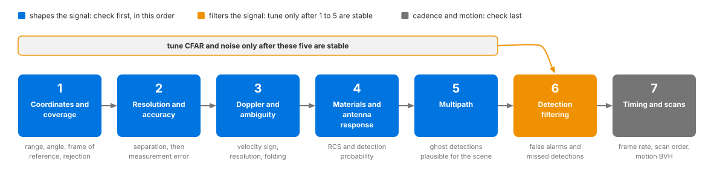

.. SPDX-FileCopyrightText: Copyright (c) 2026 NVIDIA CORPORATION & AFFILIATES. All rights reserved.
.. SPDX-License-Identifier: LicenseRef-NvidiaProprietary
..
.. NVIDIA CORPORATION, its affiliates and licensors retain all intellectual
.. property and proprietary rights in and to this material, related
.. documentation and any modifications thereto. Any use, reproduction,
.. disclosure or distribution of this material and related documentation
.. without an express license agreement from NVIDIA CORPORATION or
.. its affiliates is strictly prohibited.

.. _sensors-nonvisual-radar-howto-validate-parameterization:

Validate a Parameterization
===========================

Validate a Radar generic wpmDmat profile in controlled scenes before using it
in a full scenario. Start with a configuration that produces detections.

Before you start, you should have chosen the values on the prim
(:doc:`choose_parameters`), given the radar one scan configuration per operating
mode (:doc:`scan_configurations`) and created the renderer so that moving
targets produce radial velocity (:doc:`moving_targets`). You should know how a
radar frame is read back, bounding by ``Counts`` and testing the ``VALID`` bit
(:doc:`../outputs`, and :doc:`Sensor Outputs <../../../common/sensor_outputs>`
for the rule every point cloud follows), and where each attribute is explained
(:doc:`../attributes`).

.. _sensors-nonvisual-radar-howto-validate-parameterization-loop:

Validation workflow
-------------------

One controlled scene, one thing changed at a time, many frames per measurement:

1. Build a small scene with one reference target at a known range and angle.
2. Record the detections across many frames, not one.
3. Change exactly one parameter group.
4. Record again with the same scene, motion and material assignments, from the
   same starting point and with the same steps.
5. Compare the distributions.

Apply this procedure to the seven validation scenarios below, in order.

Method
------

Validate each scan configuration in a small scene with known geometry and
motion before evaluating a full traffic scenario. This makes discrepancies
easier to isolate.

.. _sensors-nonvisual-radar-howto-validate-parameterization-distributions:
.. _sensors-radar-validate-distributions:

Compare distributions over multiple frames. Sampling, measurement noise and
:ref:`CFAR filtering <sensors-nonvisual-radar-attributes-cfar>` can change the
detection count, so a single-frame comparison cannot reliably identify the
effect of a parameter edit. See :ref:`output variation
<sensors-common-sensor-outputs-counts-vary>`.

.. _sensors-nonvisual-radar-howto-validate-parameterization-one-change:
.. _sensors-radar-validate-one-change:

Change one parameter group at a time, and hold everything else fixed.
Retain the scene, motion and material assignments so results remain
comparable. The model takes no seed. Its noise starts from a fixed, built-in
point when the RenderProduct is first stepped and again after
:py:meth:`~ovrtx.Renderer.reset` (:c:func:`ovrtx_reset` in C). It advances
with every frame the model traces. Keep the step sequence the same between
recordings. If two things change between runs, or the scene is re-authored
between them, you cannot tell which change caused a difference.

.. _sensors-nonvisual-radar-howto-validate-parameterization-order:
.. _sensors-radar-validate-order:

Check coordinates and coverage, resolution and accuracy, Doppler and
ambiguity, materials and antenna response, and multipath before tuning CFAR
and noise. Errors in these inputs can otherwise be mistaken for filtering
errors. Check timing and scan cycling after validating the measurements.

irst five boxes with the note that CFAR is tuned only after they are stable.
   :width: 1182

   The seven checks in dependency order. Each check assumes the ones to its
   left hold: detection filtering comes after everything that shapes the signal
   it filters, and timing comes last, because a scan has to measure correctly
   before its cadence matters.

.. _sensors-nonvisual-radar-howto-validate-parameterization-metadata:

Read ``scanIdx`` and the :ref:`scan-limit parameters
<sensors-nonvisual-radar-outputs-scan-params>` alongside the detections.
They report the scan configuration, maximum range, velocity interval and
angular limits. Request ``Coordinates``, ``RCS`` and ``RadialVelocityMs`` on
the ``PointCloud`` RenderVar. ``Counts`` and ``Flags`` are always included;
see :ref:`channels <sensors-nonvisual-radar-outputs-channels>`.

.. note::

   None of the checks rests on per-detection timing: a radar frame carries
   none, as :ref:`Timestamps <sensors-nonvisual-radar-outputs-time-offset>` explains.

.. _sensors-nonvisual-radar-howto-validate-parameterization-checks:

Validation scenarios
--------------------

Run each scenario in order and compare observations with the stated criteria.
Checks that expect a target require valid detections; a published scan with
``Counts[0] == 0`` contains no detections to measure.

.. _sensors-nonvisual-radar-howto-validate-parameterization-coverage:

1. Coordinates and coverage
^^^^^^^^^^^^^^^^^^^^^^^^^^^

Place one strong reference target at known ranges and at boresight, at the
field-of-view edges and just outside the field of view. Verify range, angle,
frame of reference and rejection.

With ``enAngAliasing`` false, the boresight and edge placements must each
produce detections whose reported range matches the known range. Place the
edge targets just inside the edge: every antenna gain profile is zero outside
the scan's angular limits, and the default, ``COSINE_FALLOFF``, falls to zero at
the limit itself (:ref:`antenna <sensors-nonvisual-radar-attributes-antenna>`).
The placement outside the field of view must produce no detection of the
target. Count detections as :ref:`Counts, Flags and the detection cap
<sensors-nonvisual-radar-outputs-counts>` describes, bounding by ``Counts[0]``
and testing the ``VALID`` bit; the same section says :ref:`what a scan that
detects nothing delivers <sensors-nonvisual-radar-outputs-empty-scan>`.
Coordinates are reported in the coordinate system and frame the output
attributes select, so confirm those first if the ranges look wrong by a
constant (:ref:`Output coordinates <sensors-nonvisual-radar-attributes-output-group>`).

.. _sensors-nonvisual-radar-howto-validate-parameterization-separation:

2. Resolution and accuracy
^^^^^^^^^^^^^^^^^^^^^^^^^^

Place two targets on either side of the published range, velocity or angular
separation limit. Test separation independently from measurement error, then
enable noise and compare the error distribution.

With measurement noise disabled, vary target separation and placement relative
to bin boundaries. Measure how often the pair resolves across positions and
frames, and compare that result with the device's acceptance criteria.
Resolution is not a hard separation threshold: binning, return strength and
CFAR filtering all affect the result.
For angular separation in a ``FAST`` scan, set ``cfarMode`` to ``4D`` first:
under the default ``2D`` two targets in the same range-velocity cell come back
as one whatever the angular resolution
(:ref:`cfarMode <sensors-nonvisual-radar-attributes-cfar-mode-scope>`). Then
enable the corresponding noise attribute (:ref:`noise <sensors-nonvisual-radar-attributes-noise>`): the spread of the reported
values must widen, and it must widen where you authored it. For a target at
boresight, expect the spread of the reported angle to match the standard
deviation you authored; towards the edge of the field of view it is wider.
Noise authored on range that widens the azimuth distribution instead means the
attribute is not the one you think it is.

.. _sensors-nonvisual-radar-howto-validate-parameterization-doppler:

3. Doppler and ambiguity
^^^^^^^^^^^^^^^^^^^^^^^^

Move a target at known radial velocities below and beyond the scan's
unambiguous velocity. Verify velocity sign, resolution and folding. Repeat with
transverse motion to distinguish speed from radial velocity.

Below the limit, ``RadialVelocityMs`` must match the known radial velocity,
with the sign the geometry implies: an approaching target reads negative
(:ref:`RadialVelocityMs <sensors-nonvisual-radar-outputs-radial-velocity>`).
Beyond it, the value must fold back into the scan's unambiguous interval, a
plausible reading at the wrong velocity rather than a dropped detection. Which
interval that is depends on the scan's ``datacubeMode``. A ``FAST`` scan folds
into the symmetric interval the frame reports as ``minVelMps`` to
``maxVelMps``; read it from each frame rather than predicting it, because the
active entry of ``maxVelMpsSequence`` advances only when that scan fires
(:ref:`velocity cycle <sensors-nonvisual-radar-attributes-velocity-cycle>`).
A ``WAVEFORM`` scan reports the bounds derived from its selected
``chirpRepetitionTimeSequence`` entry, the sensor's ``waveLengthMm`` and its
other chirp attributes
(:ref:`aliasing <sensors-nonvisual-radar-attributes-aliasing>`). Purely
transverse motion at the same speed must not produce the same Doppler; if it
does, the motion is not reaching the trace (:doc:`moving_targets`).

.. _sensors-nonvisual-radar-howto-validate-parameterization-materials:

4. Materials and antenna response
^^^^^^^^^^^^^^^^^^^^^^^^^^^^^^^^^

Sweep a reference target across range, incidence angle and field of view.
Compare RCS and detection probability for calibrated non-visual materials and
antenna data. This check needs the ``RCS`` channel on the RenderVar.

``RCS`` must vary across the sweep. An ``RCS`` distribution that is identical
for two non-visual materials the radar distinguishes, or flat across incidence
angle, means the material assignment or the antenna gain data is not being
applied, not that the sensor is insensitive. Pick two different base
materials, such as ``steel`` against ``concrete`` as the runnable radar
examples do. :doc:`Non-Visual Sensor Materials <../../../../materials/nonvisual_sensor_materials>` covers how the
labels are authored, and :ref:`antenna
<sensors-nonvisual-radar-attributes-antenna>` the gain data.

.. _sensors-nonvisual-radar-howto-validate-parameterization-multipath:

5. Multipath
^^^^^^^^^^^^

Add a ground plane, wall or other strong reflector and compare direct-path
detections with ``traceTreeDepth`` values appropriate to the intended scenario.
Confirm that any ghost detections are physically plausible for the scene.

Raising ``traceTreeDepth`` is what allows detections at ranges longer than the
direct geometric distance to the target, because the reported range is half the
round-trip propagation distance; whether any appear depends on the scene
geometry and the material response (:ref:`traceTreeDepth
<sensors-nonvisual-radar-attributes-trace-depth>`). It can also cost a
direct-path detection; :ref:`the CFAR note
<sensors-nonvisual-radar-attributes-cfar>` explains why. And a scan keeps at
most 2500 detections (:ref:`the detection cap
<sensors-nonvisual-radar-outputs-detection-cap>`), so when ``Counts[0]`` is
2500 a direct-path detection can be among those dropped. A direct-path
detection that disappears must be explained by indirect energy you can place
in or next to its cell, or by a scan at the cap; one that cannot be is a fault.
Each added detection has to be explainable by a path you can draw in the scene;
one that cannot be is a parameterization to reject, not a result to keep.

.. _sensors-nonvisual-radar-howto-validate-parameterization-filtering:

6. Detection filtering
^^^^^^^^^^^^^^^^^^^^^^

Adjust CFAR and noise only after geometry, materials, antenna response and
resolution are stable. Compare false alarms and missed detections against
recordings or explicit acceptance criteria.

Count false alarms and missed detections over many frames, in a scene where
every reflector is known, and compare both against a criterion written down
before the run. An empty scene is not a false-alarm test for this model.
Raising ``cfarOffset`` should reduce false alarms and increase missed
detections; a change that moves both in the same direction means something
earlier in the list is still unstable. See :ref:`CFAR
<sensors-nonvisual-radar-attributes-cfar>` for threshold formation, control
definitions and the limits of empty-scene testing.

.. _sensors-nonvisual-radar-howto-validate-parameterization-timing:

7. Timing and scans
^^^^^^^^^^^^^^^^^^^

Verify the frame rate and the scan order for every configured scan. For moving
sensors or targets, confirm that the renderer's motion BVH is on and that the
expected time-dependent geometry and Doppler appear.

Frames must arrive at the authored ``omni:sensor:frameRate`` when you step at
the scan period, once ``omni:sensor:startTime`` has passed. A step without a
radar firing returns no radar frame; a completed scan with no detections
still returns a frame with ``Counts[0] == 0`` (:ref:`empty scans
<sensors-nonvisual-radar-outputs-empty-scan>`). The scan index, read from
each ``PointCloud``'s ``scanIdx`` param, must then cycle through the configured
scans in lexicographic instance order, with the scan limits changing in step;
:doc:`scan_configurations` gives that check in full. For a nonzero
``timeOffsetUsec``, check that ``timestampNs`` includes the delay and that a
moving target's position matches that time. A step that fires no scan must
leave the pending scan and its ambiguity entry unchanged.

For motion, the Radar generic wpmDmat model needs an active motion BVH, with
``AUTO`` or ``ENABLE`` (:ref:`Motion BVH
<sensors-common-output-configuration-motion-bvh>`); create the renderer as
:ref:`Simulate Moving Targets
<sensors-nonvisual-radar-howto-moving-targets-shape>` shows, and confirm it
before evaluating target Doppler.

The question at this step is whether the motion reaching the trace is the
motion you intended. Both runnable radar examples animate a steel cube toward
the radar and print the radial-velocity interval of each step;
:doc:`moving_targets` describes the scene and the printed summary. A target you
have animated toward the sensor must move the printed interval away from zero,
on the negative side; if it stays at zero on steps that carry real detections,
check whether scene updates are reaching rendering. Over several steps, check that valid detections are present and the approaching
target has negative radial velocity. Distinguish that target from stationary
panels; a nonzero velocity somewhere in the frame is not enough to validate
its sign or magnitude.

.. _sensors-nonvisual-radar-howto-validate-parameterization-verify:

Verification
------------

Validate every scan configuration against known scene geometry, motion and
the device's published limits. Follow the
:ref:`comparison procedure <sensors-nonvisual-radar-howto-validate-parameterization-loop>`:
change one parameter group at a time and record distributions across repeated
frames with a consistent step sequence. Investigate failed checks before
using the profile in a larger scenario. :doc:`choose_parameters` identifies
the relevant controls.

.. _sensors-nonvisual-radar-howto-validate-parameterization-symptoms:

Potential issues
----------------

- Every check produces zero detections: first distinguish steps with no radar
  frame from published scans with ``Counts[0] == 0``. The latter are completed
  acquisitions that detected no targets; see :ref:`empty scans
  <sensors-nonvisual-radar-outputs-empty-scan>`. For nonempty scans, bound reads
  by ``Counts[0]`` and check the ``Flags`` ``VALID`` bit per :ref:`Counts,
  Flags and the detection cap <sensors-nonvisual-radar-outputs-counts>`.
  Confirm that the authored limits reached the model per :ref:`the
  reach-the-model check
  <sensors-nonvisual-radar-howto-choose-parameters-reach-the-model>`.
- Results change between two runs you believe are identical: the scene, the
  motion or the material assignments moved, or the runs did not start from the
  same point or take the same steps. Refer to :ref:`holding everything else
  fixed <sensors-nonvisual-radar-howto-validate-parameterization-one-change>`.
- A single frame looks right and the aggregate does not, or the reverse: one
  frame is not a measurement once noise is enabled. Refer to :ref:`comparing
  distributions
  <sensors-nonvisual-radar-howto-validate-parameterization-distributions>`.
- CFAR settings that worked in one scene fail in another: they were tuned
  before materials and antenna response were stable. Refer to :ref:`the order
  of the checks <sensors-nonvisual-radar-howto-validate-parameterization-order>`.
- Detections appear at plausible but wrong ranges, angles or velocities: range
  or angular aliasing is enabled, or the target is faster than the scan's
  unambiguous velocity, which a ``FAST`` scan folds without a switch. That is
  folding, not error, and it belongs in the parameterization only when the real
  operating mode has the same ambiguity
  (:ref:`aliasing <sensors-nonvisual-radar-attributes-aliasing>`).
- Only one scan ever appears to be validated: the scan index, the ``scanIdx``
  param of each ``PointCloud``, is not advancing. Refer to
  :doc:`scan_configurations`.
- A target you animated shows no motion effects, and no error was logged: the
  renderer was created without the motion BVH, so the radar ran without it.
  Refer to :doc:`moving_targets`.

Related
-------

- :doc:`Choose Parameter Values <choose_parameters>` — which values are copied, calibrated or simulation-only, and configuration verification.
- :doc:`Run More Than One Scan Pattern <scan_configurations>` — scan order, the one-scan-per-firing cycle and stepping at the scan period.
- :doc:`Simulate Moving Targets <moving_targets>` — the motion BVH requirement, the animated example scene and its printed summary.
- :doc:`Python radar example <../../../../examples/python_sensor_radar>` — the runnable scene with the steel and concrete cubes.
- :doc:`C radar example <../../../../examples/c_sensor_radar>` — the same scene driven from C.
