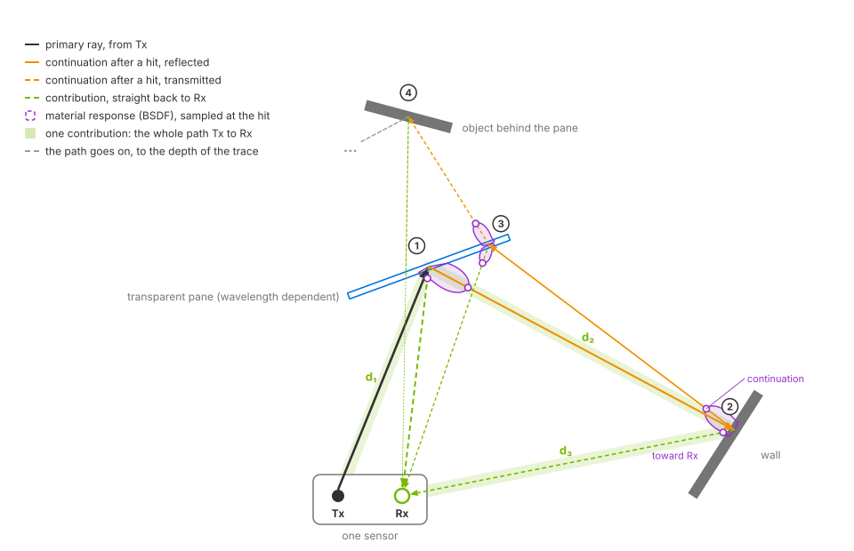

.. SPDX-FileCopyrightText: Copyright (c) 2026 NVIDIA CORPORATION & AFFILIATES. All rights reserved.
.. SPDX-License-Identifier: LicenseRef-NvidiaProprietary
..
.. NVIDIA CORPORATION, its affiliates and licensors retain all intellectual
.. property and proprietary rights in and to this material, related
.. documentation and any modifications thereto. Any use, reproduction,
.. disclosure or distribution of this material and related documentation
.. without an express license agreement from NVIDIA CORPORATION or
.. its affiliates is strictly prohibited.

.. _sensors-nonvisual-radar:
.. _sensors-nonvisual-radar-index:
.. _sensors-models-radar-wpm-dmat:

Radar generic wpmDmat model
===========================

The Radar generic wpmDmat model simulates radar detections with position,
radial velocity and radar cross section (RCS). Positions are spherical by
default, with Cartesian output also available (:doc:`outputs`).

*wpmDmat* means Wave Propagation Model Detection Matrix. The model traces
propagation paths into a range–velocity–azimuth–elevation detection matrix,
then extracts detections using a constant false alarm rate (CFAR) threshold.
See the :doc:`glossary <../../reference/glossary>` for these terms.

.. figure:: ../../../img/sensors/nonvisual/radar_field_hero.avif
   :align: center
   :alt: Two panels side by side. Left, the radar example's field scene from its preview camera: steel panels on an arc, a steel cube crossing the field, the radar marked with a white dot. Right, a top view of the same step's detections over 10 m range rings, colored by signed radial velocity: the cube's blue, the panels' green.
   :width: 1200

   *Radar 1 m above asphalt, observing a steel cube moving among 33 steel
   panels. Left: camera view. Right: detections on 10 m range rings, colored
   by signed radial velocity. Blue approaches, green is near zero and red
   recedes.*

.. _sensors-wpm-multiple-backscatter:

Simulation
----------

The model traces paths with multiple surface interactions. Each interaction
can contribute energy to the receiver, producing arrivals with different
strengths and delays.

.. _sensors-nonvisual-radar-index-detections:
.. _sensors-radar-detection-not-sample:
.. _sensors-wpm-contribution:

Detection processing
^^^^^^^^^^^^^^^^^^^^

``FAST`` mode maps traced arrivals directly into detection-matrix bins.
``WAVEFORM`` mode computes the matrix from sampled waveforms. CFAR processing
then extracts detections from cells above the threshold.
``omni:sensor:WpmDmat:cfarMode`` selects a 2D or 4D neighborhood for the test;
see :ref:`CFAR controls <sensors-nonvisual-radar-attributes-cfar>` and
:ref:`mode-specific attributes <sensors-nonvisual-radar-attributes-mode-split>`.

Geometry, antenna sensitivity, materials, return strength, discretization,
noise and filtering all affect detection. One object can produce several
detections or none.

Reported range is derived from the full round-trip propagation path. An
indirect path can therefore produce a ghost detection farther away than the
surface's geometric distance.

hit 4 and fades out toward the depth of the trace. Dashed green contribution rays run from every hit straight back to Rx, the one from hit 4 crossing the pane again. Purple lobes at hits 1 and 2 show the surface's material response with two sampled directions, the continuation and the direction of Rx; at hit 3 the lobe sits on both sides of the pane. The path Tx, pane, wall, Rx is highlighted with its segment lengths d1, d2 and d3; the rays thin with every hit.
   :width: 960

   A propagation path from transmitter Tx through a pane, wall and pane to
   an object behind the glass. Each hit generates one reflected or transmitted
   continuation and a contribution toward receiver Rx. The highlighted
   Tx → pane → wall → Rx path has length d₁ + d₂ + d₃, which determines its
   arrival time. The contribution from behind the pane crosses it again on
   the return path.

   At each hit, the bidirectional scattering distribution function (BSDF) is
   evaluated for the continuation and receiver directions. Surface interactions
   reduce the remaining energy; transmission also depends on wavelength.
   The diagram shows refraction toward the pane's normal and traces the path
   to the configured depth.

   Indirect paths can produce ghost detections whose reported range exceeds
   the geometric distance to either surface.

For a direct-path return, radial velocity is the component of relative motion
along the line of sight; purely transverse motion produces no Doppler.
Multipath returns also depend on motion projected along the other path segments.

``RadialVelocityMs`` is signed, negative for an approaching detection. Moving or
articulated surfaces can produce several velocity contributions when their
motion is represented in the scene and the configured velocity resolution can
separate them. Seeing scene motion within a step needs the renderer's motion
BVH; refer to :ref:`sensors-nonvisual-radar-index-motion-bvh`.

.. _sensors-nonvisual-radar-index-phenomena:

Simulated effects
^^^^^^^^^^^^^^^^^

The model simulates the following effects. See
:ref:`mode-specific controls <sensors-nonvisual-radar-attributes-mode-split>`
for their attributes.

.. list-table::
   :class: compact-table
   :header-rows: 1
   :widths: 24 76

   * - Phenomenon
     - What you observe
   * - Field of view and antenna sensitivity
     - Targets outside the configured angular interval are rejected unless
       angular aliasing is enabled. Within the interval, the transmit and
       receive gain patterns change the strength of a return with its
       direction. Default cosine falloff produces weaker returns toward the
       edges of the field of view.
   * - Materials and radiometry
     - Material assignment, incidence geometry, wavelength, antenna gain and
       distance set the strength and the RCS of a return. Incorrect or missing
       non-visual material data changes detection. See
       :doc:`../../../materials/nonvisual_sensor_materials` and
       :ref:`RCS calibration <sensors-nonvisual-radar-attributes-rcs-tuning>`.
   * - Multipath and ghost detections
     - Indirect propagation paths produce additional detections with shifted
       range, angle, velocity or RCS. Scene geometry and material response
       determine their strength. :ref:`Trace depth
       <sensors-nonvisual-radar-attributes-trace-depth>` limits path length in
       surface interactions; antenna patterns and detection thresholds also
       affect which paths produce detections.
   * - Motion and Doppler
     - Sensor and target motion change radial velocity, and several moving
       surfaces create a velocity spread when the motion and the geometry are
       represented and resolvable. See
       :ref:`motion BVH <sensors-nonvisual-radar-index-motion-bvh>` and
       :doc:`howto/moving_targets`.
   * - Range, angle and velocity ambiguity
     - Values outside an unambiguous interval are discarded or folded into that
       interval, producing an aliased range, angle or radial velocity.
       Each frame reports its scan's unambiguous limits; see :doc:`outputs`.
   * - Detection and false alarms
     - Weak arrivals are removed, while configured noise varies the measured
       values or changes which arrivals cross the threshold.
   * - Fidelity and performance
     - Denser geometric sampling, more propagation depth and larger datacubes
       resolve more arrivals but need more processing and memory.

.. _sensors-nonvisual-radar-index-motion-bvh:
.. _sensors-motion-radar-without-bvh:

Motion BVH
~~~~~~~~~~

Radial velocity from scene motion requires an active motion BVH. Select
``AUTO`` or ``ENABLE`` when creating the renderer; see
:ref:`Motion BVH <sensors-common-output-configuration-motion-bvh>`.
:ref:`Moving-target verification
<sensors-nonvisual-radar-howto-moving-targets-motion-bvh>` covers the output
without motion BVH and how to check whether it is active.

Outputs
-------

Each :doc:`PointCloud <outputs>` frame contains detections and metadata
identifying the scan configuration and its unambiguous range, velocity and
angle limits. Use this metadata to identify the scan that produced a frame.
Raw signal samples, datacubes and other intermediate processing data are not
available as outputs.

.. _sensors-nonvisual-radar-index-features:

Antenna and scan configuration
------------------------------

Transmit and receive gain patterns are independent. They support cosine
falloff (default), custom gain grids and steerable patch arrays.
See :ref:`antenna attributes <sensors-nonvisual-radar-attributes-antenna>`
and :ref:`gain grids <sensors-nonvisual-radar-attributes-gain-grid>`.
``WAVEFORM`` mode also supports MIMO (multiple input, multiple output) with
:ref:`real or virtual receiving apertures
<sensors-nonvisual-radar-attributes-aperture>`.

A sensor can cycle through multiple scan configurations, each with its own
field of view, bins and processing settings; see :doc:`howto/scan_configurations`.
All scans must use the same ``datacubeMode``. ``WAVEFORM`` includes sampling
and finite-duration transform effects, with different processing costs from
``FAST``. See :doc:`howto/choose_parameters`,
:ref:`transmit power <sensors-nonvisual-radar-attributes-sampling>` and
:ref:`wavelength <sensors-nonvisual-radar-attributes-wavelength>`.

Applications
------------

Use this model to generate detection lists for tracking, sensor fusion and
obstacle sensing. Automotive radar profiles can combine near and far scans,
MIMO arrays and Doppler measurements; the default 3.9 mm wavelength is close
to 77 GHz. Robotics profiles can model short-range sensing with material
response and multipath effects.

Validate a profile in controlled scenes before using it in larger scenarios;
see :doc:`howto/validate_parameterization`. Radar, lidar and camera sensors
can use the same scene and simulation clock.

Sensor definition
-----------------

Apply ``OmniSensorGenericRadarWpmDmatAPI`` to an ``OmniRadar`` prim and target
it from a RenderProduct with a ``PointCloud`` RenderVar. Select the detection
channels to read. See :doc:`../../common/sensor_configuration` for sensor
authoring, :doc:`../../common/output_configuration` for output setup and
:doc:`../../common/sensor_outputs` for reading tensors. :doc:`attributes`
defines the radar controls. The stepping and mapping workflow is also shown
in :doc:`../../first_sensor`.

.. _sensors-nonvisual-radar-index-examples:

The :doc:`Python <../../../examples/python_sensor_radar>` and
:doc:`C <../../../examples/c_sensor_radar>` examples use a moving steel cube
and a stationary concrete cube. The approaching steel cube produces negative
radial velocities. Python displays detections in Rerun; C prints them.
Both examples include an alternative scene with thin steel panels, shown above.
See :doc:`howto/moving_targets` for the scene and stepping loop, and
:doc:`outputs` for reading detections.

The example's sensor definition applies the schema and sets output coordinates,
a 10 Hz frame rate and the transform:

.. tab-set::

   .. tab-item:: USDA
      :sync: usda

      .. literalinclude:: ../../../../examples/python/radar/radar_example.usda
         :language: usda
         :start-after: # [snippet:configure-radar-sensor]
         :end-before: # [/snippet:configure-radar-sensor]
         :prepend: #usda 1.0

   .. tab-item:: USD Python
      :sync: python

      .. literalinclude:: ../../../../tests/docs/usd/test_nonvisual_authoring.py
         :language: python
         :start-after: # [snippet:doc-nonvisual-example-configure-radar-sensor-python]
         :end-before: # [/snippet:doc-nonvisual-example-configure-radar-sensor-python]
         :dedent:

Configuration and outputs
-------------------------

Use :doc:`attributes` for controls and :doc:`howto/index` to build and validate
a device profile. Read :doc:`outputs` for detection channels, scan metadata,
valid-entry handling and visualization.

For shared behavior, see :doc:`../../common/runtime_updates` and
:doc:`../../../materials/nonvisual_sensor_materials`. The :doc:`lidar output-shaping guide
<../lidar_core/howto/output_shaping>` explains the coordinate and reference-frame
choices also used by radar.

.. toctree::
   :maxdepth: 1

   attributes
   howto/index
   outputs

Related
-------

- :doc:`Sensor Configuration <../../common/sensor_configuration>` — prims, applied schemas and attribute overrides.
- :doc:`Output Configuration <../../common/output_configuration>` — RenderProducts, RenderVars and the renderer options sensors depend on.
- :doc:`Sensor Outputs <../../common/sensor_outputs>` — mapping and reading composite outputs.
- :doc:`Limitations <../../troubleshooting/limitations>` — model limits.
