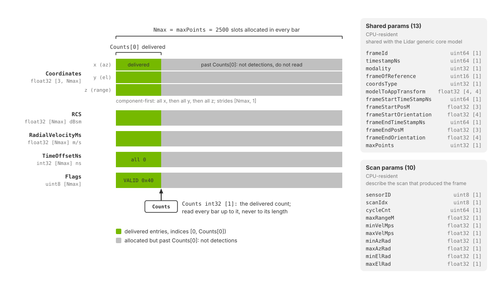

.. SPDX-FileCopyrightText: Copyright (c) 2026 NVIDIA CORPORATION & AFFILIATES. All rights reserved.
.. SPDX-License-Identifier: LicenseRef-NvidiaProprietary
..
.. NVIDIA CORPORATION, its affiliates and licensors retain all intellectual
.. property and proprietary rights in and to this material, related
.. documentation and any modifications thereto. Any use, reproduction,
.. disclosure or distribution of this material and related documentation
.. without an express license agreement from NVIDIA CORPORATION or
.. its affiliates is strictly prohibited.

.. _sensors-nonvisual-radar-outputs:

Outputs
=======

The Radar generic wpmDmat model delivers one ``PointCloud`` composite output
per requesting RenderVar. It contains per-detection tensors, two automatically
included tensors and CPU-resident parameters describing the frame and scan.
See :doc:`attributes` for output controls and
:doc:`../../common/sensor_outputs` for mapping and container access.

Each entry represents a detection accepted by processing, rather than a
ray hit. There is no per-emitter, per-echo or per-surface information. Each
published radar frame contains one scan, which may have zero detections.

An object can produce multiple detections or none. Multipath can produce ghost
detections whose ranges follow the propagation path. ``RadialVelocityMs``
measures direct-path line-of-sight motion or, for multipath returns, motion
projected along the propagation segments. See :doc:`index`.

.. _sensors-nonvisual-radar-outputs-requesting:

Requesting the output
---------------------

A radar scene needs a RenderProduct whose ``camera`` relationship names the
``OmniRadar`` prim and whose ``orderedVars`` names a RenderVar with
``sourceName = "PointCloud"``; the RenderVar's ``channels`` attribute lists the
tensors to produce. :doc:`../../common/output_configuration` explains
RenderProducts, RenderVars and the ``channels`` attribute in general. The example below requests coordinates, radar cross section and radial
velocity. Omit ``RCS`` from ``channels`` when you do not need it.

.. tab-set::

   .. tab-item:: USDA
      :sync: usda

      .. literalinclude:: ../../../../examples/c/radar/radar_example.usda
         :language: usda
         :start-after: # [snippet:configure-radar-pointcloud-output]
         :end-before: # [/snippet:configure-radar-pointcloud-output]
         :prepend: #usda 1.0

   .. tab-item:: USD Python
      :sync: python

      .. literalinclude:: ../../../../tests/docs/usd/test_nonvisual_authoring.py
         :language: python
         :start-after: # [snippet:doc-nonvisual-example-radar-pointcloud-python]
         :end-before: # [/snippet:doc-nonvisual-example-radar-pointcloud-python]
         :dedent:

The names you can list are ``Coordinates``, ``RCS``, ``TimeOffsetNs``,
``RadialVelocityMs`` and ``Flags``. ``Counts`` and ``Flags`` are added whether
or not you list them, so the ``Counts`` entry the example scenes author is
permitted but not required. How the list is read, what an unknown name does
and several ``PointCloud`` RenderVars on one product are on :ref:`channels
<sensors-common-output-configuration-channels>`.

.. _sensors-nonvisual-radar-outputs-channels:

Channels
--------

The table lists every channel a radar ``PointCloud`` can carry. ``Nmax`` is
the capacity of the per-detection tensors, the number of entries each of them
is allocated for. The model publishes it beside the channels as the
``maxPoints`` param, and for this model it is the fixed detection cap
described :ref:`below <sensors-nonvisual-radar-outputs-detection-cap>`. The
entries a frame delivered are the first ``Counts[0]`` of them.

.. list-table::
   :class: compact-table
   :header-rows: 1
   :widths: 15 8 12 12 53

   * - Channel
     - Type
     - Shape
     - Unit
     - Meaning
   * - ``Counts``
     - ``int32``
     - ``[1]``
     - detections
     - Number of entries delivered this frame. Bounds every per-detection
       tensor. Always published.
   * - ``Flags``
     - ``uint8``
     - ``[Nmax]``
     - unitless
     - Per-detection status bits. The ``VALID`` bit is ``0x40``; this model
       sets no other bit. Always published.
   * - ``Coordinates``
     - ``float32``
     - ``[3, Nmax]``
     - m, or deg / deg / m
     - Position of the detection in the configured representation and frame,
       packed component-first. Cartesian rows are x, y and z in meters;
       spherical rows, the default, are azimuth and elevation in degrees
       followed by range in meters.
   * - ``RCS``
     - ``float32``
     - ``[Nmax]``
     - dBsm
     - Radar cross section: a logarithmic measure, in decibel square meters,
       of how detectable the target is. The value depends on the scan's RCS
       calibration attributes and scene. Compare the range of values across
       a frame when evaluating response. It is clamped to [-60, 60]
       dBsm; detections below the scan's minimum accepted RCS are dropped
       (:ref:`rcsTuningCoefficients
       <sensors-nonvisual-radar-attributes-rcs-tuning>`).
   * - ``RadialVelocityMs``
     - ``float32``
     - ``[Nmax]``
     - m/s
     - Doppler radial velocity along the line of sight. Signed; approaching
       detections are negative.
   * - ``TimeOffsetNs``
     - ``int32``
     - ``[Nmax]``
     - ns
     - Time offset of the detection within the scan. ``0`` for every
       detection, because the model simulates a scan at one instant.

RCS, dBsm and the other radar terms are defined in the
:doc:`glossary <../../reference/glossary>`; the RCS calibration attributes,
``rcsTuningCoefficients`` among them, are on :doc:`attributes`. The
subsections below say how to read each channel.

.. _sensors-nonvisual-radar-outputs-counts:

Counts, Flags and the detection cap
^^^^^^^^^^^^^^^^^^^^^^^^^^^^^^^^^^^

``Counts[0]`` gives the number of delivered entries. Read only slots
``[0, Counts[0])``; the tensor length is allocated capacity. See
:ref:`reading a variable-size output <sensors-common-sensor-outputs-reading>`.

- **A scan produced detections:** ``Counts[0]`` is the detection count.
- **A scan produced no detections:** ``Counts[0]`` is ``0`` and the output
  still carries the scan's parameters and acquisition timestamp.
- **No scan fired:** no radar frame is published. This occurs when the
  pending scan's acquisition time falls outside the step's time window,
  commonly when simulation steps are shorter than the radar's scan period.

A scan can fire at time zero, so ``timestampNs = 0`` is a valid acquisition
timestamp. See
:ref:`stepping and delivery <sensors-nonvisual-radar-howto-scan-configurations-stepping>`
for aligning steps with scans, and :doc:`../../common/multi_rate` for sensors
running at different rates.

.. _sensors-nonvisual-radar-outputs-empty-scan:
.. _sensors-channels-radar-empty-scan:

Empty scans
~~~~~~~~~~~

A scan with no detections publishes ``Counts[0] = 0``. Its scan parameters,
including ``scanIdx``, ``cycleCnt`` and ``timestampNs``, still describe that
acquisition. Per-detection tensors retain their allocated capacity, but have
no delivered entries to read. Use ``Counts[0]`` to recognize an empty scan;
no ``RCS`` channel is needed for this check.

Validity flags
~~~~~~~~~~~~~~

Every delivered detection has the ``VALID`` bit set. No other flag bits are
set. Radar has no ``includeInvalidPoints``
option and does not include invalid slots within ``[0, Counts[0])``.

Test validity with ``Flags[i] & 0x40``, as the radar examples do. Avoid an
exact comparison with ``0x40`` so the reader also works with models that set
additional bits. See :ref:`validity flags
<sensors-common-sensor-outputs-valid-bit>`.

.. _sensors-nonvisual-radar-outputs-detection-cap:
.. _sensors-radar-detection-cap:
.. _sensors-channels-radar-allocation:

Detection limit
~~~~~~~~~~~~~~~

Each scan can report up to 2500 detections. Additional detections are dropped
without a saturation indicator. ``maxPoints`` and the per-detection tensor
shapes report this fixed capacity; ``Counts[0]`` bounds the entries to read.
See :ref:`allocated capacity <sensors-common-sensor-outputs-capacity>`.

.. _sensors-nonvisual-radar-outputs-shaping:
.. _sensors-channels-radar-namespace:
.. _sensors-radar-spherical-degrees:

Coordinate controls
^^^^^^^^^^^^^^^^^^^

``omni:sensor:WpmDmat:elementsCoordsType`` selects the coordinate
representation; ``outputFrameOfReference`` selects the reference frame, and
``customFrameOfReferenceTrafo`` supplies its pose when set to ``CUSTOM``.
See :ref:`coordinate controls <sensors-nonvisual-radar-attributes-output-group>`
for tokens, units and defaults. The radar ignores the lidar's ``omni:sensor:Core:*``
attributes (:ref:`namespaces <sensors-nonvisual-radar-attributes-namespaces>`).

The ``SENSOR`` frame uses :ref:`ISO 8855 axes
<sensors-common-sensor-outputs-sensor-frame>`. Read ``coordsType`` and
``frameOfReference`` from each output to identify the active settings,
particularly after a :doc:`runtime update <../../common/runtime_updates>`.

``Coordinates`` is packed component-first: all the x values, then all the y,
then all the z (or all the azimuths, all the elevations, then all the
ranges), with the capacity as the step between components, not the delivered
count. The mapped tensor reports this as a shape of ``[3, Nmax]``
with strides of ``[Nmax, 1]``. Take the layout from the shape and strides
rather than from the channel's name, because other models pack a channel of
the same name differently (:ref:`Tensor layouts <sensors-common-sensor-outputs-packing>`). Both example scenes author
``CARTESIAN``, which is why the Python example plots the delivered columns as
x, y, z points without a conversion.

.. _sensors-nonvisual-radar-outputs-radial-velocity:
.. _sensors-channels-radial-velocity-sign:

RadialVelocityMs
^^^^^^^^^^^^^^^^

Approaching detections have negative ``RadialVelocityMs``. To select moving
detections in either direction, threshold its absolute value. To distinguish
approaching and receding detections, retain the sign. The example's steel
cube moves toward the radar by 1 m per step for ten steps and produces
negative values.

A ``FAST`` scan folds radial velocity into the interval the frame reports as
``minVelMps`` to ``maxVelMps``, so a value inside that interval can belong to
a faster target; :ref:`aliasing and the unambiguous intervals <sensors-nonvisual-radar-attributes-aliasing>` explains the folding and the
``WAVEFORM`` case.

Doppler from moving targets needs the renderer's motion BVH (:ref:`Motion BVH
<sensors-common-output-configuration-motion-bvh>`); :ref:`the moving-targets
how-to <sensors-nonvisual-radar-howto-moving-targets-motion-bvh>` says what
the model does without it and how to check that the switch was active.

.. _sensors-nonvisual-radar-outputs-time-offset:
.. _sensors-radar-timeoffset-zero:

Timestamps
^^^^^^^^^^

The ``TimeOffsetNs`` channel is delivered when requested and holds ``0`` for
every detection, because the model simulates each scan as a single instant.
A radar frame therefore carries no per-detection timing. The frame's own
timing is in its params: ``timestampNs`` is the scan's instant, and
``frameStartTimeStampNs`` and ``frameEndTimeStampNs`` bound the frame's time
window, which can be wider than that instant. Consistent with this, the model has no motion-compensation
attribute (:ref:`Limitations <sensors-troubleshooting-limitations-radar>`).

The Lidar generic core model defines a channel of the same name differently
(:ref:`the lidar time offset <sensors-nonvisual-lidar-core-outputs-time-offset>`);
:ref:`Model-specific channel semantics <sensors-common-sensor-outputs-shared-names>` gives the rule.

.. _sensors-nonvisual-radar-outputs-no-material-id:

Material identifiers
^^^^^^^^^^^^^^^^^^^^

The radar ``PointCloud`` has no ``MaterialId`` channel, and no other channel
or param names a material: the label a detection came from is not reported.
The labels and how to author them are on :doc:`../../../materials/nonvisual_sensor_materials`.

.. _sensors-nonvisual-radar-outputs-params:
.. _sensors-output-container-radar-frame-header:
.. _sensors-output-container-radar-value-sets:

Params
------

A radar ``PointCloud`` carries CPU-resident :ref:`parameters
<sensors-common-sensor-outputs-params>`: thirteen shared with core lidar and
ten radar-specific scan parameters. The table below gives the radar semantics
for the :ref:`shared parameters <sensors-common-sensor-outputs-shared-params>`.

.. list-table::
   :class: compact-table
   :header-rows: 1
   :widths: 24 10 10 56

   * - Param
     - Type
     - Shape
     - Value
   * - ``frameId``
     - ``uint64``
     - ``[1]``
     - The model's frame counter. It never restarts and can skip values
       between published scans when no acquisition occurs in an intervening
       time window. It is not a count of delivered scans; use ``cycleCnt``
       and ``scanIdx`` below to follow the scan cycle.
   * - ``timestampNs``
     - ``uint64``
     - ``[1]``
     - The scan's acquisition time, in nanoseconds: its scan time plus the
       selected scan's ``timeOffsetUsec`` delay (:ref:`the frame rate
       <sensors-nonvisual-radar-attributes-frame-rate>` defines both). With
       ``omni:sensor:frameRate`` unset, ``(0, 1)``, it equals
       ``frameEndTimeStampNs``. Zero is valid for a scan acquired at time
       zero. A scan with no detections still reports its acquisition time.
   * - ``modality``
     - ``uint32``
     - ``[1]``
     - ``2``, radar.
   * - ``frameOfReference``
     - ``uint16``
     - ``[1]``
     - ``0`` sensor, ``1`` world, ``2`` custom, as
       ``omni:sensor:WpmDmat:outputFrameOfReference`` selected it.
   * - ``coordsType``
     - ``uint32``
     - ``[1]``
     - ``0`` Cartesian, ``1`` spherical, as
       ``omni:sensor:WpmDmat:elementsCoordsType`` selected it. Spherical is
       the default, so an output whose sensor never set the attribute reads
       ``1``.
   * - ``modelToAppTransform``
     - ``float32``
     - ``[4, 4]``
     - Transform from the sensor frame to the application frame: a
       homogeneous transform stored row by row, with a bottom row of
       ``0, 0, 0, 1``, whose rotation takes the model's ISO 8855 axes to the
       application's.
   * - ``frameStartTimeStampNs``
     - ``uint64``
     - ``[1]``
     - Start of this frame's time window, in nanoseconds. The scan's
       acquisition time can fall later in this window.
   * - ``frameStartPosM``
     - ``float32``
     - ``[3]``
     - Sensor position at that start, in meters, in the world frame.
   * - ``frameStartOrientation``
     - ``float32``
     - ``[4]``
     - Sensor orientation at that start, as a world-frame unit quaternion
       ordered x, y, z, w.
   * - ``frameEndTimeStampNs``
     - ``uint64``
     - ``[1]``
     - End of this frame's time window, in nanoseconds. It does not move when
       ``timeOffsetUsec`` delays the acquisition; ``timestampNs`` does.
   * - ``frameEndPosM``
     - ``float32``
     - ``[3]``
     - Sensor position at that end, in meters, in the world frame.
   * - ``frameEndOrientation``
     - ``float32``
     - ``[4]``
     - Sensor orientation at that end, as a world-frame unit quaternion
       ordered x, y, z, w.
   * - ``maxPoints``
     - ``uint32``
     - ``[1]``
     - The capacity ``Nmax``: the fixed cap of 2500 detections per scan,
       duplicating the bound already in the per-detection tensors' shapes.

The shared table on Sensor Outputs lists the full enumerations of
``modality``, ``frameOfReference`` and ``coordsType``.

.. _sensors-nonvisual-radar-outputs-pose-without-motion-bvh:

Without the motion BVH the scene does not move within a frame, while the radar
itself still does: ``frameStartPosM``, ``frameStartOrientation``,
``frameEndPosM`` and ``frameEndOrientation`` are its poses at the start and
the end of the frame's time window, the rays fire from its pose at the scan's
acquisition time, ``frameStartTimeStampNs`` and ``frameEndTimeStampNs`` bound
that window, and ``RadialVelocityMs`` still reflects the radar's own movement
between frames. The model publishes
neither ``motionCompensationState`` nor ``compactionType``, the two lidar-only
params: it has no motion compensation (:ref:`Limitations
<sensors-troubleshooting-limitations-radar>`), and it delivers no invalid
entries, so there is no compaction to describe.

.. _sensors-nonvisual-radar-outputs-scan-params:
.. _sensors-channels-radar-scan-params:
.. _sensors-output-container-radar-params:

Scan parameters
^^^^^^^^^^^^^^^

The following ten parameters identify the radar model instance, scan
configuration and cycle count, and report ambiguity bounds before measurement
noise. They accompany every radar ``PointCloud``. See
:doc:`howto/scan_configurations` for scan authoring and cycle verification.

d and the rest grayed out, with a bracket labeled Nmax = maxPoints = 2500 over the full width and one labeled Counts[0] over the filled part. Beside the tensors two boxes list the CPU params: the thirteen shared params from frameId to maxPoints, and the ten scan params from sensorID to maxElRad.
   :align: center
   :width: 1100

   Anatomy of one radar ``PointCloud`` output. The per-detection tensors,
   ``Coordinates`` as three component-first rows and ``RCS``,
   ``RadialVelocityMs``, ``TimeOffsetNs`` and ``Flags`` as one row each, are
   allocated for ``Nmax`` entries, the ``maxPoints`` capacity, and
   ``Counts[0]`` marks how many of them this frame delivered. Beside the
   tensors sit the CPU params: the thirteen shared with the Lidar generic core
   model and the ten that describe the scan.

.. list-table::
   :class: compact-table
   :header-rows: 1
   :widths: 24 10 10 56

   * - Param
     - Type
     - Shape
     - Value
   * - ``sensorID``
     - ``uint8``
     - ``[1]``
     - A number the process assigns to each radar model instance as it is
       created, ``0`` for the first, then ``1``, ``2`` and so on, constant
       for the life of the model. It is not authored and not persistent
       across runs.
   * - ``scanIdx``
     - ``uint8``
     - ``[1]``
     - Index of the scan configuration this frame used: the position of its
       instance name in the model's scan order, counted from ``0``, so
       ``s001`` is ``0`` and ``s002`` is ``1``. The order and its rules are
       under :ref:`Scan instances
       <sensors-nonvisual-radar-attributes-scan-instances>`.
   * - ``cycleCnt``
     - ``uint64``
     - ``[1]``
     - How many times this scan has fired, counted from ``0`` at its first
       firing. Firings of other scans and frames that fired no scan do not
       increase it. The events that restart the :ref:`velocity sequence
       <sensors-nonvisual-radar-attributes-velocity-cycle>` restart each
       scan's count at ``0``. It is not ``frameId``, which never restarts.
   * - ``maxRangeM``
     - ``float32``
     - ``[1]``
     - The scan's maximum unambiguous range, in meters: its ``maxRangeM``
       attribute as the model resolved it.
   * - ``minVelMps``
     - ``float32``
     - ``[1]``
     - The lower velocity ambiguity bound, in meters per second. In ``FAST``
       it is the negative of ``maxVelMps``. In ``WAVEFORM`` it follows the
       selected chirp timing and can be asymmetric with nonzero frequency
       stepping between chirps.
   * - ``maxVelMps``
     - ``float32``
     - ``[1]``
     - The upper velocity ambiguity bound for this frame, in meters per
       second: the active ``maxVelMpsSequence`` entry in ``FAST``, or derived
       from the selected ``chirpRepetitionTimeSequence`` entry, the sensor's
       ``waveLengthMm`` and the other chirp attributes in ``WAVEFORM``
       (:ref:`aliasing <sensors-nonvisual-radar-attributes-aliasing>`). Only
       the scan that fires advances its sequence (:ref:`velocity sequence
       <sensors-nonvisual-radar-attributes-velocity-cycle>`).
   * - ``minAzRad``
     - ``float32``
     - ``[1]``
     - The negative of ``maxAzRad``, in radians.
   * - ``maxAzRad``
     - ``float32``
     - ``[1]``
     - The scan's azimuth half-angle, its ``maxAzAngDeg`` attribute,
       converted to radians.
   * - ``minElRad``
     - ``float32``
     - ``[1]``
     - The negative of ``maxElRad``, in radians, for every ``elevMode``.
   * - ``maxElRad``
     - ``float32``
     - ``[1]``
     - The scan's elevation half-angle, its ``maxElAngDeg`` attribute,
       converted to radians.

Compare the output's scan-limit parameters with the authored values to check
the active configuration, including when ``Counts[0]`` is zero;
:ref:`configuration verification
<sensors-nonvisual-radar-howto-choose-parameters-reach-the-model>` describes
the check. :doc:`attributes` defines
``maxRangeM``, ``maxVelMpsSequence``, the angular half-angles and ``elevMode``.

.. _sensors-nonvisual-radar-outputs-angle-units:
.. _sensors-output-container-radar-angle-units:

Angular units
^^^^^^^^^^^^^

Angular limits and spherical coordinates use different units:

- ``minAzRad``, ``maxAzRad``, ``minElRad`` and ``maxElRad``: radians.
- Azimuth and elevation in spherical ``Coordinates``: degrees.

For example, ``maxAzAngDeg = 75`` produces limits of approximately
``minAzRad = -1.309`` and ``maxAzRad = 1.309``. A detection at the positive
azimuth limit has a spherical azimuth near 75 degrees.

Convert the angles to the same units before comparing them. Compare directly
only when ``frameOfReference = 0`` (sensor frame): the limits are always
sensor-relative, while world or custom coordinates use their selected frame.

.. _sensors-nonvisual-radar-outputs-reading:

Reading the output
------------------

Use the RenderVar's full prim path to locate its output:
``/World/Render/Vars/PointCloud`` in the examples. Follow the shared
:ref:`mapping <sensors-common-sensor-outputs-mapping>`,
:ref:`synchronization <sensors-common-sensor-outputs-synchronization>` and
:ref:`lifetime <sensors-common-sensor-outputs-lifetime>` rules.

The read routines of the two radar examples show the radar reading rule. The
Python one maps the output to the CPU, bounds every tensor by ``Counts[0]``,
keeps the entries whose ``VALID`` bit is set and transposes the
component-first ``Coordinates`` into one row per detection; the C one applies
the same bound and filter to ``RCS`` and ``RadialVelocityMs`` and prints the
minimum and maximum of each.

.. tab-set::

   .. tab-item:: Python
      :sync: python

      .. literalinclude:: ../../../../examples/python/radar/main.py
         :language: python
         :start-after: # [snippet:read-radar-pointcloud]
         :end-before: # [/snippet:read-radar-pointcloud]
         :dedent:

   .. tab-item:: C
      :sync: c

      .. literalinclude:: ../../../../examples/c/radar/main.cpp
         :language: cpp
         :start-after: // [snippet:read-radar-pointcloud]
         :end-before: // [/snippet:read-radar-pointcloud]
         :dedent:

Read ``coordsType`` and ``frameOfReference`` before interpreting coordinates.
``Counts[0] = 0`` identifies a scan with no detections (:ref:`Counts, Flags and the detection cap
<sensors-nonvisual-radar-outputs-counts>`).

.. _sensors-nonvisual-radar-outputs-using:

Using the detections
--------------------

Apply the ``Counts`` bound and the ``VALID`` filter before anything else.
Then plot Cartesian ``Coordinates`` directly as x, y, z points; for spherical
``Coordinates``, convert azimuth, elevation and range to Cartesian coordinates
first, or use a visualization that understands the spherical representation,
remembering that the angles are in degrees.

Coloring by signed ``RadialVelocityMs`` is a useful default: blue for
approaching detections, green near zero and red for receding ones, so that a
target closing on the sensor stands out from the static scene. The Python
example maps the signed value to such a color:

.. literalinclude:: ../../../../examples/python/radar/main.py
   :language: python
   :start-after: # [snippet:radial-velocity-colors]
   :end-before: # [/snippet:radial-velocity-colors]
   :dedent:

Color by ``RCS`` when inspecting material response or detectability. Compare
its minimum and maximum across a frame; both the scan calibration and scene
affect these values. The :doc:`Python radar example
<../../../examples/python_sensor_radar>` shows the ``Counts`` bound, the
``Flags`` filter and velocity coloring in a live viewer; the :doc:`C radar
example <../../../examples/c_sensor_radar>` requests ``RCS`` as well and
prints both ranges on every step.

.. figure:: ../../../img/sensors/nonvisual/radar_example_velocity_and_rcs.avif
   :alt: Two top-down plots of the radar example scene's detections on step 5 of the example's run, range rings every 10 m, the steel cube approaching 25 m ahead and left, the concrete cube standing still 30 m ahead and right, both labeled. Left, colored by signed radial velocity with the example's mapping, the steel cube's detections blue and the concrete cube's green. Right, the same detections colored by RCS from this frame's minimum to its maximum in dBsm.
   :align: center
   :width: 1608

   The detections of the radar example scene on step 5 of the example's run,
   seen from above, the steel cube approaching at 10 m/s and the concrete
   cube standing still: left, colored by signed ``RadialVelocityMs`` with the
   example's mapping, the approaching cube blue and the static one green;
   right, the same detections colored by ``RCS`` from this frame's minimum to
   its maximum. The scene is the C example's copy, which requests ``RCS``.

Related
-------

- :doc:`USD Attributes <attributes>` — the attributes that shape this output and the scan limits the params report
- :doc:`Choose Parameter Values <howto/choose_parameters>` — mapping a datasheet to attributes and checking that they reached the model
- :doc:`Run More Than One Scan Pattern <howto/scan_configurations>` — authoring several scans and verifying the cycle from ``scanIdx`` and ``cycleCnt``
- :doc:`Validate a Parameterization <howto/validate_parameterization>` — the checks that read these params and detections
- :doc:`Simulate Moving Targets <howto/moving_targets>` — the motion BVH and radial velocity from a moving scene
