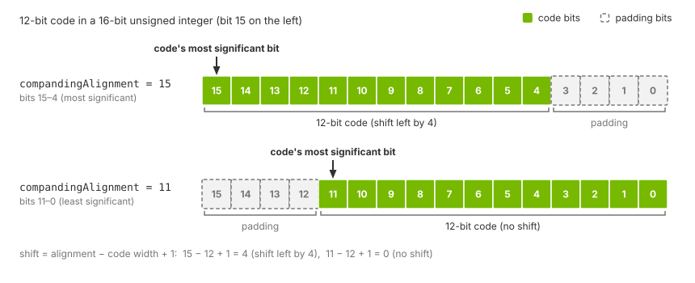

.. SPDX-FileCopyrightText: Copyright (c) 2026 NVIDIA CORPORATION & AFFILIATES. All rights reserved.
.. SPDX-License-Identifier: LicenseRef-NvidiaProprietary
..
.. NVIDIA CORPORATION, its affiliates and licensors retain all intellectual
.. property and proprietary rights in and to this material, related
.. documentation and any modifications thereto. Any use, reproduction,
.. disclosure or distribution of this material and related documentation
.. without an express license agreement from NVIDIA CORPORATION or
.. its affiliates is strictly prohibited.

.. _sensors-visual-camera-core-howto-companding-and-isp:

Compand to a RAW Format and Run the ISP
=======================================

A camera sensor computes its codes at a wider bit depth than it transmits, and
the image signal processor (ISP) on the receiving end expands them again.

**Goal.** This page authors both ends of that hand-off on the Camera generic core
model so that they agree: you pick a RAW width, author the curve, the pedestals
and the alignment, describe the result to the ISP, supply its program and verify
the post-ISP primary output.

*Companding* (compress and expand) is the piecewise-linear compression a sensor
applies to its internal codes before it sends them, and the ISP is the stage
that expands them again on the receiving end. Why sensors compand and what the
ISP does to the image is explained on the :doc:`model overview <../index>`;
this page is about the authoring.

Before you start, read :doc:`Shape an Image Like a Camera Sensor
<image_pipeline>` for the end-to-end task this page is one part of,
:doc:`Author a Color Filter Array <color_filter_array>` for the largest code
the mosaic stage produces, which the curve has to cover, and the :doc:`USD
attributes page <../attributes>` for the meaning of every attribute named here.
All of them belong to the model's ``omni:sensor:core:*`` set on the ``Camera``
prim.

If you stop at ``OmniCameraSensorPreIsp``, the companded RAW image, you need
only the first four sections, and of :ref:`Stay within 16 bits for the full pipeline <sensors-visual-camera-core-howto-companding-and-isp-16bit-gate>` only the
output-type rule: the 16-bit limit applies to the full pipeline alone, and the
pre-ISP pipeline runs no ISP and needs no program.

.. _sensors-visual-camera-core-howto-companding-and-isp-raw-width:

Choose the RAW width and author the knee points
-----------------------------------------------

A RAW format names how many bits per pixel the sensor transmits: RAW12 is
twelve, RAW10 ten, RAW8 eight. Decide the width first; everything else on this
page follows from it. When the ISP follows, choose RAW8, RAW10, RAW12 or
RAW14: those are the widths the ISP accepts (:ref:`Describe the codes to the ISP <sensors-visual-camera-core-howto-companding-and-isp-describe-codes>`) whose
codes fit the 16-bit unsigned input type (:ref:`Stay within 16 bits for the full pipeline <sensors-visual-camera-core-howto-companding-and-isp-16bit-gate>`).

The curve and pedestal attributes are defined in the :ref:`companding group
<sensors-visual-camera-core-attributes-companding>` of the USD attributes
page, where a curve is also pictured; on this page, *x* is a knee's internal
code and *y* its output code, as in the ``(x, y)`` pairs of
``compandingLinearCompandCoeff``. The last knee fixes the format:

- Its *y* is the largest code the sensor transmits. Make it
  2\ :sup:`n` − 1 for RAW\ *n*: 4095 for RAW12, 1023 for RAW10, 255 for RAW8.
- Its *x* is the largest internal code the curve still distinguishes. Start
  from the largest code the mosaic stage produces: for weights that sum to 1
  and an input normalized to 1 that is ``colorFilterArrayMaximalValue``
  (16777215 for a 24-bit internal range), plus any pre-pedestal from
  :ref:`Set the pedestals <sensors-visual-camera-core-howto-companding-and-isp-pedestals>`.
  Clear pixels (weights ``[1, 1, 1]``) can reach three times that value and
  sensor noise adds to every code; everything above the last *x* clamps to
  the last *y*. :doc:`Author a Color Filter Array <color_filter_array>`
  explains how the maximal value is chosen.

Beside the schema's default RAW12 curve, which the companding group describes,
a second curve shows another way to place the knees over the same 24-bit
internal range:

.. code-block:: usda

    float2[] omni:sensor:core:compandingLinearCompandCoeff = [
        (0, 0), (100, 100), (212, 175), (450, 308), (954, 423), (2024, 624),
        (4293, 762), (9106, 1003), (19313, 1167), (40963, 1456), (86883, 1652),
        (184279, 1998), (390856, 2233), (829005, 2646), (1758320, 2928),
        (3729396, 3423), (7910050, 3759), (16777215, 4095)
    ]

Codes up to 100 pass through unchanged; from the second knee the segments
flatten, until the top one maps about 8.9 million internal codes onto 336.

.. _sensors-visual-camera-core-howto-companding-and-isp-pedestals:

Set the pedestals
-----------------

The two pedestal attributes, ``compandingPrePedestal`` before the curve and
``compandingPostPedestal`` after it, are defined in the :ref:`companding group
<sensors-visual-camera-core-attributes-companding>`; author them if the sensor
you model has a pedestal. The pre-pedestal is part of the last *x* of
:ref:`Choose the RAW width and author the knee points <sensors-visual-camera-core-howto-companding-and-isp-raw-width>`.
Keep the curve's last *y* plus the post-pedestal at or below 2\ :sup:`n` − 1
for your RAW width: the output integer width and the alignment shift are
derived from the last *y* alone. The post-pedestal is added to the curve's
output before the alignment shift.

.. _sensors-visual-camera-core-howto-companding-and-isp-alignment:
.. _sensors-camera-isp-alignment:

Choose the alignment
--------------------

Receivers can expect a RAW12 code in either the most or least significant
12 bits of a 16-bit unsigned integer. Set ``compandingAlignment`` to match the
receiver. The :ref:`companding group
<sensors-visual-camera-core-attributes-companding>` defines how the bit position
is counted and how the shift is calculated. For RAW12 in a 16-bit integer:

- ``compandingAlignment = 15``, the shipped default: the code occupies bits
  15 to 4, with zero padding in bits 3 to 0.
- ``compandingAlignment = 11``: the code occupies bits 11 to 0, with zero
  padding in bits 15 to 12.

         15 to 0. In the upper row the 12-bit code occupies bits 15 to 4 and
         bits 3 to 0 are padding; in the lower row the code occupies bits
         11 to 0 and bits 15 to 12 are padding.
   :width: 860

   A 12-bit code stored in a 16-bit unsigned integer:
   ``compandingAlignment = 15`` places it in bits 15 to 4 (shifted left by 4);
   ``compandingAlignment = 11`` places it in bits 11 to 0 (no shift).

To preserve all code bits, the alignment must be at least the code width
minus one and at most the output integer width minus one: 15 for the 16-bit
output described in
:ref:`Stay within 16 bits for the full pipeline <sensors-visual-camera-core-howto-companding-and-isp-16bit-gate>`.
The attribute's valid range for each integer width is on the :doc:`USD attributes
page <../attributes>`.

.. _sensors-visual-camera-core-howto-companding-and-isp-16bit-gate:
.. _sensors-camera-isp-16bit-gate:

Stay within 16 bits for the full pipeline
-----------------------------------------

The output integer type is determined by the curve. If the curve's
last *y* fits in 16 bits, the companding stage writes 16-bit codes and
``OmniCameraSensorPreIsp`` is a single-component 16-bit unsigned image; if it
does not, the stage writes 32-bit codes. The ISP accepts 16-bit input only.

.. warning::

   When ``OmniCameraSensorPostIsp`` is requested, a curve whose last *y*
   exceeds 65535 is refused: the pipeline is not built for that product, none
   of the model's outputs arrive, and the reason is logged as an error. Keep
   the last *y* at or below 65535 for the full pipeline. The five-stage
   pre-ISP pipeline, built when only ``OmniCameraSensorPreIsp`` is requested,
   has no such limit and delivers 32-bit codes when the curve needs them.

:doc:`Limitations <../../../troubleshooting/limitations>` lists this limit
beside the model's other by-design limits, and the :doc:`Symptom Index
<../../../troubleshooting/symptoms>` has the entry for a pipeline that refused
to build.

.. _sensors-visual-camera-core-howto-companding-and-isp-describe-codes:

Describe the codes to the ISP
-----------------------------

The ISP does not read the companding attributes: author
``ispSmodelSensorRawFormat`` for the curve's width and
``ispSmodelRawDataPaddingMode`` for the alignment (``LEFT`` for alignment 15,
``RIGHT`` for 11); the :ref:`ISP group
<sensors-visual-camera-core-attributes-isp>` of the USD attributes page
defines both. For RAW12 at alignment 15, use ``LEFT`` padding:

.. code-block:: usda

    int omni:sensor:core:compandingAlignment = 15
    string omni:sensor:core:ispSmodelRawDataPaddingMode = "LEFT"
    string omni:sensor:core:ispSmodelSensorRawFormat = "RAW12"

.. _sensors-visual-camera-core-howto-companding-and-isp-isp-program:
.. _sensors-camera-isp-program-required:

Supply the ISP program
----------------------

The program is yours to supply: the ovrtx package carries none. Author it in
``ispSmodelCameraProgram`` as a base64 string on one line, beside the raw
format and padding mode of :ref:`Describe the codes to the ISP <sensors-visual-camera-core-howto-companding-and-isp-describe-codes>`; the
value is tens of kilobytes of encoded text, not something you read or type.
The :ref:`ISP group
<sensors-visual-camera-core-attributes-isp>` of the USD attributes page
defines the attribute and its empty default, and the :ref:`Primary outputs
<sensors-visual-camera-core-outputs-primary-outputs>` section of the Outputs page
says what the post-ISP outputs carry until a program is authored.

Request the primary output
--------------------------

On the RenderProduct bound to the camera, request ``HdrColor`` and
``OmniCameraSensorPostIsp``, and add ``OmniCameraSensorPreIsp`` and
``OmniCameraSensorPostYuvIsp`` while you verify. ``OmniCameraSensorPostIsp``
is the :ref:`primary output
<sensors-visual-camera-core-outputs-primary-outputs>` that builds the full
pipeline with the ISP in it. ``OmniCameraSensorPreIsp`` is the RAW primary
output, and ``OmniCameraSensorPostYuvIsp`` is a :ref:`diagnostic tap
<sensors-visual-camera-core-outputs-taps>`. The output-selection rules and the
request example are on the :doc:`Outputs page <../outputs>`.

.. _sensors-visual-camera-core-howto-companding-and-isp-verify:

Verify it worked
----------------

Check three things in one frame:

1. ``OmniCameraSensorPreIsp`` is a single-component 16-bit unsigned image whose
   codes sit where the alignment put them. At alignment 15 with a RAW12 curve
   and no post-pedestal, every code is a multiple of 16 and none exceeds 65520
   (4095 shifted left by 4); at alignment 11 none exceeds 4095. A 32-bit image
   here means the curve's last *y* is above 65535 (:ref:`Stay within 16 bits for the full pipeline <sensors-visual-camera-core-howto-companding-and-isp-16bit-gate>`).
2. ``OmniCameraSensorPostYuvIsp`` and ``OmniCameraSensorPostIsp`` arrive in
   the formats the :doc:`Outputs page <../outputs>` lists and hold a picture
   of the scene. Look at them: the example script saves every output as a PNG
   preview and prints, for each, the shape, element type, minimum, maximum,
   mean and fraction of non-zero elements. A processed image is not empty and
   its values vary, with the minimum and maximum apart and the mean between
   them.
3. The formats alone do not show that the ISP ran: with an empty program they
   are exactly the same, and only the content differs. A post-ISP image that
   carries no picture while ``OmniCameraSensorPreIsp`` is healthy means that no
   program reached the stage (:ref:`Supply the ISP program <sensors-visual-camera-core-howto-companding-and-isp-isp-program>`).

:doc:`Shape an Image Like a Camera Sensor <image_pipeline>` has the checks for
the earlier stages, and the :doc:`Symptom Index
<../../../troubleshooting/symptoms>` the entries for a pipeline that was never
built and for ISP taps that produce nothing.

When it goes wrong
------------------

Each entry names the mechanism and the section that states it in full; the
:doc:`Symptom Index <../../../troubleshooting/symptoms>` holds the full symptom
text.

- **The companding curve's largest output exceeds 16 bits, so the full
  pipeline refused to build.** When ``OmniCameraSensorPostIsp`` is requested, a
  curve whose last *y* exceeds 65535 is refused: none of the model's outputs
  arrive and the reason is logged as an error. Keep the last *y* at or below
  65535 for the full pipeline; the pre-ISP pipeline alone has no such limit.
  Refer to :ref:`Stay within 16 bits <sensors-visual-camera-core-howto-companding-and-isp-16bit-gate>` and the
  entry under :ref:`Missing output <sensors-troubleshooting-symptoms-nothing>`.
- **The ISP taps produce nothing, or nothing processed, while the earlier taps
  work.** Either ``OmniCameraSensorPostIsp`` was not requested, so only the
  pre-ISP pipeline was built and the ISP-side taps have no stage behind them,
  or no program is authored in ``ispSmodelCameraProgram``, the schema default,
  and ``OmniCameraSensorPostYuvIsp`` and ``OmniCameraSensorPostIsp`` are
  published without a processed image, in the same formats as with a program.
  Refer to :ref:`Supply the ISP program <sensors-visual-camera-core-howto-companding-and-isp-isp-program>`, :ref:`the
  primary outputs <sensors-visual-camera-core-outputs-primary-outputs>` and the entry under
  :ref:`Missing output <sensors-troubleshooting-symptoms-nothing>`.
- **The padding mode does not match the alignment, or the raw format does not
  match the curve's width.** The ISP does not read the companding attributes:
  it is told the layout of the codes by ``ispSmodelRawDataPaddingMode``,
  ``LEFT`` for alignment 15 and ``RIGHT`` for 11, and their width by
  ``ispSmodelSensorRawFormat``, so author both to match what the curve and the
  alignment produce. Refer to :ref:`Describe the codes to the ISP <sensors-visual-camera-core-howto-companding-and-isp-describe-codes>` and the
  :ref:`ISP group <sensors-visual-camera-core-attributes-isp>`.
- **The codes arrive without their lowest bits.** ``compandingAlignment`` is
  lower than the code needs. To preserve all code bits, the alignment must be
  at least the code width minus one and at most the output integer width minus
  one. A lower position shifts the code right and discards its least significant
  bits. Refer to
  :ref:`Choose the alignment <sensors-visual-camera-core-howto-companding-and-isp-alignment>` and the
  :ref:`companding group <sensors-visual-camera-core-attributes-companding>`.
- **A camera product is missing its input or its primary output.** ``HdrColor`` must
  sit on the same product and one of the two primary outputs has to be present as
  well; if either is missing, the product is skipped and an error is logged, and
  a tap on its own does not build a pipeline for the tap to sit on. Refer to
  :ref:`the primary outputs <sensors-visual-camera-core-outputs-primary-outputs>`,
  :doc:`Configure the Input Image <input_image>` and the entry under
  :ref:`Missing output <sensors-troubleshooting-symptoms-nothing>`.

Related
-------

- :doc:`Camera generic core model <../index>` — why sensors compand, what the ISP does to the image, and the model's example.
- :doc:`USD Attributes <../attributes>` — the companding and ISP attribute groups, with the valid alignment ranges.
- :doc:`Outputs <../outputs>` — the primary output requirement, the per-stage formats and the request example.
- :doc:`Sensor API Schemas <../../../reference/schemas>` — types, defaults, allowed tokens and the shipped 17-point curve.
