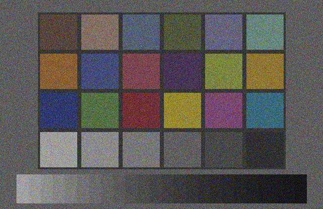

.. SPDX-FileCopyrightText: Copyright (c) 2026 NVIDIA CORPORATION & AFFILIATES. All rights reserved.
.. SPDX-License-Identifier: LicenseRef-NvidiaProprietary
..
.. NVIDIA CORPORATION, its affiliates and licensors retain all intellectual
.. property and proprietary rights in and to this material, related
.. documentation and any modifications thereto. Any use, reproduction,
.. disclosure or distribution of this material and related documentation
.. without an express license agreement from NVIDIA CORPORATION or
.. its affiliates is strictly prohibited.

.. _sensors-visual-camera-core:

Camera generic core model
=========================

The Camera generic core model processes a rendered HDR image through a fixed
sequence of stages: photosite response, color filter array, sensor noise,
bit-depth compression and image signal processing (ISP).

Configure these stages to produce sensor codes with a mosaic pattern and a
chosen transport bit depth, or an ISP-processed RGB image. The model uses an
existing rendered image; unlike :doc:`non-visual sensors <../../nonvisual/index>`,
it does not trace the scene itself.

.. figure:: ../../../img/sensors/visual/camera_core_hdr_raw_isp_comparison.avif
   :align: center
   :alt: Three panels: the rendered HdrColor Cornell box with a small outlined rectangle at the right edge of the blue sphere; a magnified gray mosaic of that rectangle, a regular lattice of brighter and darker squares whose pattern changes along a diagonal boundary; and the processed image of the whole frame, brighter and more saturated than the input.
   :width: 1000

   One Cornell box frame three times. Left, the rendered ``HdrColor`` input,
   scaled for display, the small box marking the crop of the center panel;
   center, that crop of the RAW mosaic before the ISP
   (``OmniCameraSensorPreIsp``), magnified until each sensor code is one
   photosite, where the blue sphere meets the green wall and the 2x2 pattern
   changes with the color under it; right, the processed image after the ISP
   (``OmniCameraSensorPostIsp``).

.. _sensors-visual-camera-core-what-it-simulates:

What it simulates
-----------------

.. _sensors-visual-camera-core-boundary:
.. _sensors-camera-core-boundary:

Where the model begins
^^^^^^^^^^^^^^^^^^^^^^

The Camera generic core model applies sensor and ISP post-processing to
:ref:`HdrColor <camera-output-tables>`, the renderer's linear, unclipped
high-dynamic-range image. The :doc:`Cameras <../../cameras>` section and
its :doc:`Outputs <../../cameras/outputs>` page describe the render modes and
AOVs produced by the renderer, including ``HdrColor``, ``LdrColor``, depth and
segmentation.

``HdrColor`` is the model's only input. The tone-mapped 8-bit ``LdrColor`` is
not an input. :doc:`Configure the Input Image <howto/input_image>` explains the
required ``HdrColor`` precision, the supported render modes and why
``LdrColor`` is unsuitable.

.. _sensors-visual-camera-core-pipeline:

What the model does to the image
^^^^^^^^^^^^^^^^^^^^^^^^^^^^^^^^

The operations run in a fixed order, the same every frame and for every camera,
and the attributes you author decide how each one behaves. In order:

- **Color correction** makes the rendered image look like what this sensor
  would have measured rather than what a neutral observer sees.
- **The color filter array** collapses color to one sensor code per pixel,
  following the 2×2 mosaic you author, exactly as the physical filter mosaic
  over the photosites would.
- **Sensor noise** adds photon shot noise, the randomness of photon arrival
  itself, and dark shot noise, from thermally generated carriers, to every
  code, random from one frame to the next; how each source scales with the
  signal is explained in the noise group of :doc:`USD Attributes <attributes>`.
- **Companding** compresses the wide internal code range onto the transport bit
  depth a sensor really sends. Rather than truncating, which would throw away
  the whole top of the range, it uses a piecewise-linear curve that spends codes
  generously on the dark end, where precision is needed, and sparingly on the
  bright end.
- **The ISP** undoes what the sensor did, and then some: it expands the
  companded codes back to a linear range, reconstructs three color components
  per pixel from the mosaic, denoises and converts color, producing a YUV image
  that a final decode turns back into RGBA for display. It is the one stage that
  runs a program you supply rather than one assembled from attributes;
  :doc:`Compand to a RAW Format and Run the ISP <howto/companding_and_isp>`
  covers authoring one.

         consecutive frames, with grain that changes from frame to frame.

   Photon shot noise on a color chart over ten consecutive frames: the grain is
   random from one frame to the next.

:ref:`Why the color filter array matters <sensors-visual-camera-core-color-filter-array>`,
on :doc:`Author a Color Filter Array <howto/color_filter_array>`, explains what
the color filter array's 2×2 mosaic is for and what RCCB and the Bayer orderings
trade against each other. Which pattern a sensor carries is a trade, and the
trade is worth understanding before you author one.

.. _sensors-visual-camera-core-what-you-get:

What you get
------------

The model delivers its results as AOVs on the RenderProduct that renders the
camera, requested like any other camera output: through a RenderVar whose
``sourceName`` names them (:doc:`Output Configuration
<../../common/output_configuration>` covers the RenderProduct and the
RenderVar). Seven names are reserved for the model. Two are
:ref:`primary outputs <sensors-visual-camera-core-outputs-primary-outputs>`, the images the
pipeline is built to deliver, and one of them must be requested; the other five
are optional :ref:`diagnostic taps <sensors-visual-camera-core-outputs-taps>`
that publish the image as it leaves one stage. Every product that requests any
of the seven must also request ``HdrColor``, the model's only input.

What arrives are image
surface sized to the product's display dimensions. While the input to the pipeline
is a high-dynamic-range RGB image and the output is a low-dynamic-range RGB image, the
intermediate image formats change along the pipeline and are not viewable without decoding :doc:`Outputs <outputs>` gives each stage's format, element type
and shape, which primary output builds which pipeline, when a tap publishes and what
switches the pipeline on.

.. _sensors-visual-camera-core-features:

Features at a glance
--------------------

- One schema applied to the ``Camera`` prim you already render through, one
  input and one primary output requested on its RenderProduct, diagnostic taps
  where you want to watch a stage in the middle, and a check from the shape of
  what comes back that the sensor stages ran
  (:doc:`Shape an Image Like a Camera Sensor <howto/image_pipeline>`).
- Three choices on the RenderProduct that decide what the model sees: that
  ``HdrColor`` is requested on the same product as the model's outputs, which
  floating-point precision it arrives in, and which render mode puts light into
  it; the 8-bit ``LdrColor`` is not an input
  (:doc:`Configure the Input Image <howto/input_image>`).
- Any 2×2 mosaic, authored as four weight triples with the semantic token that
  labels it and the maximal value that puts the codes into the range of the
  sensor's bit depth
  (:doc:`Author a Color Filter Array <howto/color_filter_array>`).
- A RAW width, with the companding curve, pedestals and alignment that compress
  the codes onto it, and the ISP program that expands them again into the
  processed image
  (:doc:`Compand to a RAW Format and Run the ISP <howto/companding_and_isp>`).
- The fixed order of the stages with the AOV each one publishes, each output's
  format, element type and shape, and how products and cameras pair up
  (:doc:`Outputs <outputs>`).

.. _sensors-visual-camera-core-when-to-use:

When to use it
--------------

The model is for work that consumes camera data the way a sensor delivers it
rather than the way a renderer does. Automotive and robotics perception stacks
that take RAW frames can be fed from a simulated scene with the
mosaic, the noise and the transport format of the sensor they were built for.
ISP tuning and camera-perception algorithms can be validated against
sensor-realistic imagery: a high-dynamic-range sensor covers a range wider than
one exposure can by combining captures taken at different gains into one code
space, and the noise model follows those zones; the same sensor works internally
at 20 or 24 bits but transmits RAW8, RAW10, RAW12 or RAW14, and the companding
stage reproduces that compression. And because every control is an attribute on
the camera prim, sensor layouts can be compared on one rendered scene with
nothing else changed, an RGGB mosaic against an RCCB one, for example.

.. _sensors-visual-camera-core-what-it-does-not-do:

What the model does not do
^^^^^^^^^^^^^^^^^^^^^^^^^^

The following settings and outputs are configured outside this model:

- **Lens geometry, depth of field, exposure time** belong to the ``Camera``
  prim's own attributes (:doc:`USD Attributes <../../cameras/usd_camera_attributes>`,
  :doc:`Lens Calibration <../../cameras/lens_calibration>`) and to the
  render mode; the model operates on the rendered result of those choices.
- **Global illumination, reflections, shadows, denoising** belong to the
  renderer (:doc:`Render Modes <../../cameras/render_modes>`).
- **Depth, disparity or stereo output** is the :doc:`Camera single-view stereo
  depth model <../depth_camera/index>`, with its own outputs and its own input
  requirements; it is not this model.
- **Detections, returns, points, echoes** are the :doc:`non-visual models
  <../../nonvisual/index>`. This model produces image surfaces only: no counts,
  no returns, no per-point time offsets.

.. _sensors-visual-camera-core-example:
.. _sensors-visual-camera-core-how-it-is-authored:

How it is authored
------------------

You configure the model by applying ``OmniSensorGenericCameraCoreAPI`` to the
``Camera`` prim you already render through; :doc:`USD Attributes <attributes>`
says what that implies for the camera and its intrinsics. Every control is an
attribute on that prim, grouped by the operation it configures, and the same
page explains each group and the namespace they live in. Requesting the model's
outputs on the camera's RenderProduct, the prim that names which outputs a
camera delivers (:doc:`Output Configuration <../../common/output_configuration>`),
is what runs the pipeline; :doc:`Outputs <outputs>` maps each stage to the
output it publishes and gives the element formats, which change along the way.

The smallest complete request is the schema on the camera and, on its
RenderProduct, ``HdrColor`` and one primary output; applying an API schema to a prim,
in USDA or through the Python API, is described in
:doc:`Sensor Configuration <../../common/sensor_configuration>`.

.. tab-set::

   .. tab-item:: USDA
      :sync: usda

      .. literalinclude:: ../../../../tests/docs/usd/data/camera_core_request.usda
         :language: usda
         :start-after: # [snippet:doc-camera-core-request]
         :end-before: # [/snippet:doc-camera-core-request]
         :prepend: #usda 1.0

   .. tab-item:: USD Python
      :sync: python

      .. literalinclude:: ../../../../tests/docs/usd/test_usd_python_examples.py
         :language: python
         :start-after: # [snippet:doc-camera-core-request-python]
         :end-before: # [/snippet:doc-camera-core-request-python]
         :dedent:

This model ships without a public example: no project in the
:doc:`example gallery <../../../examples/index>` runs it. The authoring is on
the pages under this model. :doc:`USD Attributes <attributes>` gives the
attributes you author on the ``Camera`` prim. :doc:`Outputs <outputs>` gives
the outputs you request on the RenderProduct and how to read them back. The
:doc:`how-tos <howto/index>` give the configuration task by task, and
:doc:`Shape an Image Like a Camera Sensor <howto/image_pipeline>` builds one
sensor end to end. Creating a renderer, stepping it and reading an output back
are the same for every sensor and are walked through in
:doc:`Your First Lidar Sensor <../../first_sensor>`.

Pages under this model
----------------------

Use :doc:`attributes` for the lower-case ``omni:sensor:core:`` controls,
:doc:`howto/index` to configure the pipeline, and :doc:`outputs` before mapping
images: it defines the primary outputs, intermediate formats and activation rules.

.. toctree::
   :maxdepth: 1

   attributes
   howto/index
   outputs

Related
-------

- :doc:`Configure the Input Image <howto/input_image>` — ``HdrColor`` on the same product, its precision and the render mode behind it.
- :doc:`Output Configuration <../../common/output_configuration>` — authoring a RenderProduct and its RenderVars.
- :doc:`Sensor Outputs <../../common/sensor_outputs>` — mapping an output and reading it back.
- :doc:`USD Attributes of the camera <../../cameras/usd_camera_attributes>` and :doc:`Lens Calibration <../../cameras/lens_calibration>` — projection, focus, exposure and lens distortion of the ``Camera`` prim.
- :doc:`Cameras <../../cameras>` and its :doc:`Outputs <../../cameras/outputs>` — what a rendered camera view delivers besides color.
- :doc:`Glossary <../../reference/glossary>` — AOV, color filter array, Bayer pattern, companding and ISP, defined once.
