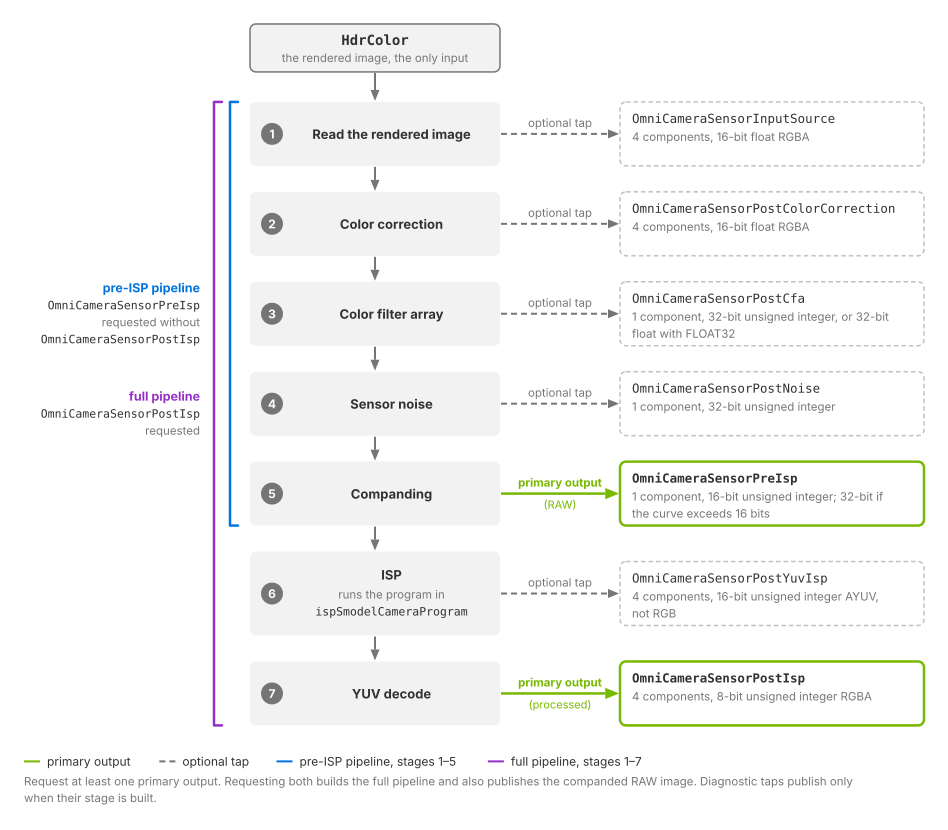

.. SPDX-FileCopyrightText: Copyright (c) 2026 NVIDIA CORPORATION & AFFILIATES. All rights reserved.
.. SPDX-License-Identifier: LicenseRef-NvidiaProprietary
..
.. NVIDIA CORPORATION, its affiliates and licensors retain all intellectual
.. property and proprietary rights in and to this material, related
.. documentation and any modifications thereto. Any use, reproduction,
.. disclosure or distribution of this material and related documentation
.. without an express license agreement from NVIDIA CORPORATION or
.. its affiliates is strictly prohibited.

.. _sensors-visual-camera-core-outputs:

Outputs
=======

The Camera generic core model delivers its results as AOVs on the RenderProduct
that renders the camera, requested like any other camera output: through a
RenderVar whose ``sourceName`` names them
(:doc:`Output Configuration <../../common/output_configuration>` covers the
RenderProduct and the RenderVar). Seven names are reserved for the model. Two
are *primary outputs*, the images the pipeline is built to deliver, and one of
them must be requested; the other five are optional *taps* that publish the
image as it leaves one stage. Every product that requests any of the seven must also
request ``HdrColor``, the linear high-dynamic-range render that is the model's
only input: one input AOV and one primary output AOV are required, everything
else is optional. The :ref:`camera output tables <sensors-cameras-outputs-tables>`
describe ``HdrColor`` itself, per render mode, and :doc:`Configure the Input
Image <howto/input_image>` covers its precision and the render mode that must
produce it.

What arrives is a picture, not a point cloud. Unlike the non-visual models,
there is no ``Counts`` channel bounding a variable number of returns and no
per-point time offset: every output is a full image surface sized to the
product's display dimensions. The element type changes along the pipeline,
though. The color filter array collapses the three color components into one
component of sensor codes, and the image signal processor (ISP) works in a YUV
representation before the final decode back to RGBA, so a consumer that
assumes every output is an RGB image misreads the middle of the pipeline. The
table below gives each stage's format, element type and shape in the notation
of the :ref:`camera output tables <sensors-cameras-outputs-tables>`.

.. _sensors-visual-camera-core-outputs-formats:
.. _sensors-camera-isp-order:
.. _sensors-camera-isp-stage-formats:

The pipeline and its outputs
----------------------------

The operations run in a fixed order, the same every frame and for every
camera. Nothing about the order is authored: what you author on the camera
prim decides how each stage behaves, not which stages exist. Each stage hands
its result to the next, and each can also publish that result as an AOV, so
the seven names are also a map of where you are in the sequence.

         read the rendered image, color correction, color filter array, sensor
         noise, companding, ISP and YUV decode, each labeled with the AOV it
         publishes and that AOV's element format. OmniCameraSensorPreIsp is
         marked as the primary RAW output after companding and
         OmniCameraSensorPostIsp as the primary processed output after the YUV
         decode; the other five AOVs are marked as optional taps.
   :width: 948

   The pipeline from ``HdrColor`` to its two primary outputs.
   Requesting ``OmniCameraSensorPreIsp`` alone builds the five-stage pipeline
   through companding; requesting ``OmniCameraSensorPostIsp`` builds the full
   pipeline through YUV decode. The five other names are optional taps on the
   stage they follow.

.. list-table::
   :header-rows: 1
   :widths: 11 29 20 9 11 9 11

   * - Stage
     - What it does to the image
     - Published as (``sourceName``)
     - Format
     - Type
     - Shape
     - Publishes on
   * - Read the rendered image
     - Reads ``HdrColor`` into the pipeline. This is the entry point and the
       pipeline's only input.
     - ``OmniCameraSensorInputSource``
     - RGBA
     - float16
     - ``(H, W, 4)``
     - Both pipelines
   * - Color correction
     - Optional black-level and full-well normalization, the sensor response
       scale, a 3×3 color matrix, then a per-component white balance. Still a
       color image, always in this format.
     - ``OmniCameraSensorPostColorCorrection``
     - RGBA
     - float16
     - ``(H, W, 4)``
     - Both pipelines
   * - Color filter array
     - Collapses the three color components into one sensor code per pixel,
       according to the 2×2 mosaic you author, and scales it into sensor-code
       range.
     - ``OmniCameraSensorPostCfa``
     - Sensor code
     - uint32; float32 when ``colorFilterArrayOutputDataTypeFormat`` is
       ``FLOAT32``
     - ``(H, W, 1)``
     - Both pipelines
   * - Sensor noise
     - Adds photon shot noise and dark shot noise to each sensor code. A
       ``FLOAT32`` color-filter-array output is converted to integer codes
       before noise is added, so the float representation ends at
       ``OmniCameraSensorPostCfa``.
     - ``OmniCameraSensorPostNoise``
     - Sensor code
     - uint32, always
     - ``(H, W, 1)``
     - Both pipelines
   * - Companding
     - Compresses the wide internal code range onto the narrower range a sensor
       transmits, through the piecewise-linear curve in
       ``compandingLinearCompandCoeff``.
     - ``OmniCameraSensorPreIsp``
     - Sensor code
     - uint16; uint32 when the curve's largest output value needs more than
       16 bits
     - ``(H, W, 1)``
     - Both pipelines with uint16; pre-ISP pipeline only with uint32
   * - ISP
     - Runs the program in ``ispSmodelCameraProgram``: decompanding,
       demosaicing, denoising and color-space conversion. Produces a YUV
       image, not RGB. Requires uint16 input.
     - ``OmniCameraSensorPostYuvIsp``
     - AYUV (alpha, luma and two chroma components per pixel)
     - uint16
     - ``(H, W, 4)``
     - Full pipeline only
   * - YUV decode
     - Converts the ISP's YUV result back to RGBA.
     - ``OmniCameraSensorPostIsp``
     - RGBA
     - uint8
     - ``(H, W, 4)``
     - Full pipeline only; its primary output

.. figure:: ../../../img/sensors/visual/camera_core_aov_strip.avif
   :align: center
   :alt: Seven thumbnails of one Cornell box frame in a row, each with a magnified crop beneath it and its AOV name: two color images, the second with shifted colors; three gray images whose crops show a 2x2 lattice of photosites; a gray luma image with a smooth crop; and the color processed image.
   :width: 1100

   The seven AOVs of one Cornell box frame in pipeline order, each above a
   magnified crop of the same image region: ``OmniCameraSensorInputSource``
   and ``OmniCameraSensorPostColorCorrection`` are color images;
   ``OmniCameraSensorPostCfa``, ``OmniCameraSensorPostNoise`` and
   ``OmniCameraSensorPreIsp`` are single-component surfaces of sensor codes,
   shown gray, whose 2x2 mosaic appears in the crops;
   ``OmniCameraSensorPostYuvIsp`` is the ISP's AYUV result, pictured as its
   luma; ``OmniCameraSensorPostIsp`` is the decoded RGBA image. The
   floating-point and sensor-code images are scaled for display.

.. _sensors-visual-camera-core-outputs-attributes:

Attributes that shape the output
--------------------------------

Three attributes, all in the ``omni:sensor:core:`` namespace of the camera
prim, reshape what the outputs carry rather than what the pixels hold.
``colorFilterArrayOutputDataTypeFormat`` (:ref:`color filter array group
<sensors-visual-camera-core-attributes-cfa>`) chooses the element type of the
color-filter-array tap, and of nothing after it.
``compandingLinearCompandCoeff`` (:ref:`companding group
<sensors-visual-camera-core-attributes-companding>`) decides, through its
largest output value, whether the companded codes are 16-bit or 32-bit unsigned
integers. Companding supports both formats, but the ISP requires
16-bit unsigned input. The 32-bit form is supported when requesting
``OmniCameraSensorPreIsp`` without ``OmniCameraSensorPostIsp``. Requesting the
full pipeline with a curve that requires 32-bit output is rejected
(:ref:`the ISP's 16-bit input requirement
<sensors-visual-camera-core-howto-companding-and-isp-16bit-gate>`).
``ispSmodelCameraProgram`` (:ref:`ISP group
<sensors-visual-camera-core-attributes-isp>`) decides whether the ISP stage
has a program to run, which the next section covers; the same group holds the
raw-format and padding attributes that describe the companded codes to the
ISP.

.. _sensors-visual-camera-core-outputs-primary-outputs:
.. _sensors-visual-camera-core-outputs-terminals:
.. _sensors-camera-core-terminals:

Primary outputs
---------------

Two of the seven names are primary outputs, and one of them must be present on
the product. The primary output you request also decides how much of the
pipeline is built.

.. list-table::
   :header-rows: 1
   :widths: 30 70

   * - Primary output AOV
     - What it is, and what it builds
   * - ``OmniCameraSensorPostIsp``
     - The processed image. Requesting it builds the complete pipeline, all
       seven stages, including the ISP stage that runs the program in
       ``omni:sensor:core:ispSmodelCameraProgram``.
   * - ``OmniCameraSensorPreIsp``
     - The sensor output just before ISP processing, typically the RAW image:
       the single-component mosaic of companded sensor codes, as a camera
       transmits it before any processing. Requesting it without
       ``OmniCameraSensorPostIsp`` builds the shorter five-stage pipeline that
       stops after companding: the ISP and YUV decode stages are not built at
       all, and this pipeline needs no ISP program.

If both are requested, the complete pipeline is built.
``OmniCameraSensorPreIsp`` publishes the companded RAW image while processing
continues through the ISP and YUV decode to ``OmniCameraSensorPostIsp``. Both
remain primary outputs. If neither is requested while some other model AOV is,
the product is skipped and the reason is logged as an error; a tap on its own
does not build a pipeline for it to sit on.

The ISP stage is not configured by attributes: it runs the program authored in
``ispSmodelCameraProgram``, whose schema default is the empty string. Until
you author one, ``OmniCameraSensorPostYuvIsp`` and ``OmniCameraSensorPostIsp``
are published without a processed image, while the five stages before them run
as usual. :ref:`Supply the ISP program
<sensors-visual-camera-core-howto-companding-and-isp-isp-program>` covers
obtaining a program and describing the companded codes to it; the
:ref:`ISP group <sensors-visual-camera-core-attributes-isp>` on the attributes
page gives the attribute semantics.

.. _sensors-visual-camera-core-outputs-taps:
.. _sensors-camera-core-taps:

Diagnostic taps
---------------

The other five names are optional taps on intermediate stages:
``OmniCameraSensorInputSource`` (the read-back input),
``OmniCameraSensorPostColorCorrection``, ``OmniCameraSensorPostCfa``,
``OmniCameraSensorPostNoise`` and ``OmniCameraSensorPostYuvIsp``. Each one
publishes the image as it leaves one stage, so a parameterization can be
inspected where it went wrong rather than only at the end. A tap publishes
only when the stage behind it is part of the pipeline that was built: on the
pre-ISP pipeline ``OmniCameraSensorPostYuvIsp`` produces nothing.

The noise stage draws its grain from a fixed seed, so the same scene and the
same sensor codes give the same grain in every run. Comparing one run against
another therefore does not show whether noise was added; comparing
``OmniCameraSensorPostCfa`` against ``OmniCameraSensorPostNoise`` in the same
frame does. :doc:`Shape an Image Like a Camera Sensor <howto/image_pipeline>`
uses the taps this way to verify a configuration.

.. note::

   The taps are the model's diagnostic mechanism. They are not part of the
   imaging contract and none of them is required to obtain sensor output; a
   consumer should rely on the two primary outputs.

.. _sensors-visual-camera-core-outputs-reserved-names:
.. _sensors-camera-core-reserved-names:

What enables the pipeline
-------------------------

Two things together run the pipeline on a RenderProduct: the product's camera
carries ``OmniSensorGenericCameraCoreAPI`` and no other sensor schema, and the
product names one of the seven outputs. A camera carries exactly one
``OmniSensorGeneric*`` schema; a camera with none of them, or with two, is
rejected, and its product delivers none of this model's outputs. The schema
supplies the parameters, so an attribute you leave unauthored runs on the
schema default; the output name switches the pipeline on.

One consequence follows. If you build an image graph of your own and happen to
name one of its outputs ``OmniCameraSensorPostCfa`` on a product whose camera
carries the schema, you have enabled this model on that product. The product then also needs ``HdrColor`` (:ref:`requested on the
same product <sensors-visual-camera-core-howto-input-image-hdrcolor>`) and one
of the two primary outputs, or it is skipped. Pick names outside the reserved seven.

.. _sensors-visual-camera-core-outputs-per-product:

One pipeline per product
------------------------

Because the attributes live on the camera prim, each camera in a stage carries
its own configuration, and the RenderProduct bound to that camera delivers that
camera's outputs. Each RenderProduct also gets a pipeline of its own, so
products rendered in the same frame can request different primary outputs and carry
different settings: one product can stop at ``OmniCameraSensorPreIsp`` while
another runs the full pipeline on a differently configured camera. A product
that renders several cameras into one frame takes every setting from the first
of its cameras.

Request example
---------------

The example below authors the smallest complete request, in USDA and with the
USD Python API: a camera carrying the schema, a product bound to it with the
input and the full-pipeline primary output in its ``orderedVars``, and the two
RenderVars.

.. tab-set::

   .. tab-item:: USDA
      :sync: usda

      .. literalinclude:: ../../../../tests/docs/usd/data/camera_core_request.usda
         :language: usda
         :start-after: # [snippet:doc-camera-core-request]
         :end-before: # [/snippet:doc-camera-core-request]
         :prepend: #usda 1.0

   .. tab-item:: USD Python
      :sync: python

      .. literalinclude:: ../../../../tests/docs/usd/test_usd_python_examples.py
         :language: python
         :start-after: # [snippet:doc-camera-core-request-python]
         :end-before: # [/snippet:doc-camera-core-request-python]
         :dedent:

Swap the primary output for ``OmniCameraSensorPreIsp`` to stop before the ISP, and
add any of the five taps to watch a stage in the middle.

The outputs are mapped and read back like any other output. Each one
is an image tensor whose format, element type and shape follow the table
above; a reader that maps the taps expecting four components everywhere must
switch to one component between ``OmniCameraSensorPostCfa`` and
``OmniCameraSensorPreIsp``. :ref:`Mapping an output
<sensors-common-sensor-outputs-mapping>` covers the mechanics, and
:doc:`Decoding camera outputs <../../cameras/decoding_outputs>` shows image
outputs being read in Python and C.

If nothing arrives
------------------

When nothing arrives, or the product is skipped and the reason is logged as an
error, the :doc:`Symptom Index <../../troubleshooting/symptoms>` lists the
misconfigurations of this model and links back to the rule each one breaks.

Related
-------

- :doc:`USD Attributes <attributes>` — the attribute groups behind each stage and the three that reshape the output
- :doc:`Configure the Input Image <howto/input_image>` — requesting ``HdrColor``, its precision and the render mode that produces it
- :doc:`Compand to a RAW Format and Run the ISP <howto/companding_and_isp>` — the companding curve, the ISP's 16-bit input requirement and supplying an ISP program
- :doc:`Cameras: Outputs <../../cameras/outputs>` — every rendered camera AOV per render mode, ``HdrColor`` among them
- :doc:`Sensor Outputs <../../common/sensor_outputs>` — mapping an output and reading it back
