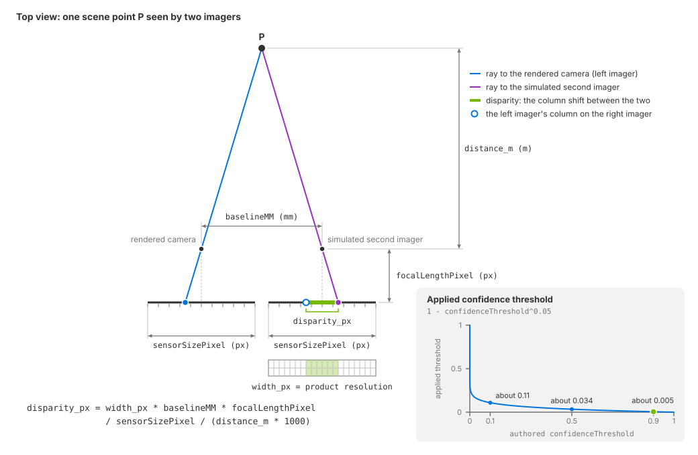

.. SPDX-FileCopyrightText: Copyright (c) 2026 NVIDIA CORPORATION & AFFILIATES. All rights reserved.
.. SPDX-License-Identifier: LicenseRef-NvidiaProprietary
..
.. NVIDIA CORPORATION, its affiliates and licensors retain all intellectual
.. property and proprietary rights in and to this material, related
.. documentation and any modifications thereto. Any use, reproduction,
.. disclosure or distribution of this material and related documentation
.. without an express license agreement from NVIDIA CORPORATION or
.. its affiliates is strictly prohibited.

.. _sensors-visual-depth-camera-attributes:

USD Attributes
==============

The Camera single-view stereo depth model has fourteen
``omni:sensor:depthSensor:*`` attributes: optics, noise and quantization,
confidence, range limits, and visualization. Unauthored values use the schema
defaults listed in :doc:`Sensor API Schemas <../../reference/schemas>`.

Apply ``OmniSensorGenericDepthSensorSingleViewAPI`` to the ``Camera`` prim.
Without it, or with a second sensor schema on the same camera, the model
produces no output.

.. _sensors-visual-depth-camera-attributes-where-applies:

Where the schema applies
------------------------

Everything is authored on the ``Camera`` prim the product renders through.
``OmniSensorGenericDepthSensorSingleViewAPI`` is a single-apply API schema that the
sensor schema restricts to ``Camera`` prims, and applying it brings the fourteen
attributes with it, all in one namespace. There is no sensor prim. The schema
also brings the shared ``omni:sensor:*`` attributes: the
:ref:`identity strings <sensors-ref-model-identity-vs-plugin>` ``modelName``,
``modelVendor`` and ``marketName``. What the product delivers comes from the
attribute values on its
camera. How to apply the schema and request the outputs is on
:doc:`Set Up a Depth Product <howto/set_up_depth_product>`.

One attribute, ``enabled``, has no effect in ovrtx: requesting the model's
outputs on the product enables the post-processing pipeline, as :ref:`The required set
<sensors-visual-depth-camera-outputs-required-vars>` on the Outputs page
describes; :doc:`Limitations <../../troubleshooting/limitations>` lists it. The
other fourteen are the subject of this page.

.. _sensors-visual-depth-camera-attributes-optics:

Optics and disparity
--------------------

This is the group that reshapes the output. A stereo camera turns disparity into
distance (the :doc:`overview <index>` defines the term); this model runs that
relation backwards, taking each pixel's rendered distance and writing it into the
pixel where a second imager, displaced by the baseline, would have seen it (the
*reprojection*). Three attributes, together with the product's width, decide how
much disparity a given distance produces, and a fourth caps it. Together they set
the depth resolution at every distance, the width of the occlusion holes (the
regions only one imager can see) and the closest distance the sensor can see.

.. code-block:: text

    disparity_px = width_px * baselineMM * focalLengthPixel
                   / sensorSizePixel / (distance_m * 1000)

lue.
   :width: 1040

   Disparity geometry (schematic, not to scale). Two imagers separated by
   ``baselineMM`` see a point at
   distance ``distance_m`` in different columns. The disparity is the column
   shift expressed in pixels at the product's resolution. The reference imager
   is ``sensorSizePixel`` pixels wide with focal length ``focalLengthPixel``.
   The inset shows the applied confidence threshold as a function of the authored
   ``confidenceThreshold``.

.. _sensors-depth-sensor-disparity-width:

``focalLengthPixel`` should match the real camera's horizontal focal length in
pixels, and ``sensorSizePixel`` should match the image width at which that focal
length is specified. Use the calibrated horizontal focal length (``fx``) and
image width from the same camera mode. For a physical imager, these values can
also be calculated from its focal length, active width and horizontal pixel
pitch, all expressed in millimeters:

.. code-block:: text

    focalLengthPixel = focal_length_mm / pixel_pitch_mm
    sensorSizePixel = active_sensor_width_mm / pixel_pitch_mm

Use the active image area and pixel spacing for the selected mode, including
any crop, binning or resizing. A calibration for that mode already accounts for
these changes. ``sensorSizePixel`` is a horizontal pixel count.

Configure the rendered camera from the same intrinsics. For a pinhole camera
with a matching field of view, the relationship is:

.. code-block:: text

    focalLengthPixel / sensorSizePixel
        = Camera.focalLength / Camera.horizontalAperture

The Camera prim's focal length and aperture use the same length unit, so their
ratio is independent of that unit. The depth attributes are authored separately
and are not automatically derived from the Camera prim. Set the rendered
projection as :doc:`USD Camera Attributes <../../cameras/usd_camera_attributes>` describes.

``width_px`` is the product's horizontal resolution, the first component of
``resolution`` on the RenderProduct
(:doc:`Output Configuration <../../common/output_configuration>`). The model
scales the reference focal length to this width:

.. code-block:: text

    effective_focal_length_px = focalLengthPixel * width_px / sensorSizePixel

When rendering the same field of view at another resolution, keep the reference
``focalLengthPixel`` and ``sensorSizePixel`` pair together. If you instead use a
calibration at the new resolution, update both values from that calibration.
Changing ``sensorSizePixel`` alone changes the modeled intrinsics. Doubling the
product width doubles disparity in output pixels; scale ``maxDisparityPixel``
accordingly to preserve the near limit, as shown in
:ref:`Build a Profile from a Spec Sheet
<sensors-visual-depth-camera-howto-spec-sheet-profile-near-limit>`.

.. list-table::
   :header-rows: 1
   :widths: 26 74

   * - Attribute
     - What it does
   * - ``baselineMM``
     - Distance between the two simulated imagers, in millimeters. Match the
       real device's baseline. The sign determines the horizontal reprojection
       direction, so a negative value is allowed. A larger baseline increases
       disparity, improves far-range depth resolution and widens occlusion holes.
   * - ``focalLengthPixel``
     - Horizontal focal length in pixels at the reference image width
       ``sensorSizePixel``. Match the real camera's calibration or derive it
       from physical focal length and pixel pitch as above.
   * - ``sensorSizePixel``
     - Reference image width in pixels, from the same camera mode or calibration
       as ``focalLengthPixel``. It equals the product width when rendering at
       that reference resolution. Values below 1.0 are raised to 1.0.
   * - ``maxDisparityPixel``
     - Largest disparity the sensor can resolve, in rendered-image pixels.
       Match the device's disparity limit, converted to the product's resolution.
       A sample whose disparity exceeds it is discarded during reprojection, which sets
       the near limit of the sensor. The worked example is on
       :doc:`Build a Profile from a Spec Sheet <howto/spec_sheet_profile>`.

.. _sensors-visual-depth-camera-attributes-noise:

Noise and quantization
----------------------

Three attributes shape the noise, and they act on the disparity, not on the
distance. For each pixel and each frame, a standard-normal sample is scaled by
``noiseSigma``, added to the disparity, and the result is rounded to a multiple
of ``noiseMean``. The sample is then written at the pixel that the perturbed
disparity specifies. The model perturbs the measurement's pixel position while
preserving its distance value, which is how a disparity-quantized sensor
behaves: a whole-pixel disparity step is a larger distance step far away than
near.

The random draw is repeated every frame, so the noise is temporal as well as
spatial: a static scene does not produce a static depth image.
``noiseDownscaleFactorPixel`` coarsens the noise field so that neighboring pixels
share one sample.

These are processing parameters measured on the rendered image's pixel grid.
Set them from the device's disparity precision and measured noise behavior.
Physical pixel pitch is used to convert the optical dimensions above; it is not
a value for these noise attributes. Convert measurements made at a different
image resolution to the product's pixel grid before tuning.

Setting ``noiseMean`` to ``0`` switches noise and quantization off together;
:doc:`Tune Noise, Quantization and Confidence <howto/noise_and_confidence>` walks
through the noise-free run and through shaping the noise.

.. list-table::
   :header-rows: 1
   :widths: 26 74

   * - Attribute
     - What it does
   * - ``noiseMean``
     - Quantization step of the disparity, in rendered-image pixels. ``0``
       disables noise and quantization together.
   * - ``noiseSigma``
     - Standard deviation of the Gaussian jitter added to the disparity before
       quantization, in rendered-image pixels.
   * - ``noiseDownscaleFactorPixel``
     - Coarseness of the noise field, in rendered-image pixels. At ``1.0`` every
       pixel draws its own sample; higher values make neighboring pixels share
       one. Values below 1.0 are raised to 1.0.

.. _sensors-visual-depth-camera-attributes-confidence:

Confidence
----------

Three attributes control which pixels have valid depth measurements. The
confidence test is binary and evaluated at each sample's source pixel in the
rendered view. A sample is accepted when its combined confidence exceeds
``1 - confidenceThreshold^0.05``. Combined confidence is the sum of two terms:

- **Texture**: an edge (gradient) measure of the luminance image, saturated to the
  0–1 range. This is why raising the scene's texture detail, or its lighting
  contrast, increases depth coverage, and why a plain wall produces nothing. The
  measure needs a neighborhood, so the outermost ring of pixels contributes no
  texture confidence.
- **Simulated IR projection**, when ``effectiveDistance`` is greater than zero:
  ``(effectiveDistance / distance)²``, saturated to 1. Within the effective
  distance this term equals 1 and exceeds any applied threshold below 1, so a
  surface is accepted regardless of texture. Beyond that distance, the term
  decreases proportionally to the inverse square of distance.
  At the default of ``0.0`` the term is zero and only texture counts.

.. _sensors-visual-depth-camera-attributes-confidence-remap:
.. _sensors-depth-sensor-confidence-remap:

The applied threshold is ``1 - confidenceThreshold^0.05``. This nonlinear
mapping decreases from 1 to 0 as the authored value increases from 0 to 1.
An authored value of ``0.9`` gives an applied threshold near ``0.005``:

.. list-table::
   :header-rows: 1
   :widths: 40 60

   * - Authored ``confidenceThreshold``
     - Applied confidence threshold
   * - ``0.0``
     - ``1.0``
   * - ``0.1``
     - about ``0.11``
   * - ``0.5``
     - about ``0.034``
   * - ``0.9``
     - about ``0.005``
   * - ``1.0``
     - ``0``

At an authored value of ``0.0``, the applied threshold is 1. Texture confidence
alone cannot exceed 1, so acceptance requires contributions from both texture
and the IR term. At ``1.0``, the applied threshold is 0, so any pixel with
positive combined confidence passes.

.. warning::

   Increasing ``confidenceThreshold`` lowers the applied threshold and accepts
   more pixels. Decreasing it requires greater combined confidence.

.. list-table::
   :header-rows: 1
   :widths: 26 74

   * - Attribute
     - What it does
   * - ``confidenceThreshold``
     - How permissive the confidence test is, remapped as above. A higher
       authored value keeps more pixels.
   * - ``effectiveDistance``
     - Range of the simulated IR projector, in meters, the unit of the distance
       output (:doc:`Outputs <outputs>` says why). ``0`` disables IR emulation.
   * - ``outlierRemovalEnabled``
     - Cleanup along each row after reprojection: a single invalid pixel between
       two valid neighbors is filled with the farther of them, and a single valid
       pixel between two invalid neighbors is removed. The cleanup needs both
       row neighbors, so it skips the leftmost and rightmost columns. On by
       default.

.. _sensors-visual-depth-camera-attributes-range-gates:

Range limits
------------

Two attributes bound what is reported. ``minDistance`` and ``maxDistance`` are in
meters, like the distance output (:doc:`Outputs <outputs>` explains the unit).
These filters are applied at several stages. The final write rejects distances
less than or equal to ``minDistance`` or greater than or equal to
``maxDistance``. Author ``minDistance`` below ``maxDistance``: otherwise, the
model clamps it to just below ``maxDistance``, leaving a very narrow interval
of accepted distances.

These attributes apply explicit distance filters. ``maxDisparityPixel``
separately determines the minimum distance implied by the stereo geometry.
The distance filters also define the interval used by the grayscale and rainbow
visualizations, modes 2 and 3. With the default ``maxDistance`` of
``10000000.0``, normalization over ten million meters maps typical scene
distances to nearly the same value. Both images therefore appear effectively
uniform. Author a realistic ``maxDistance`` before using mode 2 or 3.

.. list-table::
   :header-rows: 1
   :widths: 26 74

   * - Attribute
     - What it does
   * - ``minDistance``
     - Near cutoff, in meters, inclusive: a distance at or below it is no
       measurement. Also the near end of the visualization gradient.
   * - ``maxDistance``
     - Far cutoff, in meters, inclusive: a distance at or above it is no
       measurement. Also the far end of the visualization gradient.

.. _sensors-visual-depth-camera-attributes-visualization:

Visualization and diagnostics
-----------------------------

Two attributes serve inspection rather than measurement. ``rgbDepthOutputMode``
selects which diagnostic image the ``DepthSensorOutputVisualization`` output
contains; the mode table, the fallback for values outside it, and what each image
can and cannot tell you are on :doc:`Outputs <outputs>`. ``showDistance`` marks the
center pixel of that visualization red and prints the center pixel's distance
and disparity to standard output, a quick check of a parameterization against a
target at a known distance. The readout is the rendered distance and the
disparity your optics give for it, printed whether or not that sample passes
the range and disparity filters, so it is not the filtered sensor measurement.

Related
-------

- :doc:`Outputs <outputs>` — the five outputs, what a zero means, the units, the two frames and the visualization modes.
- :doc:`Set Up a Depth Product <howto/set_up_depth_product>` — applying the schema and requesting the outputs that run the pipeline.
- :doc:`Build a Profile from a Spec Sheet <howto/spec_sheet_profile>` — mapping a datasheet onto these attributes and working out the near limit.
- :doc:`Sensor Configuration <../../common/sensor_configuration>` — applying API schemas and the identity strings.
- :doc:`Runtime Parameter Updates <../../common/runtime_updates>` — the rules every model shares for editing attributes while the simulation runs.
