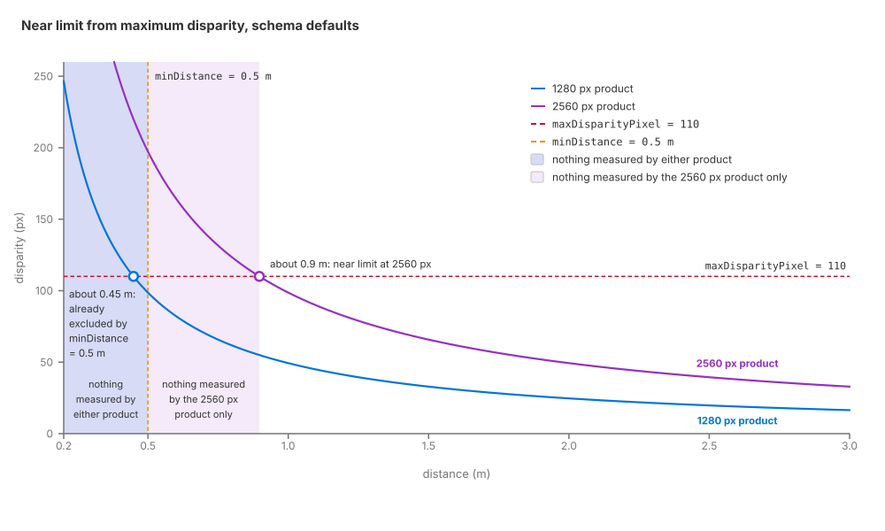

.. SPDX-FileCopyrightText: Copyright (c) 2026 NVIDIA CORPORATION & AFFILIATES. All rights reserved.
.. SPDX-License-Identifier: LicenseRef-NvidiaProprietary
..
.. NVIDIA CORPORATION, its affiliates and licensors retain all intellectual
.. property and proprietary rights in and to this material, related
.. documentation and any modifications thereto. Any use, reproduction,
.. disclosure or distribution of this material and related documentation
.. without an express license agreement from NVIDIA CORPORATION or
.. its affiliates is strictly prohibited.

.. _sensors-visual-depth-camera-howto-spec-sheet-profile:

Build a Profile from a Spec Sheet
=================================

**Goal.** Build a depth-camera profile from a vendor specification, separating
measured values from estimates. Account for unit conversions and the near limit
set by maximum disparity and product width.

**Before you start.** Have a working :doc:`depth product <set_up_depth_product>`
and read the model's :doc:`capabilities <../index>` and :doc:`attributes <../attributes>`.
The :doc:`lidar profile guide <../../../nonvisual/lidar_core/howto/spec_sheet_profile>`
provides general profiling advice and three worked tutorials. The
:doc:`radar guide <../../../nonvisual/radar_wpm_dmat/howto/spec_sheet_profile>`
applies the method to radar; :ref:`shared attributes <sensors-common-sensor-configuration-shared-attributes>` covers sensor identity
and timing.

The shape
---------

Published values initialize the product and validation against recorded data or
a known scene makes the profile trustworthy; :doc:`the lidar profile guide
<../../../nonvisual/lidar_core/howto/spec_sheet_profile>` states the general
advice in full. For a depth camera, optical dimensions and range limits can be
taken from the datasheet. Confidence and noise also depend on the device's
matching algorithm, calibration and firmware post-processing. Public spec
sheets rarely specify these in enough detail to determine model parameters,
so tune those attributes and record them as tuned. The four
source-confidence categories the lidar tutorials use (:ref:`Source confidence <sensors-recipes-source-confidence>`) serve a depth profile just as
well.

Map the spec sheet
------------------

Every attribute of the model is authored on the RenderProduct, in one namespace
(:ref:`where the schema applies <sensors-visual-depth-camera-attributes-where-applies>`). Configure the
``Camera`` prim's projection from the same camera calibration as the depth
attributes (:ref:`matching the intrinsics <sensors-depth-sensor-disparity-width>`).
The output resolution is the product's own ``resolution``. The frame rate of the
depth stream is the capture rate of the
``Camera`` prim the product renders through: apply ``OmniSensorAPI`` to that prim
and author ``omni:sensor:frameRate`` on it (:ref:`frame rate
<sensors-common-multi-rate-frame-rate>`); an unscheduled camera renders one frame
per step. Either way the model produces its outputs for every frame the product
renders.

The depth-specific fields go into the ``omni:sensor:depthSensor:`` attributes below;
their types and defaults are in the :doc:`generated schema reference
<../../../reference/schemas>`. Most of the optics rows end in the
:ref:`disparity <sensors-visual-depth-camera-attributes-optics>` the model
derives from each pixel's distance.

.. _sensors-visual-depth-camera-howto-spec-sheet-profile-table:

.. list-table::
   :header-rows: 1
   :widths: 24 30 46

   * - Spec sheet field
     - Attribute
     - Notes
   * - Output resolution of the depth stream
     - ``resolution`` on the RenderProduct
     - Match the published output resolution of the depth stream you are
       modeling. The width enters the disparity; :ref:`the near limit <sensors-visual-depth-camera-howto-spec-sheet-profile-near-limit>` shows
       what changing it does. The product and its ``resolution`` are described
       under :ref:`RenderProduct
       <sensors-common-output-configuration-renderproduct>`.
   * - Baseline
     - ``baselineMM``
     - The distance between the two simulated imagers, in millimeters. What the
       sign does and what a larger magnitude trades is in :ref:`the optics group
       <sensors-visual-depth-camera-attributes-optics>`.
   * - Focal length in pixels
     - ``focalLengthPixel``
     - Use the real camera's calibrated horizontal focal length (``fx``) at
       the reference width recorded in ``sensorSizePixel``. If only physical
       dimensions are available, convert them using :ref:`the optics group
       <sensors-visual-depth-camera-attributes-optics>`. Configure the Camera
       prim consistently; these values are authored separately.
   * - Reference image width
     - ``sensorSizePixel``
     - Use the image width in pixels from the same calibration or camera mode
       as ``focalLengthPixel``, accounting for crop, binning or resizing. Match
       the RenderProduct width to it when reproducing that mode's resolution.
       For another output resolution, follow :ref:`the reference-to-output
       scaling <sensors-depth-sensor-disparity-width>`.
   * - Minimum depth, maximum depth or closest range
     - ``minDistance``, ``maxDistance``, ``maxDisparityPixel``
     - Set the two limits from the datasheet range, in meters; they are
       convenience cutoffs (:ref:`range limits <sensors-visual-depth-camera-attributes-range-gates>`). The near end a
       real device has comes from its maximum disparity, which is what
       ``maxDisparityPixel`` reproduces. Express a published disparity limit in
       pixels at the RenderProduct's resolution; the next section gives the
       conversion and the resulting near limit.
   * - Confidence and noise claims: fill rate, depth accuracy, projector range
     - ``confidenceThreshold``, ``effectiveDistance``, ``noiseMean``,
       ``noiseSigma``, ``noiseDownscaleFactorPixel``
     - These claims are not transcribed; they are what you tune against. Start
       from the defaults and tune these attributes against measurements or
       acceptance criteria such as the published accuracy and fill rate; public
       spec sheets rarely provide enough detail to set them uniquely. The noise
       attributes use rendered-image pixels; convert measured disparity steps,
       jitter and spatial noise scales to that pixel grid. A
       published infrared projector range is a starting value for
       ``effectiveDistance``, in meters. :doc:`Tune Noise, Quantization and
       Confidence <noise_and_confidence>` gives the procedure and
       :doc:`../attributes` the semantics, including which way
       ``confidenceThreshold`` works.

.. _sensors-visual-depth-camera-howto-spec-sheet-profile-near-limit:
.. _sensors-depth-sensor-near-limit:

The near limit
--------------

The maximum disparity determines the minimum distance accepted during
reprojection. A sample whose disparity exceeds ``maxDisparityPixel`` is
discarded. Because disparity is inversely proportional to distance, the
corresponding distance is calculated by inverting the disparity formula:

.. code-block:: text

    near_limit_m = width_px * baselineMM * focalLengthPixel
                   / (sensorSizePixel * maxDisparityPixel * 1000)

With the schema defaults on a 1280-pixel-wide product, disparity is
``49.335 / distance_m`` pixels (``55 × 897 / 1000``, with the width and sensor
size canceling). Disparity exceeds ``maxDisparityPixel = 110`` at distances
below about 0.45 m. Because the default ``minDistance`` is 0.5 m, that distance
filter already excludes these samples and determines the effective near limit.
Increasing the product width to 2560 pixels with all other parameters unchanged
doubles disparity at every distance. The maximum disparity is then exceeded
below about 0.9 m, so it determines the effective near limit even though
``minDistance`` remains 0.5 m.

cts the maximum disparity at about 0.45 m, so minDistance determines the effective near limit. The 2560-pixel curve intersects it at about 0.9 m, which becomes the effective near limit.
   :align: center
   :width: 1000

   Effective near limit at two output resolutions. At 1280 pixels, the
   0.5 m ``minDistance`` determines the near limit. At 2560 pixels, disparity
   exceeds the 110-pixel maximum below about 0.9 m, which determines the near
   limit.

The effective near limit is the greater of ``minDistance`` and the distance
derived from the maximum disparity. To model a device's published minimum range,
set ``minDistance`` to it and keep the disparity-derived distance at
or below it. With the product rendered at ``sensorSizePixel``, the device's own
disparity range in ``maxDisparityPixel`` does that by construction; at another
width with the same field of view, scale the disparity limit by the ratio of
product width to sensor size to preserve the near limit. Set ``maxDistance``
from the far end of the datasheet range. These two distance attributes apply
explicit filters and define the visualization interval; their comparisons are
described under :ref:`range limits <sensors-visual-depth-camera-attributes-range-gates>`.

.. _sensors-visual-depth-camera-howto-spec-sheet-profile-verify:

Verify it worked
----------------

Validate with simple scenes before using the profile in a full simulation. A
profile that has not been checked against a known target is a set of transcribed
numbers, not a sensor model.

- **Check the camera intrinsics and image dimensions.** Confirm that
  ``focalLengthPixel`` and ``sensorSizePixel`` come from the same camera mode or
  calibration, and that their ratio agrees with the rendered camera's field of
  view. Match the product resolution to the device's output mode, or apply the
  pixel-unit conversions described above.
- **Check the disparity at a known distance.** Put a flat, textured target at a
  known distance in the center of the view and set ``showDistance``
  (:ref:`the visualization attributes
  <sensors-visual-depth-camera-attributes-visualization>`); use the readout to
  confirm the scene scale and that ``baselineMM``, ``focalLengthPixel``,
  ``sensorSizePixel`` and the product width reproduce the device's disparity at
  that distance.
- **Check the near limit.** Read ``DepthSensorDistance`` at the center pixel
  while you move the target in: it should hold a value just beyond the published
  minimum range and read zero nearer (:ref:`invalid measurements <sensors-visual-depth-camera-outputs-invalid-entries>`). Visualization mode 3
  shows the same thing at a glance, because a pixel with no measurement is black
  there.
- **Compare the input with the result.** Visualization mode 4 shows the input
  depth before the simulation and mode 2 the simulated distance across the
  limits; switching ``rgbDepthOutputMode`` between them on the same scene shows
  where the simulation loses what the input had. Read ``DepthSensorDistance`` for
  numbers; the distance and disparity modes quantize values to eight bits
  and are diagnostic images, not measurements.
- **Compare the depth output against recorded calibration targets** where you
  have them: the same target geometry seen by the device and by the product,
  compared for range, coverage and the width of the holes around objects. Expect
  to tune the confidence and noise attributes to close the gap; that is what
  :doc:`noise_and_confidence` is for. The camera imagery itself is validated
  separately, against calibration targets, in :doc:`Python: Camera calibration <../../../../examples/python_camera_calibration>`.
- **Render enough frames first.** Warm the renderer up before you judge
  coverage; a product read too early shows dropouts that are not the profile's
  (:ref:`invalid measurements <sensors-visual-depth-camera-outputs-invalid-entries>`).

When it goes wrong
------------------

.. _sensors-visual-depth-camera-howto-spec-sheet-profile-gap:

**A published field has no attribute to map onto.** The matcher's block size and
the vendor's spatial, temporal or hole-filling filters belong to a matcher and
firmware the model does not simulate; the only such filter it has is the fixed
single-pixel cleanup that ``outlierRemovalEnabled`` switches (:ref:`confidence
group <sensors-visual-depth-camera-attributes-confidence>`). Record the gap
rather than forcing an approximate value into an unrelated attribute; :ref:`the
lidar page says why <sensors-nonvisual-lidar-core-howto-spec-sheet-profile-gap>`.
Depth accuracy and fill-rate claims are a different case: they are not
transcribed either, but they are the targets the confidence and noise row of
:ref:`the table <sensors-visual-depth-camera-howto-spec-sheet-profile-table>` is
tuned against.

**Nothing is measured near the camera although** ``minDistance`` **allows it.**
The maximum disparity decides the near end there, not the limit; :ref:`the near limit <sensors-visual-depth-camera-howto-spec-sheet-profile-near-limit>` works out
the distance at which it rejects samples and how to adjust it.

.. _sensors-visual-depth-camera-howto-spec-sheet-profile-units:

**The profile behaves, but the numbers are subtly wrong.** Confirm units against
:doc:`USD Attributes <../attributes>`: ``baselineMM`` is in millimeters, the two
limits and ``effectiveDistance`` in meters, and ``focalLengthPixel`` and
``sensorSizePixel`` in pixels at the same reference image width. Check that
these intrinsics agree with the Camera prim, and that disparity and noise
parameters use the product's pixel grid.

Related
-------

- :doc:`USD Attributes <../attributes>` — the disparity formula, the optics group, the range limits, the noise and confidence attributes this page maps onto, and the ``showDistance`` readout.
- :doc:`Outputs <../outputs>` — the five outputs, what a zero means and the visualization modes.
- :doc:`Set Up a Depth Product <set_up_depth_product>` — applying the schema and requesting the RenderVars the model needs.
- :doc:`Output Configuration <../../../common/output_configuration>` — the RenderProduct and its ``resolution``.
- :doc:`Sensor Configuration <../../../common/sensor_configuration>` — the ``omni:sensor:*`` attributes every sensor prim shares, including the frame rate.
