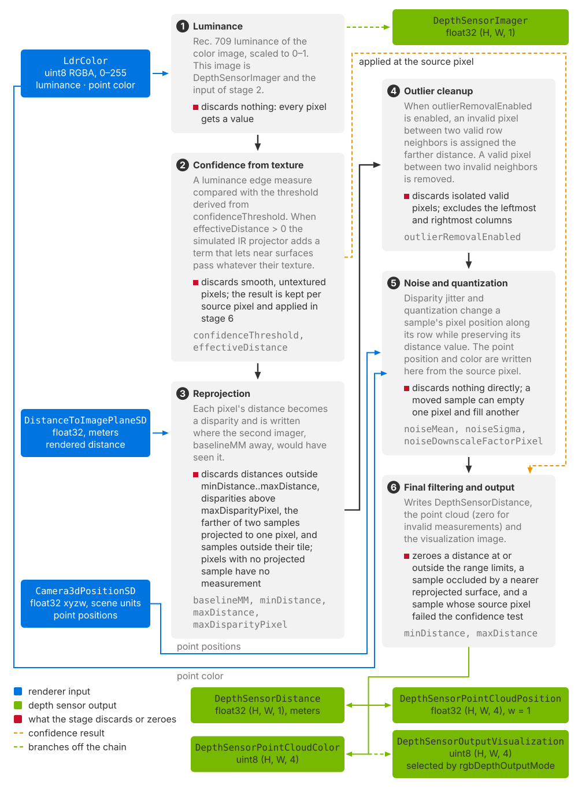

.. SPDX-FileCopyrightText: Copyright (c) 2026 NVIDIA CORPORATION & AFFILIATES. All rights reserved.
.. SPDX-License-Identifier: LicenseRef-NvidiaProprietary
..
.. NVIDIA CORPORATION, its affiliates and licensors retain all intellectual
.. property and proprietary rights in and to this material, related
.. documentation and any modifications thereto. Any use, reproduction,
.. disclosure or distribution of this material and related documentation
.. without an express license agreement from NVIDIA CORPORATION or
.. its affiliates is strictly prohibited.

.. _sensors-visual-depth-camera-outputs:

Outputs
=======

The Camera single-view stereo depth model post-processes renderer outputs and
publishes five image tensors at the RenderProduct's resolution, with
channel-last shapes. Request them as RenderVars on the product that renders
through the model's ``Camera``.

See :doc:`howto/set_up_depth_product` for the required input and output requests,
and :doc:`Sensor Outputs <../../common/sensor_outputs>` for mapping and reading
tensors. The sections below define the formats, units, coordinate frames and
invalid values.

.. _sensors-visual-depth-camera-outputs-inputs:
.. _sensors-depth-sensor-vs-depth-aovs:

Inputs
------

The post-processing pipeline reads three renderer outputs from the same
RenderProduct and produces five sensor outputs. The :ref:`camera output tables
<camera-output-tables>` define the inputs and their units. The model uses them
as follows:

- :ref:`DistanceToImagePlaneSD <camera-output-tables>` supplies the rendered
  distance, in meters, that the model processes.
- :ref:`Camera3dPositionSD <camera-output-tables>` supplies the point positions,
  in scene units. The model copies them into its point cloud; it does not
  reconstruct positions from the distance.
- :ref:`LdrColor <camera-output-tables>` supplies the luminance the confidence
  test works on and the color associated with each point. It is the tone-mapped 8-bit
  sRGB image with alpha, values 0 to 255.

Two other camera outputs report distance and are not read here:
:ref:`DistanceToCameraSD <camera-output-tables>` and
:ref:`DepthSD <camera-output-tables>`; the :ref:`camera
output tables <camera-output-tables>` define and compare the three.

The model places no condition on the render mode. It runs on every product that
delivers the three inputs; the :ref:`camera output tables <camera-output-tables>`
say which render modes deliver each of them.

``DepthSensorDistance`` is the model's processed distance output, in meters.
A zero denotes an invalid measurement. :ref:`Reconstructed depth data
<sensors-visual-depth-camera-reconstructed-depth-data>` describes the modeled
stereo-camera effects.

The model is independent of the :doc:`Camera generic core model
<../camera_core/index>`, which runs on a camera of its own, since a camera
carries one sensor model, and reads ``HdrColor`` rather than ``LdrColor``;
:doc:`the overview <index>` says how the two relate.

.. _sensors-visual-depth-camera-outputs-required-vars:
.. _sensors-depth-sensor-required-vars:

The required set
----------------

Requesting any of the five ``DepthSensor*`` outputs enables the depth
post-processing pipeline on that RenderProduct. The pipeline runs after the
renderer produces the frame. Applying ``OmniSensorGenericDepthSensorSingleViewAPI``
to the product's camera sets the parameters; the pipeline runs only when its
outputs are requested.
The product must request three inputs and at least one depth output:

- Request ``LdrColor``, ``DistanceToImagePlaneSD`` and ``Camera3dPositionSD``.
  If an input is missing, an error is logged and no depth output is written.
- Request whichever outputs you need: ``DepthSensorImager``,
  ``DepthSensorDistance``, ``DepthSensorPointCloudPosition``,
  ``DepthSensorPointCloudColor`` or ``DepthSensorOutputVisualization``.
  Any one of these enables the pipeline; requesting all five is optional.

The ``RenderVar`` prims that request these eight names and the ``orderedVars``
relationship that lists them are shown in :ref:`Set Up a Depth Product
<sensors-visual-depth-camera-howto-set-up-depth-product-runs-when-requested>`
and explained in :ref:`Output Configuration
<sensors-common-output-configuration-rendervar>`.

.. _sensors-visual-depth-camera-outputs-stages:

Post-processing stages
----------------------

The model post-processes each rendered frame once per product in six stages.
Several stages can invalidate measurements. Check them in order when a depth
value is missing.

nce result from stage 2 to the depth and point-cloud entries.
   :width: 100%

   The six post-processing stages read ``LdrColor``,
   ``DistanceToImagePlaneSD`` and ``Camera3dPositionSD`` and produce the five
   sensor outputs. Labels identify the measurements each stage discards.
   ``DepthSensorImager`` is produced by stage 1 and
   ``DepthSensorOutputVisualization`` by stage 6.

1. **Luminance.** The tone-mapped color image is reduced to one luminance value
   per pixel with the Rec. 709 weights and normalized to the 0–1 range. That
   image *is* ``DepthSensorImager``, and it is also the input of the next stage.
   Nothing is discarded here: every pixel gets a value.

2. **Confidence, from image texture.** Each pixel of the luminance image is
   tested for texture against the threshold derived from ``confidenceThreshold``,
   with a simulated IR projector contribution within ``effectiveDistance`` (:ref:`the
   confidence attributes <sensors-visual-depth-camera-attributes-confidence>`
   define the calculation). Smooth, untextured regions fail, simulating a
   stereo matcher's failure to find correspondences there. The result is
   recorded per pixel of the rendered view and applied in the last stage.

3. **Reprojection.** Each pixel's rendered distance is converted to a
   disparity and written into the pixel that the second imager, displaced by
   ``baselineMM``, would have seen it in (:ref:`the optics attributes
   <sensors-visual-depth-camera-attributes-optics>` define the disparity and
   give the relation). A distance outside the range limits, ``minDistance`` to
   ``maxDistance``, or a disparity above ``maxDisparityPixel``, is dropped
   before it is written. The maximum disparity determines the near limit of
   reprojection. When two surfaces project to the same destination pixel, the
   nearer sample is retained. Pixels with no projected sample have no
   measurement. These occlusion holes correspond to regions hidden from one
   of the two viewpoints, and they widen as the baseline grows. On a tiled
   product, one whose ``rel camera`` lists several cameras each rendered into
   its own tile of the frame (:ref:`Set Up a Depth Product
   <sensors-visual-depth-camera-howto-set-up-depth-product-per-product>`), a
   sample must project within its own camera's tile; samples that project into
   a neighboring tile are discarded.

4. **Outlier cleanup**, when ``outlierRemovalEnabled`` is on, which it is by
   default: the single-pixel row cleanup that :ref:`the confidence attributes
   <sensors-visual-depth-camera-attributes-confidence>` describe fills an invalid
   pixel between valid neighbors and removes a valid pixel between invalid
   neighbors. It skips the leftmost and rightmost columns.

5. **Noise and quantization**, applied to the disparity: a sample moves along
   its row, so this stage can empty one pixel and fill another (:ref:`the noise
   attributes <sensors-visual-depth-camera-attributes-noise>` say how the
   jitter and the step are drawn; :doc:`Tune Noise, Quantization and Confidence
   <howto/noise_and_confidence>` says how much to add and how to turn it off).
   The point cloud entry and its color are written here too, taken from the
   pixel of the rendered view the sample came from.

6. **Final filtering and output.** A distance at or outside the range limits is
   zeroed, a sample that a nearer reprojected surface should have occluded is
   zeroed, and a sample whose *source* pixel failed the confidence test is
   zeroed. Accepted distances are written to ``DepthSensorDistance``; the point
   cloud entry is zero for invalid measurements, and the
   visualization image is written in the same stage.

What comes back
---------------

The table lists the five outputs and their invalid measurement values. Types
have explicit widths: ``float32`` is a 32-bit floating-point type and ``uint8``
is an 8-bit unsigned integer type.

.. list-table::
   :header-rows: 1
   :widths: 30 12 12 46

   * - ``sourceName``
     - Type
     - Shape
     - Description
   * - ``DepthSensorDistance``
     - float32
     - ``(H, W, 1)``
     - The simulated distance, in meters. Zero means no measurement.
   * - ``DepthSensorPointCloudPosition``
     - float32
     - ``(H, W, 4)``
     - Position of each point in the rendered camera's frame, in scene units,
       with ``w = 1``. An entry with no measurement is all zeros, ``w``
       included.
   * - ``DepthSensorPointCloudColor``
     - uint8
     - ``(H, W, 4)``
     - The color of the source pixel for each point, as RGBA. An entry with no
       measurement is opaque black.
   * - ``DepthSensorImager``
     - float32
     - ``(H, W, 1)``
     - Luminance of the rendered view, 0–1. Written for every pixel, whether or
       not the depth sample was accepted. Also the confidence stage's input, which is why it
       must be requested.
   * - ``DepthSensorOutputVisualization``
     - uint8
     - ``(H, W, 4)``
     - The diagnostic image selected by ``rgbDepthOutputMode``, as RGBA.

.. figure:: ../../../img/sensors/visual/depth_camera_cornell_outputs.avif
   :alt: Five panels and a legend: a grayscale depth image of a Cornell box with black holes and a black band on the left; a grayscale luminance image of the same view; the color image with the same black holes; the magenta-to-yellow depth visualization; and a point cloud seen obliquely from beside the camera, the room's walls, the tall box and the sphere with gaps behind them and a white dot at the camera.
   :width: 1100

   The five outputs of a Cornell box test scene's fisheye depth product, from
   one frame. ``DepthSensorDistance`` as a grayscale image, near bright, zero
   black; ``DepthSensorImager``, the luminance of the rendered view from 0 to
   1; ``DepthSensorPointCloudColor``, the color associated with each point, empty
   entries opaque black; ``DepthSensorOutputVisualization`` in mode 3; and
   ``DepthSensorPointCloudPosition`` projected from a viewpoint beside and
   above the camera, each point in the color of ``DepthSensorPointCloudColor``
   and the white dot marking the camera. Outside the lens's image area and
   wherever the model produced nothing, every output holds its no-measurement
   value.

.. _sensors-visual-depth-camera-outputs-invalid-entries:
.. _sensors-depth-sensor-invalid-entries:

Invalid measurements
--------------------

Zero denotes an invalid measurement. Occlusion holes, failed confidence,
distances outside the range limits and disparities above the maximum all
resolve to the same zero distance and the same all-zero point. There is no
separate validity channel, so a consumer filters on the distance being non-zero,
or on the point's ``w`` component. Large empty regions are the normal behavior
of this model on an untextured scene, not a failure.

.. note::

   Reading the outputs after too few rendered frames leaves speckled dropouts
   across the depth image: where the color has not yet resolved, there is no
   texture for the confidence test to pass. Warm the renderer up before you judge
   coverage (:ref:`Output Configuration <sensors-common-output-configuration-warmup>`).

.. _sensors-visual-depth-camera-outputs-two-frames:
.. _sensors-depth-sensor-two-frames:

Two frames
----------

The distance image and the point cloud share a pixel grid but not a frame. Both
are images at the product's resolution, laid out row by row, so the entry for
row *r* and column *c* of either array is at index *r* × *width* + *c* of its
flat tensor. That grid is the second imager's, because that is where
reprojection put each sample. The point and its color at (*r*, *c*) belong to
the distance at (*r*, *c*). Positions are read from ``Camera3dPositionSD`` at
the source pixel, one noisy disparity to the side in the same row.
``Camera3dPositionSD`` holds the camera-space positions of the rendered view,
so the points are in the rendered camera's own frame. A consumer that projects
the point cloud with the depth image's geometry, or vice versa, is mixing two
frames.

.. _sensors-visual-depth-camera-outputs-units:
.. _sensors-depth-sensor-units:

Units
-----

Distances are in meters; point positions are in scene units. The renderer
delivers ``DistanceToImagePlaneSD`` in meters whatever the stage's
``metersPerUnit`` (the :ref:`camera output tables <camera-output-tables>` are
canonical for the input units), and this model applies no unit conversion of its
own. So ``DepthSensorDistance``, the ``minDistance`` and ``maxDistance`` limits
and the ``effectiveDistance`` range are meters on every stage.
``DepthSensorPointCloudPosition`` is taken from ``Camera3dPositionSD``, which is
in scene units, so on a stage whose ``metersPerUnit`` is not 1 the point cloud
is not in the unit of the distance image.

.. _sensors-visual-depth-camera-outputs-visualization:
.. _sensors-depth-sensor-visualization-aov:

Visualization
-------------

``rgbDepthOutputMode`` selects one image, written to the dedicated
``DepthSensorOutputVisualization`` output. It does not modify ``LdrColor``.
Values outside the table fall back to mode 0.

.. list-table::
   :header-rows: 1
   :widths: 10 90

   * - Value
     - Image
   * - ``0``
     - The rendered color, passed through. The default.
   * - ``1``
     - Grayscale ramp that repeats every meter of distance.
   * - ``2``
     - Grayscale gradient across ``minDistance`` to ``maxDistance``, near is
       bright.
   * - ``3``
     - Rainbow gradient across the same interval, shifted so that near values
       are purple; pixels with no measurement are black.
   * - ``4``
     - The depth of the position input (``Camera3dPositionSD``), before the
       simulation, in grayscale.
   * - ``5``
     - The reprojected distance, before noise and confidence culling.
   * - ``6``
     - The confidence map: pixels that passed the threshold at full brightness,
       the rest showing the raw texture gradient.
   * - ``7``
     - The disparity computed from that input depth, in grayscale.

Every mode but 0 and 6 quantizes a distance or disparity to an 8-bit value, so
they are diagnostic images and not measurements; read ``DepthSensorDistance``
for a number. ``showDistance`` marks the center pixel of the visualization for
a quick check against a target at a known distance (:ref:`the visualization
attributes <sensors-visual-depth-camera-attributes-visualization>` describe the
readout).

.. note::

   Modes 2 and 3 normalize their gradient between ``minDistance`` and
   ``maxDistance``, so author a realistic ``maxDistance`` before using either;
   :ref:`the range limits <sensors-visual-depth-camera-attributes-range-gates>`
   explain why the default leaves both images effectively uniform.

.. _sensors-visual-depth-camera-outputs-attributes:

Attributes that shape the output
--------------------------------

Every attribute of ``OmniSensorGenericDepthSensorSingleViewAPI`` is explained, with its
unit, clamps and relations, on :doc:`USD Attributes <attributes>`; types and
defaults are in the generated :doc:`Sensor API Schemas <../../reference/schemas>`.
Grouped by what they do to the outputs:

- :ref:`Optics <sensors-visual-depth-camera-attributes-optics>` set how much
  disparity a distance produces and, through the maximum disparity, the closest
  distance the sensor can see: ``baselineMM``, ``focalLengthPixel``,
  ``sensorSizePixel`` and ``maxDisparityPixel``. The product's width enters the
  disparity too, so changing the resolution moves the near limit
  (:doc:`Build a Profile from a Spec Sheet <howto/spec_sheet_profile>`).
- :ref:`Range limits <sensors-visual-depth-camera-attributes-range-gates>` bound
  the accepted distance interval and the visualization interval: ``minDistance`` and ``maxDistance``.
- :ref:`Noise <sensors-visual-depth-camera-attributes-noise>` changes sample
  pixel positions through disparity jitter and quantization: ``noiseMean``, ``noiseSigma`` and
  ``noiseDownscaleFactorPixel``.
- :ref:`Confidence <sensors-visual-depth-camera-attributes-confidence>` decides
  where depth exists at all: ``confidenceThreshold``, ``effectiveDistance`` and
  ``outlierRemovalEnabled``.
- :ref:`Visualization <sensors-visual-depth-camera-attributes-visualization>`
  selects the diagnostic image and the center-pixel readout:
  ``rgbDepthOutputMode`` and ``showDistance``.

Related
-------

- :doc:`USD Attributes <attributes>` — the fourteen attributes in their groups, with units, clamps and relations.
- :doc:`Set Up a Depth Product <howto/set_up_depth_product>` — authoring the RenderProduct, the eight RenderVars and more than one depth product in a step.
- :doc:`Tune Noise, Quantization and Confidence <howto/noise_and_confidence>` — shaping the noise and raising depth coverage.
- :doc:`Cameras: Outputs <../../cameras/outputs>` — the definitions and units of the three inputs and of the other distance outputs.
- :doc:`Output Configuration <../../common/output_configuration>` — RenderProduct, RenderVar and warming up the renderer.
- :doc:`Symptom Index <../../troubleshooting/symptoms>` — the symptoms a depth product shows when its request, unit or frame is wrong.
